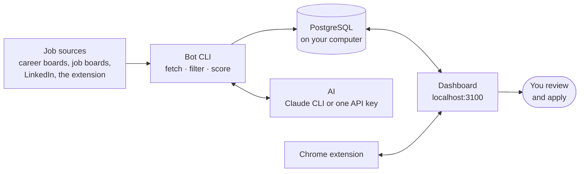

<p align="center">
  
</p>

<p align="center">
  <a href="https://github.com/abdulrehmandar2234/talaash/actions/workflows/test.yml"></a>
  <a href="https://github.com/abdulrehmandar2234/talaash/actions/workflows/docker.yml"></a>
  <a href="https://abdulrehmandar2234.github.io/talaash/"></a>
  
  
  <a href="LICENSE"></a>
</p>

<p align="center">
  <i>Talaash</i> (Urdu for "search") is a personal job-search assistant that runs on your own computer.<br>
  It finds software jobs in the countries you target and remote jobs open to where you live,<br>
  scores them against your CV and prepares each application. <b>You review it and apply yourself.</b>
</p>

<p align="center">
  <a href="#quick-start"><b>Quick start</b></a>
  &nbsp;·&nbsp;
  <a href="#what-it-does"><b>What it does</b></a>
  &nbsp;·&nbsp;
  <a href="#how-it-works"><b>How it works</b></a>
  &nbsp;·&nbsp;
  <a href="https://abdulrehmandar2234.github.io/talaash/"><b>Documentation</b></a>
</p>

> [!IMPORTANT]
> **Talaash never applies on your behalf.** It finds, scores and prepares; you read every posting, check every CV and letter, and submit every application yourself. The Chrome extension only types prepared values into empty form fields when you click **Fill this form**. It never clicks a button and never submits.

<picture>
  <source media="(prefers-color-scheme: dark)" srcset="docs/images/jobs-dark.png">
  
</picture>

<p align="center"><sub>The dashboard with demo data: every match with its AI review, visa label, salary and deadline.</sub></p>

## What it does

<table>
  <tr>
    <td width="50%" valign="top">
      <h3>🔎 Finds jobs every morning</h3>
      Company career boards (Greenhouse, Lever, Ashby, Recruitee, Workable, SmartRecruiters, Workday, Personio), job boards (Himalayas, Remotive, RemoteOK, Jobicy, Arbeitnow, Adzuna, Hacker News "Who is hiring", freehire.me), LinkedIn's guest search, and any job page through the Chrome extension.
    </td>
    <td width="50%" valign="top">
      <h3>🧹 Filters out what does not fit</h3>
      Country, visa, remote region, role and seniority in the title, job type, language, posting age and passed deadlines. Every rejected job keeps its reason, so you can see why it was left out.
    </td>
  </tr>
  <tr>
    <td valign="top">
      <h3>🎯 Scores every match</h3>
      A keyword score against your CV, then an AI review (0–100, verdict, reasons, gaps, red flags) that also reads the whole description for location and visa limits.
    </td>
    <td valign="top">
      <h3>📝 Prepares the application</h3>
      The right CV version and template, a cover letter, a CV headline and summary for the job, and form answers. Only facts from your own CV, never invented skills.
    </td>
  </tr>
  <tr>
    <td valign="top">
      <h3>🧩 Helps you fill the form</h3>
      The Chrome extension types the prepared values into empty fields when you click <b>Fill this form</b>. It never overwrites what you typed, never clicks a button and never submits.
    </td>
    <td valign="top">
      <h3>📊 Tracks every application</h3>
      Statuses, notes, contacts, follow-up reminders and drafts, dead-link checks, deadlines and analytics: your funnel, response rates and time to response.
    </td>
  </tr>
</table>

Every feature and every source is described in [Features](docs/features.md).

<details>
<summary><b>See a job's page</b>: AI review, skills match, letter, CV summary and the CV for this job</summary>
<br>

</details>

<details>
<summary><b>See the Chrome extension</b>: send a job to Talaash, then fill the application form from the side panel</summary>
<br>

</details>

## Quick start

**With Docker** (nothing else to install: the database, the dashboard and the daily run in one command):

```bash
git clone https://github.com/abdulrehmandar2234/talaash.git && cd talaash
docker compose up -d                 # then open http://localhost:3100
docker compose exec app bot setup    # your profile, markets and AI
```

The [Docker guide](docs/install/docker.md) covers your files, the AI (an API key or a local model), the time zone and updates.

**Without Docker**, you need Git, Node.js 24+ and PostgreSQL 15+ running, and for the AI a signed-in [Claude Code CLI](docs/ai.md) or one API key of any OpenAI-compatible provider.

```bash
git clone https://github.com/abdulrehmandar2234/talaash.git && cd talaash
npm install && npm --prefix web install
npx playwright-core install chromium-headless-shell   # prints CVs and letters to PDF
npm run bot -- setup     # writes .env, creates the database, starts your CV, asks for your profile and markets
npm run bot -- doctor    # checks the whole setup and says how to fix what is missing
```

Then put your own CV in `cv/master.json` (it starts as the fictional Jane Doe): `npm run bot -- cv:import my-cv.pdf` reads the CV you already have into a draft, and `cv:import --apply` saves it after you check it. Then:

```bash
npm run bot -- cv:default   # your CV as a PDF
npm run bot -- fetch        # the first jobs, a few minutes
npm run web                 # the dashboard on http://localhost:3100
```

The [Quickstart](docs/quickstart.md) explains each step. For a fresh machine, follow the full guide for your computer: [macOS](docs/install/macos.md), [Linux](docs/install/linux.md), [Windows](docs/install/windows.md) or [Docker](docs/install/docker.md).

## How it works



Two programs share one local PostgreSQL database:

1. **The bot CLI** (`src/`, Node + TypeScript): fetches, scores, calls the AI and renders CV PDFs. `npm run bot -- <command>`; every command is in the [CLI reference](docs/cli.md).
2. **The dashboard** (`web/`, Next.js, `npm run web`): your job list, job pages, settings and analytics. Heavy work runs as background tasks through the same CLI commands.

A scheduler runs `bot daily` once a day at a time you choose, 09:00 by default (fetch, dead-link check, AI review, notification, backup, cleanup). The architecture, the path of one job and the code layout are in [How it works](docs/how-it-works.md).

## Principles

|                                     |                                                                                                                                                                                                            |
| ----------------------------------- | ---------------------------------------------------------------------------------------------------------------------------------------------------------------------------------------------------------- |
| 🏠 **Local first**                  | The database, the dashboard and the CLI run on your machine; the dashboard only answers on `127.0.0.1`. The AI is the Claude Code CLI you are signed in to, or one API key of your own ([AI](docs/ai.md)). |
| 🤝 **APIs over scraping**           | Public job-board APIs wherever possible, with paced requests. No logins, account creation or CAPTCHAs are ever automated.                                                                                  |
| ✅ **Truthful CVs**                 | CV versions only re-order and re-frame what is in your master CV; they never add skills or claims (enforced by tests).                                                                                     |
| 🛡️ **Postings are data**            | Hidden text and invisible characters in postings are dropped, and text written to AI tools is flagged on the job instead of followed.                                                                      |
| 🔒 **Nothing personal in the code** | Your CV, profile and settings (`cv/master.json`, `cv/applicant.json`, `config.json`, `.env`) are gitignored and stay on your computer.                                                                     |

## Documentation

| Page                                                                                                                                                    | What is in it                                                          |
| ------------------------------------------------------------------------------------------------------------------------------------------------------- | ---------------------------------------------------------------------- |
| [Quickstart](docs/quickstart.md)                                                                                                                        | Six commands from a clone to your first jobs                           |
| Install on [macOS](docs/install/macos.md), [Linux](docs/install/linux.md), [Windows](docs/install/windows.md), or with [Docker](docs/install/docker.md) | From a fresh machine to the daily run and the extension                |
| [Your CV and profile](docs/your-cv-and-profile.md)                                                                                                      | `cv/master.json`, `cv/applicant.json`, templates, letters, CV feedback |
| [Configuration](docs/configuration.md)                                                                                                                  | Every `config.json` key and environment variable, presets, filters     |
| [AI](docs/ai.md)                                                                                                                                        | Claude CLI or one API key, presets, models, cost, running without AI   |
| [Daily use](docs/daily-use.md)                                                                                                                          | The dashboard, the extension, follow-ups, everyday commands            |
| [Features](docs/features.md)                                                                                                                            | Everything Talaash does, and every job source                          |
| [CLI reference](docs/cli.md)                                                                                                                            | Every command and the daily run                                        |
| [How it works](docs/how-it-works.md)                                                                                                                    | Architecture, a job's journey, CV pipeline, database, tests            |
| [Troubleshooting](docs/troubleshooting.md)                                                                                                              | Common problems, general and per OS                                    |
| [Updating](docs/updating.md)                                                                                                                            | Getting a newer version                                                |

The same pages are a website: [abdulrehmandar2234.github.io/talaash](https://abdulrehmandar2234.github.io/talaash/). To browse them on your computer: `npm --prefix docs install`, then `npm run docs` (http://localhost:3300).

## Contributing

Pull requests are welcome: fork the repository, change it on a branch and open a pull request. [CONTRIBUTING.md](CONTRIBUTING.md) has the ground rules (the bot never applies, CVs stay truthful, nothing personal in commits), the development setup and the checks to run. [ROADMAP.md](ROADMAP.md) lists what is done and what is still open, and [CHANGELOG.md](CHANGELOG.md) what changed in each release. Found a bug or have an idea? [Open an issue](https://github.com/abdulrehmandar2234/talaash/issues/new/choose). A security problem goes privately through [SECURITY.md](SECURITY.md).

The screenshots use demo data: fictional companies and the example profile, never a real search.

## License

[MIT](LICENSE): you may use, copy, change and share the code, also commercially, as long as the copyright notice stays with it. It comes with no warranty.
