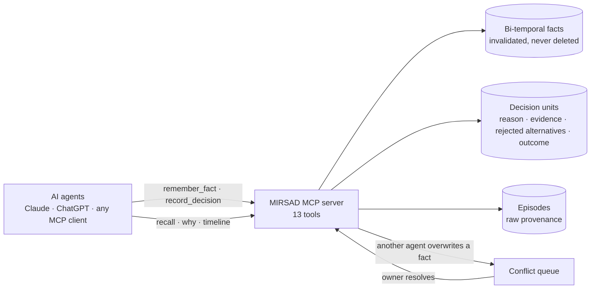

# مِرصاد — MIRSAD


[](https://pypi.org/project/mirsad-mcp/)
[](https://pypi.org/project/mirsad-mcp/)
[](https://registry.modelcontextprotocol.io/v0.1/servers?search=io.github.amkkoussay/mersad)
[](https://mcpservers.org/servers/amkkoussay/mersad)
[](https://github.com/amkkoussay/Mersad/releases)
[](https://m8ven.ai/mcp/amkkoussay-mersad-qvj17r?s=readme)
[](https://www.bestpractices.dev/projects/16853)

<sub>The OpenSSF badge is a best-practices self-attestation by the project, not a security certification or an independent audit.</sub>

<p align="center">
  
</p>
<p align="center"><sub>Live MCP tool calls against a fictional demo workspace — no real data.</sub></p>

> **MIRSAD (مِرصاد)** is a shared, living memory hub for AI agents — one local
> store that Claude, ChatGPT and any MCP client can all read and write.
> Bi-temporal facts (nothing is ever silently overwritten), decisions stored
> as first-class units with their reasons, evidence and outcomes, and
> cross-agent conflicts that only the owner resolves. It ships with a live
> graph view: open the local page and watch your agents' memory grow as a
> network while they work. Local-first · MCP-native · SQLite/D1 · no heavy
> infrastructure, no LLM needed in the write path.
>
> _Keywords: MCP server, AI agent memory, shared memory, temporal knowledge
> graph, decision log, Claude, ChatGPT, SQLite, local-first._

_One project, three labels: the product is **MIRSAD** (مِرصاد); the GitHub
repository is `Mersad`; the PyPI package and its command are `mirsad-mcp`
(Python import: `mirsad`). All three names refer to this same project._

**ذاكرة جماعية واحدة لكل مساعداتك.** خادم ذاكرة مبني على رسم معرفي زمني (Temporal Knowledge Graph) يقرأ منه ويكتب فيه كل مساعداتك وأنت نفسك — عبر بروتوكول MCP نفسه — فلا يضيع قرار اتُّخذ مع مساعدٍ عن بقيّة المساعدين، ولا تُنسى أسبابه وأدلّته ونتائجه.


## What is MIRSAD?

MIRSAD is an **open-source shared memory server for AI agents**, built on the
Model Context Protocol (MCP). Instead of every assistant keeping its own
private, forgetful memory, MIRSAD gives all of them **one collective memory**
they can read and write: Claude, ChatGPT, or any MCP client.

### Features

- **Bi-temporal facts** — facts carry validity time and recording time;
  updates invalidate, never delete, so you can ask "what was true then?"
- **Decisions as first-class units** — every decision is stored with its
  reasons, evidence, rejected alternatives, effects and outcomes, and can
  be traced with a single `why` query.
- **Cross-agent conflict queue** — when one agent challenges another's
  fact, the standing value stays current and the challenger waits as a
  pending candidate until the owner's ruling decides which value stands.
  Nothing is silently lost, and a machine's version never wins by
  arriving later.
- **Live graph viewer** — open the local page and watch the memory as a
  living network (entities, decisions, values, edges) while agents write;
  click any node to read its story.
- **Arabic + English name resolution** — normalization and entity aliases,
  so a fact stored as "MIRSAD" is found when an agent searches «مِرصاد».
- **Zero LLM in the write path** — deterministic storage on a single
  SQLite file; runs anywhere, even on a phone via Termux.

### Official MCP Registry

mcp-name: io.github.amkkoussay/mersad

Install from PyPI: `pip install mirsad-mcp` — then point your MCP client
at the `mirsad-mcp` command (stdio by default; set
`MIRSAD_TRANSPORT=streamable-http` to serve HTTP instead).

### Quickstart

```bash
git clone https://github.com/amkkoussay/Mersad.git
cd Mersad
python3 -m venv .venv && .venv/bin/pip install -r requirements.txt
MIRSAD_DB=~/mirsad.db .venv/bin/python -m mirsad.mcp_server
# MCP endpoint: http://127.0.0.1:8765/mcp  ·  Live graph: http://127.0.0.1:8765/
```

Then add `http://127.0.0.1:8765/mcp` as a custom MCP connector in your
assistant of choice, and it shares this memory with every other client.

## لماذا وُجد؟ (ما وجدناه في مراجعة الأنظمة الكبرى)

راجعنا Graphiti وCognee وMem0 وLetta وgraph-agent-memory وMemori. الخلاصة: لا واحد منها يخزّن **«القرار وسببه ودليله ونتيجته» كوحدة أولى جاهزة**، وأغلبها يحتاج LLM مدفوعًا وقاعدة رسوم منفصلة لمجرّد الكتابة، وفي Mem0 يحسم نموذجٌ لغوي التناقضات تلقائيًا بلا انتظار حكمك، وLetta يترك الذاكرة لقرار النموذج. مِرصاد يأخذ أفضل أفكارهم ويصلح أضعف نقاطهم:

| الفكرة | من أين | كيف في مِرصاد |
|---|---|---|
| حقائق ثنائية الزمن (valid/recorded) تُبطَل ولا تُحذف | Graphiti | نفس النموذج، لكن **بلا LLM في طريق الكتابة** — الحسم حتمي بالكود |
| التعارضات سجلّات صريحة لا دمج صامت | Cognee (FactConflict) | أيّ كتابة من وكيل فوق حقيقة نشطة لوكيل آخر تفتح **تعارضًا** ينتظر قرارك |
| نسبة كل سجلّ لكاتبه | Mem0 | `source_agent` على كل حقيقة وقرار |
| مرآة Markdown قابلة للمراجعة والنسخ عبر git | Letta / Basic Memory | `export` يولّد سجلًّا مقروءًا كاملًا |
| ذاكرة الاستدلال طبقة أولى | graph-agent-memory | **القرار وحدة واحدة**: قرار ← أسباب ← أدلّة ← بدائل مرفوضة ← ملفات متأثرة ← نتائج، مع سلسلة استبدال (supersedes) |

والفرق العملي الأكبر: **ملف SQLite واحد، صفر خدمات خارجية، صفر مفاتيح API** — يعمل على أيّ جهاز، حتى هاتفك عبر Termux.

## How MIRSAD compares

MIRSAD's niche is not raw recall quality — it is auditability: who wrote a
fact, when it was true, why a decision was taken, and who settled a
disagreement. An honest side-by-side with the systems it is most often
compared to:

|  | MIRSAD | Mem0 | Graphiti (Zep's open engine) | Official MCP memory server |
|---|---|---|---|---|
| Storage | One SQLite file, local-first | Vector store, optional graph add-on | Neo4j or FalkorDB graph database | A local JSON file |
| How memory is written | Agents write facts and decisions explicitly through MCP tools — no LLM in the write path | An LLM extracts facts from conversations, then decides ADD / UPDATE / DELETE / NOOP | An LLM extracts entities and edges from raw episodes | Agents write entities, relations and observations through tools |
| Facts over time | Bi-temporal (validity + recording windows); superseded facts are invalidated, never deleted | Memories are updated or deleted as the LLM decides; each memory keeps a change history | Bi-temporal; contradicted edges are invalidated, never deleted | Values are overwritten in place |
| When two sources disagree | The conflict is queued for the **owner** to resolve — a machine's version never silently wins | The LLM resolves it automatically at write time | The newer fact wins automatically (LLM-checked) | No conflict concept |
| Decisions | First-class units: reason, evidence, rejected alternatives, effects, outcomes, supersede chains | Not a built-in unit | Not a built-in unit (can be modelled as nodes) | Not a built-in unit |
| Recall | Keyword full-text search + structural queries — no embeddings | Embedding similarity (+ graph queries) | Hybrid: embeddings, keyword and graph search | Graph traversal over entities |

Letta (formerly MemGPT) takes a different shape: it is an agent framework
whose agents edit their own memory blocks, rather than a shared store that
several independent agents write to.

## نموذج البيانات

- **كيانات (Entities):** أشخاص، مشاريع، ملفات، مفاهيم.
- **حقائق (Facts):** (كيان، علاقة، قيمة) مع أربعة أزمنة: متى صحّت في العالم، متى توقّفت، متى سُجّلت، متى أُبطلت — فيمكن السؤال: «ما الصحيح الآن؟» و«ما الذي كان صحيحًا وقتها؟».
- **قرارات (Decisions):** الوحدة الكاملة أعلاه، بحالات proposed/accepted/rejected/superseded.
- **حلقات (Episodes):** النصّ الخام المصدر لكل سجلّ — لا يُحذف أبدًا (الأصل/Provenance).
- **تعارضات (Conflicts):** خلافات بين الوكلاء تنتظر حكمك، وحكمك نفسه يُحفظ.

المسار بصريًا — كل المكوّنات أعلاه جداول في ملف SQLite واحد:



## التشغيل

```bash
cd Mersad
python3 -m venv .venv && .venv/bin/pip install "mcp[cli]<2"

# خادم MCP عبر HTTP (للموصّلات) — المنفذ 8765 افتراضيًا
MIRSAD_DB=~/mirsad.db .venv/bin/python -m mirsad.mcp_server

# أو عبر سطر الأوامر
.venv/bin/python -m mirsad.cli --db ~/mirsad.db fact "Project" cache_backend Redis --agent agent-a
.venv/bin/python -m mirsad.cli --db ~/mirsad.db why Redis
.venv/bin/python -m mirsad.cli --db ~/mirsad.db export
```

الأدوات الثلاث عشرة عبر MCP: `remember_fact`، `current_fact`، `timeline`، `subject_brief`، `record_decision`، `record_outcome`، `add_alias`، `why`، `recall`، `open_conflicts`، `resolve_conflict`، `memory_stats`، `version_info`.

## خريطة الذاكرة الحية (النسخة المحلية)

شغّل الخادم المحلي ثم افتح **http://127.0.0.1:8765/** في المتصفح: شبكة حية
لذاكرتك — الكيانات والقرارات والقيم عقدٌ، والحقائق والروابط روابط. تتحدث
الخريطة لحظيًا بينما يكتب أي وكيل في الذاكرة (الكتابة الجديدة تنبض وتظهر
في مكانها)، والضغط على أي عقدة يفتح قصتها: حقائقها الحالية، خطها الزمني،
القرارات التي شاركت فيها ومَن كتب ماذا ومتى. التعارضات المفتوحة تُعلَّم
بحلقة حمراء. كل ذلك محلي بالكامل — صفحة واحدة بلا أي اعتماديات خارجية،
والمحرك يعرّض البيانات عبر `GET /graph`.

## الاختبارات (قابلة للفشل فعليًا)

```bash
.venv/bin/python demo.py       # 24 فحصًا على المحرّك: قرارات، زمن، تعارض بين وكيلين، أسماء بديلة، استبدال
.venv/bin/python test_mcp.py   # خادم حقيقي + عميل MCP رسمي: كتابة من وكيل وقراءة من آخر
.venv/bin/python test_graph.py # 13 فحصًا على خريطة الذاكرة الحية: عقد وروابط وقصص وعدّاد تغييرات
.venv/bin/python test_core_fixes.py # 36 فحصًا لمعاني 0.3.0: المتحدّي المنتظِر، فهرسة الحلقات، subject_brief، الكتابة الذرّية
# وحزم أخرى: test_hardening.py (التصليب)، test_recall_like.py + test_recall_echo.py (حدود البحث)، test_annotations.py (تعليقات الأدوات)
```

## توصيل التطبيقات — الحقيقة كما تحققنا منها (نوفمبر 2026)

- **Claude (هاتف وويب):** يدعم موصّلات MCP بعيدة على **كل الخطط** (المجانية: موصّل واحد) بأدوات قراءة **وكتابة**. أضف الخادم من claude.ai ← Settings ← Connectors، وسيعمل داخل محادثات الهاتف (الاتصال من سحابة Anthropic).
- **ChatGPT:** إضافة خادم مخصص من **الويب فقط**، ثم يعمل على الهاتف. لكن على الخطط الفردية (Pro) الصلاحية **قراءة فقط** — يقرأ الذاكرة المشتركة ولا يكتب فيها؛ الكتابة عبر MCP محفوظة لخطط Business/Enterprise/Edu. (Plus: غير مُتحقق منه بدقة من مصدر OpenAI.)
- **شرط تقني لا مفرّ منه:** الخادم يجب أن يكون على **رابط HTTPS عام** ليصل إليه التطبيقان (localhost لا يكفي). خيارات الاستضافة: نفق آمن (مثل Cloudflare Tunnel) من جهازك، أو خدمة سحابية مجانية، أو VPS رخيص — القرار والخطوة التالية عليك (تحتاج حسابك).
- **تنبيهان صادقان:** (1) الذاكرة عبر MCP «عند الطلب» — المساعد يستدعي الأدوات أثناء المحادثة حين يقرّر أو حين تطلب منه، ليست مرآة حيّة تلتقط كل شيء تلقائيًا. (2) هوية الكاتب (`agent`) في هذه النسخة يصرّح بها العميل نفسه؛ في نسخة الإنتاج يجب أن تأتي من تسجيل الدخول (OAuth) حتى لا ينتحل وكيلٌ اسم آخر.

## خريطة الطريق

1. OAuth حقيقي للخادم (هوية موثّقة لكل مساعد/جهاز).
2. استيراد أرشيف محادثات ChatGPT (conversations.json) وClaude وتحويله لحلقات.
3. استخراج تلقائي اختياري بالـLLM لمن يريده — كطبقة فوق الكتابة اليدوية، لا بديلًا عنها.
4. بحث دلالي بالتضمينات بجانب البحث النصي والرسمي الحالي.
