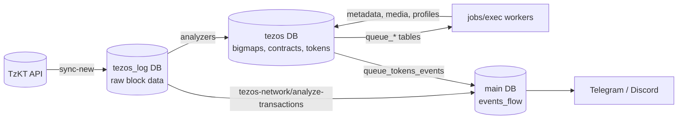

# CryptoNoises

Backend of CryptoNoises: Telegram and Discord bots that notify users about activity of their Tezos wallets and NFTs
(sales, offers, listings, mints, transfers), plus a Tezos indexer that feeds them.

The project is no longer maintained and is published as is.

## Components

| Part | Namespace | What it does |
|------|-----------|--------------|
| Tezos indexer | `src/CryptoNoisesTezos` | Syncs transactions and bigmap updates from the Tezos blockchain, analyzes markets, syncs token/contract metadata, downloads IPFS media and builds previews. |
| Bots + API | `src/CryptoNoises` | Telegram bot (webhooks), Discord bot (long-running threads), notification queues, hunters that turn transactions into events. |
| Core | `src/CryptoCore` | Shared infrastructure: DB wrapper, CLI commands base, job queues, environment config. |

Entry points:

| Path | Type | Purpose |
|------|------|---------|
| `public-api/` | web root | Telegram webhooks. |
| `public-app/` | web root | Short links that redirect to marketplaces (`/token/...`, `/user/...`, `/collection/...`). |
| `commands/run` | CLI | Bots + API commands (cron jobs, Discord threads, maintenance). |
| `commands/run-tezos` | CLI | Indexer commands (cron jobs). |
| `bin/discord-*` | shell | Start / stop / restart Discord bot threads. |

Run `commands/run` or `commands/run-tezos` without arguments to print the list of available commands.

## Requirements

- PHP 7.4 (see `composer.json` `config.platform`) with extensions: `curl`, `gd`, `mbstring`, `fileinfo`, `json`, `pdo_mysql`.
  See [PHP version and upgrading](#php-version-and-upgrading) before trying PHP 8.x.
- MySQL / MariaDB.
- Composer.
- ImageMagick (`convert`) and `ffmpeg` for media previews.
- A web server (Apache with `mod_rewrite`, or nginx) for `public-*` folders.

## PHP version and upgrading

The project was built and run in production on **PHP 7.4** (end of life since November 2022). The stack is old:

| Dependency | Locked version | Notes |
|------------|----------------|-------|
| `bcosca/fatfree` (Fat-Free Framework, routing / DB) | 3.8.1 | fails on PHP 8.4 (`E_STRICT is deprecated`) |
| `team-reflex/discord-php` | 7.3.4 | very old major; current majors changed the API |
| `react/promise` (via discord-php) | 2.9 | v3 removed `done()` that the bot code uses |
| `monolog/monolog` (via discord-php) | 2.8 | |
| `davtur19/turibot` (Telegram API client) | 1.20 | |

The project's own code avoids the common PHP 8 breaks (no `strftime()`, explicit nullable types, no `null` passed to
string functions, guarded reads of optional array keys). It passes `php -l` on PHP 7.4 and 8.4, but it was **not run**
on PHP 8.x, so expect some warnings to surface there.

What is needed to move to PHP 8.x:

1. Set `config.platform.php` in `composer.json` to the target version and run `composer update`.
2. Upgrade Fat-Free Framework to a release that supports your PHP version (required for PHP 8.4).
3. Upgrade `team-reflex/discord-php` to a current major. This is the biggest part: interactions, `MessageBuilder`,
   embeds, events and promises changed. Discord code lives in `src/CryptoNoises/Bots/Connections/DiscordBotConnection.php`,
   `src/CryptoNoises/Bots/Gates/DiscordBotGate*.php`, `src/CryptoNoises/Bots/Threads/*` and
   `src/CryptoNoises/Bots/Core/DiscordEmbedWrapper.php`, `src/CryptoNoises/Bots/Threads/Helpers/CommandWrapper.php`. With `react/promise` v3 replace `->done(...)` by `->then(...)`.
   The manual `vendor/` patch from [Known issues](#known-issues) is not needed after the upgrade (re-check embeds with footers).
4. Check `davtur19/turibot` for a version compatible with your PHP.
5. Run with `error_reporting(E_ALL)` and fix remaining warnings: Fat-Free turns warnings into fatal errors.

## Installation

```bash
composer install
cp config/consts-secrets.example.php config/consts-secrets.php
cp config/environment.example.php    config/environment.php
```

Both copied files are gitignored. Fill them in as described below.

### `config/consts-secrets.php` - credentials

| Constants | Description |
|-----------|-------------|
| `kSECRET_MYSQL_*` | PDO DSN + credentials for the bots/API databases: `main`, `log`, `shared`. |
| `kSECRET_TEZOS_MYSQL_*` | PDO DSN + credentials for the indexer databases: `tezos`, `tezos_log`. |
| `TELEGRAM_BOT_API` | Token of the main Telegram bot (from @BotFather). |
| `TELEGRAM_ASSISTANT_API`, `TELEGRAM_ASSISTANT_USER_ID` | Optional assistant bot; answers only to the given Telegram user id. |
| `TELEGRAM_DEBUGGER_API`, `TELEGRAM_DEBUGGER_USER_ID` | Debugger bot: Fatal / Error / Warning logs are sent to this user. |
| `TELEGRAM_WEBHOOK_SECRET` | Random secret for webhook authorization (see [Telegram webhooks](#telegram-webhooks)). |
| `kDISCORD_TOKEN_MAINBOT` | Discord bot token for main-loop and notifier threads. |
| `kDISCORD_TOKEN_ASSISTANT` | Discord bot token for the assistant thread (may be the same bot). |
| `kDISCORD_GUILD_ID` | Your Discord server id: the assistant thread syncs its members (needs the privileged `GUILD_MEMBERS` intent). |
| `kDISCORD_CLIENT_ID_MAINBOT` | Application id of the main bot, used for "invite bot to server" links. |

### `config/environment.php` - deployment settings

| Key | Description |
|-----|-------------|
| `environment` | `production`, `development` or `development-local`. Token mint / update notifications work only in `production`, see [Enabling the bots](#enabling-the-bots). |
| `api.public_domain` | Base URL of `public-app/`. |
| `api.public_api_url` | Base URL of `public-api/` (Telegram webhooks are registered on it). |
| `api.discord.channel_auto_join_hi` | When set, the main-loop thread requests the privileged `MESSAGE_CONTENT` intent (enable it in the Discord developer portal, or the bot cannot connect). |
| `api.links.*` | Public links used in bot messages and redirects: homepage, Twitter, Discord invite / ticket channel, Discord privacy help, privacy policy. Empty value hides the related button or text line. |
| `api.limits.*` | Limits, the same for every user: `wallets` (50), `following` (1000), `offers_max_holders` (250: an offer on a token or collection with more holders is not sent to anyone). |
| `api.discord.*` | Optional Discord channel ids: auto-join channels and "missed message" channel. |
| `api.channel_user_ids.*` | Optional broadcast feeds (see comments in the example file). |
| `tezos.ipfs_local_base_url` / `tezos.ipfs_local_base_path` | Where media previews are stored and from which URL they are served. |
| `tezos.private_storage_base_path` | Storage for downloaded originals. |
| `tezos.cmd_imagemagick_convert`, `tezos.cmd_ffmpeg` | Paths to external tools. |
| `tezos.cmd_timeout` | Path to coreutils `timeout`; kills conversions that run longer than `tezos.media.tool_timeout_sec`. Empty string disables it. |
| `tezos.media.*` | Media previews: JPEG thumbnail width / quality (256 px, 60%); optional mp4 video preview and GIF animated preview (both off by default) with their width, bitrate, fps; input duration limit (30 s); ImageMagick / ffmpeg run time limit (60 s). |

### Database

The project uses 4 MySQL / MariaDB databases on one server (cross-database queries are used, so one DB user needs
access to all of them). Database names are free - they are taken from the DSNs in `config/consts-secrets.php`.
The schema was verified on MySQL 8.0 and MariaDB 10.6.

| Schema file | Connection in code | Constant(s) in `consts-secrets.php` |
|-------------|--------------------|-------------------------------------|
| `sql/schema/main.sql` | `dbMain`, `dbLog` | `kSECRET_MYSQL_HOST_MAIN`, `kSECRET_MYSQL_HOST_LOG` (**same database**) |
| `sql/schema/shared.sql` | `dbShared` | `kSECRET_MYSQL_HOST_SHARED` |
| `sql/schema/tezos.sql` | `dbTezos` | `kSECRET_TEZOS_MYSQL_HOST_MAIN` |
| `sql/schema/tezos_log.sql` | `dbTezosLog` | `kSECRET_TEZOS_MYSQL_HOST_LOG` |

```bash
for db in cryptonoises cryptonoises_shared cryptonoises_tezos cryptonoises_tezos_log; do
    mysql -e "CREATE DATABASE $db CHARACTER SET utf8mb4 COLLATE utf8mb4_unicode_ci"
done

mysql cryptonoises           < sql/schema/main.sql
mysql cryptonoises_shared    < sql/schema/shared.sql
mysql cryptonoises_tezos     < sql/schema/tezos.sql
mysql cryptonoises_tezos_log < sql/schema/tezos_log.sql

# after config/consts-secrets.php and config/environment.php are filled in:
commands/run /lifecycle/prepare/tables     # creates the log tables for the current month
```

Notes:

- Schema files can be applied again safely (`CREATE TABLE IF NOT EXISTS`).
- Some tables are created by the code at runtime, they are not in the schema:
  - monthly log tables `<name>_YYYY_MM` (bots DB) - from `template__<name>` tables by `/lifecycle/prepare/tables`
    (cron runs it daily; run it once by hand after creating the schema);
  - block-range tables `transactions_NNNNxxxx` / `bigmap_updates_NNNNxxxx` (Tezos log DB) - from
    `template__transactions_0xxxx` / `template__bigmap_updates_0xxxxx` of the Tezos DB, during blockchain sync;
  - `temp__events_flow_locked_ids__*` (bots DB).
- `sql/schema/tezos.sql` also creates two helper functions for manual queries: `ADDR2ADID(address)` and
  `ADID2ADDR(adid)`.
- Optional: `sql/schema-helpers/main_stats_views.sql` and `sql/schema-helpers/tezos_stats_views.sql` add `stats_*`
  views with queue / state counters for manual monitoring. The code does not use them.
- Then load the reference data and the indexer start points (`sql/data/`, see its [README](sql/data/README.md)):

  ```bash
  sql/data/load.sh main   cryptonoises
  sql/data/load.sh shared cryptonoises_shared
  sql/data/load.sh tezos  cryptonoises_tezos
  ```

  Without the start rows the sync commands stop with `<fixer table>: no jobs yet, seed the start level first`, see
  [How the Tezos indexer works](#how-the-tezos-indexer-works).

### Web server

Point two (sub)domains to `public-api/` and `public-app/`. Each folder has an `.htaccess`
that routes all requests to its `index.php`. For nginx use the equivalent `try_files $uri /index.php?$query_string;`.

Serve `tezos.ipfs_local_base_path` as static files from `tezos.ipfs_local_base_url`.

## Telegram webhooks

Telegram delivers updates to `public-api/`:

| Bot | Webhook path |
|-----|--------------|
| Main bot (`TELEGRAM_BOT_API`) | `/telegram/webhook` |
| Assistant (`TELEGRAM_ASSISTANT_API`) | `/telegram/assist` |
| Debugger (`TELEGRAM_DEBUGGER_API`) | `/telegram/debug` |

How authorization works:

1. Generate a random `TELEGRAM_WEBHOOK_SECRET` (1-256 chars of `A-Z a-z 0-9 _ -`), e.g. `openssl rand -hex 32`.
2. Register webhooks for all configured bots:
   ```bash
   commands/run /telegram/webhook/set
   ```
   This calls Telegram `setWebhook` with `url = api.public_api_url + path` and `secret_token = TELEGRAM_WEBHOOK_SECRET`.
3. Telegram sends the secret in the `X-Telegram-Bot-Api-Secret-Token` header with every update.
   `TelegramWebhookAuth` compares it with `hash_equals()`. Requests without a valid header get `403` and are not logged.

Bots without a token are skipped. After changing the secret or the domain, run `/telegram/webhook/set` again.
Check the current state with `commands/run /telegram/webhook/info`.

## Discord bot

The Discord bot runs as three long-running PHP processes:

| Thread | Purpose |
|--------|---------|
| `main-loop` | Handles slash commands, buttons and guild events. |
| `notifier` | Delivers queued notifications. |
| `assistant` | Syncs the members of your server (`kDISCORD_GUILD_ID`) into `discord_users`, and keeps a stats message up to date in the channel set by `discord.stats.main.channel-id` (DB `config` table, optional). |

```bash
bin/discord-start   [all|main-loop|notifier|assistant]
bin/discord-stop    [all|main-loop|notifier|assistant]
bin/discord-restart [all|main-loop|notifier|assistant]
```

Register slash commands once (and after changing them):

```bash
commands/run /discord/bot/commands/create
```

A thread is detected by its command line `<project>/commands/run /discord/bot/start/<thread>`, so several copies
of the project can run on one host. Start threads via `bin/` (or by the real, non-symlinked path) so they are detected.
Logs are written to `log/<Thread>-YYYYMMDD.log`.

## Cron

Everything except the web entry points runs from cron. A complete schedule (the one used in production, with
generic paths) is in [`crontab.example`](crontab.example) - copy it to `/etc/cron.d/`, adjust the project path and
user, and enable jobs gradually: blockchain sync first, then analyzers and background jobs, bots last.

What runs there:

| Group | Commands | Interval |
|-------|----------|----------|
| Blockchain sync | `run-tezos /blockchain/transaction/sync-new`, `/blockchain/bigmap-updates/sync-new`, `/blockchain/bigmap-updates/sync-check` (2 threads: ~1 min and ~1 hour back) | every minute |
| Log tables cleanup | `run-tezos /blockchain/*/cleanup offset=50000` | hourly |
| Analyzers | `run-tezos /analyze/transactions/new`, `/analyze/bigmap-updates/new limit=50000` | every minute |
| Indexer jobs | `run-tezos /jobs/exec jobId=...`: `sync-contracts-metadata` (4 threads), `detect-new-tokens` (4), `sync-tokens-metadata` (10), `merge-tokens-metadata`, `sync-ipfs.primary` (10), `sync-ipfs.secondary` (3), `sync-profiles` (10) | every minute |
| Indexer maintenance | `run-tezos /jobs/clean/file-cache`, `/jobs/clean/media-convert-zombies`, `/jobs/recover-dead-jobs` | every minute |
| Events -> notifications | `run /tezos-network/analyze-transactions/new`, `/tezos-network/wallets/sync`, `/events/nfts-mint/tezos`, `/events/nfts-updates/tezos` | every minute |
| Exchange rates | `run /coingecko/sync` | every minute |
| Tezos domains expiry | `run /jobs/exec jobId=domains-expiry` (every minute), `domains-expiry-find-new` (10 min), `domains-expiry-cleanup` (daily) | mixed |
| Bots maintenance | `run /jobs/recover-dead-jobs`, `/lifecycle/check/error-logs`, `/lifecycle/clean-up/*`, `/lifecycle/prepare/tables` (daily, creates next month log tables) | 1 min .. daily |
| Bots | `run /telegram/notifier/events-flow`, `/telegram/notifier/inform-flow`, `bin/discord-start` | every minute |

`threadIdx` / `threadCnt` split one queue between parallel workers; tune the numbers to your hardware.
Most commands accept `verbose=1` to print progress when run by hand.

## How the Tezos indexer works

The indexer does not talk to a Tezos node: all chain data comes from the public [TzKT API](https://api.tzkt.io)
(`src/CryptoNoisesTezos/Vendors/Tzkt.php`), metadata and media from IPFS gateways, profiles from TzKT and
[Tezos Profiles](https://tzprofiles.com). It works block by block (`level` = block number) in three stages:



### 1. Sync: TzKT -> raw log tables

| Command (`run-tezos`) | Reads from TzKT | Writes |
|-----------------------|-----------------|--------|
| `/blockchain/transaction/sync-new` | `/v1/operations/transactions?level.ge=..&level.le=..` (a range of blocks per request) | `transactions_NNNNxxxx` (tezos_log DB), `blocks`, `address`, `transactions_entrypoints` |
| `/blockchain/bigmap-updates/sync-new` | `/v1/bigmaps/updates?level.ge=..&level.le=..` (a range of blocks per request) | `bigmap_updates_NNNNxxxx` (tezos_log DB) |
| `/blockchain/bigmap-updates/sync-check thread-id=N offset=M` | the same, again | re-counts the updates of a block `M` levels back; on mismatch it rolls sync and analysis back to that block |
| `/blockchain/*/cleanup offset=50000` | - | drops the log tables whose whole block range is more than `offset` blocks behind the slowest indexer reader (its sync and analyzer; the bots side is not taken into account) |

The raw tables are split by block ranges (`transactions_1417xxxx` = blocks 14170000..14179999; early ranges are
larger, up to 1M blocks) and created on the fly from `template__transactions_0xxxx` / `template__bigmap_updates_0xxxxx`.
A block is synced only when it is `kSYNC_BLOCK_BEHIND` (1) blocks behind the chain head
(`src/CryptoNoisesTezos/Config.php`).

`sync-new` loads a whole range of blocks per TzKT request (`src/CryptoNoisesTezos/Syncs/`): the range grows while
blocks are sparse and shrinks to what fits into one page of 10000 items; items are paged by id. Every block still gets
its own `fixer_*` row (empty blocks are written in bulk), so the analyzers, `sync-check` and the cursors work per block.

### Initial sync from block 1

The indexer starts from block 1 so that the database has the whole history. On a test stand (TzKT over the internet,
MySQL 8 in Docker) the sync ran at ~500 blocks/s and the transactions analysis at ~250 blocks/s on the early chain;
blocks get denser later (NFTs appear from ~1.3M), so plan for days, not hours, to reach the chain head
(~15.8M blocks at the end of 2026). For the initial sync:

- **MySQL without replication:** let InnoDB flush its log once a second instead of on every commit (about 2x faster
  on the test stand) and, if you do not need the binary log, turn it off; restore your settings after the catch-up:

  ```ini
  [mysqld]
  innodb_flush_log_at_trx_commit = 2
  disable_log_bin                       # MySQL 8 writes a binary log by default; MariaDB does not
  ```

- **MySQL with replication:** do not change these settings on a replicated server. A crash-safe replica needs
  `innodb_flush_log_at_trx_commit = 1` and `sync_binlog = 1`; with weaker values a crash leaves the primary and the
  replica silently out of sync. Instead, run the catch-up on a separate server without replication (settings above),
  then restore the defaults, take a snapshot (`mysqldump`, Percona XtraBackup or the MySQL clone plugin) and set up
  the primary and the replica from it. After the catch-up the indexer writes a block every few seconds, so the
  default settings are not a bottleneck.
- Keep the hourly `cleanup` in cron: it removes raw log tables that both the sync and the analyzer have passed.
- Keep the bots disabled until the indexer has caught up, see [Enabling the bots](#enabling-the-bots).

### 2. Analyze: raw log -> indexer tables

| Command (`run-tezos`) | Reads | Writes |
|-----------------------|-------|--------|
| `/analyze/bigmap-updates/new` | `bigmap_updates_*` | `bigmaps`, `bigmap_keys*`, `bigmap_data_*` (ledgers, operators, supply, metadata, token metadata, market deals / offers); post actions push work to `queue_contracts`, `queue_tokens_detected`, `queue_profiles` and update Tezos domains (`domains_*`) |
| `/analyze/transactions/new` | `transactions_*` | "hunters" (`Analyzers/TransactionHunters/`) recognize mints and updates on known marketplaces (objkt, teia, fxhash, kalamint, rarible) and profile changes; they push to `queue_profiles` / `queue_tokens_metadata_merge` |

An analyzer never runs ahead of the sync it reads (the transactions analyzer waits for both syncs), so cron order
does not matter.

### 3. Jobs: queues -> metadata, media, profiles

`run-tezos /jobs/exec jobId=<id> threadIdx=<i> threadCnt=<n>`, every queue is a table in the tezos DB:

| `jobId` | Queue table | What it does | Pushes to |
|---------|-------------|--------------|-----------|
| `detect-new-tokens` | `queue_tokens_detected` | creates `tokens` rows for tokens found in bigmaps | `queue_tokens_metadata` |
| `sync-tokens-metadata` | `queue_tokens_metadata` | downloads token metadata JSON (IPFS / storage), fills `tokens*` (formats, attributes, tags, creators, royalties, mimetypes) | `queue_ipfs_primary` |
| `merge-tokens-metadata` | `queue_tokens_metadata_merge` | merges marketplace extra data (`tokens_append`) into tokens | - |
| `sync-ipfs.primary` | `queue_ipfs_primary` | downloads token media, makes previews with ImageMagick / ffmpeg (`ipfs_media*`, files in `tezos.ipfs_local_base_path`); when the token is complete, publishes it for the bots | `queue_tokens_events` (mint for a new token, update for a changed one) |
| `sync-ipfs.secondary` | `queue_ipfs_secondary` | the same worker for a second, manually filled queue (the code never pushes to it) | - |
| `sync-contracts-metadata` | `queue_contracts` | contract metadata (TZIP-16) -> `contracts` | - |
| `sync-profiles` | `queue_profiles` | TzKT account metadata + Tezos Profiles -> `profiles_*` | - |

Queue mechanics (`src/CryptoCore/Models/Queues/QueueAbstract.php`): a task is `idle` -> `syncing` -> moved to
`<queue>__done` on success; on failure it is retried later (`iteration`, back-off `iteration^2` minutes) and after 16
tries moved to `<queue>__failed`. `threadIdx` / `threadCnt` split tasks by `queue_task_id % threadCnt`.
`/jobs/recover-dead-jobs` returns tasks stuck in `syncing` (and stuck sync blocks) back to `idle`.

### Where the progress is stored

In table and method names "fix" means "record": `fixer_*` tables and `fix*()` methods record progress, they do not
repair anything (`fixer_thrash` is a historical spelling of "trash").

Each stage keeps its own cursor, so any command can be stopped and restarted safely:

| Stage | Table (DB) | Cursor |
|-------|------------|--------|
| Transactions sync | `fixer_transactions_sync` (tezos) | one row per block: `idle` / `processing` / `success` / `error`; the next block is the last row + 1 |
| Bigmap updates sync | `fixer_bigmap_updates_sync` (tezos) | the same; `items_count_check1..3` hold the `sync-check` results |
| Bigmap updates analysis | `fixer_bigmap_updates_analyze` (tezos) | the same |
| Transactions analysis | `config` (tezos), key `TezosAnalyzer.LastSyncedLevel` | last analyzed block |
| Wallet events (bots) | `fixer_tezos_transactions_analyze` (main) | one row per block, like the `fixer_*` tables above; empty until you enable the bots, see below |

A block in state `error` (or stuck in `processing`) stops its stage; `/jobs/recover-dead-jobs` sets it back to `idle`
after a few minutes, so it is retried. If it keeps failing, read `notice` in its row. `fixer_events` logs these
recoveries, `fixer_thrash` keeps the rows removed by `sync-check` roll-backs.

Two more switches:

- `command-lock.<command>` keys in `config` (tezos and main DB) pause a command by hand: any value other than `0`
  makes it exit with `Command locked!` (add `unlock=1` to run it anyway). Parallel runs of the same command are
  prevented separately, by checking the process list, so cron can start everything every minute.
- `command-lock.analyze.bigmap-updates.max-level` (tezos `config`): stop the bigmap analysis at this block
  (`NULL` = no limit).

On a fresh database these tables are empty and the commands stop with `<fixer table>: no jobs yet, seed the start level first`. The indexer
start point comes with the data in `sql/data/` (see [Database](#database)): block 1 in the three `fixer_*` tables of
the tezos DB and `TezosAnalyzer.LastSyncedLevel = 0`. To index only recent history, change these values together
before loading, see [`sql/data/README.md`](sql/data/README.md).

### Enabling the bots

The bots side reads the indexer through `src/CryptoNoises/GatewayTezos/`: wallet transactions from the raw log tables
(`/tezos-network/analyze-transactions/new`), token mints / updates from `queue_tokens_events`, wallet and token data
from the indexer tables.

A fresh install has no users, so the order is: indexer first (it re-indexes the whole chain from block 1, which takes
a long time), bots only after it has caught up with the chain, then users. The bots start from the current block, not
from block 1: they need no history (it is already in the indexer tables), and the raw log tables of old blocks are
gone anyway (they are dropped 50000 blocks behind the indexer).

Right before enabling the bots in cron:

```sql
-- 1. the last block both indexer syncs have finished (tezos DB)
SELECT LEAST(
    (SELECT MAX(level) FROM cryptonoises_tezos.fixer_transactions_sync     WHERE state = 'success'),
    (SELECT MAX(level) FROM cryptonoises_tezos.fixer_bigmap_updates_sync   WHERE state = 'success')
) AS start_level;

-- 2. start the bots from that block (main DB); without this row the command stops with
--    "fixer_tezos_transactions_analyze: no jobs yet, seed the start level first", that is why sql/data/ has no start row for it
INSERT INTO cryptonoises.fixer_tezos_transactions_analyze (level, state) VALUES (<start_level>, 'idle');

-- 3. drop the token events collected during the full sync (tezos DB): one mint event per token of the whole history.
--    /events/nfts-mint/tezos has no age filter, so it would process them one by one for days, and the first users
--    would get notifications about old mints. They are not created again (events_token_mint / events_token_updates
--    remember what was already published).
DELETE FROM cryptonoises_tezos.queue_tokens_events;
```

Token mint / update notifications work only with `environment = production`: the bots read events of scope `api`
in production and `dev` otherwise, and the indexer publishes only `api` events
(`kTOKEN_EVENTS_FixMintAndUpdate_forProduction` / `_forDevelopment` in `src/CryptoNoisesTezos/Config.php`).

## Security notes

- Media from token metadata is untrusted. The code forces the ImageMagick input coder from the detected mimetype
  (PNG, JPEG, GIF, BMP, TIFF, WEBP only) and does not render SVG: an SVG can reference local files, and the preview
  is public. Also restrict ImageMagick with a `policy.xml` (allow only those coders, set memory/disk/time limits), and
  run the indexer on a host without access to internal services.
- Never commit `config/consts-secrets.php` or `config/environment.php`.
- `/lifecycle/clean-up/old-data` (daily) keeps logs with personal data for 64 days: monthly log tables, `log_errors`,
  `log_events`, `log_discord_events`, `discord_missed_messages`, members who left (`discord_users`) and `log/*.log`.

## Known issues

- `team-reflex/discord-php`: in production `Discord\Parts\Embed\Embed::setFooter()` was patched manually in
  `vendor/` - the line `'icon_url' => $iconurl,` was commented out. Re-apply it after `composer install` if embeds
  with footers are rejected.

## License

[MIT](LICENSE) - Copyright (c) 2021-2026 Andrii Bakulin.
