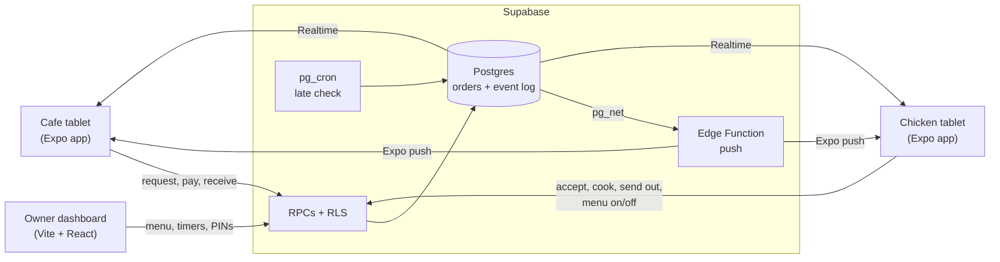

&nbsp;&nbsp;&nbsp;&nbsp;

# Cluck & Cup

**An order relay between two stores: But First, Coffee and Urban StrEat**

[The problem](#the-problem) · [Our solution](#our-solution) · [The Results](#results) · [Screenshots](#screenshots) · [Tech stack](#tech-stack) · [Team](#cluck--cup-team)

> [!NOTE]
> Cluck & Cup is an academic project for **CSSWENG (Software Engineering)** at De La Salle University, built in 2026 by a team of eight for a real client. The source code lives in a private repository. This repository describes the project; the code is available on request.

## The problem

But First, Coffee and Urban StrEat share an owner and sit about a kilometre apart. Cafe customers often want chicken from Urban StrEat, so the cafe cashier types the order into Messenger. Someone at Urban StrEat has to notice that message, retype it into their own POS and reply by hand.

On a busy Saturday night the chicken staff are working the counter and miss the message. The customer was promised 30 to 40 minutes, and by the time anyone notices, the order is already late. The client named this as the biggest cause of delays, especially on weekends from 6 pm onwards.

There were smaller problems too:

- **No order numbers**, so several orders at once were hard to tell apart.
- **No status**: the only way to know whether an order was cooking or on its way was to message back and forth.
- **No payment trail**: if a payment was questioned later, nothing tied it to a specific order.

## Our solution

Cluck & Cup runs on the Android tablets both stores already have and connects them, so orders pass between the stores automatically.

- **Orders get noticed.** The chicken tablet sounds a loud alert the moment an order arrives. Staff accept it, decline it, or lower the quantity when stock is low, and the cafe sees the answer straight away. An order that sits too long at any step is flagged as late, so no one has to keep checking.
- **Every order is tracked.** Each order has its own number, and both tablets show where it is: waiting for a response, ready to pay, cooking, on the way, or received.
- **Payments are recorded.** The cashier records whether the customer paid with GCash or cash, and that is saved with the order along with a log of every step.
- **The menu stays honest.** Chicken staff switch items on or off when something sells out, so the cafe can't order what isn't available.
- **Wi-Fi drops don't lose orders.** Every action is saved on the tablet and sent once the connection is back. A sticky **"NOT sent"** notice shows while anything is still waiting.
- **The owner sees everything.** A web dashboard shows sales, busy hours, problems and every order, and lets the owner change the menu, alert timers and tablet PINs.

> [!IMPORTANT]
> Cluck & Cup does not replace the stores' existing POS (Utak POS PH), and it doesn't process payments. Staff still ring up sales as before. The app only passes orders between the two stores and records how each customer paid.

## Results

| | Before | After |
| :--- | :--- | :--- |
| Order acknowledged by the chicken store | about 3 to 8 minutes | 20 to 60 seconds |
| Cashier entering an order | 1 to 2 minutes | about 20 seconds |
| Unanswered orders | noticed by chance | flagged on both tablets after an owner-set delay (3 minutes by default) |

The late alerts come from the server, so they reach both tablets even while the POS app is in the foreground. The database enforces every order rule through seven allowed transitions and one shared transition function, so no tablet can skip payment or write to orders directly.

## Screenshots

The tablet screenshots follow one order, **#001**, through both stores on a local build running on two tablet emulators. It went from request to received in two minutes. The dashboard figures come from 60 days of generated demo orders.

### First-run setup

Each tablet is set up once: pick the store and type its PIN, allow notifications, keep the app awake, and play a test alert.

<table>
  <tr>
    <td width="33%"></td>
    <td width="33%"></td>
    <td width="33%"></td>
  </tr>
</table>

### One order, start to finish

**1. The cafe composes the order.** A menu composer replaces free typing. The cashier taps an item, picks its flavours, and reviews the cart before sending it.

<table>
  <tr>
    <td width="50%"></td>
    <td width="50%"></td>
  </tr>
</table>

**2. The chicken store gets it at once.** The cafe sees *Waiting for response*. The chicken tablet rings and shows a *New request* under **Answer now**.

<table>
  <tr>
    <th width="50%">Cafe</th>
    <th width="50%">Chicken</th>
  </tr>
  <tr>
    <td></td>
    <td></td>
  </tr>
</table>

**3. The chicken store answers.** Staff accept everything, decline with a reason, or lower a quantity when stock runs short.

**4. The cafe takes payment.** The cafe gets an *accepted* alert with the total. The chicken side is told not to cook until payment is in.

<table>
  <tr>
    <th width="50%">Cafe</th>
    <th width="50%">Chicken</th>
  </tr>
  <tr>
    <td></td>
    <td></td>
  </tr>
</table>

The cashier records GCash with its 13-digit reference, or cash. Nothing is charged here; the app only records how the customer paid.

**5. Cook, send, receive.** Payment turns the order into *Cook now* on the chicken tablet. Staff mark it on the way when the runner leaves, and the cafe marks it received when it arrives.

<table>
  <tr>
    <th width="50%">Cafe</th>
    <th width="50%">Chicken</th>
  </tr>
  <tr>
    <td></td>
    <td></td>
  </tr>
</table>

On the cafe tablet, the runner leaving sends an *on the way* alert, and marking it received completes the timeline.

<table>
  <tr>
    <td width="50%"></td>
    <td width="50%"></td>
  </tr>
</table>

### Also on the tablets

<table>
  <tr>
    <td width="50%"><b>Item availability.</b> Chicken staff switch items off when they sell out, so the cafe can't order them.  </td>
    <td width="50%"><b>Report a problem.</b> About an order (missing or wrong items, payment) or general (running late, GCash down), with text or a voice clip.  </td>
  </tr>
</table>

**Offline.** When the Wi-Fi drops, the tablet says so and keeps working. Changes are saved on the tablet and sent when the connection returns.

### Owner dashboard

**Overview.** Gross sales, orders, average order and late orders for a date range, plus both stores side by side, how customers paid, busy hours, sales by day, problems by day, and the items most often unavailable.

<table>
  <tr>
    <td width="50%"><b>Orders</b>, searchable and filterable by date, status and payment  </td>
    <td width="50%"><b>Order detail</b>, with the payment and every step, by which tablet and when  </td>
  </tr>
  <tr>
    <td width="50%"><b>Menu</b>: items, prices, flavours, add-ons and options  </td>
    <td width="50%"><b>Alert timers</b> for when an order counts as late at each step  </td>
  </tr>
  <tr>
    <td width="50%"><b>Devices</b>: tablet PINs, signed-in tablets and remote logout  </td>
    <td width="50%"><b>Sign-in</b> for the owner  </td>
  </tr>
</table>

## Tech stack

| Part | Stack |
| :--- | :--- |
| Staff app | Expo SDK 58 (React Native 0.88), Expo Router, TanStack Query with a persisted offline queue, expo-notifications |
| Owner dashboard | Vite and React, served as a web app |
| Backend | Supabase: Postgres, row-level security, RPCs, Realtime, pg_cron, pg_net, and a Deno Edge Function for push |
| Shared code | `@cluck/shared`: pure TypeScript for money, orders, payments and status labels |
| Tests and CI | Vitest (unit) and pgTAP (database), both run in GitHub Actions |

**Staff app.** A single Expo app serves both tablets. After sign-in it opens either the cafe or the chicken screens (separate Expo Router route groups), locked to landscape for 8-inch tablets. TanStack Query keeps a persisted queue of every write, which is how the app keeps working through Wi-Fi drops. Order alerts arrive as push notifications on a high-priority channel with their own sound.

**Backend.** The tablets never write to tables. Every change goes through a Postgres function (an RPC) that checks the role, the current status and the allowed next status, then writes the order and an event log row in one transaction. Row-level security limits what each store and the owner can read. `pg_cron` checks for late orders every minute, and `pg_net` calls the push Edge Function, which sends notifications through Expo's push service.

**Owner dashboard.** A small React app on the same Supabase project. It reads order data through views and changes settings through the same RPC layer as the tablets.

**Shared package.** Money, order and status rules live in one framework-free TypeScript package that the app, the dashboard and the tests all import, so a rule is written once.

## Cluck & Cup Team

CSSWENG Group 1, De La Salle University, 2026.

| Name | Role |
| :--- | :--- |
| Morgan, Jack Owen | Project Manager |
| Hallare, Zach Benedict | Business Analyst |
| Tan, Neil Justine | Business Analyst |
| Campo, Benette Enzo | Lead Developer |
| Fortunato, Jayel James | Developer |
| Yee, Ivan Rae | Developer |
| Cheung, Tsz Man | Quality Assurance |
| Maglente, Michael Stephen | Quality Assurance |
