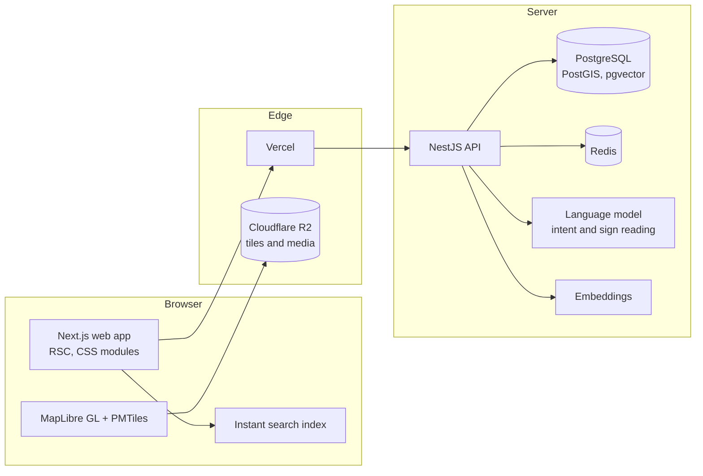

<p align="center">
  
</p>

<h1 align="center">Darb · درب · דרב</h1>

<p align="center">
  <strong>Every business, in every city, town and village, one search away.</strong><br />
  <a href="https://darb.co.il">darb.co.il</a>
</p>

---

Darb is a local business directory for Israel, built from scratch for the way people here actually
search: in Hebrew, in Arabic, in English, and often in a mix of all three typed on a phone keyboard.
You describe what you need in your own words, and Darb finds the business that has it, shows it on
a map of the whole region, and opens a card that tells you whether it's open right now and how to
get there.

It covers the north today, with **13,000+ real businesses across 1,138 places**, Arab, Druze,
Jewish and mixed towns alike, and grows from there.

## What makes it different

**Search that understands the request, not just the words.**
A query like _"שיפוצניק שעובד בשבת בטמרה"_ or _"wen fi saloon 2arib"_ goes through two lanes. The
first answers instantly in the browser from a static index that normalizes Hebrew, Arabic, Latin
and Arabizi spelling. The second reads the intent (what, where, which must-haves) with a language
model under a strict schema and a 1.5 second budget, then matches it against what each business
actually offers, down to single menu items and services. When the model is slow or unavailable, the
results from the first lane stand on their own. Nobody sees an error page because a model timed out.

**A map you can move through.**
The country, a town, a category and a single business are levels of one continuous camera, not
separate pages. The map shows only what you're looking at: hover a category and only its
businesses appear, numbered the same as the list. Vector tiles are self-hosted, so there's no
per-view map bill and no third-party tracking.

**Real data, with its sources.**
Every listing comes from an official register (Ministry of Energy, Ministry of Transport, Ministry
of Education, banks) or from OpenStreetMap, and records where it came from and under which licence.
Imports are deduplicated, geocoded against the local street grid and pinned only when the address is
certain. For towns the open maps barely cover, an admin can add businesses from the street with a
phone: photo of the sign, location, review before anything is published.

**Every business gets a designed screen, not a template.**
A café reads like a menu board, a barber like an appointment book, a fuel station like the
forecourt, a garage like a service dashboard. Businesses that have their own app built on Darb show
a live preview of it right on their card.

**Right to left first.**
Hebrew and Arabic are the primary languages, not a translation layer. Layout, typography, numbers,
map labels and motion are designed for RTL and mirrored for English.

## By the numbers

|                            |                                               |
| -------------------------- | --------------------------------------------- |
| Real businesses            | 13,000+, each with a recorded source          |
| Places                     | 1,138 cities, towns and villages              |
| Categories                 | 18 sectors, 211 kinds of business             |
| Languages                  | Hebrew, Arabic, English (plus Arabizi search) |
| Search quality set         | 103 real queries, checked on every change     |
| Unit and integration tests | about 1,500                                   |
| End-to-end specs           | 21, on desktop and phone viewports            |

## How it's built



- **Web:** Next.js 16 (app router, server components), CSS modules with shared design tokens, a
  light theme by day and an automatic night theme, installable as an app on the home screen.
- **API:** NestJS with Prisma on PostgreSQL. PostGIS for distance and "near me", pgvector for
  semantic matching, Redis for caching and rate limits.
- **Search:** two lanes (instant and smart), hybrid retrieval over names, kinds and offerings,
  ranking tuned on a recorded quality set, an anonymous search log with a fixed retention window.
- **Map:** MapLibre GL over a Protomaps extract of Israel served from R2, plus a 2.5D view inside
  each place. Without WebGL, the list is the whole experience.
- **Admin:** Clerk sign in, review and approval of every new business, an audit trail, and a seed
  that never overwrites what an admin edited.
- **Contracts:** one shared set of zod schemas between the API and the web app, so a mismatched
  field fails the build, not production.

```
apps/
  web/          Next.js site, admin and map
  api/          NestJS API, search, imports, admin endpoints
packages/
  contracts/    Shared request and response schemas
  core/         Domain rules: hours, plans, templates
  i18n/         Hebrew, Arabic and English copy
  search-text/  Spelling normalization across scripts
  seed/         Real data, its sources, and the import toolkit
  stage/        The map camera and its levels
  tokens/       Colours, type, motion and brand assets
```

## Quality

Nothing ships on a red build. Every pull request runs type checks, lint and formatting, the unit and
integration suites against a real database, the full Playwright suite on desktop and phone
viewports, accessibility checks (WCAG AA) on every page in all three languages, a performance
budget per route, and the search quality set. The language model is replayed from recorded answers
in CI, so tests are deterministic and cost nothing.

Privacy is built in rather than bolted on: the search log keeps no IP, account or location, the
visitor's IP is kept only as a short-lived salted hash for rate limiting, and the map is self-hosted.

## Running it locally

Requires Node 22.12+, pnpm 11 and Docker.

```sh
pnpm install
cp apps/api/.env.example apps/api/.env
cp apps/web/.env.example apps/web/.env.local
pnpm dev   # Postgres, Redis, migrations and seed; API on :4000, web on :3000
```

No keys are needed to run it: without them, search uses the instant lane and an offline
embedding. Tests, environment keys, the map tiles and the search tooling are covered in
[docs/development.md](docs/development.md). Hosting and releases are in [docs/launch](docs/launch).

## Data and licences

Map data © OpenStreetMap contributors (ODbL). Tiles and basemap style by Protomaps (BSD-3-Clause).
MapLibre GL JS and pmtiles (BSD-3-Clause). Noto Sans glyphs (SIL OFL 1.1). Business data from
Israeli government open data (data.gov.il) and OpenStreetMap, attributed per listing.

## Team

**Nour Alden Mousa** · [@b14ckPanther](https://github.com/b14ckPanther)

**Lama**, Co-Founder & CPO · [@Lzbedat3](https://github.com/Lzbedat3)
