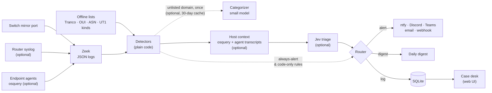

# tapwatch

[](https://github.com/barnabys-drew/tapwatch/actions/workflows/tests.yml)
[](https://github.com/barnabys-drew/tapwatch/actions/workflows/sast.yml)
[](LICENSE)
[](pyproject.toml)

**Network security monitoring for a home or small office: Zeek on a mirror port, the router's
own syslog, optional endpoint agents, readable detection code, and AI triage that can't override
the facts.**

tapwatch watches a copy of your router's traffic and finds what's odd: new devices, beaconing,
DNS tunnelling, exposed services, rogue DHCP, scans, remote-control tools, IoT devices talking
somewhere new. The router's syslog adds its IPS verdicts and admin logins; an osquery agent on a
PC names the program behind a connection and catches encoded commands and shells spawned by
documents. A first contact says what kind of site it is (offline lists, with an optional small
model for the rest; odd TLS sessions and upload spikes carry the listed kind), and on the tapwatch
PC a case says whether the owner's coding agent was behind it. An optional small AI model
([Jev](https://docs.typesafe.ai)) helps decide what's worth interrupting you for, and alerts
reach your phone. One small box runs it all, with no SIEM; nothing leaves but your
notifications, list downloads and the optional AI questions, and those see words, not packets.

> **Start here.** Setting it up in an office or home with UniFi and a Windows PC, and new to all of
> this? Follow [docs/setup/office-unifi.md](docs/setup/office-unifi.md): one installer
> (`install-windows.cmd`) and a few clicks in UniFi. Everything below is the detail.

## Why this exists

- **Homes have no SOC.** Commercial NSM assumes an analyst reads alerts all day. tapwatch's job is
  to stay quiet: one real home night produced **ten items to read and one alert** without Jev,
  two with ([eval/RESULTS.md](eval/RESULTS.md)).
- **Most devices can't run an agent.** TVs, cameras, hubs and phones are only visible on the
  wire, so tapwatch watches the network first. Computers can optionally run an
  [osquery agent](agents/README.md) that names the program behind a connection.
- **LLM triage is useful but unsafe on its own.** Here, code does the counting, baselines and "is
  this domain normal?". The model only judges behaviour described in words, and code-proven
  facts set floors and ceilings it can't cross.
- **AI coding agents make network traffic too.** On the tapwatch machine, host context tells the
  owner's own agent work from an agent that's been prompt-injected or hijacked.

## How it works



The full design, routing rules and trade-offs are in **[docs/ARCHITECTURE.md](docs/ARCHITECTURE.md)**.

## Highlights

- **34 case types from 32 detectors** tuned for homes (table below). Each is plain Python with
  tests and a written spec. Learned baselines survive restarts and follow the *device* (DHCP
  hostname, then MAC, then IP), so a laptop keeps its history when it moves between addresses.
- **Sites named by kind.** First contacts, odd TLS sessions and upload spikes carry the kind of
  site from the offline UT1 lists (advertising, remote control, file hosting, media, ...), and,
  opt-in, from a small model asked once per domain which of a fixed set of labels fits (security
  vendor, conferencing, CDN, SaaS, ...), cached, a fact only, never routing.
- **Quiet by design.** A 3-day learning period sends the AI's alerts to the digest. Code-proven
  ceilings keep known shapes out of your phone: heartbeats to push, EDR, NTP and STUN services,
  popular destinations, uploads to sync services, a sync company's own network or from a laptop
  marked employer-managed, symmetric video-call hours, a "scan" from a phone the router just
  moved between access points or that tore down a page's sessions. "Suppress similar" rules can
  cover a whole domain, and cases they match arrive already closed.
- **The router's own signals.** Its syslog (UniFi CEF, parsed against real lines) brings IPS
  verdicts, admin logins (a new source or repeated failures always alert) and Wi-Fi client
  events the mirror can't see.
- **Guardrailed AI triage.** Always-alert rules never reach the model and can't be suppressed.
  "Is this domain normal?" is never asked (it's the model's measured weak spot). The model needs
  0.75 confidence to alert on its own. Without an API key, it runs rules-only.
- **Agent-aware host context.** For traffic from the tapwatch machine (matched by its DHCP name,
  not just its address), osquery names the program, and Claude Code session markers, the exec
  parent chain and transcripts show whether the owner asked for it. Process proof outranks
  transcript context, and twelve host rules read the agent's own rows for shapes the wire can't
  show.
- **It watches itself.** Every feed it depends on (Zeek's logs, each endpoint agent's frequent
  queries) has a measured longest-allowed silence; a feed that stops is a case within minutes, not a
  blind spot found days later. `tapwatch selfcheck` replays 18 scripted attack and false-positive
  shapes through the detectors as configured and reports a detection rate; CI runs it, and it is one
  command to run after a deploy.
- **A case desk with no JavaScript.** It's a queue, a case page with ±5 minutes of Zeek evidence,
  workflow, notes, an audit trail, expiring "suppress similar" rules and stats, including a
  week-by-week benchmark: noise rate, how often the model agreed with your dispositions, and how
  often host context's verdict matched them. The CSP allows no scripts, and every change carries a
  CSRF token.
- **Private by design.** The AI sees device *names*, never internal IPs, MACs or packet contents.
  Network strings are quoted as untrusted. A personal-data gate runs in CI.
- **Few dependencies.** Standard-library Python plus PyYAML, SQLite, and Zeek in Docker. Runs
  under Docker Compose or as systemd user services, on Linux or a Windows PC with WSL.

## The case desk

A triage queue, case pages with the evidence and what the AI was shown, workflow and notes,
expiring suppressions, and per-detector stats. It's server-rendered HTML with no JavaScript at all.


<details>
<summary>A case page, stats and suppressions</summary>


</details>

Screenshots are of made-up data: `python3 tools/demo_desk.py` builds the same demo desk locally.

## Results

From [eval/RESULTS.md](eval/RESULTS.md): six public Stratosphere Lab malware captures, plus 14 hours
of a real ~20-device home network.

| | Rules only | With Jev |
|---|---|---|
| Infected hosts surfaced (alert or digest) | 4 / 7 | 4 / 7 |
| Infected hosts **alerted** | 1 / 7 | **2 / 7** |
| Home night: items to read | 10 | 10 |
| Home night: false alerts | 1 | 2 |
| WannaCry: cases raised for one worm | 10 | 10 |
| Jev cost for everything above | | $0.0008 |

Measured 2026-10-15 after the noise review. Jev's value is **promotion**: it turned HtBot's C2 from
a digest item into an alert without losing anything. The home night's one rules-only "false alert" is
a remote-control tool found on a work laptop, which the labels call benign and the detector is right
about; two of its items are a phone's iCloud backup and a work laptop's EDR upload. The earlier run
(2026-10-13) and what changed are in [eval/RESULTS.md](eval/RESULTS.md). The sample is small, so
treat it as a sanity check, not a benchmark. The scripted self-check (`tapwatch selfcheck`) stands at
27/27 attack shapes detected and 4/4 false-positive shapes quiet, and runs on every push to `dev`.

## What it catches

| Detector | Finds |
|---|---|
| `new_device` | a device never seen before joins, keyed on its MAC (vendor, randomized MAC, night-time) |
| `beaconing` | very regular repeat connections to one outside host (command-and-control heartbeat); push, EDR, NTP, STUN and popular services are capped at digest |
| `dns_anomaly` | bursts of failed or random-looking lookups (DGA), and DNS tunnelling |
| `exposure` | a device answers a connection from the internet: port forward, UPnP (**always alerts**) |
| `mgmt_access` | a device tries the router's admin page, or SSH/RDP/SMB/VNC/telnet on another device; a sweep across 5+ devices in 10 minutes is one alert (worm shape) |
| `rogue_dhcp` | a DHCP server other than the router (**always alerts**) |
| `takeover` | webhook/callback catchers, paste and file-drop sites (**always alert**), tunnels and remote-control tools (contact, not just a lookup) |
| `iot_drift` | a camera, TV, hub or other fixed-function device talks to new networks, countries or ports |
| `odd_port` | outbound on a port no device in the house uses, or an unusually long connection |
| `dns_bypass` | a device starts resolving names outside your resolver (plain, DoT, DoQ, DoH) |
| `upload_spike` | an hour of uploads far above that device's normal for that hour; capped at the digest when assets.yaml marks it employer-managed |
| `upload_stopped` | a steady uploader (a camera) goes quiet for hours |
| `off_hours` | a device busy at an hour it's normally idle |
| `tls_odd` | encrypted sessions stacking weak oddities (no name, unexplained IP, odd port, bad cert) |
| `cleartext_auth` | HTTP basic auth, FTP logins, telnet, POP3/IMAP or MQTT without encryption |
| `new_domain` | first contact with a rarely used domain, off the popular list or random-looking (code-routed; log-only, kept out of the queue by default) |
| `scan` | one host probing many hosts or ports; a Wi-Fi client the router just moved between access points or dropped (its syslog) is held to the digest |
| `udm_ips`, `udm_admin` | the router's own IPS verdicts, and admin logins (new source or repeated failures **always alert**), from its syslog; the feed is parsed against lines a real UniFi gateway sends |
| `host_encoded_cmd`, `host_app_shell`, `host_temp_exec`, `host_lolbin`, `host_bad_sig`, `host_persist`, `host_destructive`, `host_recon`, `host_extension`, `host_linux_connect`, `host_linux_cmd`, `host_lsass` | on a PC with the [osquery agent](agents/README.md): an encoded or download-and-run command, a document app or browser starting a shell, a program in a temp folder, a built-in Windows tool, or a badly signed program connecting out, or a new task, service, startup item, cron job or WMI subscription that runs a script or a shell, a command that removes backups or logs, turns off Defender or adds an account, a burst of discovery commands, a program reading lsass memory, a new browser extension with sensitive access, and on Linux a temp-folder, in-memory or shell connection, a download-and-run, reverse-shell or history-clearing command, and new SSH keys or systemd units (download-and-run command combinations and the four downloader tools, certutil, bitsadmin, mshta and regsvr32, **always alert**) |
| `ioc_match`, `ids_alert` | your threat lists (**always alert**), the downloaded AdFection / Candiru spyware list (its C&C, validation and Candiru tiers **always alert**; its ad-delivery and older-campaign tiers are graded leads), and Suricata alerts if you run it |

Design notes and rule specs (Sigma and SQL) are in [docs/detections/](docs/detections/DESIGN.md).

## Quickstart

You need a managed switch that can **mirror** the port your router plugs into
([how](docs/setup/mirror-port.md)), and a machine with a second network port for the mirror.

**Linux box with Docker:**

```bash
git clone https://github.com/barnabys-drew/tapwatch && cd tapwatch
python3 -m venv .venv && .venv/bin/pip install -e .
.venv/bin/tapwatch init            # detects your router and interfaces, asks a few questions
.venv/bin/tapwatch update-feeds    # public lists: popular domains, MAC vendors, IP-to-network, site categories, public suffixes, AdFection IOCs
TAP_IFACE=<mirror NIC> docker compose -f deploy/docker-compose.yml up -d --build
```

Add `--profile syslog` for the router syslog listener, or `--profile ids` for Suricata.

**A Windows PC:** double-click `install-windows.cmd`. It sets up WSL, Ubuntu, Npcap, tapwatch, the
endpoint agent and the services, restarting once, and finishes with `tapwatch doctor`
([the guide](docs/setup/office-unifi.md); each step by hand: [docs/setup/windows.md](docs/setup/windows.md)).

**Linux without Docker:** run tapwatch as systemd user services with
`tapwatch service install --zeek-dir <dir>`.

`init` writes `config.yaml`, `assets.yaml` and `.env` (secrets live only in `.env`), offers to
download the public lists, and lists every VLAN's gateway you tell it about (one is strict, the
rest are learned). If your LAN has a public IPv6 prefix, put it in `network.local_nets` so that
traffic is watched too. Alerts can go to **ntfy** (phone push; `init` makes a private topic),
**Discord**, **Teams**, **email** or any **webhook**. The first 3 days are a learning period: the AI's alerts go to the daily digest instead of
your phone while the baselines fill (always-alert rules still interrupt), so expect it to be quiet before it settles.

**Try it without a network** (synthetic capture, no real hosts, no malware):

```bash
python3 eval/make_synthetic_pcap.py eval/data/synthetic.pcap
eval/replay.sh eval/data/synthetic.pcap eval/out/synthetic        # Zeek in Docker, networking off
.venv/bin/tapwatch eval --zeek-dir eval/out/synthetic --labels eval/labels.example.yaml --warmup 0
```

### Commands

| Command | Does |
|---|---|
| `tapwatch init` | detect the network, ask a few questions, write config, assets and `.env` |
| `tapwatch run --zeek-dir DIR` | the live alerter: follow Zeek logs, triage, route, notify |
| `tapwatch ui` | the case desk at http://127.0.0.1:8765/ (set `TAPWATCH_UI_TOKEN` for other devices) |
| `tapwatch digest` | send the pending digest now (it also goes out daily) |
| `tapwatch mark 42 fp` | close case 42 as a false (`fp`) or true (`tp`) positive |
| `tapwatch update-feeds` | refresh the public lists: Tranco, IEEE MAC vendors, iptoasn, UT1 site categories, the Public Suffix List, the AdFection / Candiru indicators, and the vulnerability data for the agents' software (CISA KEV, OSV, NVD; weekly is plenty) |
| `tapwatch software [--vulns]` | each endpoint agent's installed software from its daily snapshot, and with `--vulns` what the downloaded vulnerability data matches |
| `tapwatch syslog` | receive the router's CEF syslog into `udm.log` |
| `tapwatch service install` | install systemd user services (alerter, case desk, watchdog; `--capture-iface` adds capture, `--syslog` the router syslog listener) |
| `tapwatch who 42 --zeek-dir DIR` | ask the PC (osquery and agent transcripts) who made case 42's traffic |
| `tapwatch explain [--apply]` | find repeat cases host context explains, and suggest or apply suppressions (the case desk's suppressions page lists the same suggestions with an Apply button) |
| `tapwatch replay` / `tapwatch eval` | push finished logs through the pipeline, or score rules-only vs Jev on labelled traffic |
| `tapwatch selfcheck` | detection rate on 18 scripted attack and false-positive shapes, rules only; exit 1 on a regression |
| `tapwatch benchmark` | week-by-week noise rate, Jev agreement and host-context accuracy from the case desk, as Markdown |
| `tapwatch doctor [--send]` | check every part of the install (capture, mirror port, router logs, agents, alerts, AI keys, lists, disk, the Windows side) and say how to fix what isn't working; `--send` adds a test alert |
| `tapwatch test-alert` / `tapwatch notify` | check your notification channels |

Optional extras: [router syslog](docs/setup/router-syslog.md) adds the router's own IPS verdicts
and admin logins, and the [endpoint agents](agents/README.md) (osquery) name the program behind a
connection and feed the twelve host rules.

## What leaves the network

- **AI summaries**, if enabled: the device's *name* from `assets.yaml` (never internal IPs, MACs or DHCP hostnames), a
  description in words, and up to three domain names, quoted as untrusted data. With host context
  that adds program names and yes/no facts, but never transcript text, session IDs, paths or
  command lines. About $0.02 a day at 1,000 cases.
- **Your notifications**, to the channels you configure. They include the device name and its LAN
  address. Domain names in them are defanged.
- **Public list downloads** (`update-feeds`): downloads only, nothing is sent. The vulnerability check
  downloads whole public datasets (CISA KEV, OSV's dump for your Linux release) and asks NVD by CVE id, so the
  house's software list never leaves the box.
- **Domain categorizer**, if enabled (`categories: {ai: true}`, off by default): the public registrable
  domain only (`example.com`), to Anthropic, once per domain, cached for 30 days, at most `per_hour` (default 60) an hour.

Packet contents and MAC addresses never leave, and internal addresses never reach the AI.

## Repository layout

```
src/tapwatch/        the package
  cli.py               subcommands, wiring
  zeek.py              log replay and live follower (rotation-safe)
  detectors.py         every network detector, plus state encoding
  hostrules.py         the five endpoint rules over the agent's osquery rows
  categories.py        kind of site: offline UT1 lists, optional small-model lookup, cache
  hostctx.py           osquery and agent-transcript host context
  summarizer.py        case -> short IP-free text for the AI
  triage.py            Jev client (typed questions, pinned model)
  router.py            alert / digest / log, with guardrails
  pipeline.py          detectors -> context -> triage -> route -> store -> notify
  store.py             SQLite schema, workflow, suppressions, learned state
  ui.py, evidence.py   case desk and Zeek evidence lookup
  notifiers.py         ntfy, Discord, Teams, email, webhook, Herdr
  syslogin.py          router CEF syslog listener
  wizard.py, service.py, feeds.py, explain.py, evaluate.py
tests/               pytest suite (synthetic data only)
deploy/              docker-compose, Zeek scripts, Windows keep-alive
agents/              osquery (and Sysmon) installers for endpoints
eval/                capture replay, public-capture fetcher, watchdog, RESULTS.md
docs/                architecture, detection design and rule specs, setup guides, roadmap
tools/               personal-data gate
```

## Documentation

| Doc | What's in it |
|---|---|
| [docs/ARCHITECTURE.md](docs/ARCHITECTURE.md) | data flow, components, routing guardrails, host context, security model, design decisions |
| [docs/detections/DESIGN.md](docs/detections/DESIGN.md) | the detection catalogue (R01–R21), with measured baselines and how Jev is used |
| [docs/detections/rules/](docs/detections/rules/README.md) | Sigma and DuckDB SQL versions of the rules |
| [eval/RESULTS.md](eval/RESULTS.md) | eval method, numbers, tuning history and caveats |
| [docs/setup/](docs/README.md#setup-guides) | mirror port, router syslog, Windows |
| [agents/README.md](agents/README.md) | endpoint agents (osquery, Sysmon) |
| [docs/ROADMAP.md](docs/ROADMAP.md) | what's built and what's planned |
| [CONTRIBUTING.md](CONTRIBUTING.md) · [SECURITY.md](SECURITY.md) | development, adding a detector, reporting vulnerabilities |

## Development

```bash
python3 -m venv .venv && .venv/bin/pip install -e '.[dev]'
make test lint
python3 tools/check_personal_data.py     # no personal data in tracked files
```

CI runs the personal-data gate, ruff and pytest (synthetic data only) on every push to `dev`, and
adds Semgrep and Trivy on PRs into `main`.

## Status

**v0.2.0**, running on a real home network since 2026-10-13, so expect rough edges.

- **Installs verified from scratch:** the Linux paths (a bare container and the Compose stack, 2026-10-15)
  and the Windows path on a clean Windows 11 machine (2026-10-18: capture into Zeek and an alert to
  Discord, which found and fixed a Discord 403). The one-step Windows installer (`install-windows.cmd`)
  and `tapwatch doctor` passed a clean Windows 11 machine on 2026-10-19.
- **Detection:** the network rules, the router's syslog (verified against a live UniFi gateway), and
  the endpoint rules R17–R29 on Windows and Linux (the Linux set verified live on 2026-10-18). A scripted
  detection-rate check runs in CI; a feed-silence rule watches every log source, the router included.
- **Measuring:** the stats page and `tapwatch benchmark` report noise rate, Jev agreement and
  host-context accuracy week by week. The first live week ([results](eval/RESULTS.md)): about 5 alerts a day,
  nearly all noise while the baselines learn, 2 true positives (both digest items); host context answered on
  all 136 PC cases and named the program for 106, and its intent verdicts have not yet fired on real traffic.

v0.2 (evidence outside one house) and v0.2.5 (easy install) are done. Next, per the [roadmap](docs/ROADMAP.md):
more endpoint rules (v0.3) and learning from the owner's closed cases (v0.4). macOS waits until there's a Mac to test on.

## License

MIT. The malware captures used in the eval are from the
[Stratosphere Lab](https://www.stratosphereips.org/), CTU Prague. Please cite them if you reuse them.
