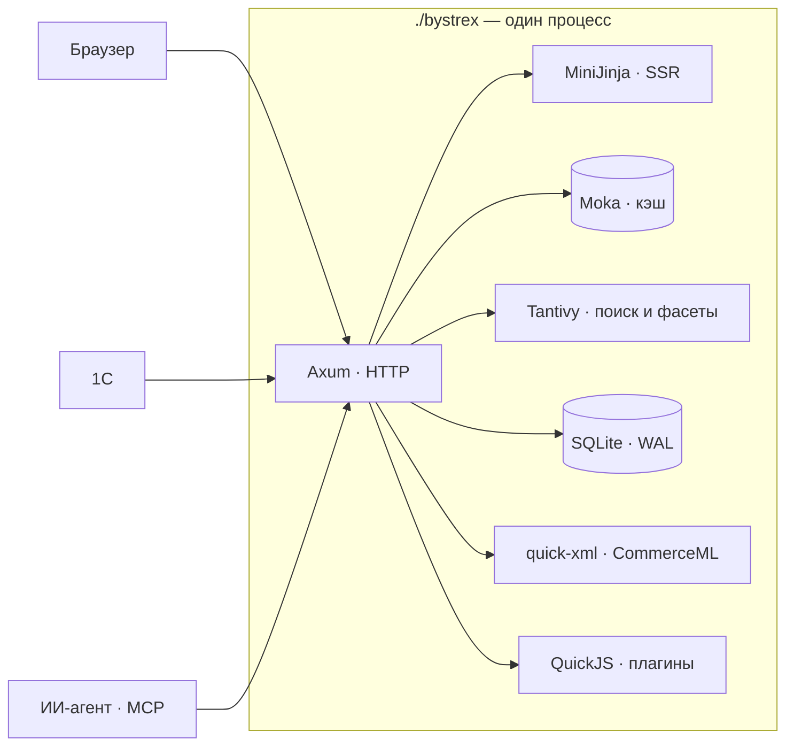

<p align="center">
  
</p>

<h1 align="center">Bystrex</h1>

<p align="center"><b>Система управления сайтом на Rust, совместимая с 1С-Битрикс.</b><br>
Сайты, порталы, каталоги и интернет-магазины: те же адреса страниц, те же данные, тот же обмен с 1С.<br>
Один быстрый бинарник — веб-сервер, база, поиск, кэш, шаблоны и плагины в одном процессе.<br>
Без PHP, внешней БД, Redis и отдельного поискового сервера. Docker не нужен, но есть образ distroless.<br>
<b>Безопасность — приоритет:</b> целые классы атак на сайты невозможны по устройству.</p>

<p align="center"><sub>Русский · <a href="README.en.md">English</a></sub></p>

<p align="center">
  
  
  <a href="#совместимость-с-1с-битрикс"></a>
  
  <a href="LICENSE"></a>
  <a href="CONTRIBUTING.md"></a>
  <br>
  <a href="https://github.com/bystrex/bystrex/stargazers"></a>
  <a href="https://github.com/bystrex/bystrex/issues"></a>
  <a href="https://github.com/bystrex/bystrex/commits/main"></a>
</p>

<p align="center">
  <b><a href="docs/SPEC.md">Спецификация</a></b> ·
  <b><a href="docs/bitrix-developers.md">Разработчику на Битриксе</a></b> ·
  <a href="#почему-rust-и-почему-быстро">Почему быстро</a> ·
  <a href="#архитектура">Архитектура</a> ·
  <b><a href="#безопасность">Безопасность</a></b> ·
  <a href="#совместимость-с-1с-битрикс">Совместимость с 1С-Битрикс</a> ·
  <a href="#модули-1с-битрикс-и-их-аналоги-в-bystrex">Модули</a> ·
  <a href="#дорожная-карта">Дорожная карта</a> ·
  <a href="#вопросы-и-ответы">Вопросы</a>
</p>

> [!IMPORTANT]
> **Проект в начале пути.** Готовы первые четыре этапа дорожной карты: контентный сайт из файлов и базы, импорт данных, прежние адреса и редиректы, `bystrex check`; поиск и умный фильтр; плагины, события и MCP-сервер; админка той же структуры, что в 1С-Битрикс, с пользователями, группами и правами. Каталога и магазина ещё нет — это план. Числа в разделе «Целевые показатели» — цели, а не результаты замеров. Замеры появятся вместе с воспроизводимым стендом.

<table>
  <tr>
    <td width="20%" valign="top">
      <b>Один бинарник</b><br>
      Скачал файл <code>./bystrex</code>, запустил — сайт работает. Ни одной внешней зависимости.
    </td>
    <td width="20%" valign="top">
      <b>Быстрый по устройству</b><br>
      Rust без сборщика мусора. База, поиск и кэш живут в том же процессе — запрос не ходит по сети.
    </td>
    <td width="20%" valign="top">
      <b>Безопасный по устройству</b><br>
      Сервер не исполняет загруженные файлы, у базы нет сетевого порта, плагины работают в песочнице.
    </td>
    <td width="20%" valign="top">
      <b>Совместим снаружи</b><br>
      Сайт и интернет-магазин переезжают с 1С-Битрикс: прежние адреса страниц, тот же адрес и протокол обмена с 1С.
    </td>
    <td width="20%" valign="top">
      <b>Сделан для ИИ-агентов</b><br>
      Сайт — это TOML, HTML и JavaScript. Валидатор, типы и MCP-сервер встроены.
    </td>
  </tr>
</table>

## Что такое Bystrex

Bystrex — открытая (MIT) система управления сайтом, написанная на Rust, и открытая альтернатива «1С-Битрикс: Управление сайтом». Она совместима с 1С-Битрикс по адресам страниц, данным и обмену с 1С, поэтому сайт или интернет-магазин переезжает без потери позиций в поиске. Цель первого релиза — полная замена редакции «Бизнес»: ядро, интернет-магазин, обмен с 1С, сообщества и маркетинг. Каждая подсистема — модуль, который включается одной строкой в конфиге. Админка устроена как в 1С-Битрикс: те же разделы меню, вкладки и поля форм, режим правки прямо на сайте.

| Что собрать | Что для этого нужно |
|---|---|
| Корпоративный сайт, лендинг | Ядро: страницы, меню, формы |
| Новости, блог компании, база знаний | Ядро: инфоблоки, разделы, поиск |
| Каталог продукции без корзины | Ядро: инфоблоки, умный фильтр |
| Интернет-магазин | Модули «Каталог» и «Магазин», при необходимости — «Обмен с 1С» |
| Сообщество, клиентский портал | Модули «Сообщества»: форум, блоги, фотогалерея, социальная сеть |
| Маркетинг и поддержка клиентов | Модули «Маркетинг» и «Сервисы»: рассылки, опросы, реклама, веб-аналитика, техподдержка, обучение |

- **Владельцу сайта или интернет-магазина на 1С-Битрикс** — переезд без потери адресов и позиций в поиске. Платы за лицензию нет, сервер нужен самый простой.
- **Разработчику и веб-студии** — структура сайта лежит в файлах, а не в базе. Rust знать и компилировать не нужно.
- **ИИ-агенту** — весь сайт помещается в контекст, каждая правка проверяется одной командой.

## Почему Rust и почему быстро

Скорость здесь — следствие устройства, а не оптимизаций задним числом. Типичная CMS на PHP тратит время не на язык, а на походы по сети и запуск интерпретатора на каждый запрос.

| Что стоит времени в типичной CMS | Как устроено в Bystrex |
|---|---|
| Интерпретатор заново поднимает ядро на каждый запрос | Скомпилированный процесс, который уже держит всё в памяти |
| Запрос к базе идёт по сети или сокету | SQLite в том же процессе: чтение — это вызов функции |
| Кэш в отдельном сервере (Redis, Memcached) | Кэш в памяти процесса, сброс по тегам |
| Фильтр по свойствам — тяжёлые `JOIN` по таблицам свойств | Фасеты считает встроенный поисковый движок Tantivy |
| Отдельный поисковый сервер | Полнотекстовый поиск в том же бинарнике |
| Большая выгрузка из 1С целиком читается в память | Потоковый разбор XML: память не растёт с размером файла |
| Паузы сборщика мусора | В Rust сборщика мусора нет |
| Пять–шесть процессов и контейнеров | Один процесс, один файл базы |

### Целевые показатели

Это **цели**, по которым будет приниматься работа. Ни одно число пока не измерено.

| Метрика | Цель | Условия |
|---|---|---|
| Размер бинарника | < 30 МБ | release, статическая сборка |
| Память в простое | < 30 МБ | пустой сайт |
| Ответ страницы элемента | p50 < 2 мс, p99 < 10 мс | кэш прогрет, замер на сервере |
| То же без кэша | p50 < 10 мс | 100 000 элементов |
| Умный фильтр | p50 < 5 мс | 100 000 элементов, 30 свойств |
| Импорт из 1С | ≥ 5 000 товаров/с при памяти < 100 МБ | `import.xml` на 500 МБ |
| Проверка проекта | < 100 мс | `bystrex check` |
| Старт процесса | < 1 с | 100 000 элементов |

Стенд и генератор данных будут лежать в `bench/`, чтобы любой мог повторить замер на своём сервере.

## Архитектура



Публичная часть сайта — честный серверный рендеринг: браузер и поисковые роботы сразу получают готовый HTML. HTMX догружает фрагменты (список при смене фильтра, форма, корзина), поэтому страница не перезагружается и не тянет мегабайты JavaScript. JSON API доступен для внешнего фронта и мобильных приложений.

| Слой | Технология | Зачем |
|---|---|---|
| HTTP | [Axum](https://github.com/tokio-rs/axum) + Tokio | Асинхронный сервер без сборщика мусора |
| База | SQLite (WAL) через [SQLx](https://github.com/launchbadge/sqlx) | Нет сетевой задержки, вся база — один файл |
| Поиск и фасеты | [Tantivy](https://github.com/quickwit-oss/tantivy) | Умный фильтр и поиск с русской морфологией |
| Кэш | [Moka](https://github.com/moka-rs/moka) | Готовые фрагменты HTML в памяти процесса |
| Шаблоны | [MiniJinja](https://github.com/mitsuhiko/minijinja) + HTMX + Tailwind | Правка HTML без перекомпиляции |
| Обмен с 1С | [quick-xml](https://github.com/tafia/quick-xml) | Потоковый разбор CommerceML |
| Плагины | QuickJS через [rquickjs](https://github.com/DelSkayn/rquickjs) | Логика сайта на JavaScript в песочнице |

## Безопасность

Безопасность — главный приоритет Bystrex. Сайты на PHP-CMS чаще всего взламывают не через ядро, а через то, что вокруг него: загруженный файл, который сервер выполнил как код, сторонний модуль с полными правами, порт базы, открытый в сеть, пароль от базы в файле на сервере, забытый без обновлений компонент окружения. В Bystrex многие из этих путей закрыты устройством системы, а не фильтром, который нужно настроить и не обойти.

| Частый путь взлома сайта на PHP-CMS | Как устроено в Bystrex |
|---|---|
| Загруженный файл (`shell.php`, «картинка» с кодом) исполняется сервером | Интерпретатора нет: сервер исполняет только свой бинарник. Загрузки отдаются как данные: HTML и SVG — только скачиванием и в песочнице CSP |
| Шаблон сайта — код на PHP с полным доступом к серверу | Шаблоны на MiniJinja: подстановки и циклы без доступа к файлам, сети и базе, вывод экранируется по умолчанию |
| Сторонний модуль работает с правами ядра | Плагины и модули — JavaScript в песочнице QuickJS: без файлов и сети, с лимитами памяти и времени. Модуль видит только свои настройки |
| Порт базы открыт в сеть, пароль от базы лежит в файле настроек | SQLite в процессе сервера: у базы нет сетевого порта и нет пароля, который можно украсть |
| SQL-инъекция через склейку запроса | Только запросы с параметрами; текст SQL собирается из констант кода |
| Ошибки работы с памятью в расширениях на C | Rust; `unsafe` запрещён во всём коде проекта (`unsafe_code = "forbid"`) |
| Подбор пароля, кража сессии, подделка запроса (CSRF) | Argon2id; в базе только хеши токенов сессий и ключей API; токен в каждой форме админки; ограничение частоты входа по адресу и по логину |
| Редактор вставляет в текст скрипт и крадёт сессию администратора | HTML от редактора без прав администратора чистится по белому списку; в админке строгая CSP: внедрённый скрипт не выполнится |
| Скрипты с чужого CDN подменены | Сайт-пример и админка не загружают скрипты с чужих CDN: файлы вшиты в бинарник |
| Много сервисов, которые нужно вовремя обновлять: PHP, веб-сервер, база, кэш, поиск | Один бинарник. Меньше частей — меньше уязвимостей, которые нужно успеть закрыть |

Эти пути общие для PHP-CMS, включая 1С-Битрикс. Там их закрывают настройкой сервера и модулем «Проактивная защита» — фильтром атак, журналом вторжений и контролем активности. Аналоги этих инструментов в Bystrex тоже есть: стоп-лист адресов, журнал вторжений, ограничение частоты. Но главная ставка сделана на то, чтобы атаке было не к чему приложиться.

**Развёртывание.** Docker не обязателен, но готов образ [distroless](deploy/Dockerfile): только статический бинарник, без оболочки и пакетного менеджера, от пользователя без прав и с корневой файловой системой только для чтения. Без контейнера — [юнит systemd](deploy/bystrex.service) с песочницей. Порядок — в [docs/deploy.md](docs/deploy.md).

Нашли уязвимость? Сообщите закрыто по [SECURITY.md](SECURITY.md).

## Возможности первой версии

**Ядро — есть всегда**

- **Контент:** инфоблоки, разделы, элементы, свойства, справочники, страницы, меню.
- **Поиск:** полнотекстовый поиск с русской морфологией и умный фильтр с ЧПУ по любому инфоблоку.
- **Пользователи:** регистрация, группы, права на инфоблоки, личный кабинет.
- **Формы:** веб-формы, результаты, почтовые уведомления.
- **SEO:** серверный рендеринг, сохранение адресов, карта 301-редиректов, `sitemap.xml`, шаблоны мета-тегов.
- **Расширение:** события `before:*` и `after:*`, плагины на JavaScript, планировщик задач.
- **Управление:** админка той же структуры, что в 1С-Битрикс, режим правки на сайте, инфоблоки и свойства через интерфейс, сайты и языки, резервные копии одной командой.

**Модули — включаются в `bystrex.toml`**

- **Каталог:** торговые предложения (SKU), типы цен, склады и остатки.
- **Магазин:** корзина, заказы, промокоды, ЮKassa (включая СБП и чеки 54-ФЗ), Т-Касса, СДЭК, YML-фид.
- **Обмен с 1С:** CommerceML 2.x и 3.1 — товары, цены, остатки, заказы.
- **Сообщества:** форум, блоги, фотогалерея, социальная сеть, wiki, менеджер идей, календарь.
- **Маркетинг:** подписка и рассылки, email-маркетинг, опросы, реклама и баннеры, веб-аналитика, A/B-тесты.
- **Сервисы:** техподдержка, обучение и тесты, документооборот, бизнес-процессы с визуальным редактором, списки, отчёты.
- **Лендинги:** посадочные страницы из готовых блоков — аналог «Сайтов 24».

Выключенный модуль не создаёт ни таблиц, ни маршрутов, ни пунктов в админке.

## Совместимость с 1С-Битрикс

Bystrex задуман как замена «1С-Битрикс: Управление сайтом» для сайтов и интернет-магазинов. Совместимость делается снаружи — по протоколам, адресам, форматам данных и привычным понятиям. PHP-код 1С-Битрикс не запускается: у каждого модуля редакции «Бизнес» есть свой аналог в Bystrex, а шаблоны и собственный код переносятся конвертером и ИИ-агентом.

| Что | Как |
|---|---|
| Обмен с 1С | Тот же адрес `/bitrix/admin/1c_exchange.php` и протокол CommerceML |
| Адреса страниц | Страницы, разделы и элементы открываются по прежним URL; для изменившихся — 301 |
| Адреса фильтра | Прежние ссылки вида `…/filter/…/apply/` отдают ту же выборку |
| Адреса картинок | Файлы остаются по путям `/upload/…` |
| ЧПУ и SEO | Маски `#SECTION_CODE#/#ELEMENT_CODE#/` и шаблоны `{=this.Name}` |
| Данные | Импорт инфоблоков, пользователей, редиректов, а для магазина — цен, остатков и заказов, из открытого формата |
| Настройки | Настройки инфоблоков, параметры компонентов на страницах, группы и права, настройки модулей переносятся, админка показывает их на прежних местах |
| Шаблоны | Шаблоны получают данные той же формы, что `$arResult` и `$arParams`; `bystrex port` переводит `template.php` в Jinja |
| Собственный код | Таблица соответствия событий и привычный синтаксис фильтра выборок для переноса логики из `init.php` в плагины; в JS те же имена — `AddEventHandler`, `CIBlockElement::GetList` |
| Термины | Инфоблоки, разделы, элементы, свойства, торговые предложения — те же понятия, что в 1С-Битрикс |

### Модули 1С-Битрикс и их аналоги в Bystrex

| Модуль «1С-Битрикс: Управление сайтом» | Что в Bystrex |
|---|---|
| Главный модуль: пользователи, группы, права, почтовые события | Ядро |
| Информационные блоки | Ядро: инфоблоки, разделы, элементы, свойства |
| Highload-блоки | Ядро: справочники |
| Управление структурой: страницы и меню | Ядро: `pages/` и `menu/` |
| Поиск | Ядро: полнотекстовый поиск и умный фильтр |
| Веб-формы | Ядро: формы и результаты |
| Поисковая оптимизация (SEO) | Ядро: шаблоны мета-тегов, `sitemap.xml`, редиректы |
| Торговый каталог | Модуль «Каталог» |
| Интернет-магазин | Модуль «Магазин» |
| Обмен с «1С:Предприятие» | Модуль «Обмен с 1С» |
| Валюты | Модуль «Каталог» |
| Сайты и языки | Ядро: многосайтовость |
| Форум, блоги, фотогалерея, социальная сеть | Модули «Сообщества» |
| Подписка и рассылки, опросы, реклама, веб-аналитика | Модули «Маркетинг» |
| Техподдержка, обучение, документооборот, бизнес-процессы | Модули «Сервисы» |
| Wiki, менеджер идей, календарь; email-маркетинг, A/B-тесты; списки, отчёты | Модули «Сообщества», «Маркетинг», «Сервисы» |
| Сайты 24 | Модуль «Лендинги» |
| Сторонние модули из Маркетплейса | Не запускаются: типовые интеграции встроены, остальное переносится в плагины на JavaScript |

### Переезд сайта и интернет-магазина с 1С-Битрикс

1. Открытый экспортёр выгружает данные сайта на 1С-Битрикс в открытый формат. Он работает только на чтение.
2. `bystrex import` создаёт те же инфоблоки, свойства, разделы и элементы, а для магазина — цены, остатки и заказы.
3. Страницы открываются по прежним адресам, для изменившихся строится карта 301-редиректов.
4. 1С продолжает обмениваться по прежнему адресу — настройки обмена в 1С не меняются.
5. Настройки инфоблоков, группы, права и параметры компонентов на страницах переносятся вместе с данными.
6. `bystrex port` переводит шаблоны компонентов и сайта в Jinja, логика из `init.php` переходит в плагины на JavaScript; что не перенеслось само, собрано в чек-лист `MIGRATION.md` с задачами для ИИ-агента.

## Как выглядит сайт

```
my-site/
├── bystrex.toml     # сайт, модули, интеграции
├── schema/          # инфоблоки и справочники как код
├── pages/           # статические страницы
├── menu/            # меню сайта
├── local/           # как в Битриксе
│   ├── templates/main/    # шаблон сайта: HTML + Tailwind + HTMX
│   ├── php_interface/     # init.js — логика сайта на JavaScript
│   └── modules/           # модули сторонних разработчиков
└── data/            # база, поисковый индекс, медиа
```

Магазин включается в конфиге; контентному сайту эти строки не нужны:

```toml
# bystrex.toml
[modules]
catalog = true         # торговые предложения, цены, остатки
sale = true            # корзина, заказы, оплата, доставка
exchange_1c = true     # обмен с 1С
```

Свойство элемента — несколько строк в файле схемы:

```toml
# schema/catalog.toml
[[property]]
code = "season"
name = "Сезон"
type = "enum"
filterable = true      # появится в умном фильтре
```

Шаблон — обычный HTML:

```html
<!-- local/templates/main/product.html -->
<h1>{{ product.name }}</h1>
<p class="text-2xl font-bold">{{ product.price | money }}</p>
```

Логика сайта — JavaScript вместо `init.php`, с привычными именами:

```js
// local/php_interface/init.js
AddEventHandler("iblock", "OnBeforeIBlockElementUpdate", (arFields) => {
  if (!arFields.NAME) {
    APPLICATION.ThrowException("Введите название");
    return false;
  }
});

bystrex.on("after:form.submit", async (ctx) => {
  await bystrex.notify.telegram(`Новая заявка с формы «${ctx.form.name}»`);
});

// дальше — события модуля «Магазин»
bystrex.on("calc:price", (ctx) => {
  if (ctx.quantity >= 5) ctx.price = Math.round(ctx.price * 0.9);  // опт −10 %
});

bystrex.on("after:order.create", async (ctx) => {
  await bystrex.notify.telegram(`Новый заказ #${ctx.order.id}`);   // не задерживает покупателя
});
```

## Для ИИ-агентов

| Инструмент | Что даёт |
|---|---|
| `bystrex check` | Проверяет схему, шаблоны, плагины и редиректы; отвечает файлом, строкой и подсказкой |
| `bystrex mcp` | MCP-сервер: схема, примеры элементов, предпросмотр фильтра, рендер страницы, тест обмена с 1С |
| `local/php_interface/bystrex.d.ts` | Типы событий и полей инфоблоков, обновляются при изменении схемы |
| `AGENTS.md` | Карта сайта для агента, тоже генерируется ядром |
| Песочница | Бесконечный цикл в плагине или сломанный шаблон не роняют сервер |

Инструменты MCP не отдают персональные данные пользователей.

## Дорожная карта

- [x] Спецификация v0.1
- [x] **1.** Скелет: инфоблоки, страницы, меню, импорт данных
- [x] **2.** Поиск и умный фильтр
- [x] **3.** Плагины, события, MCP, валидатор
- [x] **4.** Админка той же структуры, что в 1С-Битрикс, режим правки, пользователи, группы и права, формы
- [ ] **5.** Перенос шаблонов (`bystrex port`), переезд одной командой
- [ ] **6.** Модуль «Каталог» и обмен с 1С
- [ ] **7.** Модуль «Магазин»: корзина, заказы, оплата, доставка
- [ ] **8.** Маркетинг: рассылки, опросы, реклама, веб-аналитика
- [ ] **9.** Сообщества: форум, блоги, фотогалерея, социальная сеть
- [ ] **10.** Сервисы и лендинги: техподдержка, обучение, бизнес-процессы, «Сайты 24» — **релиз 1.0: замена редакции «Бизнес»**

Критерии готовности каждого этапа — в [спецификации](docs/SPEC.md#19-дорожная-карта).

## Вопросы и ответы

**Это уже можно поставить?**
Попробовать — да, строить на этом сайт — рано. Сейчас работают первые четыре этапа: `cargo run -p bystrex-cli -- init my-site`, затем `bystrex dev` в каталоге сайта. Готовых сборок пока нет; остальное появится по этапам дорожной карты.

**Зачем Rust, если узкое место — обычно база?**
Поэтому база встроена в процесс: у запроса на чтение нет сети. Rust нужен, чтобы всё остальное — рендер, поиск, разбор XML — тоже жило в одном процессе с предсказуемой памятью и без пауз сборщика мусора.

**Почему SQLite, а не PostgreSQL?**
Сайт почти целиком состоит из чтений, а с ними SQLite в режиме WAL справляется без отдельного сервера. Запись идёт через одну очередь. PostgreSQL планируется позже — для крупных установок.

**Нужен ли Docker?**
Нет: Bystrex — один бинарник, его можно запустить службой systemd с песочницей. Если удобнее контейнер, есть образ distroless без оболочки и пакетного менеджера. Безопасность в обоих случаях обеспечивают одни и те же меры: пользователь без прав, запись только в папку сайта, порт только для обратного прокси. Подробно — [docs/deploy.md](docs/deploy.md).

**База в одном процессе с сайтом — это не опасно?**
В PHP-CMS код сайта тоже держит пароль от базы и полный доступ к ней, поэтому взлом сайта и так означает доступ к базе. Отдельный сервер базы от этого не спасает, зато добавляет сетевой порт и пароль, которые можно украсть. Защищает другое: чтобы сайт нельзя было заставить выполнить чужой код. В Bystrex сервер не исполняет загруженные файлы, а шаблоны и плагины работают без доступа к файлам и сети. От потери данных защищают резервные копии: `bystrex backup` на работающем сайте, хранение вне сервера и в зашифрованном виде.

**Мне придётся писать на Rust?**
Нет. Rust закрыт внутри бинарника. Меняются только TOML, HTML и JavaScript — с горячей перезагрузкой.

**Это замена 1С-Битрикс?**
Да, для сайтов и интернет-магазинов: те же понятия, те же адреса страниц, тот же обмен с 1С, перенос данных. Совместимость внешняя — PHP-код 1С-Битрикс в Bystrex не выполняется.

**Можно ли перенести интернет-магазин с 1С-Битрикс?**
Так и задумано: каталог, торговые предложения, цены, остатки, заказы и пользователи импортируются, адреса сохраняются, обмен с 1С идёт по прежнему адресу. Порядок — в разделе [«Переезд»](#переезд-сайта-и-интернет-магазина-с-1с-битрикс).

**Заработают ли модули и шаблоны 1С-Битрикс из Маркетплейса?**
Нет. Они написаны на PHP и привязаны к чужому ядру. Типовые интеграции (оплата, доставка, 1С, фиды) входят в модули, а собственную логику переносят в плагины.

**Чем это отличается от headless-CMS?**
Bystrex сам рендерит страницы и содержит сайт целиком: контент, поиск, формы, а с модулями — каталог, корзину, заказы и оплату. JSON API есть, но отдельный фронтенд не обязателен.

**Это только для интернет-магазинов?**
Нет. Ядро — универсальная CMS: сайт компании, портал или каталог работают без модулей магазина. Магазин — такой же модуль, как обмен с 1С.

## Участие

Сейчас полезнее всего замечания к [спецификации](docs/SPEC.md) — откройте issue с номером раздела.

Проект разрабатывается по правилу clean-room: только публичная документация, открытые спецификации и собственные записи обменов. Подробнее — в [CONTRIBUTING.md](CONTRIBUTING.md).

## Лицензия

[MIT](LICENSE)

---

<sub>Bystrex — независимый проект с открытым исходным кодом. Он не связан с ООО «1С-Битрикс» и не одобрен им. «1С-Битрикс» — товарный знак его правообладателя; он упоминается только для описания совместимости.</sub>
