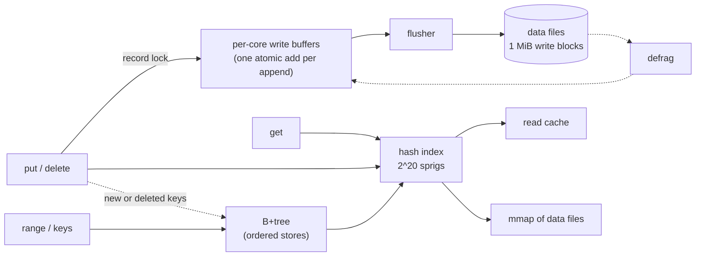

# hazeldb

An embedded key-value store for Rust: log-structured, with lock-free reads,
crash-safe writes, and optional ordered keys with range scans.

```rust
let db = hazeldb::Db::open(hazeldb::Options::new("data/kv"))?;
db.put("user/42", "ada")?;
assert_eq!(db.get("user/42")?.as_deref(), Some(&b"ada"[..]));
db.delete("user/42")?;
db.close()?;
```

## Highlights

- **Fast point operations.** A get is one optimistic index lookup and at most one
  device read; a put is one atomic add into a per-core write buffer and a copy.
  See [Performance](#performance).
- **Lock-free reads.** Reads take no locks and never write shared memory: a lookup
  that races a writer just retries, and freed memory is reclaimed with epochs.
- **Crash-safe.** Records carry CRC32C checksums, deletes are durable tombstones,
  and a block is reused only after the writes that replaced its records are on disk.
  Opt into per-write durability with group commit, or call `Db::sync` when you need it.
- **Fast restart.** A clean close saves the index, which the next open loads in
  milliseconds; after a crash, the data files are scanned in parallel.
- **Async writes, any runtime.** `put_async`, `delete_async` and `sync_async` wait for
  backpressure and the disk without blocking a thread, and `put_deferred` returns a
  write as soon as it is visible, with a handle to await its durability. See
  [Async](#async).
- **Ordered keys, optional.** A concurrent B+tree next to the hash index serves
  forward and backward range scans, without slowing down point reads.
- **Small.** About 6k lines of Rust and eight dependencies, plus `libc` on Unix or
  `windows-sys` on Windows.

## Usage

hazeldb is not on crates.io yet; depend on it by path or git:

```toml
[dependencies]
hazeldb = { path = "../hazeldb" }
```

Every `Db` method takes `&self`; share one `Db` across threads (in an `Arc` if
needed). Keys and values are byte strings: anything that is `AsRef<[u8]>`.

### Ordered keys and range scans

Create the store with `ordered: true` to scan keys in bytewise order:

```rust
use std::ops::Bound;
use hazeldb::{Db, Options};

let db = Db::open(Options { ordered: true, ..Options::new("data/orders") })?;
db.put("orders/2025-06-01/17", "…")?;

// Prefix scan: every key starting with "orders/2025-06".
for item in db.range("orders/2025-06".."orders/2025-07")? {
    let (key, value) = item?;
}

// The three most recent orders, keys only, newest first.
// ("orders0" is the first key after every "orders/…" key: '0' follows '/'.)
let latest: Vec<Vec<u8>> = db.keys("orders/".."orders0")?.rev().take(3).collect();

// Strictly greater than a key: bound pairs name the key type.
let after: &[u8] = b"orders/2025-06-01/17";
for item in db.range::<[u8]>((Bound::Excluded(after), Bound::Unbounded))? { /* … */ }
```

Ranges accept `a..b`, `a..=b`, `a..`, `..b`, `..=b` and bound pairs, over `&[u8]`,
`&str` or `Vec<u8>`. Iterators are double-ended: `.rev()` walks backwards, and both
ends can be consumed alternately.

Scans are not snapshots. A key present for the whole scan is returned exactly
once, with a value it held during the scan; keys written or deleted meanwhile may
or may not appear. `keys` skips reading values and is several times faster than
`range`.

In an ordered store, keys are at most `MAX_KEY_LEN` (512) bytes. Whether a store is
ordered is fixed when it is created.

### Configuration

`Options::new(dir)` gives working defaults. Override any field with struct update
syntax:

```rust
use std::time::Duration;
use hazeldb::{GcOptions, Options, RecoveryOptions, WriteOptions};

let opts = Options {
    ordered: true,
    write: WriteOptions { sync: true, ..WriteOptions::default() },
    gc: GcOptions {
        defrag_threshold_pct: 35,
        tombstone_interval: Some(Duration::from_secs(600)),
        ..GcOptions::default()
    },
    recovery: RecoveryOptions { threads: 8, ..RecoveryOptions::default() },
    ..Options::new("/var/lib/myapp/kv")
};
let db = hazeldb::Db::open(opts)?;
```

| Section | Field | Default | What it controls |
|---|---|---|---|
| `storage` | `devices` | `dir/data` | Data files; records are striped over them by key |
| | `device_size` | 4 GiB | Size of each data file (preallocated sparse, ≤ 2 TiB) |
| | `write_block_size` | 1 MiB | Unit of writes and defrag; also the largest record |
| | `read_cache` | 256 MiB | With `direct_io`: recently written blocks kept in memory per file |
| | `direct_io` | off | Bypass the page cache (`O_DIRECT` / `F_NOCACHE` / `FILE_FLAG_NO_BUFFERING`) |
| `write` | `flush_delay` | 1 s | Longest a write stays in memory only |
| | `max_unflushed` | 64 MiB | Backpressure: writers wait beyond this |
| | `sync` | off | Return from each write only once it is durable |
| | `full_wait` | 1 s | How long a write waits for free space before `Error::Full` |
| `gc` | `defrag_threshold_pct` | 50 | Compact blocks with less live data than this |
| | `defrag_sleep` | 0 | Pause between compacted blocks, to cap defrag bandwidth |
| | `tombstone_interval` | 1 h | How often obsolete tombstones are dropped; `None` keeps them |
| `recovery` | `fast_restart` | on | Save the index on close and load it on open |
| | `index_dir` | `dir/index` | Where the index is saved |
| | `threads` | one per core | Threads that scan the data files after a crash |
| | `checkpoint_interval` | 30 s | How often a running store checkpoints its index, so a crash replays only what was written since; `None` scans every data file instead |
| `index` | `sprig_bits` | 20 | log2 of the number of index trees |
| | `stage_entries` | 2^20 | Index growth unit (64 bytes per entry) |
| | `memory` | `Memory::Budget(64 MiB)` | Memory for the index; the rest goes to `index/runs` and, in an ordered store, `index/pages`. `Memory::Unbounded` keeps it all in memory |
| | `partition_bits` | 12 | log2 of the units flushed from memory into `index/runs` |

The layout fields (`devices`, `device_size`, `write_block_size`) and `ordered` are
fixed once a store exists; opening it with different values returns
`Error::Config`.

## Durability

- A write is visible to readers as soon as `put` returns. It reaches the data file
  within `write.flush_delay` (1 s by default); from then on it survives a process
  crash.
- `Db::sync` makes every completed write survive power loss. With `write.sync`, each
  write does so before returning; concurrent writers share each sync. Data files are
  then opened write-through (`O_DSYNC`, or `FILE_FLAG_WRITE_THROUGH` on Windows); on
  macOS, where such a write only reaches the drive's cache, each sync uses
  `F_FULLFSYNC`.
- Deletes write tombstones, so deleted keys stay deleted after a crash. A tombstone is
  dropped only once no older version of its key remains on disk.
- A block is reused only after the writes that replaced its records are on disk, in
  order, so a crash never loses a version that had already survived an earlier
  crash point.
- One process opens a store at a time (the data files are locked). `Db::close` flushes
  and syncs everything; dropping a `Db` closes it too, discarding errors.

## Async

Writes can wait for three things: room in the write cache (`write.max_unflushed`),
free blocks when space runs low (up to `write.full_wait`, then `Error::Full`), and
the disk (`write.sync`, `Db::sync`). The async methods wait for the same things
without blocking the thread:

| Blocking | Async | Returns |
|---|---|---|
| `put(k, v)` | `put_async(k, v).await` | once visible (and durable with `write.sync`) |
| `delete(k)` | `delete_async(k).await` | whether the key existed |
| `sync()` | `sync_async().await` | once every completed write is durable |
| `put_deferred(k, v)` | — | once visible, with a `Durability` handle |
| `delete_deferred(k)` | — | once visible, with `Option<Durability>` (`None`: key absent) |

- **Any runtime.** The futures are plain `std::future::Future`s and `Send`; hazeldb
  depends on no async runtime. The store's flusher threads wake them exactly where
  they would wake a blocked thread; nothing is offloaded to helper threads and
  nothing polls. A blocking method that has to wait runs the same future, parking the
  thread; the common case, with nothing to wait for, runs straight through.
- **No locks held across waits.** A write waits for admission before taking its
  record lock; when its append would have to wait, it releases the lock, undoing its
  index changes, and retries after the wait. A suspended future holds no lock.
- **Cancellation-safe.** Dropping a future at any await point leaves the store
  consistent and unregisters its waker. A write either happened or did not: if the
  future is dropped while waiting for durability, the write stays, visible and on its
  way to disk.
- **Visibility apart from durability.** `put_deferred` returns once readers can see
  the write, with a `Durability` handle that resolves once it is on stable storage
  (whatever `write.sync` says; concurrent waiters share each sync). `.await` it, or
  call `.wait()` from blocking code. It is cheap and `Send`, and borrows the `Db`.
- **Reads are synchronous.** A get never waits for another thread: an index lookup
  plus one copy from the write buffers, the read cache or the file mapping, or one
  `pread` with `direct_io`. Call it from async code directly.

A Redis-style server with `appendfsync always`: handlers apply commands under the
server's own key locks, and the connection task replies once the write is durable,
without holding the locks or blocking a tokio worker during the sync:

```rust,ignore
use std::sync::Arc;

async fn set(db: Arc<hazeldb::Db>, locks: Arc<KeyLocks>, key: Vec<u8>, val: Vec<u8>)
    -> hazeldb::Result<&'static str>
{
    let durable = {
        let _guard = locks.lock(&key);     // the server's own lock
        db.put_deferred(&key, &val)?       // visible to readers from here
    };                                     // lock released before the disk wait
    durable.await?;                        // the tokio worker runs other tasks meanwhile
    Ok("+OK")
}

#[tokio::main]
async fn main() -> hazeldb::Result<()> {
    let db = Arc::new(hazeldb::Db::open(hazeldb::Options::new("data/kv"))?);
    db.put_async(b"a", b"1").await?;       // durable on return with `write.sync`
    let task = tokio::spawn({
        let db = db.clone();
        async move { db.sync_async().await }
    });
    task.await.expect("sync task")?;
    Ok(())
}
```

## How it works



- **Keys** are hashed with SHA-256; the 32-byte digest is a record's identity, in
  memory and on disk. Independent bits of the digest pick the index tree, the data
  file, the record lock stripe and the allocator shard, so nothing contends on a hot
  spot.
- **The index** keeps 64 bytes per key in memory-mapped arenas, split over 2^20 small
  red-black trees ("sprigs"). Each sprig sits behind a sequence lock: writers take it,
  readers traverse optimistically and retry if a writer intervened. Under its
  memory budget it keeps only recently written keys in memory: past the budget,
  partitions (ranges of sprigs) are flushed as immutable sorted runs of 48-byte
  entries to `index/runs`. Each partition's runs form a log-structured merge tree
  with lazy leveling: full levels merge into the next, and the deepest merge takes
  the partition's base run along while that run is at most ten times larger. Every
  run but the base has a Bloom filter in memory, so a lookup reads about one page
  through the memory map. A put that misses memory does not read the runs; the
  version it replaced is released when its partition is next flushed.
- **Storage** is a set of preallocated files cut into write blocks. Records are
  appended to the open write buffer of the writer's core; a flusher per file writes
  full blocks, and partial ones after the flush delay. Recently written blocks stay in
  memory; other reads copy from a memory map of the file (or use one `pread` with
  direct I/O).
- **Defrag** compacts blocks whose live data falls below the threshold, emptiest
  first, by moving their live records to a separate buffer.
- **Tombstones** are collected in the background once no older version of their key
  remains on disk, so a full scan after a crash can never resurrect a deleted key.
- **Recovery.** After a clean close, the index is reloaded from disk (a bounded index
  just reopens its runs) and the B+tree reopens its page file, reading nodes in as
  scans and writes reach them.
  Otherwise the data files are scanned in parallel and the highest sequence number of
  each key wins; per-key sequence numbers come from the record lock stripes, so there is
  no global counter.
- **Ordered keys.** Ordered stores also write each key into its record and keep a
  B+tree of the keys. It changes only when a key appears or disappears: overwrites and
  point reads never touch it. Nodes are 4 KiB pages with prefix truncation, 8-byte key
  heads and search hints; concurrency uses optimistic lock coupling, so scans never
  block writers. Range scans fetch values in batches to overlap their memory misses.
  Nodes live in the frames of a buffer pool, found through a page table (vmcache's, in
  software). Under the index's memory budget, a cleaner thread keeps a reserve of free frames
  by evicting cold nodes to `index/pages` (a clock sweep), and descents read them back
  through a mapping of that file. Writers never write the file themselves: concurrent
  writes to one file serialize in the kernel, while mapped reads scale. Inserts into a
  leaf that is not in memory go to a change buffer, as in InnoDB, and the leaf takes
  them when it is next read in; the pool remembers each evicted leaf's free space and
  buffers only what fits, so applying the buffer never splits a leaf. Rebuilding the
  tree after a crash sorts its keys through temporary files.

## Performance

Apple M4 Max (16 cores), macOS, 1M keys with 100-byte values, data files on the
internal SSD. Other workloads were running on the machine, so treat these as lower
bounds.

| 16 threads | default | `ordered: true` |
|---|---|---|
| Load: insert new keys | 36.0 M/s | 11.8 M/s |
| Random get | 40.0 M/s | 37.8 M/s |
| Random overwrite | 18.9 M/s | 16.3 M/s |
| 50% get, 50% overwrite | 33.0 M/s | 28.8 M/s |
| Range scan of 100 keys with values, random start | — | 34.8 M keys/s |
| Same, keys only | — | 243 M keys/s |
| Open after a clean close | 31 ms | 36 ms |
| Open after a crash (parallel scan of a 4 GiB file) | 276 ms | 404 ms |

On one thread: a get takes about 0.4 µs, an overwrite 0.25 µs, an insert 0.19 µs
(0.53 µs in an ordered store).

- Sustained overwrites are bound by the SSD: every overwrite eventually costs a block
  write plus defrag, and blocks are reused only after a barrier sync.
- Ordered stores pay for the B+tree when keys appear or disappear: inserting new keys
  is about 3× slower. Gets are unaffected, and overwrites only pay for the bigger
  records (each one also stores its key).
- Range scans read values in write order, not key order, so each value is a random
  read; scanning keys only is about 7× faster.

Reproduce with:

```sh
cargo run --release --example bench -- --threads 16 --keys 1000000 --value 100 --secs 3 --device-mib 4096 [--ordered]
```

## Limitations

- Linux, macOS and Windows. Developed on macOS; the test suites of the library and of
  `search` also pass on Windows 10 (NTFS); Linux builds but has seen less testing.
  The `examples/redis` server is Unix only.
- The index takes its budget (`index.memory`, 64 MiB by default) plus 1 to 2 bytes
  per key: measured on an M4 Max with one writer and 41-byte keys, an ordered store
  with a 128 MiB budget peaked at 160, 186 and 319 MiB at 10, 40 and 160 million keys,
  and an unordered one at 422 MiB at 160 million. The write buffers come on top: one
  write block per core plus `write.max_unflushed`. `Memory::Unbounded` keeps the whole
  index in memory instead: about 64 bytes per key, plus about 30 per 8-byte key for an
  ordered store's B+tree.
- The OS caches `index/runs` (48 bytes per key) as memory allows. Each put costs
  index writes that grow with the logarithm of keys ÷ entries the budget holds: 134,
  266 and 300 bytes at 60, 250 and 900 keys per entry (250 is a billion keys under
  256 MiB). A lookup that misses memory read 1.01 to 1.04 pages. A budget under about
  100 entries per partition (26 MiB with the default 4,096) fills its pages poorly:
  lower `partition_bits` with it.
- An ordered store's B+tree keeps its budget's worth of pages in memory. Inserts
  into leaves on disk go to a change buffer, so they cost about as much CPU as with
  the whole tree in memory; scans and removals pay for reading leaves back. Keys
  that arrive in order within a few thousand places (logs, time-ordered ids) cost
  about 60 bytes of `index/pages` per insert at any size. Keys in random order dilute
  the buffer as the tree grows: 171, 856 and 1,824 bytes per insert at 10, 24 and 40
  million keys under a 128 MiB budget, on the way to one 4 KiB page each.
- A record (key, value and 58 bytes of header) must fit in a write block: just under
  1 MiB with the defaults, at most 8 MiB.
- No transactions, multi-key atomicity or snapshots. Writes to one key are
  linearizable; scans see each key's latest value as they reach it.
- Data files are preallocated: `device_size` per file whatever the data size (sparse
  on file systems that support it).

## Development

```sh
cargo test --release        # unit, integration, crash (SIGKILL) and ordered-key tests
cargo clippy --all-targets
cargo run --release --example bench -- --threads 16 --keys 1000000 --value 100 \
    --secs 3 [--ordered] [--direct] [--device-mib N] [--defrag-sleep-us N] [--dir PATH]
```

## Examples

- [`examples/redis`](examples/redis/README.md): `hazeldb-redis`, a Redis-protocol
  server with Valkey 9.1.3 semantics that keeps its dataset in hazeldb.

## License

MIT or Apache-2.0, at your option.
