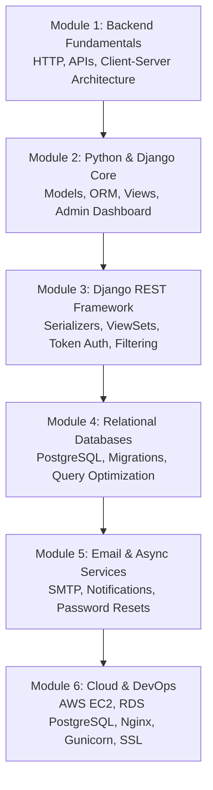
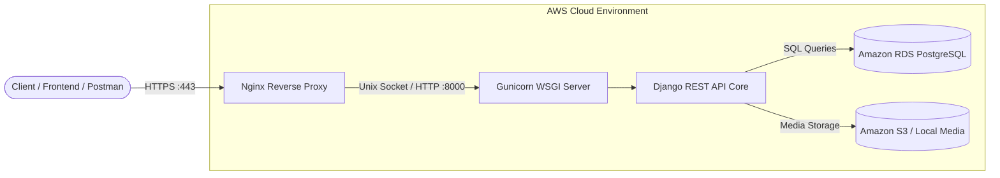

# Become a Backend Developer: Complete Python, Django, REST API, & AWS Course

A practical, project-based curriculum designed to take you from backend fundamentals to deploying production-ready REST APIs on AWS. Built with **Python**, **Django**, **Django REST Framework (DRF)**, **PostgreSQL**, **Nginx**, **Gunicorn**, and **AWS (EC2 & RDS)**.

[](https://github.com/codewithmuh/backend_course/releases)
[](https://github.com/codewithmuh/backend_course/stargazers)
[](https://github.com/codewithmuh/backend_course/network/members)
[](LICENSE)
[](https://python.org)
[](https://djangoproject.com)
[](https://aws.amazon.com)
[](https://youtube.com/@codewithmuh)
[](https://www.udemy.com/course/learn-backend-development-with-python-django-and-aws/)


---

## 📑 Table of Contents
- [Course Curriculum & Roadmap](#-curriculum--roadmap)
- [System Architecture](#-system-architecture)
- [Tech Stack](#-tech-stack)
- [Local Development Setup](#-local-development-setup)
- [API Endpoints & Testing with Postman](#-api-endpoints--testing)
- [Production Deployment to AWS](#-production-deployment-to-aws)
- [Contributing](#-contribution-guidelines)
- [Author & Community](#-author)
- [License](#-license)

---

## 🎓 Curriculum & Roadmap



| Module | Core Topics | Deliverables |
| :--- | :--- | :--- |
| **1. Fundamentals** | HTTP Methods (`GET`, `POST`, `PUT`, `DELETE`), Status Codes, JSON | Architecture overview |
| **2. Django & ORM** | Project architecture, Django Apps, SQLite to PostgreSQL | E-commerce database models |
| **3. RESTful APIs** | DRF Serializers, ModelViewSets, Pagination, Permissions | CRUD endpoints for products |
| **4. Database Design** | Relationships (1:1, 1:N, N:M), Indexing, Foreign Keys | Optimized product catalog |
| **5. Authentication** | Session vs Token vs JWT authentication | Secure user login / registration |
| **6. Production AWS** | AWS EC2 Ubuntu, Nginx reverse proxy, Gunicorn daemon, SSL | Live HTTPS web application |

---

## 🏛️ System Architecture



---

## 🛠️ Tech Stack

- **Language:** Python 3.10+
- **Web Framework:** Django, Django REST Framework (DRF)
- **Database:** PostgreSQL (Production) / SQLite (Local Dev)
- **WSGI Server:** Gunicorn
- **Reverse Proxy & Web Server:** Nginx
- **Cloud Infrastructure:** AWS EC2, AWS RDS, Route 53, ACM / Let's Encrypt Certbot
- **Testing:** Postman, Django Test Suite

---

## 💻 Local Development Setup

### 1. Clone the repository
```bash
git clone https://github.com/codewithmuh/backend_course.git
cd backend_course
```

### 2. Create and activate a Python virtual environment
```bash
# macOS / Linux
python3 -m venv venv
source venv/bin/activate

# Windows
python -m venv venv
venv\Scripts\activate
```

### 3. Install project dependencies
```bash
pip install --upgrade pip
pip install -r requirements.txt
```

### 4. Run database migrations
```bash
python manage.py makemigrations
python manage.py migrate
```

### 5. Create a Superuser (Admin Access)
```bash
python manage.py createsuperuser
```

### 6. Run the local development server
```bash
python manage.py runserver
```
Visit `http://127.0.0.1:8000/` in your browser or explore the Django admin panel at `http://127.0.0.1:8000/admin/`.

---

## 🧪 API Endpoints & Testing

Test these endpoints locally using **Postman** or `curl`:

| Method | Endpoint | Description |
| :--- | :--- | :--- |
| `GET` | `/api/products/` | List all available products |
| `POST` | `/api/products/` | Create a new product (Admin authenticated) |
| `GET` | `/api/products/<id>/` | Retrieve specific product details |
| `PUT` / `PATCH` | `/api/products/<id>/` | Update product attributes |
| `DELETE` | `/api/products/<id>/` | Delete product record |

---

## ☁️ Production Deployment to AWS

For full production deployment instructions on AWS:
1. **EC2 Server Setup:** Follow our dedicated guide on [AWS EC2 + Nginx](https://github.com/codewithmuh/react-aws-ec2-nginx).
2. **PostgreSQL Database:** Provision an Amazon RDS PostgreSQL instance and point `DATABASES['default']` in `settings.py` via environment variables.
3. **Domain & SSL:** Configure Nginx and run Certbot (`sudo certbot --nginx -d api.yourdomain.com`).

---

## 🤝 Contribution Guidelines

Contributions, issues, and feature requests are welcome!
1. Fork the Project (`https://github.com/codewithmuh/backend_course/fork`)
2. Create your Feature Branch (`git checkout -b feature/AmazingFeature`)
3. Commit your Changes (`git commit -m 'Add some AmazingFeature'`)
4. Push to the Branch (`git push origin feature/AmazingFeature`)
5. Open a Pull Request

---

## 👨‍💻 Author

**Muhammad Rashid** — Backend & Cloud DevOps Engineer, AWS Community Builder.
- 🎓 **Udemy Course:** [Learn Backend Development with Python, Django, & AWS](https://www.udemy.com/course/learn-backend-development-with-python-django-and-aws/)
- 🎥 **YouTube:** [@codewithmuh](https://youtube.com/@codewithmuh)
- 💼 **LinkedIn:** [Muhammad Rashid](https://www.linkedin.com/in/muhammadrashid-daha/)
- 🌐 **Website:** [codewithmuh.com](https://codewithmuh.com)

⭐ **If you find this course repository helpful, give it a star!**

---

## 📄 License

This repository is distributed under the [MIT License](LICENSE).
