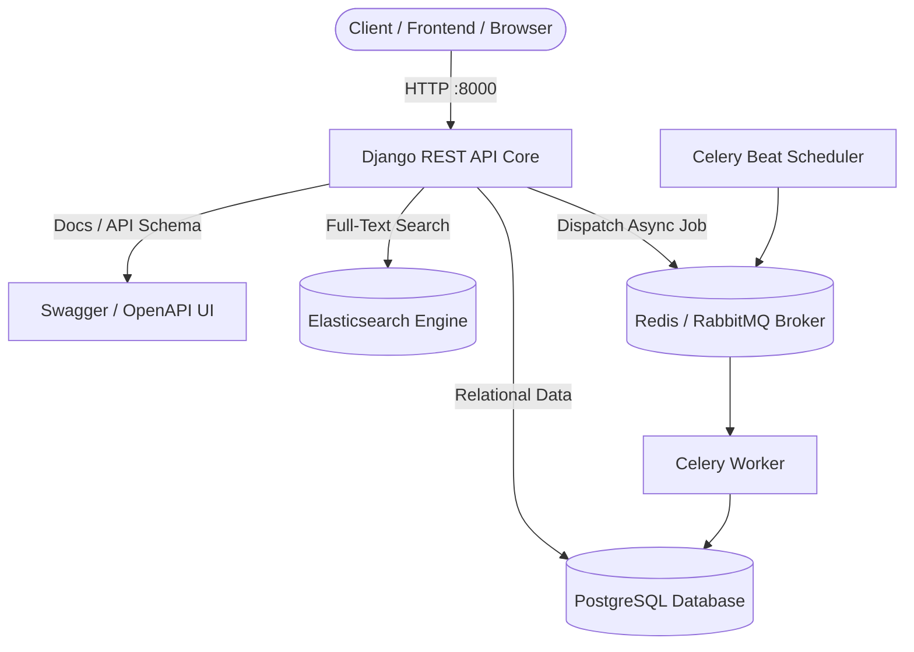

# Production-Grade Django Starter Kit

A batteries-included, modular boilerplate and development environment for **Django 4.2+** and **Django REST Framework (DRF)**. Pre-configured with **Docker Compose**, **PostgreSQL**, **Elasticsearch**, **Celery** (asynchronous workers + scheduler), and **Swagger / OpenAPI** interactive documentation.

[](https://github.com/codewithmuh/django-starter-kit/releases)
[](https://github.com/codewithmuh/django-starter-kit/stargazers)
[](https://github.com/codewithmuh/django-starter-kit/network/members)
[](LICENSE)
[](https://python.org)
[](https://djangoproject.com)
[](https://docker.com)
[](https://docs.celeryq.dev)
[](https://elastic.co)
[](https://youtube.com/@codewithmuh)
[](https://www.linkedin.com/in/muhammadrashid-daha/)


---

## 📑 Table of Contents
- [Architecture Overview](#architecture-overview)
- [Key Features](#features)
- [Project Directory Layout](#project-directory-layout)
- [One-Command Quickstart](#one-command-quickstart)
- [Environment Configuration](#environment-configuration)
- [Services & Ports Reference](#services--ports-reference)
- [Common Development Commands](#common-development-commands)
- [Author & Community](#author)
- [License](#license)

---

## 🏛️ Architecture Overview



---

## 🌟 Features

- 🐳 **One-Command Docker Setup:** No need to install and configure Python, PostgreSQL, Redis, or Elasticsearch manually.
- ⚡ **Asynchronous Task Processing:** Pre-wired **Celery** workers and **Celery Beat** periodic task scheduler.
- 🔍 **Full-Text Search Engine:** Integrated **Elasticsearch** service ready for search indexing and fast queries.
- 📖 **Self-Documenting REST APIs:** Interactive **Swagger / OpenAPI** documentation at `/api/docs/`.
- 🗄️ **Production PostgreSQL:** Resilient relational database layer pre-configured with volume persistence.
- 🛡️ **Secure Secret Management:** Clean environment segregation using `.env` templates.

---

## 📂 Project Directory Layout

```
django-starter-kit/
├── backend/                       # Django project source code
│   ├── apps/                      # Modular Django apps
│   ├── config/                    # Core settings (base, dev, prod), WSGI, ASGI
│   └── manage.py                  # Management script
├── build-process/                 # Docker orchestration assets
│   ├── docker-compose-django-backend.yml
│   ├── Dockerfile
│   └── local.backend.env          # Development environment variables
├── requirements/                  # Split Python dependencies
│   ├── base.txt
│   ├── local.txt
│   └── production.txt
└── README.md
```

---

## 🚀 One-Command Quickstart

### 1. Clone the repository
```bash
git clone https://github.com/codewithmuh/django-starter-kit.git
cd django-starter-kit
```

### 2. Configure environment variables
Verify or modify the environment values in `build-process/local.backend.env`.

### 3. Spin up all services
```bash
docker compose -f "./build-process/docker-compose-django-backend.yml" up -d --build
```

### 4. Create an admin user
```bash
docker compose -f "./build-process/docker-compose-django-backend.yml" exec web python manage.py createsuperuser
```

---

## 🔌 Services & Ports Reference

Once running, access the local services via these ports:

| Service | Port | Description |
| :--- | :--- | :--- |
| **Django Backend API** | `http://localhost:8000/` | Main application server |
| **Swagger / OpenAPI Docs** | `http://localhost:8000/api/docs/` | Interactive API sandbox & schema |
| **Django Admin** | `http://localhost:8000/admin/` | Management and database administration |
| **PostgreSQL** | `localhost:5432` | Relational database connection |
| **Elasticsearch** | `localhost:9200` | Search engine HTTP REST interface |

---

## 🛠️ Common Development Commands

```bash
# View real-time container logs
docker compose -f "./build-process/docker-compose-django-backend.yml" logs -f web

# Run database migrations inside container
docker compose -f "./build-process/docker-compose-django-backend.yml" exec web python manage.py migrate

# Stop all background services
docker compose -f "./build-process/docker-compose-django-backend.yml" down
```

---

## 👨‍💻 Author

**Muhammad Rashid** — Backend & Cloud DevOps Engineer, AWS Community Builder.  
- 🎥 **YouTube:** [@codewithmuh](https://youtube.com/@codewithmuh)  
- 💼 **LinkedIn:** [Muhammad Rashid](https://www.linkedin.com/in/muhammadrashid-daha/)  
- 🌐 **Website:** [codewithmuh.com](https://codewithmuh.com) · [devopsbymuh.com](https://devopsbymuh.com)

⭐ **If you find this Starter Kit helpful, please star the repository!**

---

## 📄 License

This project is open-source under the [MIT License](LICENSE).
