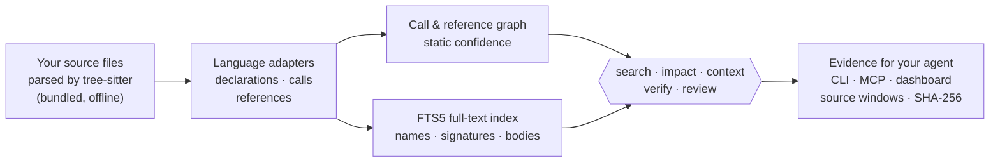
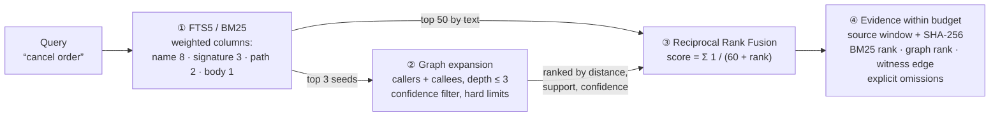

<div align="center">

<picture>
  <source media="(prefers-color-scheme: dark)" srcset="assets/logo/code-graph-logo-dark.svg">
  
</picture>

# code-graph

[](https://ko-fi.com/J3K52ADG60)

**Local code intelligence for 8 languages and SQLite SQL.**<br>
Ask your coding agent where to change the code, what the change could affect and which tests to run.

[](https://github.com/dagoSte/code-graph/releases/latest) [](LICENSE.md) [](#install) [](#mcp) [](#install) [](#install)

**English** · [Italiano](README.it.md) · [Privacy](PRIVACY.md)

[Install](#install) · [Use with your coding agent](#start-here) · [Guide](docs/guide/README.md) · [When to use it](#when) · [How it works](#how-it-works) · [Hybrid search](#hybrid-search) · [Benchmarks](#benchmarks) · [Dashboard](#dashboard) · [Two maps](#two-maps) · [Change with an agent](#change-flow) · [CLI](#cli) · [MCP](#mcp) · [Languages](#languages) · [Limits](#limits) · [What's new](#news) · [Sponsor](#support)

</div>

<a id="install"></a>
## 1. Install code-graph

Paste this into the chat in **Codex** or **Claude Code**:

```text
Install code-graph by following https://github.com/dagoSte/code-graph/blob/main/SETUP.md: show me the plan first, wait for my yes, then install it and check that it works.
```

Review the setup plan and approve it. Once setup passes its checks, open a new agent session in the repository you want to work on.

[Connect an MCP client](docs/guide/guides/agents-and-mcp.md#as-an-mcp-server) if you prefer to use code-graph through MCP.

<details>
<summary><strong>Manual installation and updating</strong></summary>

**Requirements:** Git, Bash and Python 3.10+ with `venv`. Verified on macOS arm64; CI runs the full suite on Linux and macOS with Python 3.12 and 3.13. The change flow also needs `codex` and/or `claude` installed and signed in.

```bash
git clone https://github.com/dagoSte/code-graph.git "$HOME/code-graph"
cd "$HOME/code-graph"
CG_PYTHON=python3.12 bash scripts/setup.sh
CG="$HOME/code-graph/scripts/cg"
```

`setup.sh` creates `.venv` inside the skill folder, installs the pinned dependencies from [requirements.txt](requirements.txt) (binary wheels only) and runs `cg selftest`. Nothing is installed in the system Python. If no wheel exists for your interpreter, choose another one with `CG_PYTHON`.

Link the whole folder as a skill (the destination must not exist yet):

```bash
mkdir -p "$HOME/.codex/skills" "$HOME/.claude/skills"
ln -s "$HOME/code-graph" "$HOME/.codex/skills/code-graph"    # Codex
ln -s "$HOME/code-graph" "$HOME/.claude/skills/code-graph"   # Claude Code
```

Do not copy `SKILL.md` alone: the skill needs its scripts and environment. If the agent does not see the skill, start a new session.

**Updating:** `git pull`, then `bash scripts/setup.sh` again. The index is a cache: an index from an older version is rebuilt at the next `index`.

The grammars ship inside the pinned `tree-sitter-language-pack` wheel, so indexing works offline. The launcher runs Python with `-I`, so modules from your project or `PYTHONPATH` are never imported.

</details>

<a id="start-here"></a>
## 2. Ask your coding agent in plain language

After setup, you can use code-graph entirely from your coding agent’s chat. The agent uses the skill or the project’s configured MCP connection. Paste this example:

```text
Use code-graph to investigate this change: cancelling an order should also
refund partial payments. Show me where to intervene with file and line
references, what could be affected and which tests to run.
Show me the plan before editing.
```

The agent can build or refresh the index, find likely code, trace callers and propose tests. You get an answer in the same chat. This also works for questions such as “Use code-graph to explain this stack trace” or “Use code-graph to review what my change touched.”

The [agent guide](docs/guide/guides/agents-and-mcp.md) has more prompts and setup options. The [dashboard](#dashboard) and [command line](#cli) are also available for direct use.

https://github.com/user-attachments/assets/8d89e17a-3238-4023-a3dd-3d8de4d1cc3d

[Download the English overview with captions · MP4](https://github.com/dagoSte/code-graph/releases/download/v1.9.0/code-graph-1.9.0-overview-en.mp4)

**Benchmark.** With the same 4,000-character answer budget, the historical fix file appeared in the first five candidates for **28 of 44** scorable bugs, up from **17 of 44**. [Benchmark methods and results](#benchmarks)

<picture>
  <source media="(prefers-color-scheme: dark)" srcset="docs/images/overview-dark.png">
  
</picture>

## Why code-graph

Coding agents spend most of their effort *finding* the right code: they grep, open files one by one and guess what a change will break. code-graph builds a static graph of your project once, keeps it fresh incrementally, and answers the questions an agent actually needs:

- **Where is the code for this request?** Hybrid search ranks declarations by text relevance (SQLite FTS5/BM25) and then follows calls and references to bring in the functions that matter but never mention your words. → [Hybrid search](#hybrid-search)
- **What breaks if I change it?** Callers up to the depth you choose, with a callsite for each, and the tests that reach the symbol.
- **What exactly should the agent read?** Bounded source windows with SHA-256 hashes, a character budget and an explicit list of what was left out.
- **Did the change do what it said?** After the edit, signatures, calls and findings are compared with a baseline, so new problems are not confused with old ones.

Indexing and search run on your machine: analysis never imports your modules, never runs your code, never calls a model and never sends source anywhere. What your agent then reads goes to that agent's provider, as with any agent session; see [PRIVACY.md](PRIVACY.md). The graph is a guide for reading, not a proof of behaviour: the agent still reads the source, and your tests still decide.

| | |
|---|---|
| **8 languages + SQL** | PHP, Python, JavaScript/TypeScript, Go, Dart, Java, Swift, and SQLite SQL resource maps — each with a [written coverage contract](docs/LANGUAGES.md) |
| **4 ways in** | `cg` command line, local dashboard, MCP server (15 tools), Claude Code / Codex skill |
| **Scale** | The real Go SDK (2.2 million lines, 7,035 files) indexes in 52 s; a one-file change re-indexes in 9 s ([measurements](benchmarks/SCALING.md)) |
| **Zero services** | Free to use ([FSL-1.1-MIT](LICENSE.md)), no account, pinned dependencies, works offline once installed |

<a id="when"></a>
## When it is worth it — and when it is not

| Use it | Skip it |
|---|---|
| Hundreds of files or more, or code you did not write | Small projects: about ten files are as quick to read directly |
| A change whose reach you are unsure of: shared helpers, public functions | A one-line fix in a file you already know |
| You need to know which tests to run before and after | Code driven mostly by reflection, string-registered routes or dependency injection, where static edges are missing |
| An agent session with repeated *where is X / who calls Y* lookups | Questions a single `grep` answers |

The graph helps you go from a request to file and line references, see who calls the code, and choose which tests to run. In the synthetic retrieval benchmark, the graph surfaced relevant functions that text search missed. [Hybrid search results](#hybrid-search)

<a id="how-it-works"></a>
## How it works



1. **Index.** Each file is parsed with the bundled tree-sitter grammars. Language adapters extract declarations, callsites and references, and resolve them with explicit rules per language. Unresolved or ambiguous cases are recorded as such instead of being guessed.
2. **Store.** Graph and full-text index live in one SQLite file, `.code-graph/graph.db`, updated in the same transaction. Re-indexing parses only files whose hash changed.
3. **Ask.** Search and source reads check that the source files they cite still match their recorded hashes and refuse stale evidence until you re-index. Run `index` after every change: name lookups such as `find` and `show` answer from the last index.
4. **Hand over.** Results come back as bounded JSON: the source to read, why it was selected, and what was omitted.

<a id="hybrid-search"></a>
## Hybrid search: BM25 + call graph, fused with RRF

Text search alone finds the function whose *name* matches your words. It misses the function it calls to do the real work, and the test that exercises it, because those rarely repeat the same words. code-graph's search combines both signals, entirely inside SQLite, with no embeddings and no model:



1. **Lexical ranking.** FTS5 scores each declaration with BM25 over its name, signature, path and the first 2,000 characters of its body. Identifiers are split at `snake_case` and `camelCase` boundaries, so `startHTTPServer` matches *HTTP server*. When exact words leave room, the query is widened with word roots (*cancelling* → `cancel*`) and common programming synonyms (*abort* → `cancel`); those results come after the exact ones and are marked `expanded`.
2. **Graph expansion.** The three best text matches become seeds. code-graph walks resolved calls and references in both directions (default depth 2), within fixed limits of 500 nodes and 1,000 edges per query, and reports when a limit is reached.
3. **Fusion.** [Reciprocal Rank Fusion](https://cormack.uwaterloo.ca/cormacksigir09-rrf.pdf) merges the two rankings using positions only, so a BM25 score and a graph distance never have to be put on the same scale. Each symbol counts once per channel; ties break on path and line, so results are deterministic.
4. **Evidence, not just names.** Every result says *why* it is there: its text rank and BM25 score, or the exact call edge (file, line, direction, confidence) that connected it to a seed. Source windows carry hashes, and the whole response respects your character budget.

**A worked example.** In a small checkout project, the query `cancel order` returns four results (real `cg search` output, abridged):

| Result | Why it was returned |
|---|---|
| `checkout.py: void_purchase` | text match: its docstring says *Cancel order* (BM25 rank 2) |
| `preview.py: obsolete_cancel_order` | text match on the name (BM25 rank 1) — a decoy that does nothing |
| `ledger.py: record_adjustment` | **graph:** called by `void_purchase` at `checkout.py:4`, confidence high |
| `tests/test_checkout.py: test_reversal` | **graph:** calls `void_purchase` at line 2, confidence high |

Neither `record_adjustment` nor `test_reversal` contains the word *cancel* or *order*: text search alone cannot find them, yet they are exactly what an agent must read and run before changing the cancel flow.

**Measured on the retrieval benchmark.** Seven synthetic queries across Python, TypeScript and PHP, each with declared relevant symbols ([cases](benchmarks/search-retrieval.json), [results](benchmarks/search-retrieval-results.json)):

<picture>
  <source media="(prefers-color-scheme: dark)" srcset="docs/images/retrieval-dark.svg">
  
</picture>

| Mode | Relevant symbols in the top 5 | Mean reciprocal rank | Median query time¹ |
|---|---:|---:|---:|
| Text only (`--mode lexical`) | 9 of 15 (mean recall@5 0.62) | 0.93 | 28 ms |
| Hybrid text + graph RRF (default) | **15 of 15 (mean recall@5 1.00)** | **1.00** | 28 ms |

¹ Median per query on one laptop, including opening the index. These cases are small and built by hand to exercise the mechanism; they are not a general accuracy claim. On real repositories, graph expansion is only as good as the resolved edges for each language ([coverage](#languages)). Rebuild the figures with `python3 -I benchmarks/search_retrieval.py --output …` and `python3 -I tools/readme_charts.py`.

```bash
cg --root . search "cancel order"                   # hybrid, JSON evidence (default)
cg --root . search "cancel order" --mode lexical    # BM25 only, for comparison
```

The same engine is available as the MCP tool `cg_search` and in the dashboard search bar (**Text + graph**). Full contract: [docs/SEARCH.md](docs/SEARCH.md).


<a id="benchmarks"></a>
## Benchmarks

Every figure below comes from a receipt committed in [`benchmarks/`](benchmarks/) and the charts are regenerated from those files by [`tools/readme_charts.py`](tools/readme_charts.py). Failures and negative results are published with the rest.

**Indexing scales to real SDKs, and staying current is cheap.** After the first index, code-graph re-parses only files whose content changed: on the 2.2-million-line Go SDK a one-file change is re-indexed in 9 s and an unchanged project is re-checked in 3 s. The Go SDK used to hit the 600-second limit; indexing import candidates by package brought it to 52 s with identical facts on the comparison subset ([details](benchmarks/SCALING.md#go-sdk-follow-up-13-november-2026)).

<picture>
  <source media="(prefers-color-scheme: dark)" srcset="docs/images/scale-dark.svg">
  
</picture>

| Project | Lines | Files | Full index | Unchanged | One-file change | Peak memory | Query, text / hybrid |
|---|---:|---:|---:|---:|---:|---:|---:|
| Generated, 8 languages | 10,000 | 62 | 0.36 s | 0.11 s | 0.13 s | 60 MiB | 31 / 31 ms |
| Generated, 8 languages | 100,110 | 623 | 2.49 s | 0.21 s | 0.42 s | 118 MiB | 50 / 51 ms |
| Dart SDK 3.6 | 208,759 | 433 | 4.33 s | 0.19 s | 0.48 s | 143 MiB | 70 / 77 ms |
| Generated, 8 languages | 1,000,091 | 6,226 | 26.99 s | 1.24 s | 3.58 s | 731 MiB | 209 / 234 ms |
| Go SDK go1.27.4 | 2,233,479 | 7,035 | 52.31 s | 3.15 s | 9.16 s | 1,038 MiB | 814 / 1,037 ms |

Single observations on macOS ARM64 with Python 3.13 on a running desktop; queries are medians of three warm samples of one query. The Dart SDK has 29 and the Go SDK 65 files the parser cannot fully read; code-graph marks them partial and abstains on them ([Dart](docs/DART.md#sdk-362-partial-file-diagnosis), [Go](docs/GO.md#sdk-grammar-investigation-13-november-2026)).

**The graph finds code that text search misses.** On the retrieval benchmark, hybrid search puts all 15 relevant symbols in the top five against 9 of 15 for text matching alone, at the same query time ([chart and caveats](#hybrid-search)). On ten paraphrased queries whose words differ from the code (*cancelling orders*, *free the mutex*), it now finds 22 of 22 relevant symbols, against 11 of 22 before word roots and synonyms were added ([cases](benchmarks/search-paraphrase.json): development cases written by the implementer, not an independent test). The cases are small and synthetic: they show the mechanism, not a general accuracy figure.

The improved `locate` was then frozen and measured once on 45 historical bugs from Django, typescript-eslint and Prometheus, chosen by a rule fixed before any run: a file of the historical fix is the first candidate in 23 of 44 cases (main before the change: 10) and among the first five in 30 (main: 17); the changed function is among the first five in 16 of 41 (main: 7). At the same 4,000-character budget it is 28 of 44, so most of the gain comes from ranking, not from the longer answer. A fix made after that freeze cost 7 first-place hits on the same cases; release 1.9.0 restores the evaluated order and scores 23 of 44, 30 of 44 and 18 of 41 there, a re-run made after seeing the results and therefore not blind. This measures localization only, not agents. [benchmarks/locate-bench/RESULTS.md](benchmarks/locate-bench/RESULTS.md#after-the-freeze-the-released-engine).

The [coding-agent studies](benchmarks/LIVE_RESULTS.md) report outcomes, token counts, costs and failed calls, with a breakdown by task.

<a id="dashboard"></a>
## Dashboard

```bash
"$CG" explore                                          # opens the browser
"$CG" explore --workspace /path/to/projects --no-open  # prints the address instead
```

A local web app on `127.0.0.1` with a random port and a session token; browsing and search never start a model. English or Italian, light, dark or system theme. Press **⌘K / Ctrl+K** to search.

**Symbol neighbourhood, impact and tests.** Click any function to see its callers and callees as a graph, the source with registered references, every callsite in both directions, and the tests reached through caller chains (listed, never run). The **Agent context** tab builds a packet for that symbol within a character budget.


<details>
<summary><strong>More views: project guide, architecture and resources, efficiency</strong></summary>

**Project guide.** Where to start in this project, the six steps an agent follows, and a ready-to-paste task for a change, an impact question, an error, an explanation or a final check.


**Architecture and resources.** File reads and writes, database connections and process starts found in the source, kept apart from calls: a path written in the code does not prove a link between two processes. SQLite SQL has its own section with declarations, explicit reads/writes, bounded same-script candidates and hashed source windows. SQL is never executed.


**Features → Understand and change.** Start from a declared feature card or a candidate entry point; follow its flow, contracts and recognised tests; build a context packet for the agent, then compare signatures, code and callsites after the change.

**Efficiency.** Measures each dashboard read: payload, latency, and the source tab against reading every section. Tokens are estimated as Unicode characters / 4, and negative savings stay visible.

If a source you looked at, a configuration or the index changes, the dashboard asks you to refresh before mixing old coordinates with new code.

</details>

<a id="two-maps"></a>
## Two maps, one path to the code

Keep the **Technical map** for functions, files and static calls. Open the **Functional map** to start
from a name such as **Payment** or **Orders**, then drill into the referenced code, impact and proposed
tests. Names and membership are project declarations; arrows require direct static call witnesses.
Technical candidates stay separate when no purpose is declared.

The same overview is available to the engine and agents: `cg flows "Payment" --json` or MCP
`cg_flows`, followed by `cg_prepare` for the selected declared ID. It avoids expanding every feature
just to choose one; this is not a measured claim of lower LLM token use. See the [two-map guide](docs/guide/guides/two-maps.md)
for declarations, limits and examples. Open **User guide** in the dashboard header for a visual walkthrough and shortcuts to these views.


<a id="change-flow"></a>
## Change with an agent

Hand a change to Codex or Claude and follow it to integration. One model writes, the other reviews, and the two decisive steps stay with you:

**Analyze → Understand → Plan (✅ you approve) → Change → Verify → Review and integrate (✅ you decide)**


1. **Understand.** Ask read-only questions, also about a symbol picked on the map. Describe the change and choose author and reviewer (normally the other model).
2. **Plan.** The author proposes files, affected parts, tests, risks and open questions. code-graph checks every symbol against the index, adds the impact computed from the graph and lists what is *not visible to the graph*. You choose the scope and the test command, then approve.
3. **Change.** code-graph runs the approved tests first; the author edits an isolated Git worktree, never your checkout.
4. **Verify.** code-graph re-indexes the copy and runs the tests again. New failures, errors, timeouts or files outside the scope block the change.
5. **Review and integrate.** The other model answers *accept*, *request changes* or *reject*, with findings. Send it back (up to three rounds), discard it or integrate it.

<details>
<summary><strong>Safety boundaries, integration and terminal commands</strong></summary>

- **Consent.** No agent starts without your consent for the session; it is checked again right before every start. On the command line, `cg change plan`, `edit` and `review` ask for confirmation (or `--yes`) and refuse without a terminal.
- **Read-only steps.** Questions, plan and review cannot write: Codex runs in its `read-only` sandbox; Claude runs in plan mode with only `Read`, `Grep`, `Glob` and the code-graph MCP tools.
- **Writing only in the isolated copy** `<project>/.code-graph/worktrees/<id>`, on branch `cg/change-<id>`. Codex: `workspace-write`, no shell. Claude: `acceptEdits`, no `Bash`.
- **No project configuration.** Claude loads no hooks or settings from the analysed project and gets only the code-graph MCP server. Codex starts with `--ignore-user-config --ignore-rules`, so your `config.toml` (provider, profile, default model) is not used.
- **Only code-graph runs tests**, with the approved command, without a shell, within 600 seconds. code-graph never runs `git push`.
- **Cost.** Each run is time-limited and uses your installed client's account. A Claude spending cap in USD can be set per change (`--budget-usd`) and for questions; Codex has no such flag.
- **Integration.** Leave the change on its branch (default) or merge it into a clean checkout with `git merge --no-ff`, without Git hooks or signing; on a conflict the merge is aborted. Integration needs a verdict other than *reject* and no verification blockers, unless you give a reason that stays in the history. **Discard** removes the copy and branch; the archive in `.code-graph/changes/<id>/` stays.
- **Test output** is kept in that archive: a test that prints a secret leaves it there.

```bash
"$CG" --root /path/to/project change new --intent "Rename work to compute" --author codex --reviewer claude
"$CG" --root /path/to/project change plan <id> --yes
"$CG" --root /path/to/project change approve <id> --test-argv '["python3","-m","unittest"]'
"$CG" --root /path/to/project change edit <id>        # --feedback "…" for a new round
"$CG" --root /path/to/project change verify <id>
"$CG" --root /path/to/project change review <id>
"$CG" --root /path/to/project change integrate <id>   # --merge, --force-reason "…"
```

Each command waits for its step and prints JSON; `list`, `show`, `discard` and `cancel` are also available.

</details>

<a id="cli"></a>
## Command line

### Quick tour from the terminal

From the code-graph installation folder, run this to index a project and get an example of what to ask:

```bash
scripts/cg --root /path/to/project start
```

On code-graph's own repository it prints (paths shortened):

```text
472 source files: too many to read one by one. This is what code-graph is meant for:
finding the code for a request, the impact of a change and the tests to run.

1. What breaks if I change it, and which tests should I run?
   prepare is called from 13 places; 13 tests reach it through those calls.
   $ cg --root . impact scripts/features.py:prepare --depth 3
   $ cg --root . verify scripts/features.py:prepare --plan
2. Where is the code for a request?
   $ cg --root . search prepare
3. Did my change touch anything I did not intend?
   $ cg --root . review --base HEAD
```

The same three questions open the dashboard (`cg explore`), each with a button that takes you to the right view.

| You want to know | Command | What you get |
|---|---|---|
| Where to change for a request, in one answer | `locate "request text"` | The likely places to change with their code, callers and tests, plus how much reading it saved (no model call; it refreshes the index first) |
| What breaks if I change this, and which tests to run | `impact <symbol>` · `verify <symbol> --plan` | Callers up to the depth you choose, each with its callsite, and the tests reached through them (listed, never run) |
| Where the code for a request is, in a project you do not know | `search "words"` | Matching declarations plus the functions they call or are called by, with hashed source windows |
| Whether a change touched something unintended | `review --base HEAD` | Signatures, calls and findings compared with the last commit, and a test plan |

Every command takes `--root <project>` **before** the command name. Run `index` first and after each change; it re-parses only changed files.

```bash
"$CG" --root /path/to/project index
"$CG" --root /path/to/project search "cancel order" --max-chars 9000
"$CG" --root /path/to/project impact 'OrderService.cancel' --depth 3
"$CG" --root /path/to/project context 'OrderService.cancel' --profile change --max-chars 4000
"$CG" --root /path/to/project verify 'OrderService.cancel' --plan --json
"$CG" --root /path/to/project review --base HEAD --json
```

<details>
<summary><strong>All commands</strong></summary>

| Command | What you get |
|---|---|
| `start [--lang en\|it] [--json]` | Indexes the project and shows three questions to ask it, with a real example and ready commands. |
| `index [--full]` | Builds or refreshes `.code-graph/graph.db`; reports exclusions and partial parsing. |
| `locate TEXT [--limit 5] [--max-chars 5000]` | From the text of a request to the places to change, with their code, callers and tests, and the reading it saved. No model calls. |
| `search QUERY [--mode hybrid\|lexical] [--max-chars 9000]` | JSON evidence ranked by FTS5/BM25 and graph RRF. |
| `map [--depth 2] [--limit 25]` | Module sizes, dependencies, hotspots and likely entry points. |
| `find <pattern> [--kind class\|method\|function]` | Symbols by name or `*` pattern. |
| `show <sym>` | Signature, members, bases and neighbour counts. |
| `callers <sym>` / `callees <sym>` | Neighbours with confidence and a callsite each; `callees` also lists external and dynamic calls. |
| `impact <sym> [--depth 3] [--min-conf medium]` | Transitive callers and the tests found; callbacks and decorator registrations appear as references. `impact <file> --file` works on a whole file. |
| `path <A> <B>` | The shortest call path found between two symbols. |
| `context <sym> [--max-chars 4000] [--profile understand\|change\|debug\|review]` | Context for an agent within a character budget, with omissions stated. |
| `source <file> [--line N] [--max-chars 1200]` | A bounded source window with Unicode columns and a hash. |
| `features [--query words]` / `prepare [card] …` | Feature cards, entry points and a context packet for a feature change. |
| `verify <sym> --plan` | Readable test plan with per-test and aggregate argv; `--json` keeps structured evidence. A proposal: nothing is run. |
| `review [--base REF] [--staged]` | Readable baseline, findings and test summary; `--json` keeps the full structured diff analysis. |
| `check` / `dead [--all]` | Candidates: arity, missing methods, duplicates, cycles; symbols without known callers. |
| `architecture` / `stats` | Resource observations kept apart from calls; index coverage. |
| `export [--symbol <sym>] [--depth 2]` | A self-contained offline HTML graph (no server, network or CDN). |
| `explore` / `mcp` | The dashboard; the MCP server on stdio. |
| `change …` | The change flow from the terminal. |
| `selftest` | 25 checks on fixtures: `TRUST` or `DISTRUST`. |

`<sym>` can be `name`, `Class.method`, `Class::method`, `path/file.php:name` or `path/file.php:123`; repeat an ambiguous name with its path or class. Most commands accept `--json`; the full syntax is in [SKILL.md](SKILL.md).

</details>

<a id="mcp"></a>
## MCP server

```bash
"$CG" --root /path/to/project mcp
```

A stdio MCP server with fifteen tools: `cg_locate`, `cg_search`, `cg_flows`, `cg_find`, `cg_show`, `cg_callers`, `cg_callees`, `cg_impact`, `cg_verify_plan`, `cg_prepare`, `cg_source`, `cg_read`, `cg_review`, `cg_check` and `cg_index`. No tool changes your sources or runs the analysed code; `cg_index` only refreshes the `.code-graph` cache. Responses stop at 40,000 characters with an explicit marker. The change flow passes this server to Codex and Claude automatically.

<details>
<summary><strong>Example prompts</strong></summary>

```text
If I change OrderService.cancel, which parts may be affected? List the tests that reach it.
```

```text
Prepare the context to fix this error: [error]. Show me the references in the code.
```

```text
Trace the flow from CheckoutController.submit to OrderRepository.save and list the steps the graph could not resolve.
```

```text
Compare before and after this change: what changed, and which checks are still needed?
```

```text
Use the code-graph change flow on this project: Codex writes, Claude reviews. Show me the plan and the test command before anything is approved: [description].
```

</details>

<a id="languages"></a>
## Languages

Each language has a written contract: what is resolved, and where the analysis deliberately abstains rather than guess. No compiler, SDK or language server is needed.

| Language | What is resolved | Contract |
|---|---|---|
| Python | Imports and re-exports, typed receivers, callbacks and decorators, modules loaded with `importlib`/`runpy`, FastAPI/Flask routes | [LANGUAGES](docs/LANGUAGES.md) |
| JavaScript / TypeScript | ES and CommonJS modules, barrels, `tsconfig` paths, workspace packages, JSX components | [LANGUAGES](docs/LANGUAGES.md) |
| PHP | Namespaces, function and class imports, callbacks, WordPress hooks | [LANGUAGES](docs/LANGUAGES.md) |
| Go | Package/import calls and explicit concrete receivers; interfaces and build variants abstain | [GO](docs/GO.md) |
| Dart | Libraries, relative and local `package:` imports, static methods; instance dispatch abstains | [DART](docs/DART.md) |
| Java | Declared static/private/final subset; overloads and virtual dispatch abstain | [JAVA](docs/JAVA.md) |
| Swift | File-local private/static subset; overloads and imports abstain | [SWIFT](docs/SWIFT.md) |
| SQLite SQL | Tables, views and queries with read/write observations, separate from calls | [SQL](docs/SQL.md) |

<a id="limits"></a>
## Limits

- **A guide, not a proof.** Confidence `high`, `medium` and `low` describe how a call was resolved, not that it runs. Dynamic dispatch, reflection, dependency injection and string-registered routes can leave edges missing or wrong.
- **Lexical, not semantic.** Search matches the words you use, their roots and a small list of common programming synonyms; it does not translate a question or use embeddings. Ask the agent to reformulate a request into code terms — the [agent search guide](docs/AGENT_SEARCH.md) does this.
- **Candidates only.** `check` and `dead` produce candidates to confirm; `VERIFIED_DEAD` does not authorise a deletion.
- **What is indexed.** Vendored dependencies, build folders, Git-ignored files, symlinks, files over 1 MB and minified files are skipped; add globs to `.cgignore`.
- **Local data.** `.code-graph/graph.db` contains metadata and source excerpts. It excludes itself from Git; do not publish it. See [PRIVACY.md](PRIVACY.md).
- **Measurements.** The [scale results](benchmarks/SCALING.md) describe the tested repositories and hardware. The [agent study](benchmarks/LIVE_RESULTS.md) covers 23 historical bugs from three repositories, with one run per variant.
- **Interface language.** The command line, the engine's messages and the [guide](docs/guide/README.md) are in English; the dashboard, `cg start` and this README are in English and Italian. JSON keys are in English.

```bash
scripts/cg selftest
.venv/bin/python -I tools/parallel_tests.py   # the whole suite in parallel processes
```

<a id="news"></a>
## What's new

**1.9.0 — locate, tests to run, Django scale and measured localization**

- **`locate`.** One command from a request, an issue or a stack trace to the places to change, with their source, callers and tests, within a character budget and with the reading it saved. Requests up to 200,000 characters; on 45 historical bugs a file of the fix is the first candidate in 23 of 44 cases (main before: 10). [Results](benchmarks/locate-bench/RESULTS.md).
- **Tests to run.** `verify` and `review` propose ready commands for pytest, unittest, Go, Jest/Vitest and PHPUnit (with the project's own Python), and print a short readable summary; `review --summary --json` is a compact answer for agents.
- **Django scale.** Python import resolution is indexed: Django indexes in 18 s instead of 98 s, and `review --base` takes 40 s instead of more than 600 s, with identical facts ([receipt](benchmarks/django-scale.json)).
- **Documentation and language.** A full [guide](docs/guide/README.md) with real examples and a reference generated from the code; command line, engine messages and SKILL.md in English.
- **Benchmark results.** The localization benchmark and the study of 23 historical bugs include the protocols and per-case results. [Benchmarks](#benchmarks)
- **Fixes from the field.** PHP enum methods are no longer reported as missing; `cg start` no longer exits silently when its example function has an ambiguous name. License [FSL-1.1-MIT](LICENSE.md).

<details>
<summary><strong>Earlier versions</strong></summary>

- **1.8.0** — Guided start (`cg start` and the dashboard's Start here), Go at SDK scale (52 s for 2.2 million lines), a real-repository pilot on SymPy and benchmarks in the README.
- **1.7.0** — Local hybrid search (SQLite FTS5/BM25 with graph RRF), Go, Dart, Java and Swift adapters, SQLite SQL resource maps and retrieval guidance in the change flow.
- **1.6.5** — Local API catalog (`cg catalog`), more precise Python decorators and receivers, more FastAPI/Flask routes, JS/TS module and reference fixes, `relation` in JSON impact.
- **1.6.4** — More callers found through Python re-exports and typed receivers, callbacks and registered commands as references, JS/TS barrels and path aliases, PHP function imports; fewer false dead-code candidates.
- **1.6.3** — Callers of modules loaded with `importlib` or `runpy`.
- **1.6.2** — Steadier change flow around invalid plan paths, links created by tests, MCP output and signals on macOS.
- **1.6.1** — Command-line confirmation before agent starts, a Claude spending cap, a steadier dashboard and a parallel test runner.
- **1.6.0** — Change with an agent: six steps, isolated worktree, tests before and after, review by the other model; the MCP server.
- **1.5** — Bounded source windows; Understand and change with feature cards and context packets.
- **1.4** — Context within a character budget, diff review with a test plan, the Efficiency panel, English/Italian and light/dark themes.

</details>

Full history: [CHANGELOG.md](CHANGELOG.md).

<a id="community"></a>
## Sponsors, supporters and contributors

code-graph is free to use, and it grows with the people who use it, report what the graph cannot see and talk about it.

<a id="support"></a>
### Support development

If code-graph helps you, [leave a star on GitHub](https://github.com/dagoSte/code-graph) ⭐ and support my work with a contribution on Ko-fi.

[](https://ko-fi.com/J3K52ADG60)

### Supporters and contributors

Code contributors appear on GitHub's [contributors page](https://github.com/dagoSte/code-graph/graphs/contributors). I welcome sponsorships from individuals and organisations that want to support code-graph's development: contribute on [Ko-fi](https://ko-fi.com/J3K52ADG60) or [open an issue](https://github.com/dagoSte/code-graph/issues) to discuss a collaboration.

### Get involved

- **Report a problem or suggest an idea** in the [issues](https://github.com/dagoSte/code-graph/issues). For a security problem, follow [SECURITY.md](SECURITY.md).
- **Contribute** with a [pull request](https://github.com/dagoSte/code-graph/pulls); run `selftest` and the test suite first. Contributions are accepted under the project's [license](LICENSE.md).
- **Tell us how it goes** on your projects: what helped the agent, what was missing, what the graph could not see.
- **Star the repository** ⭐ and share it if it helps your team.

---

[FSL-1.1-MIT](LICENSE.md): free to use, modify and share for any purpose except a competing product or service; each version becomes MIT two years after release · Developed by Stefano D'Agostino · [GitHub](https://github.com/dagoSte/code-graph)
