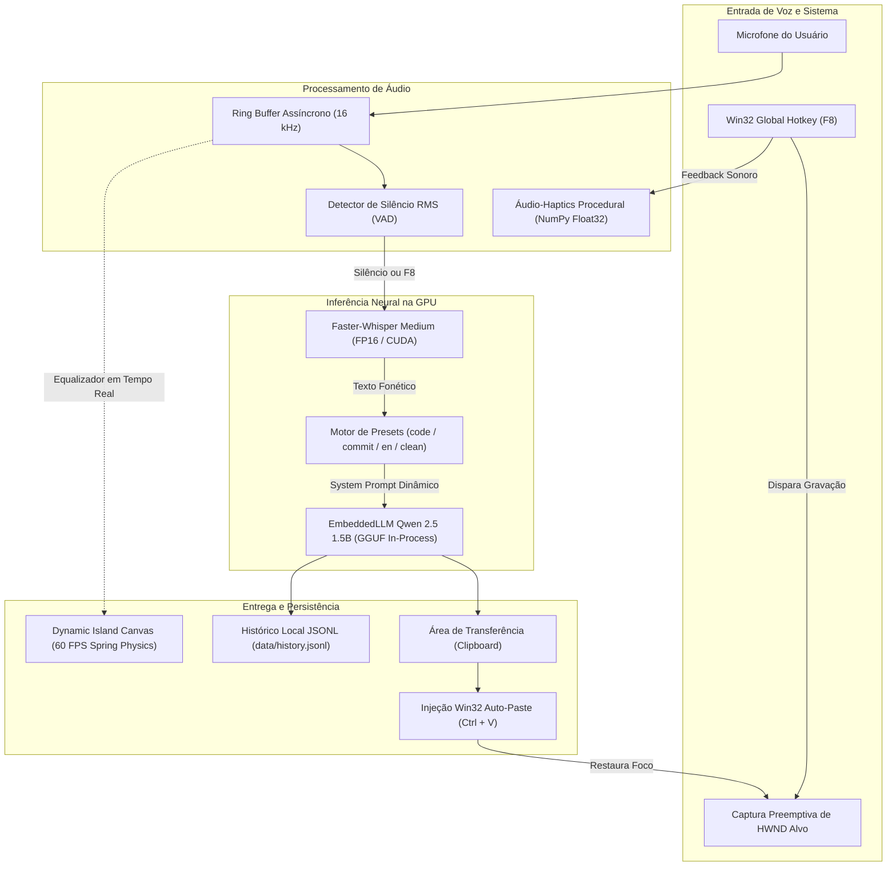

<p align="center">
  
</p>

<p align="center">
  
</p>

# Speech-to-Prompt Pipeline e Dynamic Island

> Transforme comandos de voz informais em prompts estruturados de alta densidade em menos de 300ms diretamente no cursor ativo (`Ctrl + V`), com interface flutuante inspirada no Liquid Glass da Apple e inferência 100% local acelerada na GPU.

<p align="center">
  <a href="https://www.python.org/"></a>
  <a href="https://developer.nvidia.com/cuda-toolkit"></a>
  <a href="https://github.com/SYSTRAN/faster-whisper"></a>
  <a href="https://github.com/abetlen/llama-cpp-python"></a>
  <a href="https://www.postgresql.org/"></a>
  
  <a href="LICENSE"></a>
</p>

---

## Por que o Speech-to-Prompt?

Digitar prompts longos, repletos de requisitos, contexto e restrições técnicas no meio do desenvolvimento quebra o estado de fluxo mental. O **Speech-to-Prompt Pipeline** foi concebido para resolver essa fricção na raiz:

- **⚡ Latência Instantânea (< 300ms):** Substituição de gargalos HTTP REST por um motor LLM in-process na GPU (`llama-cpp-python` com `Qwen 2.5 1.5B Instruct` em GGUF), reduzindo o tempo de resposta de 1.5s para 280ms.
- **🎯 Injeção Direta Auto-Paste (Win32):** Captura inteligente do handle (`HWND`) do seu editor (VS Code, Cursor, terminal ou navegador) no instante do clique e injeção automática de `Ctrl + V` ao concluir a fala.
- **🎛️ Perfis de Prompt Comutáveis (Presets):** Alterne entre comandos de código, mensagens de commit convencional, prompts em inglês ou transcrição bruta sem abrir janelas.
- **🔊 Áudio-Haptics Procedural Apple:** Síntese em tempo real de ondas senoidais puras em memória float32 (sino D5, acorde duplo C5 $\to$ E5 e cliques transitórios), sem depender de arquivos externos ou alertas do Windows.
- **🔒 100% Privado e Offline:** Todo o processamento fonético e de linguagem opera estritamente na VRAM da sua placa de vídeo local (RTX 4050 de 6 GB), com zero envio de dados para servidores na nuvem e zero custo por token.

---

## Como Usar no Dia a Dia

O modo desktop opera em segundo plano direto na memória RAM e GPU, sem janelas pretas de terminal:

<p align="center">
  
</p>

### Fluxo de Trabalho em 3 Passos:
1. **Acione o atalho:** Pressione <kbd>F8</kbd> em qualquer aplicativo. Um sino procedural suave confirma que o microfone está escutando.
2. **Fale livremente:** A pílula flutuante exibe a forma de onda reativa e a transcrição contínua em tempo real a 60 FPS com física de molas (Liquid Glass).
3. **Conclusão automática:** Ao pausar a fala por 3 segundos (VAD hands-free) ou pressionar <kbd>F8</kbd> novamente, o áudio é processado, o prompt é sintetizado pelo preset ativo e o texto cai imediatamente no seu cursor ativo (`Ctrl + V`).

### Tabela de Atalhos de Teclado

| Comando / Atalho | Ação | Descrição |
| :--- | :---: | :--- |
| <kbd>F8</kbd> | **Gravar / Concluir** | Alterna entre iniciar a captura de áudio e finalizar imediatamente o processamento. |
| <kbd>Tab</kbd> ou <kbd>P</kbd> ou <kbd>Shift</kbd> + <kbd>F8</kbd> | **Ciclar Preset** | Alterna ciclicamente entre os 4 perfis de prompt com feedback sonoro tátil (`tick`). |
| Clique no **Chip de Preset** | **Ciclar via Mouse** | Toque na cápsula interativa no estado ocioso da Dynamic Island para alternar o modo. |
| <kbd>Esc</kbd> | **Ocultar / Fechar** | Encerra a aplicação de forma limpa, desregistrando atalhos globais. |
| **Pausa de 3.0s** | **Auto-Stop VAD** | Detecção de silêncio adaptativa que encerra a gravação de modo mãos-livres. |

---

## Perfis de Prompt (Presets)

O motor conta com 4 perfis pré-calibrados para eliminar a necessidade de instruções repetitivas:

| Ícone | Preset | Finalidade Principal | Exemplo de Entrada Falada | Exemplo de Saída Gerada |
| :---: | :--- | :--- | :--- | :--- |
| 💻 | **`code`** *(Padrão)* | Comandos de IA estruturados para código e refatoração | *"faz uma função pra calcular fibonacci usando memoization"* | `Crie uma função em Python para calcular a sequência de Fibonacci utilizando memoization para otimizar o desempenho.` |
| 📝 | **`commit`** | Mensagens no padrão Conventional Commits | *"adicionei o suporte a auto paste no windows e testes"* | `feat(automation): add Win32 auto-paste injection with unit tests` |
| 🌐 | **`english`** | Prompts traduzidos e otimizados para LLMs em inglês | *"explique a diferença entre processo e thread de forma simples"* | `Explain the fundamental difference between a process and a thread in simple terms with concrete examples.` |
| 📄 | **`clean`** | Transcrição bruta limpa (Bypass direto sem LLM) | *"reunião com o time de engenharia às dez horas"* | `reunião com o time de engenharia às dez horas` |

---

## Início Rápido (Quickstart)

### 1. Clonar e Configurar Ambiente Virtual

```powershell
# Clone o repositório
git clone https://github.com/daniloofrs/speech-to-prompt-pipeline.git
cd speech-to-prompt-pipeline

# Crie e ative o ambiente virtual Python 3.12
python -m venv venv
.\venv\Scripts\Activate.ps1

# Instale os pacotes necessários
pip install -r requirements.txt
```

> [!TIP]
> Para habilitar aceleração nativa CUDA no `llama-cpp-python`, instale a roda pré-compilada:
> ```powershell
> pip install llama-cpp-python --extra-index-url https://abetlen.github.io/llama-cpp-python/whl/cu124
> ```

### 2. Configurar Variáveis de Ambiente

Copie o modelo de configuração:

```powershell
cp .env.example .env
```

### 3. Pré-carregar e Validar os Modelos Neurais

Execute o script de verificação atômica para baixar o Faster-Whisper Medium e o modelo GGUF para a GPU:

```powershell
python tools/preparar_modelos.py
```

### 4. Executar a Pílula Flutuante

```powershell
# Execução direta pelo terminal:
python -m src.live_pill

# Ou crie um atalho na Área de Trabalho com inicialização silenciosa em 1 clique:
powershell -ExecutionPolicy Bypass -File tools/criar_atalho.ps1
```

---

## Arquitetura do Sistema



---

## Configuração (`.env`)

Principais parâmetros disponíveis no arquivo de configuração:

| Variável | Padrão | Descrição |
| :--- | :---: | :--- |
| `LLM_BACKEND` | `embedded` | Motor do LLM: `embedded` (GGUF in-process na GPU), `direct` (Whisper puro) ou `ollama` (legado HTTP). |
| `LIVE_HOTKEY` | `F8` | Tecla de atalho global do Windows para alternar a gravação. |
| `DEFAULT_PRESET` | `code` | Perfil de prompt inicial ao abrir o app (`code`, `commit`, `english`, `clean`). |
| `AUTO_PASTE_ON_SUCCESS` | `false` | Se `true`, injeta automaticamente `Ctrl + V` na janela ativa após o processamento. |
| `AUDIO_HAPTICS` | `true` | Habilita os efeitos sonoros procedurais suaves de feedback tátil. |
| `AUTO_STOP_ON_SILENCE` | `true` | Habilita a finalização automática ao detectar silêncio contínuo. |
| `SILENCE_TIMEOUT_S` | `3.0` | Duração do silêncio (em segundos) para considerar a fala concluída. |
| `WHISPER_MODEL` | `medium` | Tamanho do modelo Whisper (`small`, `medium`, `large-v3`). |
| `WHISPER_DEVICE` | `cuda` | Dispositivo de computação (`cuda` para GPU NVIDIA ou `cpu`). |
| `EMBEDDED_MODEL_PATH` | `models/qwen2.5...` | Caminho do modelo `.gguf` para o motor embutido. |

---

## Trilha Batch e Governança com PostgreSQL

Além do assistente de produtividade instantâneo, o projeto conta com uma trilha em lote voltada para Engenharia de Dados e LLMOps, permitindo ingestão transacional, desduplicação por hash SHA-256 e auditoria de alucinações:

<p align="center">
  
</p>

```powershell
# Suba o banco de dados PostgreSQL 16 Alpine via Docker:
docker compose up -d

# Ingestão de áudio com verificação de idempotência (SHA-256):
python src/ingest.py data/samples/teste.wav

# Reescrita e curadoria com métricas de alucinação:
python src/rewrite.py
python src/evaluate.py --summary
```

---

## Dashboard Web e Refração Liquid Glass

Para monitoramento analítico, o repositório inclui um dashboard web com efeito de refração óptica inspirado no design Liquid Glass da Apple, utilizando filtros SVG nativos (`<feDisplacementMap>` e `<feGaussianBlur>`):

<p align="center">
  
</p>

```powershell
# Inicie o dashboard analítico no navegador:
python src/dashboard.py --open
```

---

## Garantia de Qualidade e Testes (QA)

A robustez da solução é assegurada por suítes completas de testes unitários, testes de regressão de renderização física e simulação de áudio:

```powershell
# 1. Executar todos os 38 testes unitários (TDD):
python -m unittest discover -s tests -p "test_*.py"

# 2. Testar integração completa dos novos recursos da Pílula Live:
python tools/test_live_pill_features.py

# 3. Validar renderização visual de todos os 5 estados da Dynamic Island:
python tools/test_render_all_states.py

# 4. Validar o algoritmo de detecção de silêncio adaptativo (VAD):
python tools/test_vad_autostop.py
```

---

## Estrutura do Repositório

```text
speech-to-prompt-pipeline/
├── assets/                       # Banners, logotipos, ícones e diagramas visuais
│   ├── app-icon.ico              # Ícone oficial de alta definição para Windows
│   ├── app-icon.png              # Logo squircle com sombra óptica
│   ├── hero-banner.png           # Banner panorâmico oficial
│   ├── liquid-glass-macro.png    # Detalhe óptico da refração Liquid Glass
│   ├── pipeline-isometric.png    # Render isométrico da arquitetura
│   └── setup-desktop.png         # Demonstração real no setup de desenvolvimento
├── data/
│   └── history.jsonl             # Log persistente e atômico do histórico de prompts
├── sql/                          # Scripts DDL e migrações do PostgreSQL
├── src/
│   ├── audio_haptics.py          # Síntese procedural de áudio senoidal em memória (Float32)
│   ├── auto_paste.py             # Captura de HWND Win32 e injeção à prova de falhas (Ctrl+V)
│   ├── config.py                 # Centralização de configurações e variáveis de ambiente
│   ├── dashboard.py              # Dashboard analítico web com shader óptico Liquid Glass
│   ├── database.py               # Conexão psycopg v3 e operações de banco de dados
│   ├── embedded_llm.py           # Motor GGUF in-process na GPU via llama-cpp-python (<300ms)
│   ├── evaluate.py               # Avaliação e curadoria de alucinações do modelo
│   ├── history.py                # Módulo de persistência e consulta do histórico JSONL
│   ├── ingest.py                 # Pipeline batch com Faster-Whisper e hash SHA-256
│   ├── live_pill.py              # Dynamic Island flutuante a 60 FPS com física de molas
│   ├── presets.py                # Catálogo de perfis de prompt (código, commit, inglês, clean)
│   └── rewrite.py                # Módulo de reescrita e parse estruturado
├── tests/                        # 38 testes unitários cobrindo todos os módulos
├── tools/                        # Ferramentas de benchmark, testes visuais e instaladores
│   ├── criar_atalho.ps1          # Script para gerar atalho desktop oficial
│   ├── preparar_modelos.py       # Pré-carregamento e verificação atômica dos modelos
│   ├── test_live_pill_features.py # Teste de integração dos recursos avançados
│   ├── test_render_all_states.py # Validação de desenho dos 5 estados de interface
│   └── test_vad_autostop.py      # Verificação de corte automático de silêncio
├── docker-compose.yml            # Infraestrutura do PostgreSQL 16 Alpine
├── requirements.txt              # Dependências do projeto
├── LICENSE                       # Licença MIT
└── README.md                     # Documentação oficial do projeto
```

---

## Contribuindo

Contribuições são muito bem-vindas! Se você deseja reportar um bug, sugerir um novo perfil de prompt ou aprimorar os algoritmos de renderização:

1. Faça um Fork do projeto.
2. Crie uma branch para a sua feature (`git checkout -b feature/novo-preset`).
3. Certifique-se de que todos os testes passem (`python -m unittest discover -s tests -p "test_*.py"`).
4. Faça commit das alterações no padrão Conventional Commits (`git commit -m "feat(presets): add markdown doc preset"`).
5. Envie um Pull Request detalhado.

---

## Licença e Autor

Distribuído sob a licença **MIT**. Consulte o arquivo [`LICENSE`](LICENSE) para mais detalhes.

Desenvolvido com foco em engenharia de alta performance por **Danilo Fernandes**:
- **GitHub:** [@daniloofrs](https://github.com/daniloofrs)
