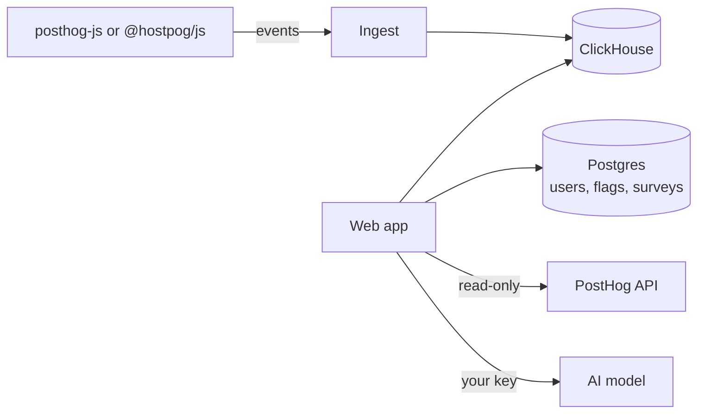

<p align="center">
  <picture>
    <source media="(prefers-color-scheme: dark)" srcset="docs/assets/wordmark-dark.svg">
    
  </picture>
</p>

<p align="center">
  <b>The open source PostHog you host yourself.</b><br>
  Product analytics with an AI analyst built in. Move off PostHog by changing one line.
</p>

<p align="center">
  <a href="LICENSE"></a>
  <a href="https://github.com/dhanush17-tech/hostpog/actions/workflows/ci.yml"></a>
  
  <a href="CONTRIBUTING.md"></a>
</p>

<p align="center">
  <a href="#self-host-in-one-command">Self-host</a> ·
  <a href="#move-off-posthog">Move off PostHog</a> ·
  <a href="#features">Features</a> ·
  <a href="docs/next-steps.md">Roadmap</a> ·
  <a href="CONTRIBUTING.md">Contributing</a>
</p>

<p align="center">
  
</p>

## Why

Product analytics bills grow with every event, and most teams use a fraction of what they pay for. HostPog runs the
parts you actually use on your own box: your data stays with you, and the AI analyst uses your own model key.

- **One command to self-host.** Postgres, ClickHouse, ingest and the app, with migrations and generated secrets.
- **Keep posthog-js.** Point `api_host` at HostPog and your events, flags and surveys keep working.
- **Ask in plain English.** The assistant runs the queries, shows the chart behind every answer, and can set up flags,
  experiments, surveys and workflows. Anything it creates starts switched off.

## Move off PostHog

<p align="center">
  
</p>

Connect PostHog read-only, then follow five steps: see what moves over, change one line, copy your history, compare the
numbers, switch off. Nothing changes for your users until the last step, and that one can be undone too.

```diff
 posthog.init("<your project token>", {
-  api_host: "https://us.i.posthog.com",
+  api_host: "https://hostpog.example.com/ph",
 })
```

## Self-host in one command

Requirements: Docker with Compose.

```bash
git clone https://github.com/dhanush17-tech/hostpog.git && cd hostpog
./hostpog up
```

Open http://localhost:3000. Manage it with `./hostpog status | logs | backup | update | down`.

> [!IMPORTANT]
> Back up `deploy/.env`. It holds the master key that encrypts stored credentials, and the database passwords.

Ingest handles about 4,900 events/s on a single 2-vCPU box ([load test](docs/loadtest.md)).

## Features

| | |
|---|---|
| **Product analytics** | Trends, funnels with drill-down, retention, web analytics, events, people, sessions, dashboards |
| **AI analyst** | Ask questions in plain English, see each step and the chart behind the answer, keep conversations per user |
| **Feature flags** | Rollouts, person conditions, variants, payloads. Bucketing matches PostHog, so users keep their variant |
| **Experiments** | Bayesian chance-to-win with intervals; launch, stop and ship |
| **Surveys** | NPS, rating, choice and open text, shown by posthog-js's own widget |
| **LLM analytics** | Cost, tokens, latency and errors by model and user, from `$ai_generation` events |
| **Logs** | OTLP/HTTP or JSON, search and filters, linked to users, 30-day retention |
| **Workflows** | Event to Slack or webhook, with retries |
| **Teams** | Workspaces, roles, invite links, audit log |
| **Bring your own model** | OpenAI, Anthropic, Gemini, OpenRouter, or a local model through Ollama |

Not here yet: session replay playback, error tracking, cohorts. See the [roadmap](docs/next-steps.md).

<table>
  <tr>
    <td></td>
    <td></td>
  </tr>
  <tr>
    <td></td>
    <td></td>
  </tr>
</table>

## How it fits together



## Develop

Requirements: Node 22+, pnpm 10, Docker.

```bash
cp .env.example .env
echo "HOSTPOG_MASTER_KEY=$(openssl rand -base64 32)" >> .env
echo "BETTER_AUTH_SECRET=$(openssl rand -base64 32)" >> .env

pnpm install
pnpm infra:up     # Postgres, ClickHouse, Redis
pnpm dev          # runs migrations, then web on :3000 and ingest on :3001
```

Before a pull request: `pnpm typecheck`, `pnpm test`, `pnpm --filter @hostpog/web build`, and `pnpm test:e2e` for UI
changes.

<details>
<summary>Repository layout</summary>

```
apps/web            Next.js app: marketing, docs, product UI, /api/v1
apps/ingest         Fastify ingestion service
packages/contracts  Zod schemas: metric DSL, envelopes, ingest payloads
packages/analytics  query compiler and result shaping
packages/posthog    read-only PostHog client and provider
packages/native     ClickHouse schema, ingest pipeline, flags, surveys, logs
packages/ai         model adapters, agent tools, assistant
packages/db         Drizzle schema and migrations, secret encryption
packages/sdk-js     @hostpog/js
packages/sdk-node   @hostpog/node
deploy/             self-host compose file
docs/               architecture, PostHog contract, load test, screenshots
```

</details>

## Telemetry

`./hostpog up` asks once whether to share anonymous usage stats. If you say yes, the ingest service sends one event a
day. Here is everything in it ([source](apps/ingest/src/telemetry.ts)):

| Field | Example |
|---|---|
| install id: a one-way hash, not linked to you | `61e68c12…` |
| version, OS, CPU architecture | `0.1.0`, `linux`, `x64` |
| team size, workspaces, projects (buckets) | `6-20`, `1`, `2-3` |
| events per day (bucket) | `10001-100000` |
| which features are on | flags, experiments, surveys, workflows, AI, logs: yes or no |

Never sent: your events, users, emails, names, URLs or keys. Turn it off any time with `HOSTPOG_TELEMETRY=0` in
`deploy/.env`, then `./hostpog update`.

## Contributing

Issues and pull requests are welcome. Start with [CONTRIBUTING.md](CONTRIBUTING.md). For security reports, see
[SECURITY.md](SECURITY.md) and do not open a public issue.

## License

MIT. See [LICENSE](LICENSE) and [THIRD_PARTY_NOTICES.md](THIRD_PARTY_NOTICES.md).

HostPog is an independent project. It is not affiliated with or endorsed by PostHog Inc.
