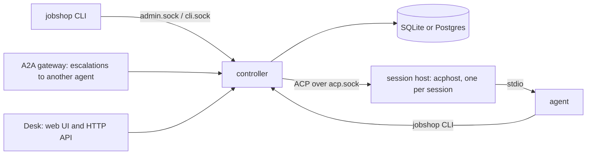

# jobshop

[](https://github.com/elee1766/jobshop/actions/workflows/ci.yml)
[](https://pkg.go.dev/github.com/elee1766/jobshop)
[](LICENSE)
[](go.mod)

> Agents: start at [llm/README.md](llm/README.md).

Jobshop is a workflow execution framework: it splits work into tickets and
hands each one to a workable unit, most often an agent session over the
Agent Client Protocol (ACP). It does not try to make the model better. It
handles what a model cannot do on its own: keep state across sessions,
react to outside events, split a large task into steps a model can
complete, and route each step to a fresh session with the right context.
It borrows its ideas from Gas Town/Gas City, Hermes/OpenClaw and
jcode/opencode.

Read [MANIFESTO.md](MANIFESTO.md) before using jobshop. It explains why
each feature exists, and the tool is easier to use well once you know that.

In practice: one Go binary and a SQLite (or Postgres) store.
Agents (any acp, jcode, claude code, gemini cli, etc) claim
tickets, work in their own git worktree and sandbox, and close them.
Workflows chain steps across pools, and humans are pulled in where needed.
Jobshop develops itself this way, taking GitHub and Linear issues to
reviewed, merged pull requests.

## Features




- [**Tickets**](docs/data-model.md): one graph of work items with blocking edges, claims and comments.
- [**Pools and sessions**](docs/running.md#concepts): a pool runs agent sessions, each in its own worktree and [sandbox](docs/isolation.md).
- [**Workflows and runs**](docs/packs.md#the-parts): a run is one ticket per step, each step in a pool, with retries and escalation.
- [**GitHub and Linear intake**](docs/ingest.md): webhooks and polling turn issues and comments into tickets; PR review and merge steps ship in [`packs/github`](packs/github/README.md).
- [**Triggers**](docs/notes/26-triggers.md): create tickets or start runs from counts, cron, events, Starlark handlers or scan signals.
- [**Packs**](docs/packs.md): directories of pools, prompts, triggers and workflows you write.
- [**Desk and A2A**](docs/notes/202-desk.md): a web UI and HTTP API over the admin socket, and an [A2A gateway](docs/notes/547-a2a-gateway.md) that hands escalations to another agent.

Goals: only features that cover something a model cannot do.
a small core you own; behavior in packs, not the core.
agents sandboxed with no long-lived keys; sessions that
survive restarts and deploys; humans see what waits on
them and can step in anywhere.

## Example flows

Shipped in [`packs/`](packs/):

- **Issue to deployed change** ([`packs/github`](packs/github/README.md) `pr-work`):
  an issue starts a run. `implement` opens a PR, `review-merge` reviews and
  merges it, and a post-merge step checks the deploy. Failed steps retry,
  then escalate to a human.
- **Triage** (`triage`): scan findings (unclaimed tickets, silent sessions,
  green PRs nobody merged) each start a diagnose run that fixes what it can.
- **Red master** (`ci-repair`): a failing master SHA starts one repair run, keyed by the SHA.
- **Linear intake** ([`packs/github`](packs/github/README.md#linear-instance)):
  an eligible Linear issue starts a run; comments flow back to the ticket.
- **Learning from past work** ([`packs/selfdev`](packs/selfdev/README.md)
  `curate`/`evaluate`): agents record corrections and failures, and a
  curator turns them into learnings later sessions recall.

## Quick start
Linux binaries are on [Releases](https://github.com/elee1766/jobshop/releases), or `nix run github:elee1766/jobshop/v<version>` ([notes](docs/notes/644-release.md)).
```
nix profile add github:elee1766/jobshop
jobshop init ./root
```

This writes `root/jobshop.yaml` and `root/pack.yaml`. To install from source,
follow [Develop](#develop). `go install ...@latest` alone cannot build the Desk
assets, which are generated rather than stored in Git.

`root/jobshop.yaml` selects the root pack with `pack: pack.yaml`.
In `root/pack.yaml`, load one reusable pack ([`packs/agent`](packs/agent/pack.yaml)):

```yaml
default_project: js
projects: {js: {}}
agents:
  jcode: {command: jcode, args: [acp]}
packs:
  - path: /path/to/jobshop/packs/agent
    vars: {checkout: /srv/widget, repo: you/widget, agent: jcode}
```

```
cd root && jobshop serve
jobshop run start pr-work --var task="add a --verbose flag" --key verbose
jobshop desk                 # web UI on 127.0.0.1:7480
```

The rest is in [docs/running.md](docs/running.md).

## Docs

| Doc | What |
| --- | --- |
| [docs/configuration/](docs/configuration/README.md) | Service YAML, CUE packs, Starlark hooks and migration |
| [docs/packs.md](docs/packs.md) | Legacy YAML pack authoring and existing example packs |
| [docs/running.md](docs/running.md) | Concepts, running a root, config and secrets |
| [docs/isolation.md](docs/isolation.md) | Sandbox, sockets, credentials, hooks, limits |
| [docs/ingest.md](docs/ingest.md) | Webhooks and generic ingest |
| [docs/nixos.md](docs/nixos.md) | NixOS module |
| [docs/desk-plugins.md](docs/desk-plugins.md) | Desk API client and migration from plugins |
| [docs/plan.md](docs/plan.md) | Design archive up to 2026-11-05 (frozen); later decisions are on [#569](https://github.com/elee1766/jobshop/issues/569) |
| [docs/layout.md](docs/layout.md) | Packages, dependencies, build and deployment |
| [docs/data-model.md](docs/data-model.md) | Tables and queries |
| [docs/notes/](docs/notes/) | Behavior as built, one note per change |
| [docs/verify/](docs/verify/) | Runbook checks against a live host |
| [`target` issues](https://github.com/elee1766/jobshop/issues?q=is%3Aopen+label%3Atarget) | Progress |

## Develop

Use Go and Node.js 22.12+ (or `nix develop`), then build the embedded frontend
before Go:

```sh
npm --prefix ui ci
npm --prefix ui run build
go build ./... && go vet ./... && go test ./... && golangci-lint run ./...
go install ./cmd/jobshop
```

Rebuild the frontend after UI changes. `pkg/transport/desk/dist` is ignored build output.
`nix build .#jobshop` builds both parts with a cached frontend derivation.
Contributor rules for people and agents (plain SQL store queries, Desk `dist`, Nix
`vendorHash`) are in [AGENTS.md](AGENTS.md); PR titles are conventional
commits ([CONTRIBUTING.md](CONTRIBUTING.md)).

## Musings

i wonder if there is a way to compile a provable graph of agent handoff interaction to prompt files.

## License

AGPL-3.0 ([LICENSE](LICENSE)); `packs/` and `examples/` are Apache-2.0, so
packs and plugins built from them can use any license.
