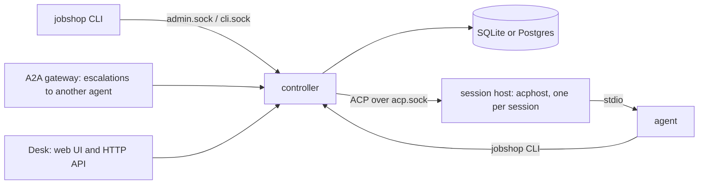

# jobshop

[](https://github.com/elee1766/jobshop/actions/workflows/ci.yml)
[](https://pkg.go.dev/github.com/elee1766/jobshop)
[](LICENSE)
[](go.mod)

> Agents: start at [llm/README.md](llm/README.md).

Jobshop is self-hosted orchestration for AI coding agents: a multi-agent
work queue that takes GitHub and Linear issues to reviewed, merged pull
requests. It drives agents over the Agent Client Protocol (ACP): jcode,
Claude Code (through an ACP adapter) or Gemini CLI (its ACP mode). One Go
binary and a SQLite (or Postgres) store replace a hosted agent platform or
a hand-built multi-agent setup (Gas City style) with something you run and
read yourself. Agents claim tickets, work in their own git worktree and
sandbox, and close them; workflows chain steps across pools, and humans
are pulled in only where needed. Jobshop develops itself this way.

## Features



- [**Tickets**](docs/data-model.md): one graph of work items with blocking edges, claims and comments.
- [**Pools and sessions**](docs/running.md#concepts): a pool runs agent sessions, each in its own worktree and [sandbox](docs/isolation.md).
- [**Workflows and runs**](docs/packs.md#the-parts): a run is one ticket per step, each step in a pool, with retries and escalation.
- [**GitHub and Linear intake**](docs/ingest.md): webhooks and polling turn issues and comments into tickets; PR review and merge steps ship in [`packs/github`](packs/github/README.md).
- [**Triggers**](docs/notes/26-triggers.md): create tickets or start runs from counts, cron, shell checks or stall signals.
- [**Packs**](docs/packs.md): directories of pools, prompts, triggers and workflows you write.
- [**Desk and A2A**](docs/notes/202-desk.md): a web UI and HTTP API over the admin socket, and an [A2A gateway](docs/notes/547-a2a-gateway.md) that hands escalations to another agent.

Goals: a small core you own; behavior in packs, not the core; agents
sandboxed with no long-lived keys; sessions that survive restarts and
deploys; humans see what waits on them and can step in anywhere.

## Example flows

Shipped in [`packs/`](packs/):

- **Issue to deployed change** ([`packs/github`](packs/github/README.md) `pr-work`):
  an issue starts a run. `implement` opens a PR, `review-merge` reviews and
  merges it, and a post-merge step checks the deploy. Failed steps retry,
  then escalate to a human.
- **Stalled work** (`stall-check`): unclaimed tickets, silent sessions and
  green PRs nobody merged each start a diagnose run that fixes what it can.
- **Red master** (`ci-repair`): a failing master SHA starts one repair run, keyed by the SHA.
- **Linear intake** ([`packs/github`](packs/github/README.md#linear-instance)):
  an eligible Linear issue starts a run; comments flow back to the ticket.
- **Learning from past work** ([`packs/selfdev`](packs/selfdev/README.md)
  `curate`/`evaluate`): agents record corrections and failures, and a
  curator turns them into learnings later sessions recall.

Planned: **escalation to a human or another agent** (#547).

## Quick start
Linux binaries are on [Releases](https://github.com/elee1766/jobshop/releases), or `nix run github:elee1766/jobshop/v<version>` ([notes](docs/notes/644-release.md)).
```
go install github.com/elee1766/jobshop/cmd/jobshop@latest   # or: nix build github:elee1766/jobshop
jobshop init ./root          # writes root/jobshop.yaml
```

Point `root/jobshop.yaml` at one pack ([`packs/agent`](packs/agent/pack.yaml)):

```yaml
default_project: js
projects: {js: {}}
agents:
  jcode: {command: jcode, args: [acp]}
packs:
  - path: /path/to/jobshop/packs/agent
    vars: {checkout: /srv/widget, repo: you/widget, agent: jcode}
```

```
cd root && jobshop serve
jobshop run start pr-work --var task="add a --verbose flag" --key verbose
jobshop desk                 # web UI on 127.0.0.1:7480
```

The rest is in [docs/running.md](docs/running.md).

## Docs

| Doc | What |
| --- | --- |
| [docs/packs.md](docs/packs.md) | Writing a pack, and the example packs |
| [docs/running.md](docs/running.md) | Concepts, running a root, config and secrets |
| [docs/isolation.md](docs/isolation.md) | Sandbox, sockets, credentials, hooks, limits |
| [docs/ingest.md](docs/ingest.md) | Webhooks and generic ingest |
| [docs/nixos.md](docs/nixos.md) | NixOS module |
| [docs/desk-plugins.md](docs/desk-plugins.md) | Writing a Desk plugin, with `examples/desk-plugins/csv-table` |
| [docs/plan.md](docs/plan.md) | Design archive up to 2026-11-05 (frozen); later decisions are on [#569](https://github.com/elee1766/jobshop/issues/569) |
| [docs/layout.md](docs/layout.md) | Packages, dependencies, build and deployment |
| [docs/data-model.md](docs/data-model.md) | Tables and queries |
| [docs/notes/](docs/notes/) | Behavior as built, one note per change |
| [docs/verify/](docs/verify/) | Runbook checks against a live host |
| [`target` issues](https://github.com/elee1766/jobshop/issues?q=is%3Aopen+label%3Atarget) | Progress |

## Develop

`go build ./... && go vet ./... && go test ./... && golangci-lint run ./...`.
Contributor rules for people and agents (sqlc, Desk `dist`, Nix
`vendorHash`) are in [AGENTS.md](AGENTS.md); PR titles are conventional
commits ([CONTRIBUTING.md](CONTRIBUTING.md)).

## License

AGPL-3.0 ([LICENSE](LICENSE)); `packs/` and `examples/` are Apache-2.0, so
packs and plugins built from them can use any license.
