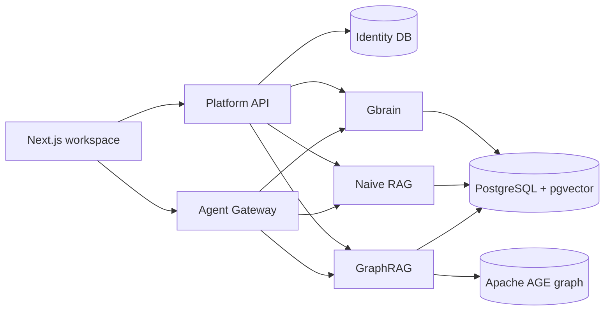

# CompanyBrain

CompanyBrain is a local-first knowledge workspace. Upload company material once, then query it
through three different retrieval engines — document RAG, a relationship graph, or a page-based
knowledge brain — and get answers with citations.

**Project page: [aiengstore.com/projects/company-brain](https://aiengstore.com/projects/company-brain).**
This repository is the open-source version of CompanyBrain and the code stays here. The project page
carries the write-up — the retrieval benchmarks, the GraphRAG gaps and the MCP wiring, each claim
traced to a file and a line — next to the rest of the collection.


## Quick start

Prerequisites:

- [Bun](https://bun.sh) and Node.js 20+.
- [uv](https://docs.astral.sh/uv/) for the two Python retrieval modules.
- PostgreSQL 17 with the `pgvector` extension, plus Apache AGE for the GraphRAG engine.
- An OpenAI-compatible embedding endpoint and a chat model endpoint.

```sh
cp .env.example .env    # fill in the database URLs and model/embedding credentials
bun install && uv sync --project modules/traditional-rag && uv sync --project modules/graph-rag
bun run postgres:dev && bun run db:init && bun run admin:create && bun run dev:all
```

Open `http://localhost:3000` and sign in with the admin account from `.env`.

What still needs separate configuration:

- `bun run postgres:dev` is a macOS helper. On Linux, start PostgreSQL yourself with `pgvector` and
  `AGE` installed and run `bun run db:init` against it.
- MinerU cloud OCR is optional; set `MINERU_*` in `.env` to enable it for scanned PDFs.
- Deployment details (systemd, production database, model settings) are in
  [docs/DEPLOYMENT.md](docs/DEPLOYMENT.md).

## GraphRAG MCP server

The GraphRAG module also runs as an MCP server over **stdio**. Run it from the repository root
with the same Python environment the workspace uses:

```sh
export GRAPH_RAG_DATABASE_URL=postgres://<local-user>@localhost:5432/graph_rag_db
export GRAPH_RAG_MCP_TOKEN=<token from the calling session>
uv run --project modules/graph-rag python -m graph_rag.mcp.server
```

`GRAPH_RAG_MCP_TOKEN` is required and process scoped; the server also reads `FF_USER_ID`,
`FF_USERNAME` and `FF_IS_ADMIN` from the environment. The Agent Gateway starts one stdio process per
user session and injects these variables.

Tools exposed: `graph_search`, `graph_list_sources`, `graph_get_document`.

## What it does

- **Three retrieval engines in one workspace.** Naive RAG (pgvector embeddings fused with keyword
  search), GraphRAG (LightRAG entity/relationship extraction stored in PostgreSQL + Apache AGE), and
  a Gbrain-style nano brain (pages, chunks, facts, typed links and dream maintenance).
- **Cited answers.** Every answer returns the source evidence it was built from, and the workspace
  shows document and graph context next to the answer.
- **Admin console.** Manage sources, knowledge bases, users, model providers and retrieval settings;
  upload and re-index material without touching the database.
- **Retrieval evaluation loop.** The repository ships an English demo corpus, golden query sets and
  a benchmark harness so a retrieval change can be measured before it ships.

## Architecture



- `apps/api` is the platform API (identity, routing, module dispatch); `apps/web` is the workspace;
  `apps/agent-gateway` runs agent conversations and MCP tool orchestration.
- `modules/nano-brain`, `modules/traditional-rag` and `modules/graph-rag` are independent retrieval
  services, each with its own HTTP API and database.
- One PostgreSQL instance hosts five databases: identity, the three engines, and agent checkpoints.

Further reading: [architecture](docs/ARCHITECTURE.md), [service boundaries](docs/SERVICE_BOUNDARIES.md),
[benchmarks](docs/BENCHMARKS.md), [platform API](docs/API.md).

## License

MIT, see [LICENSE](LICENSE). No third-party source code is vendored in this repository; the
dependencies installed from npm and PyPI keep their own licenses. See [NOTICE](NOTICE).
