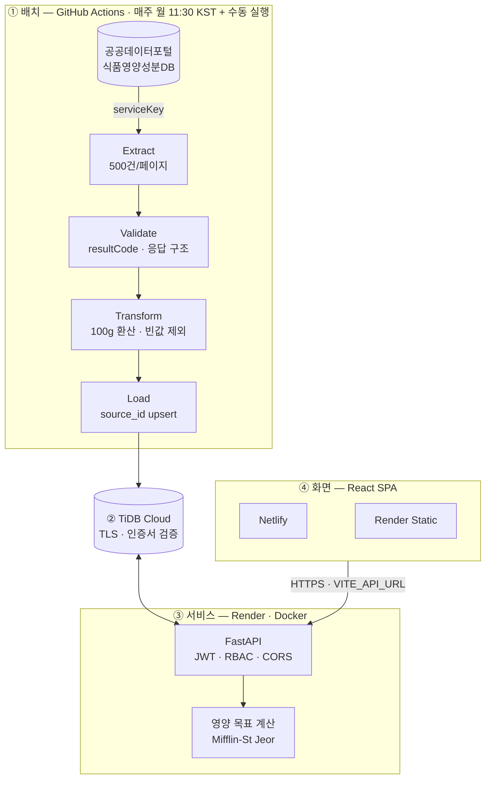

<div align="center">

# carepick

**공공데이터 식품영양 정보를 자동으로 모으고, 신체 정보로 개인 목표를 계산해<br>오늘의 식단이 목표 대비 어디쯤인지 보여 주는 헬스케어 웹 서비스**

1인 풀스택 개발 · 이오리

[](requirements.txt)
[](backend/main.py)
[](backend/models.py)
[](frontend/package.json)
[](frontend/vite.config.js)
[](frontend/src/style.css)
[](backend/db.py)
[](Dockerfile)

[](https://github.com/fsclass-n/carepick/actions/workflows/sync-foods.yml)
[](tests/test_api.py)
[](https://carepick-api.onrender.com/docs)
[](https://carepick.netlify.app)
[](https://github.com/fsclass-n/carepick)
[](https://github.com/fsclass-n/carepick/commits/main)
[](https://github.com/fsclass-n/carepick/issues)

### [포트폴리오 사이트](https://fsclass-n.github.io/carepick/) · [라이브 서비스](https://carepick.onrender.com) · [API 문서](https://carepick-api.onrender.com/docs) · [▶ 10분 발표·시연 영상](https://fsclass-n.github.io/carepick/#theater)

<sub>라이브 서비스 로그인 화면의 <b>일반 사용자 / 관리자</b> 테스트 계정 버튼으로 바로 체험할 수 있습니다. 무료 플랜이라 첫 접속 시 약 30초가 걸릴 수 있습니다.</sub>

</div>

---

## At a Glance

| 지표 | 값 | 근거 |
| --- | --- | --- |
| 공공데이터 식품 적재 | **1,095개** (원본 5,000행 정제) | `rpa/sync_foods.py` · TiDB `foods` |
| API 엔드포인트 | **18개** (인증 · 영양 · 식단 · 식품 · 관리자 · OAuth) | `backend/main.py` |
| 백엔드 자동 테스트 | **10개 통과** | `tests/test_api.py` |
| 배포 | **분리 배포 3곳** — Netlify · Render(Docker) · GitHub Actions(배치) | `netlify.toml` · `render.yaml` · `.github/workflows/` |

## 핵심 기능

- **공공데이터 자동 동기화** — 식품의약품안전처 식품영양성분DB API를 GitHub Actions가 매주 수집해 100g 기준으로 정제·적재합니다.
- **식단 기록** — 음식 이름 2글자 이상 입력 시 공공데이터를 검색(300ms 디바운스)하고, 선택하면 영양값이 자동으로 채워집니다.
- **개인 맞춤 영양 목표** — 나이·성별·키·몸무게·활동량으로 Mifflin-St Jeor 기초대사량 → 하루 열량 → 탄·단·지 목표를 계산합니다.
- **영양 리포트** — 목표 대비 오늘의 진행률, 최근 7일 열량 차트, 섭취 상태에 따른 안내 문구를 제공합니다.
- **역할 기반 권한(RBAC)** — 일반 사용자 / 관리자 메뉴와 API를 서버에서 분리하고, 공용 테스트 관리자는 실제 회원 정보를 가려 보여 줍니다.
- **인증** — 이메일(Argon2 · 비밀번호 정책), Google · Naver · Kakao OAuth, 원클릭 테스트 계정.

> 영양 목표는 추정치이며 의료적 진단·처방을 대신하지 않습니다.

---

## Architecture & Data Pipeline



**흐름 요약**

1. **수집(배치)** — 서비스 서버가 아닌 GitHub Actions에서 실행합니다. 무료 플랜 서버가 수집 작업 때문에 느려지거나 재시작되지 않도록 배치와 서비스를 분리했습니다.
2. **정제** — 공공데이터의 1회 제공량 기준 영양값을 100g 기준으로 환산합니다. 영양값이 빈 행은 0으로 채우지 않고 제외합니다("지방 0g 음식" 같은 틀린 정보 방지).
3. **저장** — 식품코드(`source_id`, UNIQUE) 기준 upsert로, 같은 작업을 여러 번 실행해도 중복이 생기지 않습니다.
4. **서비스** — 사용자가 검색해 기록한 식단과 프로필로 목표 대비 섭취량을 계산해 리포트로 보여 줍니다.

---

## Key Technical Challenges & Solutions

### 1. 공공데이터 수집 — 크롤링 대신 공식 API, 그리고 API 이관 대응

- **결정** — 공식 API가 있는 출처는 브라우저 자동화(Playwright 등)로 화면을 긁지 않습니다. 사이트 개편에 깨지지 않고, 이용 약관 문제도 없으며, 브라우저 없이 가볍게 실행됩니다.
- **문제** — 식품안전나라 서비스(`I2790`)가 공공데이터포털로 이관되며 **인증 방식**(URL 경로 → `serviceKey` 쿼리), **응답 구조**(`I2790.row` → `body.items`), **페이지 한도**가 한꺼번에 바뀌었습니다.
- **해결** — 추측으로 고치지 않고 실제 응답부터 확인했습니다. 한도는 문서 대신 **실측**으로 확정했습니다(1,000건 요청 → 오류 코드 11, 500건 정상). 포털이 주는 인코딩된 키가 두 번 인코딩되지 않도록 `unquote` 후 전달합니다.
- **안정성** — `resultCode != "00"`, 응답 구조 불일치, 마지막 페이지 전의 짧은 페이지, 적재 가능한 행 0건을 모두 **실패로 처리**해 조용히 빈 데이터가 쌓이지 않게 했습니다. 예외 메시지에 API 키가 섞이지 않도록 실패 로그에는 원인만 남깁니다.

### 2. 주기 동기화 · 중복 처리 · 정제 전략

```python
# rpa/sync_foods.py — 페이지 단위 일괄 upsert (행마다 SELECT 하지 않음)
foods = {}
for row in rows:
    data = normalize(row)                      # 100g 환산 · g 단위만 · 빈값/NaN/음수 제외
    if data is not None:
        foods[data["source_id"]] = data        # 페이지 내부 중복 제거
with SessionLocal() as db:
    existing = {
        food.source_id: food
        for food in db.scalars(select(Food).where(Food.source_id.in_(foods))).all()
    } if foods else {}                         # 페이지당 조회 1회
    for source_id, data in foods.items():
        if source_id in existing:
            for field, value in data.items():
                setattr(existing[source_id], field, value)
        else:
            db.add(Food(**data))
    db.commit()
```

- **주기**: `cron: "30 2 * * 1"`(매주 월요일) + `workflow_dispatch` 수동 실행. 수집 범위는 저장소 변수 `SYNC_MAX_PAGES`로 조절합니다.
- **멱등성**: `source_id` UNIQUE 제약 + upsert → 재실행·중복 실행에도 같은 결과.
- **N+1 제거**: 행마다 조회하던 방식을 페이지당 1회 `IN` 조회로 바꿨습니다.
- **정제 규칙**: g 단위만 채택(mL 제외) · 100g 기준 환산 · 빈값/NaN/음수 제외. 첫 10페이지 기준 **5,000행 → 1,095행**. 양보다 정확성이 중요한 도메인이라는 판단입니다.

### 3. 개인 맞춤 목표 산출 로직과 "왜 이 목표인가"

```text
기초대사량(BMR) = 10 × 체중(kg) + 6.25 × 키(cm) − 5 × 나이 + (남 +5 / 여 −161)
하루 열량       = BMR × 활동계수(1.2 · 1.375 · 1.55 · 1.725) → 10kcal 단위 반올림
3대 영양소      = 탄수화물 50% ÷ 4 · 단백질 20% ÷ 4 · 지방 30% ÷ 9 (kcal/g)
```

- **예시(테스트로 고정)**: 30세 여성 · 165cm · 60kg · 가벼운 활동 → **1,820kcal · 탄 228g · 단 91g · 지 61g**.
- **입력 검증**: 18~100세, 키 100~230cm, 몸무게 30~300kg만 허용합니다(공식이 성인 기준). 프로필이 없으면 일반 성인 예시(2,000kcal)를 쓰고 `personalized: false`로 구분합니다.
- **설명 가능성**: 리포트는 목표 대비 실제 섭취량(예: 단백질 부족)을 근거로 안내 문구를 고릅니다. 모든 분석 화면에 "추정치" 고지를 둡니다.

### 4. 권한과 계정 보안 — 화면이 아니라 서버가 막는다

- **RBAC**: 모든 관리자 API가 토큰의 역할을 다시 검사합니다. 일반 사용자의 관리자 API 호출은 `403`, `/admin` 화면 접근은 "관리자 전용 화면"으로 안내합니다.
- **공용 테스트 관리자**: 누구나 버튼 하나로 관리자가 될 수 있으므로 실제 회원의 이름·이메일은 **마스킹**하고, 권한 변경은 테스트 계정끼리만 허용합니다. 실제 회원 변경 시 서버가 `403`을 반환합니다(운영 환경에서 검증).
- **관리자 소실 방지**: 본인 권한 변경과 마지막 실제 관리자 강등을 차단합니다.
- **OAuth**: `state` 쿠키(HttpOnly)로 CSRF를 막고, 토큰을 URL에 노출하지 않도록 **2분짜리 일회용 교환 코드**(DB에는 SHA-256 해시만 저장)를 씁니다. 검증된 이메일만 허용하고, 같은 이메일이라도 기존 계정에 **자동 연결하지 않습니다**(계정 탈취 방지).
- **안전한 기본값**: 운영에서 `JWT_SECRET`·`DATABASE_URL`이 없으면 서버가 기동을 거부합니다.

### 5. 배포 이후의 문제 — "배포 성공"과 "제대로 동작"은 다르다

| 증상 | 원인 | 해결 |
| --- | --- | --- |
| 프런트 배포가 전부 `Canceled`, 사이트 404 | "변경 없으면 빌드 생략" 규칙 — 빌드 캐시가 없으면 Netlify가 이전 커밋 = 현재 커밋으로 전달 | 두 값이 같으면 무조건 빌드하도록 수정, 실제 커밋 3쌍으로 규칙을 재현 검증 |
| DB엔 데이터가 있는데 운영 검색 결과 0건 | TiDB 서버리스는 여러 클러스터가 같은 게이트웨이 호스트를 사용 → 연결 문자열이 다른 클러스터를 가리킴 | 같은 검색어를 **운영 API와 DB에 동시에 질의해 결과 수를 비교**하는 종단 간 검증으로 원인 확정 |
| 운영 서버 기동 실패(status 3) | 선택 기능인 초기 관리자 비밀번호가 정책 위반 → 서버 전체 종료 | 선택 기능은 경고 후 건너뛰도록 변경 + 회귀 테스트 |
| 공공데이터에서 고른 음식이 저장 안 됨 | 영양값은 소수점 둘째 자리(0.47g)인데 입력칸이 0.1 단위만 허용 | 시연 영상 녹화 중 발견 → 입력 단위 수정 후 재녹화로 확인 |

---

## Tech Stack

| 영역 | 기술 | 선택 이유 |
| --- | --- | --- |
| **Backend** | Python 3.11 · FastAPI · Pydantic · SQLAlchemy 2.0 · Argon2 · PyJWT · httpx | 요청 검증을 타입으로 선언(범위·NaN 차단), 바인딩 파라미터로 SQL 인젝션 차단, 메모리 하드 해시 |
| **Frontend** | React 19 · Vite 7 · React Router 7 · Tailwind CSS v4 · FontAwesome | SSR이 필요 없어 정적 호스팅만으로 배포, 반응형 드로어·접근성(`inert`, reduced motion) 직접 제어 |
| **Data / Batch** | requests · 공공데이터포털 식품영양성분DB API · GitHub Actions | 공식 API 우선, 서비스와 분리된 주간 배치 |
| **Database** | TiDB Cloud (MySQL 호환) · 테스트는 인메모리 SQLite | 개발·운영 같은 DB 엔진으로 환경 차이 제거, 테스트는 운영 데이터와 완전 격리 |
| **Infra / CI** | Docker · Render(API + Static) · Netlify · GitHub Actions · GitHub Pages | 경로 기반 조건부 배포 — 프런트/백엔드/문서 변경이 서로를 재배포하지 않음 |

## API Architecture

모든 엔드포인트는 `/api` 아래에 있으며, 문서는 [Swagger](https://carepick-api.onrender.com/docs)에서 확인할 수 있습니다.

| 그룹 | 엔드포인트 | 권한 |
| --- | --- | --- |
| Health | `GET /health` | 공개 |
| Auth | `POST /auth/register` · `POST /auth/login` · `GET /auth/me` · `GET /auth/demo-status` · `POST /auth/demo-login` | 공개 / 로그인 |
| OAuth | `GET /auth/oauth/providers` · `GET /auth/oauth/{provider}/start` · `GET /auth/oauth/{provider}/callback` · `POST /auth/oauth/exchange` | 공개 |
| Nutrition | `GET /nutrition/targets` · `PATCH /nutrition/profile` | 로그인 |
| Meals | `GET /meals` · `POST /meals` · `DELETE /meals/{meal_id}` | 로그인 · **본인 기록만** |
| Foods | `GET /foods?q=` (2~80자, LIKE 와일드카드 이스케이프) | 공개 |
| Admin | `GET /admin/users` · `PATCH /admin/users/{user_id}/role` | **관리자** (테스트 관리자는 제한) |

## Directory Structure

```text
carepick/
├── backend/                 # FastAPI 서버
│   ├── main.py              # 라우트 · 인증/RBAC · OAuth · 영양 목표 계산
│   ├── models.py            # users · meals · foods · oauth_tickets
│   └── db.py                # TiDB 연결 (TLS 인증서 검증) · 세션
├── frontend/                # React 19 + Vite SPA
│   └── src/
│       ├── main.jsx         # 홈 · 로그인 · 대시보드 · 식단 · 리포트 · 회원 관리
│       ├── api.js           # API 클라이언트 (VITE_API_URL)
│       └── style.css        # 디자인 토큰 · 반응형 · 드로어
├── rpa/
│   └── sync_foods.py        # 공공데이터 Extract → Validate → Transform → Load
├── tests/
│   └── test_api.py          # 백엔드 테스트 10개 (인메모리 SQLite)
├── .github/workflows/
│   └── sync-foods.yml       # 주간 공공데이터 동기화
├── docs/                    # 설계서 · 개발 기록 · 발표 자료 · 영상 · 포트폴리오 이미지
├── index.html               # GitHub Pages 포트폴리오 (단일 파일)
├── Dockerfile · render.yaml # Render(Docker) API 배포
└── netlify.toml             # Netlify 프런트 배포 (frontend 변경 시에만 빌드)
```

## Quality

| 대상 | 검증 |
| --- | --- |
| 백엔드 | `pytest` 10개 — 비밀번호 정책, 타인 데이터 접근 차단, RBAC, OAuth 코드 일회성·만료, 영양 공식, 수집 응답 검증·멱등 upsert, 초기 관리자 설정 실패 처리, 테스트 관리자 제한, CORS |
| 프런트엔드 | `npm run build` · 운영 화면 실제 클릭 녹화(Puppeteer)로 주요 흐름 확인 |
| 운영 | 배포 후 헬스 체크 · CORS 사전 요청 · 운영 API와 DB 결과 대조 |

## Quick Start

```bash
python -m venv .venv && .venv/Scripts/python -m pip install -r requirements.txt   # macOS/Linux: .venv/bin/python
cp .env.example .env                                                            # DATABASE_URL · JWT_SECRET 등 설정
.venv/Scripts/python -m uvicorn backend.main:app --reload                        # http://localhost:8000/docs
cd frontend && npm ci && npm run dev                                            # http://localhost:5173
.venv/Scripts/python -m pytest -q                                               # 테스트
```

환경 변수, 플랫폼별 배포 설정, OAuth 콜백 등록은 [실행 및 배포 가이드](docs/산출물/실행_및_배포_가이드.md)에 정리했습니다.

## Documents

[서비스 설계서](docs/산출물/서비스_설계서.md) · [개발 기록](docs/md/2026-11-16_개발기록.md) · [발표 자료 PDF](docs/pdf/프로젝트_발표자료.pdf) · [영상 대본·연출 가이드](docs/video/영상_대본_및_연출가이드.md)

<sub>영상 내레이션은 AI 합성 음성입니다. 이 저장소에는 별도의 오픈소스 라이선스가 지정되어 있지 않습니다.</sub>
