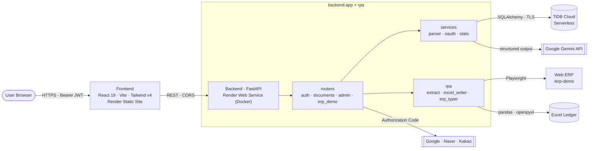
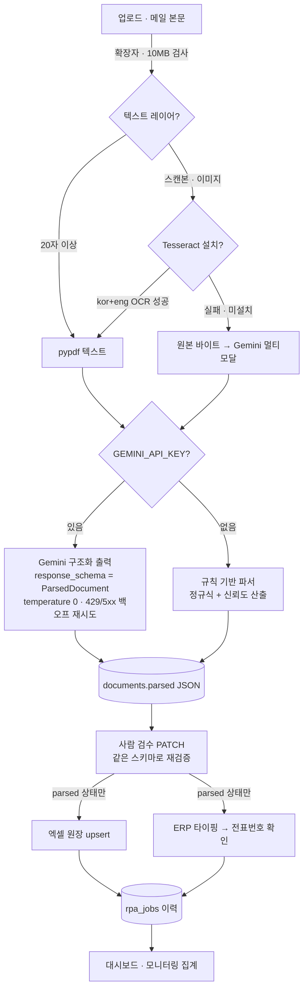

<div align="center">

# DataQuill

### 생성형 AI × RPA 기반 데이터 입력 자동화 플랫폼

**영수증 · 세금계산서 · 거래 이메일 같은 비정형 문서를 AI가 읽어 정형화하고,<br/>사람이 검수한 값을 RPA 로봇이 ERP 전표 화면과 엑셀 원장에 대신 입력합니다.**

<a href="https://fsclass-n.github.io/dataquill/">
  
</a>

**🔗 포트폴리오 → [fsclass-n.github.io/dataquill](https://fsclass-n.github.io/dataquill/)**

<br/>


<br/>


[](https://github.com/fsclass-n/dataquill/actions/workflows/deploy.yml)

[](https://github.com/fsclass-n/dataquill/issues)
[](https://github.com/fsclass-n/dataquill/commits/main)


[**라이브 서비스**](https://dataquill.onrender.com) · [**API 문서 (Swagger)**](https://dataquill-api.onrender.com/docs) · [**포트폴리오**](https://fsclass-n.github.io/dataquill/) · [**발표자료 (PDF)**](docs/pdf/프로젝트_발표자료.pdf)

</div>

> **테스트 계정** — 로그인 화면의 버튼 한 번으로 체험할 수 있습니다.<br/>
> 일반 사용자 `user@dataquill.io / User1234!` · 테스트 관리자(읽기 전용) `admin@dataquill.io / Admin1234!`<br/>
> 무료 플랜이라 첫 접속 시 서버가 깨어나는 데 1분 정도 걸릴 수 있습니다.

---

## 목차

1. [Overview](#1-overview)
2. [Key Features](#2-key-features)
3. [Architecture & Data Pipeline](#3-architecture--data-pipeline)
4. [Key Technical Challenges & Solutions](#4-key-technical-challenges--solutions)
5. [Tech Stack](#5-tech-stack)
6. [API Architecture](#6-api-architecture)
7. [Directory Structure](#7-directory-structure)
8. [Roles & Permissions](#8-roles--permissions)
9. [Getting Started](#9-getting-started)
10. [Testing & Quality](#10-testing--quality)
11. [Deployment & CI/CD](#11-deployment--cicd)
12. [Documents](#12-documents)
13. [Limitations & Roadmap](#13-limitations--roadmap)

---

## 1. Overview

| 문제 | 현상 | DataQuill 의 해결 |
| --- | --- | --- |
| **이중 수기 입력** | 같은 영수증 · 청구 메일을 ERP 에 한 번, 엑셀 원장에 또 한 번 입력 | 한 번 추출한 값을 엑셀 원장 적재 + ERP 자동 타이핑 |
| **비정형 문서** | 거래처마다 양식이 달라 정규식 규칙이 쉽게 깨짐 | Gemini 구조화 출력(Pydantic 스키마 강제) |
| **스캔본 · 사진** | 텍스트 레이어가 없어 일반 추출 불가 | 텍스트 레이어 → Tesseract OCR → Gemini 멀티모달 단계적 대체 |
| **API 없는 레거시 ERP** | 연동 API 가 없어 사람이 화면에 입력 | Playwright 로봇이 화면에 입력하고 전표번호로 성공 확인 |
| **AI 환각** | 문서에 없는 값을 그럴듯하게 생성 | `없는 값은 null` 규칙 + 신뢰도 표시 + **사람 검수 후에만 입력** |

- **기간 · 인원**: 1인 풀스택(기획 · 백엔드 · 프런트엔드 · RPA · 배포 · 문서 · 영상) — 홍기흥
- **결과**: 운영 서비스 · API · 자동 테스트 30개 · 10분 발표 영상 · 발표자료 · 진행일지/산출물(HWPX · PDF)

## 2. Key Features

[](https://fsclass-n.github.io/dataquill/#screening)

<sub>포트폴리오 페이지에서 바로 재생됩니다(다운로드 없음) — 챕터 17개로 원하는 장면 이동, 60초 하이라이트 포함.</sub>

| 기능 | 설명 |
| --- | --- |
| **6가지 입력** | PDF · 이미지(JPG · PNG · WEBP · TIFF 등) · EML · HTML · TXT 업로드(최대 10MB) + 이메일 본문 붙여넣기 |
| **AI 구조화 추출** | 거래처 · 사업자번호 · 거래일자 · 합계 · 부가세 · 결제수단 · 품목 · 적요를 JSON 으로, 신뢰도(confidence)와 함께 |
| **사람 검수** | 화면에서 수정 · 저장(서버가 같은 스키마로 재검증 → 422), 재해석 |
| **엑셀 원장 적재** | 문서 ID 기준 upsert — 여러 번 적재해도 중복 행 없음, `.xlsx` 다운로드 |
| **ERP 자동 타이핑** | Playwright 가 전표 화면에 입력 · 저장하고 **ERP 가 발급한 전표번호를 확인해야 성공** 기록 |
| **대시보드 · 모니터링** | KPI · 최근 14일 추이(KST), 관리자용 AI 파싱 성공률 · RPA 성공률 · 최근 실패 |
| **인증 · 권한** | 이메일 가입(JWT) · Google · Naver · Kakao OAuth, 운영 관리자 / 읽기 전용 테스트 관리자 / 일반 사용자 |

<table>
  <tr>
    <td align="center"><br/><sub>업로드 · AI 추출 결과 검수 · RPA 실행</sub></td>
    <td align="center"><br/><sub>로봇이 입력한 ERP 전표(전표번호 발급)</sub></td>
  </tr>
  <tr>
    <td align="center"><br/><sub>관리자 모니터링(파싱 · RPA 성공률)</sub></td>
    <td align="center"><br/><sub>회원 관리 · 권한(테스트 관리자는 읽기 전용)</sub></td>
  </tr>
</table>

## 3. Architecture & Data Pipeline

### 3.1 System Architecture



### 3.2 Document Processing Pipeline



## 4. Key Technical Challenges & Solutions

### Challenge 1. 형식이 제각각인 문서에서 신뢰할 수 있는 값 뽑기

- **문제** — 거래처마다 양식이 달라 규칙이 깨지고, 스캔본은 글자가 없으며, LLM 은 없는 값을 지어낼 수 있음
- **해결**
  - **단계적 추출**: 가장 싸고 정확한 방법부터 — 텍스트 레이어(20자 이상) → Tesseract(kor+eng) → 원본 멀티모달
  - **스키마 공유**: `ParsedDocument`(Pydantic) 하나를 Gemini `response_schema` 와 API 검증 모델로 함께 사용 → 형식 오류가 구조적으로 차단
  - **환각 통제**: 프롬프트 `문서에 없는 값은 null`, `temperature=0`, 신뢰도 표시, 사람 검수 후에만 RPA 실행(아니면 409)
  - **대체 경로**: 키가 없거나 장애 시 규칙 파서(`confidence = 0.2 + 0.15 × 찾은 필드 수 + 0.1(품목)`), 일시 오류(429 · 500 · 503 · 504)만 2 · 5 · 10초 백오프
- **결과** — 운영 샘플 영수증에서 거래처 · 사업자번호 · 금액 · 부가세 · 품목 정상 추출(신뢰도 0.98). 정량 정확도는 정답셋 구축 후 측정 예정이라 주장하지 않음

### Challenge 2. "눌렀는데 저장 안 됨"을 막는 RPA 설계

- **문제** — 화면 자동화는 클릭만으로는 성공 여부를 알 수 없고, 화면 구조가 바뀌면 깨지며, 재실행 시 중복 데이터가 생김
- **해결**
  - **결과 검증**: 저장 후 ERP 결과 요소의 `data-status="ok"` 와 `data-voucher`(전표번호)를 확인해야 성공 기록
  - **화면-코드 분리**: `FIELD_SELECTORS` 맵만 바꾸면 다른 ERP 화면에 적용, CLI(`python -m rpa.erp_typer`) 단독 실행 가능
  - **멱등 적재**: 엑셀 원장은 문서 ID 기준 행 교체 → 여러 번 적재해도 1행
  - **운영 친화 오류**: Chromium 미설치 등 환경 오류를 읽을 수 있는 문장으로 바꿔 작업 이력에 기록
  - **실행 최적화**: 헤드리스 기본(`RPA_HEADLESS`), `wait_for_selector` 로 고정 대기 없이 결과 요소만 기다림, 같은 컨테이너의 `127.0.0.1:$PORT` 로 접속

### Challenge 3. 공개 테스트 계정이 실제 관리자 권한을 갖던 보안 문제

- **문제** — 로그인 화면에 비밀번호가 공개된 관리자 계정으로 누구나 회원 권한을 바꿀 수 있었음
- **해결**
  - 운영 관리자는 서버 환경 변수 `ADMIN_TOKEN` 으로만 로그인(`compare_digest`, 같은 IP 5회 실패 시 10분 차단, 미설정 시 503)
  - 테스트 관리자는 `deps.get_current_user` **단일 진입점**에서 GET · HEAD · OPTIONS 외 요청을 403 → 새 API 를 추가해도 자동 적용
  - 공개 계정 권한은 서버 기동 시 복원, 권한 변경 API 로 변경 불가(400) — 테스트 8개로 회귀 방지

### Challenge 4. 로컬에서는 되고 운영에서만 실패하는 문제들

| 증상 | 원인 (근거) | 조치 |
| --- | --- | --- |
| 코드 변경 없이 Docker 빌드 실패 | `python:3.11-slim` 이 Debian 13 으로 변경, Playwright 1.52 는 Debian 11/12 만 지원(소스 `nativeDeps.ts` 확인) | `python:3.11-slim-bookworm` 고정 |
| 키가 없는데 AI · OAuth 가 '설정됨' | `.env` 빈 값 뒤 인라인 주석을 python-dotenv 가 값으로 읽음(헬스 체크 `parser` 노출로 발견) | 주석 분리, 테스트에서 외부 키 격리 |
| TiDB `1105 insecure transport` | TiDB Serverless 는 TLS 필수 | `DB_SSL=true` + certifi CA, 운영 DB 대신 임시 DB 로 검증 후 삭제 |
| Gemini `503 high demand` | 사용량 폭주 시 일시 오류 | 429/5xx 만 백오프 재시도 + 가짜 클라이언트 테스트 3개 |
| 운영 ERP 타이핑 연결 거부 | Render 컨테이너는 `PORT=10000` | 기본 대상 `127.0.0.1:$PORT` |
| `/login` 새로고침 404 | 정적 호스팅 SPA 규칙 없음 | `/* → /index.html` Rewrite |

## 5. Tech Stack

| 영역 | 기술 |
| --- | --- |
| **Backend** | Python 3.11 · FastAPI 0.115 · SQLAlchemy 2.0 · Pydantic v2 · PyJWT · Uvicorn |
| **AI** | Google Gemini (`google-genai`) — 구조화 출력 · 멀티모달 |
| **RPA · Data** | Playwright 1.52 · pandas · openpyxl · pypdf · pytesseract(Tesseract kor+eng) · BeautifulSoup4 |
| **Frontend** | React 19 · Vite 8 · Tailwind CSS v4 · React Router 7 · Recharts · FontAwesome |
| **Database** | TiDB Cloud Serverless(MySQL 호환, TLS) / SQLite(로컬 · 테스트) |
| **Infra · DevOps** | Docker · Render(Web Service · Static Site) · Netlify(보조) · GitHub Actions · GitHub Pages |
| **Test** | pytest · FastAPI TestClient · Playwright 화면 점검 |

## 6. API Architecture

| Method | Endpoint | 설명 | 권한 |
| --- | --- | --- | --- |
| `POST` | `/api/auth/register` · `/login` | 이메일 가입 · 로그인(JWT) | 누구나 |
| `POST` | `/api/auth/admin-login` | `ADMIN_TOKEN` 운영 관리자 로그인 | 토큰 |
| `GET` | `/api/auth/oauth/{provider}/login` · `/callback` | OAuth(state 쿠키 CSRF 검증) | 누구나 |
| `GET` | `/api/auth/me` · `/providers` | 내 정보 · 활성 제공자 | 로그인 |
| `GET` | `/api/dashboard` | 사용자 KPI · 일별 추이 | 로그인 |
| `GET` `POST` | `/api/documents` · `/upload` · `/text` | 목록 · 업로드 · 메일 본문 입력 | 로그인 |
| `GET` `PATCH` `DELETE` | `/api/documents/{id}` | 상세 · 검수 수정 · 삭제 | 본인 · 관리자 |
| `POST` | `/api/documents/{id}/reparse` · `/rpa` | 재해석 · 엑셀/ERP 입력 | 본인 · 관리자 |
| `GET` | `/api/documents/ledger.xlsx` | 엑셀 원장 다운로드 | 로그인 |
| `GET` `PATCH` | `/api/admin/users` · `/users/{id}/role` · `/stats` | 회원 관리 · 권한 변경 · 통계 | 관리자 |
| `GET` | `/api/health` | 상태 · 현재 파서 종류 | 누구나 |

오류 규약: `401` 인증 · `403` 권한/읽기 전용 · `404` 타인 문서 · `409` 중복 가입/파싱 전 RPA · `413/415` 용량/형식 · `422` 검증 · `429` 토큰 차단

## 7. Directory Structure

```text
dataquill/
├── backend/
│   ├── app/
│   │   ├── main.py              # 앱 생성 · CORS · 테이블 생성 · 테스트 계정 시드/권한 복원
│   │   ├── config.py            # 루트 .env 하나로 설정
│   │   ├── database.py          # SQLAlchemy 엔진 (SQLite / TiDB + TLS)
│   │   ├── deps.py · security.py# 인증 · 권한(테스트 관리자 쓰기 차단) · PBKDF2 · JWT
│   │   ├── routers/             # auth · documents · admin · erp_demo
│   │   └── services/            # parser(Gemini/규칙) · oauth · stats
│   ├── tests/                   # pytest 30개 (임시 DB · 외부 키 격리)
│   └── Dockerfile               # python:3.11-slim-bookworm + Tesseract + Chromium
├── rpa/                         # extract(OCR) · excel_writer · erp_typer(Playwright)
├── frontend/src/                # pages · components/layout · api(client · mock) · context
├── docs/                        # md(작업 기록) · 진행일지/산출물(HWPX) · pdf · 발표자료 · video · tools
├── index.html                   # GitHub Pages 포트폴리오 (단일 파일)
├── render.yaml · docker-compose.yml · .github/workflows/deploy.yml
└── requirements.txt             # 단일 Python 의존성 목록
```

## 8. Roles & Permissions

| 동작 | 운영 관리자 | 테스트 관리자 | 일반 사용자 |
| --- | :---: | :---: | :---: |
| 관리자 화면 조회 | ✅ | ✅ | ❌ |
| 문서 업로드 · 검수 · 삭제 | ✅ | ❌ (403) | 본인 |
| 엑셀 적재 · ERP 타이핑 | ✅ | ❌ (403) | 본인 |
| 회원 권한 변경 | ✅ | ❌ (403) | ❌ |
| 진입 방법 | `/admin/login` + `ADMIN_TOKEN` | 로그인 화면 버튼 | 가입 · OAuth · 테스트 버튼 |

## 9. Getting Started

```bash
cp .env.example .env                                    # SECRET_KEY 등 설정 (키가 없으면 규칙 파서 · Mock 모드로 동작)
py -3.11 -m venv .venv && .venv/Scripts/pip install -r requirements.txt
.venv/Scripts/python -m playwright install chromium
.venv/Scripts/python -m uvicorn backend.app.main:app --reload --port 8000   # http://localhost:8000/docs
cd frontend && npm install && npm run dev                                       # http://localhost:5173
```

Docker: `docker compose up --build` (backend 8000 · frontend 5173)

## 10. Testing & Quality

```bash
.venv/Scripts/python -m pytest backend/tests -q   # 30 passed
cd frontend && npm run lint && npm run build       # lint 오류 0 · build 성공
```

| 범위 | 내용 |
| --- | --- |
| 회원 · OAuth | 비밀번호 규칙 6종, 가입 · 중복 · 로그인 실패, 미설정 제공자 · 위조 state |
| 문서 · RPA | 업로드 → 파싱 → 엑셀, 메일 본문 · 검수 수정, 해석 불가 → failed · RPA 409, 미지원 형식 415, 데모 ERP 전표 |
| 외부 장애 | Gemini 503 ×2 → 성공, ×9 → 4회 후 실패, 400 → 즉시 실패 |
| 권한 | 관리자 403/401, 운영 관리자 토큰 · 5회 차단 · 미설정 503, 테스트 관리자 조회 허용 · 쓰기 5종 403, 공개 계정 권한 고정 · 기동 시 복원 |

## 11. Deployment & CI/CD

| 대상 | 주소 | 플랫폼 |
| --- | --- | --- |
| 서비스 | https://dataquill.onrender.com | Render Static Site (`/* → /index.html`) |
| API | https://dataquill-api.onrender.com/docs | Render Web Service (Docker) |
| 포트폴리오 | https://fsclass-n.github.io/dataquill/ | GitHub Pages |
| DB | TiDB Cloud Serverless | MySQL 호환 · TLS |

- **변경 영역만 검증 · 배포** — GitHub Actions `paths-filter` 로 `frontend/**` 는 lint · build, `backend/** · rpa/** · requirements.txt` 는 pytest. Render Build Filter 로 해당 서비스만 재배포 → 문서만 고친 커밋은 어떤 서비스도 다시 빌드하지 않음
- **비밀 값** — 루트 `.env` 하나(Vite 는 `VITE_` 접두사만 노출), 운영 값은 Render 대시보드에만 등록
- **Mock 모드** — `VITE_API_URL` 이 비면 브라우저 목업 API 로 동작(같은 권한 규칙) → 프런트 단독 배포 가능

## 12. Documents

| 문서 | 위치 |
| --- | --- |
| 발표자료 (16장 + 부록, 발표자 노트) | [`docs/프로젝트_발표자료.pptx`](docs/프로젝트_발표자료.pptx) · [PDF](docs/pdf/프로젝트_발표자료.pdf) |
| 진행일지 1~5단계 · 산출물 01~05 | [`docs/`](docs) (HWPX) · [`docs/pdf/`](docs/pdf) (PDF) |
| 작업 기록 (결정 · 검증 · 이슈) | [`docs/md/`](docs/md) |

## 13. Limitations & Roadmap

| 현재 한계 | 다음 단계 |
| --- | --- |
| RPA · LLM 호출이 API 요청 안에서 동기 실행 | 작업 큐 + 워커 분리(rpa 패키지가 이미 분리되어 이전 비용 낮음) |
| 업로드 원본이 컨테이너 디스크에 저장 | S3 등 오브젝트 스토리지, 보존 기간 정책 |
| 파싱 품질을 샘플 단위로만 검증 | 문서 유형별 정답셋으로 필드 단위 정확도 측정 |
| `create_all` 로 스키마 관리 · 새로고침 후 시각 9시간 오차 | Alembic 도입, 응답 시각에 UTC 시간대 부여 |
| 데모 ERP 대상 검증 · JWT 를 localStorage 에 저장 | 실제 ERP 커넥터(API 우선), HttpOnly 쿠키 인증 |

<div align="center">
<sub>DataQuill · 홍기흥 · 개인 포트폴리오 프로젝트</sub>
</div>
