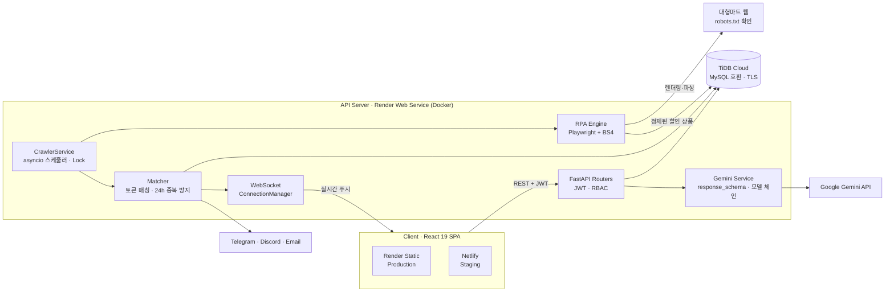
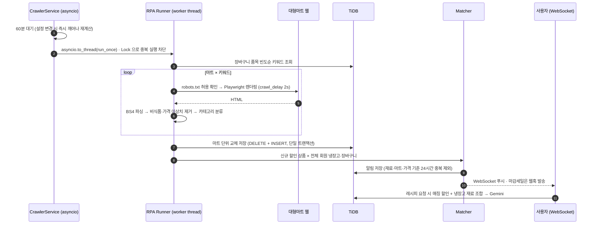

<div align="center">

# 🥗 RecipePick

**대형마트 할인 식재료 RPA 수집 × 냉장고 재고 × 건강 상태 → Google Gemini 맞춤 레시피 창작 플랫폼**

마트 마감세일을 자동으로 찾아 내 냉장고와 매칭하고, 당뇨·다이어트·고혈압 등 건강 조건에 맞는 한끼를 AI가 설계합니다.

[](https://github.com/fsclass-n/recipepick/actions/workflows/ci.yml)


[](https://github.com/fsclass-n/recipepick/issues)


[**▶ 10분 발표·시연 영상 보기**](https://fsclass-n.github.io/recipepick/#video) &nbsp;|&nbsp;
[**🌐 포트폴리오**](https://fsclass-n.github.io/recipepick/) &nbsp;|&nbsp;
[**🍳 Live 서비스**](https://recipepick.onrender.com) &nbsp;|&nbsp;
[**📘 API Docs**](https://recipepick-api.onrender.com/docs)

`팀 구성 (1인 프로젝트)` **홍기흥 — Full-stack Developer** · 기획 · 설계 · 백엔드 · 프론트엔드 · RPA · 배포 · 발표 영상

</div>

---

## 📌 Overview

| 문제 | 해결 |
| :--- | :--- |
| 할인 정보가 마트별 사이트에 흩어져 있고, 마감세일은 시간이 지나면 사라진다 | **RPA 스케줄러**가 주기적으로 할인 상품을 수집·정제해 한곳에 저장 |
| 냉장고 재료는 잊혀 버려지고, "있는 재료로 뭘 만들지"를 매번 고민한다 | 냉장고·장바구니 품목과 할인 상품을 **자동 매칭**하고 **WebSocket**으로 즉시 알림 |
| 당뇨·고혈압 등 식단 제약을 반영한 레시피를 찾기 어렵다 | 건강 기준·알레르기·목표 열량을 조합해 **Gemini 구조화 출력**으로 레시피·영양·대체 식재료 생성 |

> 찾는 수고는 RPA가, 고민은 AI가 — "수집 → 매칭 → 창작 → 알림"을 한 흐름으로 자동화했습니다.

## ✨ Key Features

| 기능 | 설명 |
| :--- | :--- |
| 🤖 **RPA 할인 수집** | Playwright(Headless Chromium) + BeautifulSoup4, robots.txt 준수, 기본 60분 주기(관리자 5분~24시간 조정) |
| 🧊 **냉장고 파먹기** | 재고·유통기한 D-day, 할인 매칭 재료 자동 하이라이트, 마트별 최저가 장바구니 맵 |
| 🪄 **Gemini 맞춤 레시피** | 건강 타입 5종 기준 · 알레르기 제외 · JSON 스키마 강제 · 모델 체인 + 템플릿 fallback |
| 🔔 **실시간 알림** | 마감세일 매칭 시 WebSocket 푸시 + 텔레그램 · 디스코드 · 이메일 웹훅 |
| 🛡 **관리자 백오피스** | 크롤러 주기·모드 제어, pandas 집계 Plotly 차트, 작업 로그, 회원 권한(RBAC) 실시간 변경 |
| 🔐 **인증** | JWT · bcrypt · 구글/네이버/카카오 OAuth · 테스트 계정 원클릭 로그인 · 비밀번호 정책 |

---

## 🏗 Architecture & Data Pipeline



### 수집 → 정제 → 저장 → 매칭 → 추천 파이프라인



---

## 🧩 Key Technical Challenges & Solutions

### 1. 동적 페이지 크롤링 · 차단 대응과 Playwright 최적화

| Challenge | Solution |
| :--- | :--- |
| 마트 페이지가 JavaScript로 렌더링되어 `requests`만으로는 상품이 보이지 않음 | **Playwright Headless Chromium**으로 렌더링 후 스크롤해 지연 로딩까지 수집, 파싱은 **BeautifulSoup4**로 분리해 HTML 픽스처만으로 단위 테스트 |
| SSG(이마트)는 Akamai 봇 차단, 롯데ON은 robots.txt `Disallow: /` | 우회하지 않고 **수집 정책을 설계**: 요청 전 `RobotFileParser`로 허용 여부 확인, 비허용 마트는 `live_enabled=False` → `auto` 모드에서 데모 데이터로 대체하고 UI에 `DEMO` 배지로 명시 |
| Render 무료 인스턴스(512MB)에서 Chromium 메모리 부담 | 실행당 브라우저 1개 공유 · 마트별 컨텍스트 분리 · `--disable-dev-shm-usage --no-zygote --disable-gpu` · **미디어/폰트 요청 차단**(`context.route`), pandas·Plotly 지연 import, 기동 직후 크롤링 30초 지연 |
| 동기 Playwright가 FastAPI 이벤트 루프를 막을 위험 | 크롤링은 `asyncio.to_thread` 워커 스레드에서 실행, `threading.Lock`으로 수동·자동 실행 충돌 차단, 진행 상황은 `run_coroutine_threadsafe`로 WebSocket 전달 |

> **Lesson** — 이미지 요청까지 차단하자 사이트가 `src`를 교체해 이미지 URL 수집이 깨졌습니다. 데이터 품질에 영향을 주는 리소스는 남기고 미디어·폰트만 차단하도록 조정했습니다.

### 2. 주기 동기화 · 중복 처리 · 데이터 정제

| Challenge | Solution |
| :--- | :--- |
| 주기 실행 중 이전 수집 결과가 남아 중복·만료 상품이 노출 | **마트 단위 교체 저장**: 이번 실행에 수집된 마트의 기존 상품을 삭제 후 삽입(단일 트랜잭션), 실행 내에서는 상품명 기준 dedupe |
| 파싱 오류 데이터 (예: 할인율 `50%`를 판매가로 읽어 할인율 99%) | 셀렉터를 `strong:not(.discountRate)`로 수정 + **가격 검증**(정가 > 판매가, 판매가 ≥ 정가의 10%) |
| `'풀무원'`의 `'무'` 때문에 두부가 채소로 분류, `계란찜기`가 계란과 매칭 | **최장 키워드 일치** 분류 + 1글자 키워드는 어절 단위 비교, **비식품 정규식 필터** |
| 같은 할인으로 매 주기 알림 폭주 | `(재료명, 마트, 판매가)` 기준 **24시간 중복 알림 제외** |
| 크롤링 도중 서버 재시작 시 작업이 `running`으로 영구 잔존 | 기동 시 `running` 작업을 `failed`로 정리하고 로그에 사유 기록 (자가 복구) |
| 주기 변경 시 대기 중인 스케줄러 반영 | `asyncio.Event`로 대기 루프를 깨워 다음 실행 시각 즉시 재계산 |

### 3. 맞춤 추천 알고리즘과 추천 근거 산출

```
추천 입력 = 선택한 냉장고 재료
          + 선택한 할인 상품
          + 장바구니·냉장고와 매칭된 할인 상품 (할인율 내림차순)
          + 건강 카테고리(채소·두부·수산·육류·곡류 등) 상위 할인 상품   → 최대 10개
```

- **매칭 로직**: 공백·괄호 기준 토큰화 + 불용어(`국산`, `친환경`, `1등급` 등) 제거 → 부분 문자열 또는 토큰 교집합으로 매칭, 후보 중 `(할인율 ↓, 가격 ↑)` 최적 상품 선택
- **프롬프트 설계**: 건강 타입별 가이드(예: 당뇨 = 저GI · 1회 탄수화물 45~60g) + 1일 목표 열량 + **알레르기 "절대 사용 금지"** + 할인 재료를 주재료로 활용하도록 지시
- **구조화 출력**: `response_schema`로 재료(`from_deal` 표시) · 조리 단계 · 1인분 영양(kcal·탄·단·지·나트륨) · 대체 식재료 · 건강 팁 · 예상 비용을 JSON으로 강제 → 파싱 실패 제거
- **추천 근거 시각화**: 건강 타입별 1인분 기준(당뇨 탄수화물 60g, 고혈압 나트륨 600mg 등)과 비교해 초과 항목을 경고, 할인 재료 활용 절약액 표시
- **가용성**: 설정 모델이 단종(404)·과부하(503)·타임아웃(40s)이면 대체 모델을 순차 시도, 모두 실패 시 규칙 기반 템플릿으로 응답하고 실패 사유를 UI에 구분 표시

> **실제 장애 사례** — 배포 후 사용 중이던 Gemini 모델이 신규 사용자 제공 중단(404)되어 모든 레시피가 템플릿으로 대체되고 있었습니다. 서버 로그로 원인을 찾아 모델 체인을 도입하고 테스트 2개를 추가했습니다.
> **한계** — 영양 수치는 LLM 추정값이며, 식약처 식품영양성분 DB 연동으로 근거화할 계획입니다.

### 4. 보안 · 실시간 권한 반영

- **RBAC 이중 방어**: 서버 `require_admin` 의존성(403) + 클라이언트 보호 라우트, 관리자 자기 강등·비활성화 차단(400)
- **OAuth**: `state`를 서명된 JWT(10분)로 발급해 CSRF 방지, 리다이렉트 허용 목록으로 Open Redirect 차단, 토큰은 URL fragment로 전달
- **실시간 반영**: 관리자가 권한·건강 타입을 바꾸면 `profile_changed` 이벤트로 대상 사용자 화면이 새로고침 없이 갱신
- **운영 안전장치**: 운영 환경에서 기본 `SECRET_KEY`면 기동 거부, TiDB TLS CA·호스트명 검증, CORS 허용 목록(개발 환경에서만 localhost)

---

## 🛠 Tech Stack

| 영역 | 기술 | 선택 이유 |
| :--- | :--- | :--- |
| **Backend** | Python 3.11 · FastAPI · SQLAlchemy 2 · Pydantic · WebSocket · PyJWT · bcrypt | 비동기 + WebSocket 내장, 입력 검증과 Swagger 자동 문서화 |
| **Frontend** | React 19 · Vite · Tailwind CSS v4 · React Router · FontAwesome | 빠른 빌드, `@theme` 디자인 토큰, 다크 모드·반응형 |
| **RPA / Data** | Playwright · BeautifulSoup4 · requests · pandas · NumPy · Plotly | JS 렌더링 대응, 파싱 로직 분리 테스트, 서버 집계 후 figure JSON 전달 |
| **AI** | Google Gemini (`google-genai`) | `response_schema` 구조화 출력, 모델 체인 fallback |
| **DB** | TiDB Cloud (MySQL 호환) · SQLite(테스트 격리) | 무상태 컨테이너 재시작에도 데이터 유지, 서버리스 무료 티어 |
| **Infra / DevOps** | Docker · Render(API·Static) · Netlify · GitHub Actions · GitHub Pages | Chromium 의존성 이미지 고정, 프런트/백엔드 독립 배포, push 자동 배포 |

---

## 🔌 API Architecture

REST **30개** + WebSocket **1개** · 전체 명세는 [Swagger `/docs`](https://recipepick-api.onrender.com/docs)

| 그룹 | 엔드포인트 | 권한 |
| :--- | :--- | :--- |
| **Auth** | `POST /api/auth/register` · `POST /api/auth/login` · `GET·PATCH /api/auth/me` · `GET /api/auth/providers` · `GET /api/auth/oauth/{provider}/login·callback` | 공개 / 회원 |
| **Fridge** | `GET·POST /api/fridge` · `PATCH·DELETE /api/fridge/{item_id}` (응답에 최적 할인 `matched_deal` 포함) | 회원 |
| **Deals** | `GET /api/deals` (마트·카테고리·검색·마감세일·정렬) · `GET /api/deals/summary` | 회원 |
| **Recipes** | `POST /api/recipes/generate` · `GET /api/recipes` · `DELETE /api/recipes/{id}` · `GET /api/recipes/health-types` | 회원 |
| **Notifications** | `GET /api/notifications` · `POST /api/notifications/read-all` · `POST /api/notifications/{id}/read` | 회원 |
| **Admin** | `GET /api/admin/overview` · `GET·PATCH /api/admin/crawler` · `POST /api/admin/crawler/run` · `GET /api/admin/crawler/jobs·stats` · `GET /api/admin/users` · `PATCH /api/admin/users/{id}` | 관리자 |
| **Public** | `GET /api/health` · `GET /api/public/stats` | 공개 |
| **Realtime** | `WS /ws?token=` — `notification` · `crawl_status` · `profile_changed` | 회원 |

## 📂 Directory Structure

```text
recipepick/
├── backend/
│   ├── app/
│   │   ├── main.py            # 앱 수명주기(테이블 생성·시드·중단 작업 정리·스케줄러), CORS, 공개 API
│   │   ├── config.py          # 루트 .env 단일 설정
│   │   ├── database.py        # TiDB(TLS 검증) / SQLite 엔진
│   │   ├── models.py          # users · fridge_items · deals · crawl_jobs · recipes · notifications
│   │   ├── security.py        # JWT · bcrypt · 비밀번호 정책 · RBAC 의존성
│   │   ├── routers/           # auth · fridge · deals · recipes · notifications · admin · ws
│   │   └── services/
│   │       ├── crawler.py     # 스케줄러 · 수집 저장 · 매칭 알림 트리거
│   │       ├── matcher.py     # 토큰 매칭 · 24시간 중복 방지
│   │       ├── gemini.py      # 프롬프트 · response_schema · 모델 체인 · fallback
│   │       └── notifier.py    # WebSocket 매니저 · 웹훅
│   ├── tests/                 # pytest 12개 (API · 파이프라인 · Gemini 체인 · WebSocket · RPA 파서)
│   └── Dockerfile             # python:3.11-slim + playwright install --with-deps chromium
├── rpa/
│   ├── base.py                # robots.txt · Playwright 렌더링 · BS4 파싱 · 정제 · 데모 데이터
│   ├── runner.py              # live / demo / auto 모드, 키워드 구성
│   └── marts/                 # homeplus(라이브) · emart · lottemart
├── frontend/                  # React 19 + Vite + Tailwind v4 (pages · components · context)
├── docs/                      # 산출물 · 진행일지 · 발표자료(pptx) · 개발 가이드 · video/(영상 제작 도구)
├── index.html · assets/       # GitHub Pages 포트폴리오
├── .github/workflows/ci.yml   # pytest · 프런트 빌드 · Docker 빌드
├── render.yaml · netlify.toml · docker-compose.yml
└── .env.example               # [R] Render 필수 · [F] 프런트 필수 변수
```

---

## ✅ Quality & Delivery

- **Test**: pytest 12개 — 인증·권한, 크롤링 → 매칭 → 알림 통합 흐름, Gemini 모델 체인/fallback, WebSocket, HTML 픽스처 기반 RPA 파서
- **CI**: push마다 `backend`(pytest) · `frontend`(build) · `docker`(이미지 빌드) 3개 job
- **CD**: `main` push → Render(`autoDeployTrigger: commit`, Docker API + Static) · Netlify Git 연동 자동 배포
- **Docs**: 단계별 산출물·진행일지, 16장 발표자료, 10분 발표·시연 영상과 [대본·연출 가이드](docs/video/영상_대본_및_연출가이드.md)

## 🚀 Getting Started

```bash
cp .env.example .env                     # TIDB_HOST 를 비우면 SQLite 로 동작, GEMINI_API_KEY 없으면 템플릿 레시피
py -3.11 -m venv .venv && .venv/Scripts/pip install -r requirements.txt
.venv/Scripts/python -m playwright install chromium
cd backend && ../.venv/Scripts/python -m uvicorn app.main:app --reload     # http://localhost:8000/docs
cd frontend && npm install && npm run dev                                   # http://localhost:5173
# 또는: docker compose up --build
```

| 테스트 계정 | 이메일 | 비밀번호 |
| :--- | :--- | :--- |
| 일반 회원 (당뇨 관리) | `user@recipepick.dev` | `Recipe!2026` |
| 관리자 | `admin@recipepick.dev` | `Admin!2026` |

> 상세 설정·배포·수집 정책은 [docs/개발_가이드.md](docs/개발_가이드.md)를 참고하세요. Render 무료 인스턴스는 첫 접속 시 깨어나는 데 최대 1분이 걸릴 수 있습니다.

---

<div align="center">

**홍기흥** · Full-stack Developer · [whyeil@naver.com](mailto:whyeil@naver.com) · [Portfolio](https://fsclass-n.github.io/recipepick/)

</div>
