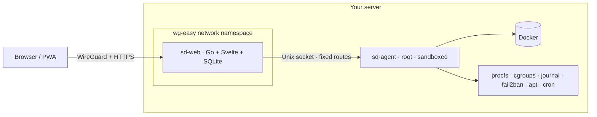

<div align="center">

# NODO

**A private control room for your self-hosted server.**
Monitoring, alerts, containers, backups, security and your apps in one fast page that
only exists inside your VPN.

[](LICENSE)


</div>

You run a VPS with a few dozen containers: your sites, a database or three, mail, n8n,
analytics… and you check on them with a mix of SSH, Portainer, a status page and
cron e-mails. NODO replaces that ritual with one panel that tells you **"everything is
fine"** or **exactly what isn't**, and lets you fix the common things safely from your
phone.

It is built for a single operator, a single server and a paranoid threat model: the panel
is **never exposed to the Internet**. It listens only on your WireGuard gateway, and every
action that changes something goes through a preview, a typed confirmation and an
append-only audit log.

> Available in **English** and **Spanish**: the interface follows your browser and has a
> language switch in the top bar. Adding a language is one folder of text files, see
> [CONTRIBUTING](CONTRIBUTING.md).

## Features

| | |
|---|---|
| 🩺 **Health at a glance** | A status strip that says *all good* or shows the first problem, live CPU, memory, disk and uptime. |
| 📈 **History** | Host metrics per minute for 7 days and per hour for a year; CPU and RAM per container for 48 hours. Charts with crosshair tooltips. |
| 🐳 **Containers** | Every container with live CPU/RAM (read straight from cgroups), events, the last 400 log lines, start / restart / stop, and *important* flags that page you when they go down. |
| 🔔 **Alerts** | 18 rules: disk, memory, load, crashed or restart-looping containers, OOM, sites down or slow, certificates, stale backups, new public ports, security updates, failed n8n workflows, mail queue… Acknowledge, silence, attach a runbook. |
| ✉️ **Notifications** | E-mail and Telegram on start and on resolve, grouped when many fire at once, with a *send test* button. |
| 🌐 **Uptime** | Your public sites checked every minute (status, expected text, latency) with 24 h / 7 d availability and TLS expiry. |
| 💾 **Backups** | Status from the actual backup file (age and size), messages from the log, and a *back up now* button. |
| 🛡️ **Protection** | fail2ban jails with ban / unban, SSH attempts per hour, top IPs and users, successful logins, every listening port with its process and container, and pending apt updates. |
| 🗓️ **Tasks** | Your crontab with human schedules, last log lines, *run now*, pause and resume. n8n workflows and failed executions. |
| 🧹 **Disk** | Where Docker's space goes, reclaimable images and build cache with one-click (well, three-step) cleanup, and which images have a newer version in their registry. |
| 📬 **Services** | mailcow queue, mailboxes and spam stats; Umami visitors per site. Both optional. |
| 📝 **Notes** | Markdown runbooks linked to alert rules, so *"what do I do now"* is right next to the alert. |
| 🚀 **Launcher** | Your self-hosted apps with colour icons, grouped and searchable. |
| 📱 **Installable** | A PWA for desktop and mobile, light and dark themes, keyboard palette (Ctrl K), accessible (axe-checked). |
| 🌍 **Multilingual** | English and Spanish today, chosen per browser; alerts by e-mail and Telegram in the language you configure. |

<table>
<tr>
<td></td>
<td></td>
</tr>
<tr>
<td></td>
<td></td>
</tr>
<tr>
<td></td>
<td></td>
</tr>
</table>

## How it works



- **sd-web** is a single Go binary with the Svelte app embedded, in a distroless,
  read-only container that shares **wg-easy's network namespace**: it binds to the VPN
  gateway (`10.8.0.1`) and has no published ports. TLS comes from Let's Encrypt through
  a Cloudflare **DNS-01** challenge, so the panel never needs to be reachable to get a
  real certificate.
- **sd-agent** is the only process that touches Docker and the host. It speaks HTTP over a
  Unix socket to exactly two uids, exposes a closed catalogue of routes with validated
  identifiers, never forwards input to a shell or to Docker, and runs under a strict
  systemd sandbox.
- **watch/** (optional) is a Cloudflare Worker that e-mails you if the panel stops sending
  heartbeats, which is how you learn that the whole server is down.

Details: [architecture](docs/architecture.md) · [security model](SECURITY.md).

## Requirements

- A Linux server with **systemd** and **cgroup v2** (Ubuntu 22.04+, Debian 12+…), x86-64 or ARM64.
- **Docker** with Compose v2, **Make**, **git**.
- **[wg-easy](https://github.com/wg-easy/wg-easy)** running as a container named `wg-easy`
  (other WireGuard setups work by adjusting `deploy/compose.yml` and `SD_LISTEN_ADDR`).
- A domain on **Cloudflare** for the DNS-01 certificate (only a DNS record is created; no
  Cloudflare proxy is involved).
- About 20 MB of RAM for the panel and 20 MB for the agent.

Optional: fail2ban, mailcow, Umami, n8n. Each panel explains how to enable it if missing.

## Install

Everything runs from a clone on the server. Go and Node are not needed on the host:
builds happen inside pinned Docker images.

**1. Get the code**

```sh
git clone https://github.com/gisbertcasanova/nodo.git && cd nodo
```

**2. Install the agent** (creates the `sdweb` user, uid/gid 10050, the systemd unit and
`/etc/nodo/agent.json`)

```sh
make build-agent
sudo deploy/install-agent.sh
sudo nano /etc/nodo/agent.json      # owner, blocked containers, backups, integrations
sudo systemctl restart sd-agent
```

At minimum set `owner` to your everyday user and list your VPN, reverse proxy and the
panel in `blocked_containers`. See [configuration](docs/configuration.md).

**3. Build the panel image and hash your password**

```sh
make image SD_VERSION=dev
printf '%s' 'a-long-passphrase' | docker run --rm -i sd-web:dev hash-password
openssl rand -hex 32                 # encryption key
```

**4. Configure the panel**

```sh
cp config/sd-web.env.example config/sd-web.env && chmod 600 config/sd-web.env
nano config/sd-web.env               # domain, user, hash, key, Cloudflare token, e-mail
cp config/apps.example.json config/apps.json
```

**5. Point a DNS name at the VPN address**

In Cloudflare create `A panel.example.com → 10.8.0.1` with the proxy **off** (grey
cloud). It resolves for everyone but only answers inside your VPN.

**6. Deploy**

```sh
deploy/deploy.sh
```

It builds the image from the current commit, starts the container, checks it stays up and
verifies that a container outside the VPN **cannot** reach it, rolling back otherwise.

**7. Open it**

Connect to WireGuard and open `https://panel.example.com`. Then, in **Seguridad**, enable
TOTP and add a passkey, and in **Webs** add the sites you want to watch.

### Alerts by e-mail or Telegram

Fill `SD_MAIL_URL`/`SD_MAIL_TOKEN` (any HTTPS endpoint that takes
`{"subject","text"}` with a bearer token) and/or `SD_TELEGRAM_TOKEN`/`SD_TELEGRAM_CHAT`,
run `deploy/deploy.sh` again and press *Probar* in **Alertas**.

### Server-down watchdog (optional)

`watch/` is a Cloudflare Worker with a cron trigger. Fill `watch/wrangler.jsonc` (KV
namespace, your mail Worker binding, public IP and ports to probe), set its secrets with
`npx wrangler secret put HEARTBEAT_TOKEN` and `MAIL_TOKEN`, deploy it with
`npx wrangler deploy`, and put its URL and token in `SD_HEARTBEAT_URL`/`SD_HEARTBEAT_TOKEN`.

## Update and roll back

```sh
git pull && deploy/deploy.sh     # panel
make build-agent && sudo deploy/install-agent.sh   # agent (keeps your agent.json)
deploy/rollback.sh               # previous panel image
```

The database migrates itself and is backed up every night to `data/backups` (seven copies).

## FAQ

**Why not Portainer, Cockpit or Netdata?** They are great at their own slice. NODO is the
glue for a single self-hosted box: health, alerts, backups, security and apps in one place,
opinionated about safety, and light: about 40 MB of RAM in total.

**Why only through a VPN?** A panel that can stop your database should not have a login
page on the Internet. With WireGuard the attack surface is one UDP port that does not
answer unauthenticated packets.

**Does it need Cloudflare?** Only for the DNS-01 certificate. Another DNS provider
supported by [libdns](https://github.com/libdns) is a small change in
`backend/cmd/sd-web/main.go`. PRs welcome.

**Can it run commands or open a shell?** No, on purpose. Use SSH over the VPN.

**Multiple servers or users?** Not yet. It is one operator, one server by design.

## Roadmap

- Discovering apps automatically from Docker labels (`nodo.name`, `nodo.icon`…)
- Live log streaming and container exec-free diagnostics
- Restore tests and off-site copies for backups
- Web push notifications from the PWA
- One-click image updates with rollback

## Contributing

Bug reports, ideas and pull requests are welcome: see [CONTRIBUTING.md](CONTRIBUTING.md).
Please report vulnerabilities privately: see [SECURITY.md](SECURITY.md).

## Acknowledgements

[Svelte](https://svelte.dev) · [Bits UI](https://bits-ui.com) · [Lucide](https://lucide.dev) ·
[Geist](https://vercel.com/font) (SIL OFL) · [certmagic](https://github.com/caddyserver/certmagic) ·
[go-webauthn](https://github.com/go-webauthn/webauthn) · [modernc SQLite](https://gitlab.com/cznic/sqlite) ·
[wg-easy](https://github.com/wg-easy/wg-easy) · [dashboard-icons](https://github.com/homarr-labs/dashboard-icons) for app logos.

## License

[MIT](LICENSE)
