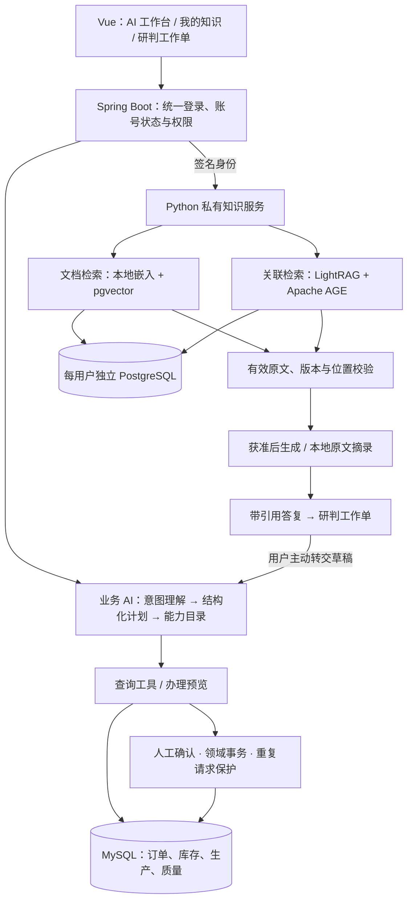

# AI-MES Copilot

[](LICENSE)

**面向智能调光台灯制造的 AI 助手：查业务、读资料、追关系，把建议带入可确认的业务流程。**

Spring Boot · Vue 3 · MySQL · Python / FastAPI · PostgreSQL / pgvector / Apache AGE · LightRAG

[AI 架构详解](docs/AI_ARCHITECTURE.md) · [教师演示与讲解](docs/TEACHER_DEMO.md) · [功能目录](docs/FEATURES.md) · [部署运行](docs/SETUP.md) · [English](README.en.md)

项目以智能调光台灯 L100 / L200 为场景，连接采购、库存、生产、质量、设备与发货。在已有 MES 上集成自然语言业务办理、私有 RAG、GraphRAG 和研判工作单，让业务数据与文档知识各有依据、能够衔接。

## AI 能做什么

| 能力 | 使用示例 | 实现方式 |
|---|---|---|
| **业务查询与分析** | “哪些物料低于安全库存？”“工单还缺什么开工条件？” | 从受权限控制的能力目录选择工具，查询当前业务数据，返回结论、表格、图表和下一步 |
| **业务办理** | 创建订单、排产、生成工单、领料、报工、入库和发货 | 结构化计划 → 校验与预览 → 用户确认 → 领域服务执行 → 回查 |
| **私有文档 RAG** | “L100 当前生效的驱动板是什么？” | 本地中文嵌入与 pgvector 检索，结合有效原文生成带文件、版本和位置的答复 |
| **GraphRAG 与融合问答** | “驱动板、装配工序和检验规范怎样关联？” | LightRAG 抽取实体关系，AGE 保存图谱，关联检索与文档证据共同支持回答 |
| **图谱探索** | 搜索 L100、查看关系、探索实体间路径 | ECharts 展示实际图数据，节点和边可追溯原文，支持筛选、缩放和文字列表 |
| **研判工作单** | 保存结论，补现场备注和人工核对项，导出交接稿 | 保存答复与来源快照，导出或转业务前复核版本，衔接原业务草稿 |
| **多轮与个性化** | 连续追问、按质检或仓储岗位解释 | 私有历史、岗位和篇幅偏好；工作台与浮窗共用草稿，重试保留下一问 |

业务能力目录含 **20 项查询分析、19 项直接办理**。知识检索、图谱和工作单属于独立扩展，具体行为见[功能说明](docs/FEATURES.md)。


*业务工作台历史演示截图，图中数量为当时的演示数据。最新操作步骤见演示说明。*

## AI 架构



**两条主线对应两类事实。** 当前库存由业务工具查询数据库；检验规范由私有知识检索原文。模型负责理解、计划和组织语言，程序负责权限、事实查询和业务执行。知识页识别实时业务请求后提供转交入口，用户检查草稿再继续。

资料上传后保留原文位置，分别建设文档向量与图谱。文档、图谱和融合模式显示实际采用的方式；图谱未就绪时可以使用已就绪文档。未配置模型或未同意处理时，仍能展示本地检索原文。

**[AI 架构详解](docs/AI_ARCHITECTURE.md)** 包含业务 Agent 时序图、RAG 入库与问答、GraphRAG、用户隔离、工作单闭环、技术取舍及关键代码入口。

## 用一个场景讲清价值

合成演示资料中的关联链为：

```text
L100 产品 → DRV-07 驱动板 → PROC-DIM 调光装配 → QC-DIM-01 检验规范
```

1. 问当前驱动板，打开文档 RAG 的引用原文。
2. 问驱动板与工序、检验怎样关联，查看融合答复和图谱路径。
3. 追问能否改用 DRV-08，核对 ECO-L100-02 的“未批准候选变更”状态。
4. 保存为研判工作单，补人工核对项，再转为业务助手草稿。

[10 份关联资料](services/private-assistant/examples/lamp-showcase/README.md)覆盖产品、BOM、装配、检验、故障、设备、仓储、变更、岗位和交接，可构建 PDF、DOCX、XLSX、TXT、MD 五格式包，并提供 [24 个核对问题](services/private-assistant/examples/lamp-showcase/questions.json)。**全部为合成教学样例。**

现场顺序、可直接使用的问题、讲解台词和无模型时的展示方式见 **[教师演示指南](docs/TEACHER_DEMO.md)**。

## 完整业务系统

采购来料 → 来料检验 → 组件生产 / 库存组件领用 → 领料转线边 → 整机生产 → 逐件检验 → 成品入库 → 出货检验 → 销售发货。

系统包含多层 BOM、父子工单、线边库存成对移转、逐件检验、八阶段订单进度、预警及多步任务。统一导航支持模块搜索，业务表单保护未保存内容，手机与桌面分别调整布局。


*生产大屏历史界面验收截图，使用临时演示数据。*

本地 YuNet / SFace 人脸认证与原账号、JWT 和退出流程衔接，支持录入、重录、解绑及管理员授权重置，实际真人验收范围见[人脸说明](docs/FACE_AUTO_CAPTURE.md)。

## 运行与验证

```powershell
git clone https://github.com/han139242/ai-mes-copilot.git
Set-Location ai-mes-copilot
```

| 场景 | 入口 |
|---|---|
| 基础 MES：JDK 21、Node.js 24、MySQL 8 | [配置与启动](docs/SETUP.md) |
| RAG / GraphRAG：Python 3.12、PostgreSQL、模型缓存 | [私有知识服务部署](services/private-assistant/README.md) |
| 课堂资料和提问 | [合成资料与构建方法](services/private-assistant/examples/lamp-showcase/README.md) |
| 本轮检查结果及历史证据 | [验证说明](docs/VERIFICATION.md) |
| 教师要求与现场待验项 | [阶段 2 要求对照](docs/STAGE2_FINAL_RELEASE.md) |

基础手动启动默认前端 5173 / 后端 8088；独立阶段 2 启动器使用前端 5181 / 后端 8089 / 私有服务 8091 / PostgreSQL 55432。先准备对应独立库和配置，服务状态以实际检查为准。

```powershell
Push-Location workspace/vscode/ems-forword
npm ci
npm test
npm run build
Pop-Location
```

模型密钥和数据库口令通过本机环境提供。公开仓库只含源码、测试、合成样例和说明。离线检索与真实生成分别验证；当前引用校验**不能自动证明每句回答都被来源支持**，关键结论需核对原文。Dify 尚未部署；第二位参与者、错误脸等真人现场项目见要求对照。

## 代码与文档

```text
workspace/idea/ems/            Spring Boot：业务 AI、权限、领域服务与测试
workspace/vscode/ems-forword/  Vue 3：AI 工作台、知识页、图谱与工作单
services/private-assistant/   Python：私有 RAG、GraphRAG、人脸与合成资料
scripts/                      启动、迁移、运行监管与验证
docs/                         架构、演示、部署与分轮验证记录
workspace/vx/                 保留的历史微信小程序代码
```

- [AI 架构与关键实现](docs/AI_ARCHITECTURE.md) · [教师演示与讲解](docs/TEACHER_DEMO.md)
- [功能目录](docs/FEATURES.md) · [阶段 2 实现](docs/STAGE2_IMPLEMENTATION.md) · [开源参考](docs/STAGE2_REFERENCES.md)
- [版本记录](CHANGELOG.md) · [贡献指南](CONTRIBUTING.md) · [历史代码边界](docs/LEGACY.md)

## 贡献与许可

感谢 [@han139242](https://github.com/han139242)、[@AnHC-00](https://github.com/AnHC-00)、[@zengjingye](https://github.com/zengjingye)。成员署名见[贡献者说明](CONTRIBUTORS.md)。

原创代码采用 [MIT License](LICENSE)，第三方依赖保留各自版权和许可证。欢迎通过 Issue 反馈问题或通过 Pull Request 改进。
