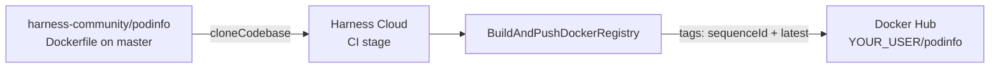

# CI | Tidbits | Publish Artifact

> **Bite-sized how-to** | ~10 min setup

---

## At a glance



The pipeline clones **[podinfo](https://github.com/harness-community/podinfo)**, builds its Dockerfile, and **pushes** the image to **Docker Hub**. Nobody runs `docker build` or `docker push` in a shell. The native **Build and Push to Docker Registry** step is the publish.

This tidbit does **not** deploy. To roll an image out to Kubernetes, see [Introduction to Basic CD Deployments](https://university-registration.harness.io/self-paced-training-tidbit-introduction-to-basic-cd-deployments).

---

## What is “publish” in Harness CI?

A CI pipeline that only compiles or tests still leaves the artifact on the build machine. **Publish** is the step that puts that artifact in a registry other people (and later CD stages) can pull.

| Registry | Native Harness step |
|---|---|
| **Docker Hub** (this demo) | `BuildAndPushDockerRegistry` |
| JFrog Artifactory (Docker) | Same step, Docker-compliant registry URL |
| AWS ECR / GCP GAR / Azure ACR | `BuildAndPushECR` / `BuildAndPushGAR` / `BuildAndPushACR` |
| Generic files (zip, jar) to Artifactory | `ArtifactoryUpload` |

This walkthrough uses Docker Hub because the auth model is one username + access token, and the image path is `user/repo`. The same `BuildAndPushDockerRegistry` step can target Artifactory’s Docker API if you change the connector URL — see [What's next?](#whats-next).

Docs: [Build and Push to Docker](https://developer.harness.io/docs/continuous-integration/use-ci/build-and-upload-artifacts/build-and-push/build-and-push-to-docker-registry), [Build and upload artifacts](https://developer.harness.io/docs/continuous-integration/use-ci/build-and-upload-artifacts/build-and-upload-an-artifact).

---

## Why this approach (and the tradeoffs)

### Why a native Build and Push step?

| | |
|---|---|
| **Pros** | Connector credentials stay out of the script; Harness Cloud uses the Docker plugin; tags and layer cache are first-class fields. |
| **Cons** | You must create a Docker connector first; a `Run` step with `docker build` looks familiar but stores or leaks Hub credentials more easily. |

Prefer the native step for this walkthrough and for production publish. Use a `Run` step only when you need a builder the native step does not wrap.

### Why tag `sequenceId` *and* `latest`?

| Tag | Role |
|---|---|
| `<+pipeline.sequenceId>` | Immutable-enough build id (1, 2, 3…). Later stages can pin this exact image. |
| `latest` | Convenient pull for a demo. It moves on every successful push. |

Do not use `latest` as the only tag in a real CD pipeline. Keep `sequenceId` (or a git SHA) so rollback has a tag to go back to.

### Why podinfo, not this repo?

The application under test is already [harness-community/podinfo](https://github.com/harness-community/podinfo) (`Dockerfile` on branch `master`). This tidbit repo holds the **Harness YAML and the walkthrough**. The pipeline’s codebase is podinfo, not this GitHub repository.

---

## Prerequisites

Before you start, make sure you have:

- A Harness account with a **Project** (note its org + project identifiers).
- Harness Cloud build credits. No delegate is required.
- A GitHub [fine-grained personal access token](https://docs.github.com/en/authentication/keeping-your-account-and-data-secure/managing-your-personal-access-tokens#creating-a-fine-grained-personal-access-token) with **Contents: Read-only** on `harness-community/podinfo` (or any token that can clone that public repo).
- A [Docker Hub access token](https://docs.docker.com/security/for-developers/access-tokens/) that can **push** to a repository you own. Use an access token, not your Hub password.
- A Docker Hub repository you can write to, named `{your-hub-user}/podinfo` (create it empty on Hub if it does not exist).

---

## Step 1 — Review this repo

```
.
├── .harness/
│   └── pipeline.yaml         ← CI stage: clone podinfo, build, push
├── connectors/
│   ├── github.yaml           ← GitHub connector pinned to podinfo
│   └── dockerhub.yaml        ← Docker Hub connector (secret id only)
└── README.md
```

The pipeline clones `https://github.com/harness-community/podinfo` at runtime. You do not copy podinfo into this folder.

This walkthrough creates secrets, connectors, and the pipeline in the Harness UI. The YAML files here are references for what the UI produces. Tokens are not in Git.

---

## Step 2 — Secrets and connectors

1. **GitHub token, then secret.** Create a fine-grained PAT with **Contents: Read-only**. In Harness: Project Settings → Secrets → Text. Id `github-pat`. Paste the token. Do not commit it.

2. **GitHub connector.** Project Settings → Connectors → New Connector → GitHub, or paste [`connectors/github.yaml`](./connectors/github.yaml).

   - URL `https://github.com/harness-community/podinfo`, connection type **Repo**.
   - Authentication: **Username** and **Token** → secret `github-pat`.
   - **Connect through Harness Platform** (`executeOnDelegate: false`) for Harness Cloud.
   - Test the connection.

3. **Docker Hub token, then secret.** In Docker Hub: Account Settings → Personal access tokens. Create a token with permission to push. In Harness: Secrets → Text. Id `dockerhub-pat`. Paste the token.

4. **Docker Hub connector.** Project Settings → Connectors → New Connector → Docker Registry, or paste [`connectors/dockerhub.yaml`](./connectors/dockerhub.yaml).

   - Docker Hub, registry URL `https://index.docker.io/v2/`.
   - Authentication: Username = your Hub username, Password = secret `dockerhub-pat`.
   - **Connect through Harness Platform**.
   - Test the connection.

New to connectors? Walk through [Introduction to CD Connector Usage](https://university-registration.harness.io/self-paced-training-tidbit-introduction-to-cd-connector-usage) first.

---

## Step 3 — Import the pipeline

1. Go to **Pipelines → Create a Pipeline** and open the YAML editor.
2. Paste [`.harness/pipeline.yaml`](./.harness/pipeline.yaml).
3. Set `projectIdentifier` and `orgIdentifier` to yours.
4. Save.

`connectorRef` values are `githubconnector` and `dockerhubconnector` — identifiers, not URLs and not tokens.

The pipeline variable `imageRepo` is `<+input>`. At run time you enter `YOUR_DOCKERHUB_USER/podinfo`.

---

## Step 4 — Run the pipeline (expect a GREEN build)

1. Click **Run**.
2. Keep branch `master` (podinfo’s default).
3. For **imageRepo**, enter `YOUR_DOCKERHUB_USER/podinfo`.
4. Click **Run Pipeline**.

Harness clones podinfo, then:

- **Build and Push podinfo** builds `Dockerfile` from the repo root and pushes two tags to Docker Hub: `<+pipeline.sequenceId>` and `latest`.
- **Confirm image coordinates** prints those two image names in the log.

**Green is the correct outcome.** Then open Docker Hub → your `podinfo` repository and confirm both tags are there.

---

## Pipeline YAML reference

The full pipeline lives at [`.harness/pipeline.yaml`](./.harness/pipeline.yaml). Key shape:

```yaml
properties:
  ci:
    codebase:
      connectorRef: githubconnector
      repoName: harness-community/podinfo
      build:
        type: branch
        spec:
          branch: master
- step:
    type: BuildAndPushDockerRegistry
    spec:
      connectorRef: dockerhubconnector
      repo: <+pipeline.variables.imageRepo>
      tags:
        - <+pipeline.sequenceId>
        - latest
      dockerfile: Dockerfile
      context: .
      caching: true
```

| Piece | Why it exists |
|---|---|
| `cloneCodebase: true` | Fetches podinfo before the step runs |
| `BuildAndPushDockerRegistry` | Native build + push; no `docker` CLI in a Run step |
| `connectorRef: dockerhubconnector` | Hub credentials stay in the connector |
| `tags: sequenceId` + `latest` | Pin-able build id plus a demo-friendly moving tag |
| `caching: true` | Docker layer cache on Harness Cloud |

---

## Common Issues & Tips

**Push fails with 401 / denied.**  
The Docker Hub token cannot write `YOUR_USER/podinfo`. Confirm the Hub username on the connector matches the namespace in `imageRepo`, and that the token is an **access token**, not the account password.

**Clone fails.**  
The GitHub connector is Repo-scoped to `harness-community/podinfo`. Test that connector. Branch must be `master`, not `main`.

**Image built but you cannot find it on Hub.**  
`imageRepo` must be `user/name`, not `docker.io/user/name`. Check the Confirm step log for the exact coordinates.

**Rate limit pulling the base image.**  
Unauthenticated pulls from Docker Hub are limited. The same Hub connector authenticates the push; if pulls fail, confirm Test Connection succeeded.

**I want Artifactory instead.**  
Keep the same step type. Point a Docker connector at your Artifactory Docker endpoint and set `repo` to the Artifactory image path. Or use `ArtifactoryUpload` for non-image files.

---

## What's next?

- **Deploy the tag.** Feed `<+pipeline.sequenceId>` into a Kubernetes (or Helm) stage — [Introduction to Basic CD Deployments](https://university-registration.harness.io/self-paced-training-tidbit-introduction-to-basic-cd-deployments).
- **Artifactory / GHCR / ECR.** Swap the Docker connector URL or use `BuildAndPushECR` / `BuildAndPushGAR` / `BuildAndPushACR`.
- **Build without push.** Scan the image before it leaves the build — [build-only and push-only](https://developer.harness.io/docs/continuous-integration/use-ci/build-and-upload-artifacts/build-without-push).

---

## Resources

- [Build and Push to Docker](https://developer.harness.io/docs/continuous-integration/use-ci/build-and-upload-artifacts/build-and-push/build-and-push-to-docker-registry)
- [Build and upload artifacts](https://developer.harness.io/docs/continuous-integration/use-ci/build-and-upload-artifacts/build-and-upload-an-artifact)
- [Docker Registry connector](https://developer.harness.io/docs/platform/connectors/cloud-providers/ref-cloud-providers/docker-registry-connector-settings-reference)
- [Docker Hub access tokens](https://docs.docker.com/security/for-developers/access-tokens/)
- [podinfo](https://github.com/harness-community/podinfo)
- Sample repo: https://github.com/harness-community/ci-tidbits-publish-artifact
