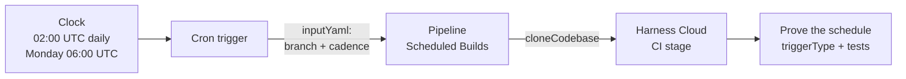

# CI | Tidbits | Scheduled Builds

> **Bite-sized how-to** | ~10 min setup

---

## At a glance



A **Cron trigger** starts this pipeline when the clock matches. Nobody clicks **Run**. The trigger YAML holds the schedule and the runtime inputs (which branch to clone, which cadence label to print). The pipeline YAML stays the same for a nightly run and a weekly run.

---

## What is a scheduled build in Harness CI?

Webhook triggers start a pipeline because Git changed. Artifact triggers start a pipeline because a registry grew a new tag. A **scheduled** trigger starts a pipeline because the time of day (or week) arrived.

Use a schedule when the work should happen even if the repo is quiet:

| Cadence | Typical job |
|---|---|
| **Nightly** | Full test suite, image rebuild, dependency refresh |
| **Weekly** | Heavier jobs you would not pay for every night — a cross-browser pack, a larger scan, a report |

The clock is **UTC** by default. Harness does not shift the expression for daylight saving. A timezone field exists behind `PIPE_SUPPORT_MULTIPLE_TIMEZONES_IN_CRON_TRIGGERS`; without that flag, write the hour you want in UTC.

Docs: [Schedule pipelines using triggers](https://developer.harness.io/docs/platform/triggers/schedule-pipelines-using-cron-triggers), [Triggers overview](https://developer.harness.io/docs/platform/triggers/triggers-overview).

---

## Why a Cron trigger (and the tradeoffs)

### Why schedule at all?

| | |
|---|---|
| **Pros** | The suite still runs on a quiet day; cost and duration sit off the merge path; one pipeline serves more than one cadence. |
| **Cons** | Cron is UTC unless the timezone flag is on; a disabled trigger looks like a missing trigger; a fire-every-minute expression burns build credits. |

A webhook still belongs on the merge path. The schedule is for the work you *want* even when nobody pushed.

### Nightly vs weekly on the same pipeline

Both triggers in this repo point at pipeline id `scheduled_builds`. They differ in three places:

1. The cron `expression`
2. The `cadence` value in `inputYaml` (`nightly` or `weekly`)
3. The trigger `identifier`

The pipeline prints `<+pipeline.variables.cadence>` and `<+pipeline.triggerType>`. `SCHEDULER_CRON` means the clock started the run. `MANUAL` means you clicked **Run** — that is the path you use to prove the stage is green before you enable a trigger.

### UNIX vs QUARTZ

This tidbit uses **UNIX** cron (`minute hour day-of-month month day-of-week`). Harness also accepts **QUARTZ** (`seconds minutes hours day-of-month month day-of-week year`). Pick one `type` per trigger and keep the field count matching that type. Mixing them silently misfires.

---

## Prerequisites

Before you start, make sure you have:

- A Harness account with a **Project** (note its org + project identifiers).
- Harness Cloud build credits (default on Harness-hosted runners). No delegate is required.
- A GitHub [fine-grained personal access token](https://docs.github.com/en/authentication/keeping-your-account-and-data-secure/managing-your-personal-access-tokens#creating-a-fine-grained-personal-access-token) with repository permission **Contents: Read-only** on the repository you will clone.

---

## Step 1 — Review this repo

The application under `app/` is the code the scheduled pipeline fetches. No local Python setup is required. Point **Repository Name** at this public repo: `harness-community/ci-tidbits-scheduled-builds`.

```
.
├── .harness/
│   ├── pipeline.yaml              ← CI stage the triggers start
│   └── triggers/
│       ├── nightly.yaml           ← 02:00 UTC every day
│       └── weekly.yaml            ← 06:00 UTC every Monday
├── connectors/
│   └── github-connector.yaml      ← GitHub connector (secret id only)
├── app/
│   ├── __init__.py
│   └── main.py
├── tests/
│   └── test_main.py
└── README.md
```

This walkthrough creates the Harness secret, the GitHub connector, the pipeline, and the triggers through the Harness UI. The YAML files in this folder are references for what the UI produces. The token is not in Git.

---

## Step 2 — Secret and connector

**Why first?** `cloneCodebase: true` needs a connector before any step runs. A Cron trigger never replaces cloning.

New to Harness connectors? Walk through [Introduction to CD Connector Usage](https://university-registration.harness.io/self-paced-training-tidbit-introduction-to-cd-connector-usage) first, then come back here.

1. **Token, then secret.** Create a fine-grained PAT with **Contents: Read-only**. In Harness: Project Settings → Secrets → Text. Id `github-pat`. Paste the token. Do not commit it.

2. **GitHub connector.** Project Settings → Connectors → New Connector → GitHub.

   - URL `https://github.com`, connection type **Account**.
   - Authentication: **Username** and **Token** → secret `github-pat`.
   - **Connect through Harness Platform** (`executeOnDelegate: false`) for Harness Cloud.
   - Test the connection against a repository the token can read.

---

## Step 3 — Import the pipeline

1. Go to **Pipelines → Create a Pipeline** and open the YAML editor.
2. Paste [`.harness/pipeline.yaml`](./.harness/pipeline.yaml).
3. Set `projectIdentifier` and `orgIdentifier` to yours.
4. Save.

`connectorRef` is `githubconnector` — the identifier from the connector YAML, not a URL and not a token.

The pipeline variable `cadence` is `<+input>`. A Cron trigger fills it from `inputYaml`. A manual run asks you for it.

---

## Step 4 — Run once by hand (expect a GREEN build)

Do this **before** you enable a trigger. A broken pipeline on a schedule burns credits every night.

1. Click **Run**.
2. For **Repository Name**, enter `harness-community/ci-tidbits-scheduled-builds`.
3. Keep branch `main`.
4. For **cadence**, enter `manual`.
5. Click **Run Pipeline**.

Harness clones the codebase, then **Prove the schedule** prints:

- `pipeline.triggerType: MANUAL`
- `cadence: manual`
- the unit tests from `tests/test_main.py`

**Green is the correct outcome.** You now know the stage works when a person starts it. The next step is the clock.

---

## Step 5 — Add the nightly Cron trigger

1. Open the pipeline → **Triggers** → **New Trigger** → **Cron**.
2. Switch to YAML and paste [`.harness/triggers/nightly.yaml`](./.harness/triggers/nightly.yaml).
3. Set `orgIdentifier` and `projectIdentifier` to yours.
4. Leave `enabled: false` until the YAML saves cleanly.
5. Save.

The expression `"0 2 * * *"` with `type: UNIX` is **minute 0, hour 2, every day** — 02:00 UTC.

`inputYaml` is what the trigger would type into the Run dialog:

| Field | Value in this tidbit |
|---|---|
| `repoName` | `harness-community/ci-tidbits-scheduled-builds` |
| `build.branch` | `main` |
| `cadence` | `nightly` |

Cron executions have no Git webhook payload. `<+trigger.commitSha>` stays empty. The trigger pins a **branch** so `cloneCodebase` still has a ref. That is why `inputYaml` sets `build.type: branch`.

6. Enable the trigger (toggle, or set `enabled: true` and save).

### Prove it without waiting until 02:00

Two options:

- **Wait** for the next 02:00 UTC and open **Executions**. The new run should show `pipeline.triggerType: SCHEDULER_CRON` and `cadence: nightly`.
- **Temporarily** change the expression to a time a few minutes ahead (still UTC), save, watch one fire, then restore `"0 2 * * *"`. Do not leave `*/1` (every minute) enabled.

On the scheduled run, **Prove the schedule** should print `SCHEDULER_CRON` and `nightly`. `<+pipeline.triggeredBy.name>` is the trigger name (`Nightly Build`), not a user email.

---

## Step 6 — (Optional) Add the weekly Cron trigger

Same pipeline, second trigger. Paste [`.harness/triggers/weekly.yaml`](./.harness/triggers/weekly.yaml).

`"0 6 * * MON"` is Monday 06:00 UTC. `cadence` is `weekly`. Enable it after a green manual run, the same as nightly.

Both triggers can stay enabled. They do not conflict. Each execution records which trigger started it.

---

## Pipeline and trigger YAML reference

### Pipeline shape

```yaml
properties:
  ci:
    codebase:
      connectorRef: githubconnector
      repoName: <+input>
      build:
        type: branch
        spec:
          branch: main
variables:
  - name: cadence
    type: String
    value: <+input>
```

The Run step echoes `<+pipeline.triggerType>` (`SCHEDULER_CRON` or `MANUAL`) and `<+pipeline.variables.cadence>`.

### Trigger shape

```yaml
trigger:
  name: Nightly Build
  identifier: nightly_build
  enabled: false
  pipelineIdentifier: scheduled_builds
  source:
    type: Scheduled
    spec:
      type: Cron
      spec:
        expression: "0 2 * * *"
        type: UNIX
  inputYaml: |
    pipeline:
      identifier: scheduled_builds
      properties:
        ci:
          codebase:
            repoName: harness-community/ci-tidbits-scheduled-builds
            build:
              type: branch
              spec:
                branch: main
      variables:
        - name: cadence
          type: String
          value: nightly
```

| Piece | Why it exists |
|---|---|
| `type: Scheduled` / `type: Cron` | Clock, not Git |
| `expression` + `type: UNIX` | Five-field cron, evaluated in UTC |
| `enabled: false` on first save | Lets you review YAML without firing |
| `inputYaml` branch | Cron has no commit SHA; clone still needs a ref |
| `cadence` | Distinguishes nightly vs weekly in the same pipeline |

---

## Common Issues & Tips

**The trigger saved but nothing runs.**  
`enabled` is still `false`, the expression is in local time instead of UTC, or you used QUARTZ fields with `type: UNIX`. Check the trigger toggle and count the fields: UNIX has five.

**Execution starts, clone fails.**  
`inputYaml` must set `repoName` and a `build` (branch or tag). Cron does not fill Git payload expressions.

**`pipeline.triggerType` is `MANUAL` on a run you expected from cron.**  
That execution came from the **Run** button. Open **Triggers** and confirm the Cron trigger is enabled. Filter executions by the trigger name.

**I changed the expression to every minute to test and forgot.**  
Disable the trigger immediately. Restore `"0 2 * * *"` (or the weekly expression). Every-minute cron on Harness Cloud spends credits.

**Daylight saving shifted my 02:00.**  
Default evaluation is UTC, which does not observe DST. If you need a wall-clock timezone, ask Harness Support for `PIPE_SUPPORT_MULTIPLE_TIMEZONES_IN_CRON_TRIGGERS` and set `timezone:` to an IANA name such as `America/New_York`.

**Webhook vs schedule on the same pipeline.**  
They coexist. A push trigger still belongs on the merge path. Keep the Cron trigger for the quiet-hours suite.

---

## What's next?

- **Webhook trigger.** Add a GitHub push or pull-request trigger on this same pipeline for the merge path.
- **Heavier weekly job.** Change the weekly trigger's `inputYaml` to select extra stages (`stagesToExecute`) when the Monday run should do more than the nightly.
- **Timezone.** Enable the multi-timezone flag if the team thinks in a local wall clock.

---

## Resources

- [Schedule pipelines using triggers](https://developer.harness.io/docs/platform/triggers/schedule-pipelines-using-cron-triggers)
- [Triggers overview](https://developer.harness.io/docs/platform/triggers/triggers-overview)
- [Triggers reference](https://developer.harness.io/docs/platform/triggers/triggers-reference)
- [Configure a codebase](https://developer.harness.io/continuous-integration/use-harness-ci/use-harness-ci/codebase-configuration/create-and-configure-a-codebase)
- [Add and use text secrets](https://developer.harness.io/docs/platform/secrets/add-use-text-secrets)
- Sample repo: https://github.com/harness-community/ci-tidbits-scheduled-builds
