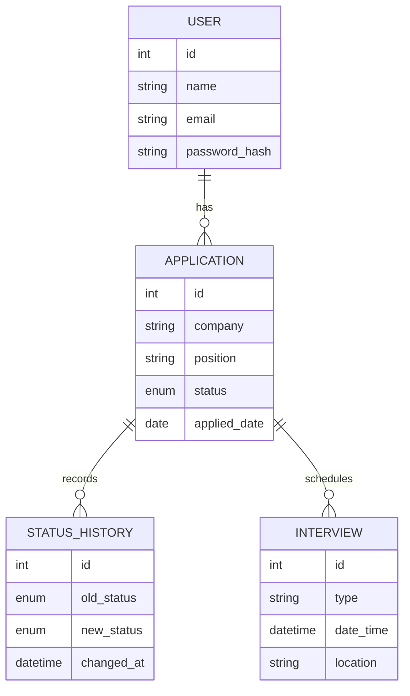

# JobTraker

A full-stack web app that helps students and job seekers track every internship and job application in one place, from wishlist to offer.


## Features

- **Secure accounts:** register and log in with JWT authentication and bcrypt-hashed passwords
- **Application tracking:** add, edit, delete, search, filter, and sort applications
- **Kanban board:** drag and drop cards between Wishlist, Applied, Interview, Offer and Rejected
- **Status timeline:** every status change is recorded with a date and time
- **Analytics:** status breakdown and weekly applications charts, plus response, interview and offer rates
- **Interview scheduling:** month calendar and upcoming list; scheduling an interview moves the application to Interview automatically
- **Private data:** every user only sees their own applications

## Screenshots

| Board | Analytics |
|---|---|
|  |  |

| Interviews | Application detail |
|---|---|
|  |  |

## Tech stack

| Layer | Technology |
|---|---|
| Frontend | React (Vite), React Router, Axios, Recharts, @hello-pangea/dnd, plain CSS |
| Backend | Node.js, Express, JWT, bcryptjs |
| Database | PostgreSQL (Neon) with Prisma ORM |

## Database design



## API overview

| Method | Endpoint | Description |
|---|---|---|
| POST | `/api/auth/register` | Create an account |
| POST | `/api/auth/login` | Log in and receive a token |
| GET, POST | `/api/applications` | List (with search and filters) or create |
| GET, PUT, DELETE | `/api/applications/:id` | Read, update or delete one application |
| GET | `/api/stats` | Analytics data |
| GET, POST | `/api/interviews` | List or schedule interviews |
| PUT, DELETE | `/api/interviews/:id` | Update or delete an interview |

All routes except register and login require a `Bearer` token.

## Run it locally

You need Node.js 18+ and a free [Neon](https://neon.tech) PostgreSQL database.

```bash
git clone https://github.com/hash-wk/JobTracker.git
cd JobTracker

# Backend
cd backend
npm install
cp .env.example .env        # then fill in DATABASE_URL and JWT_SECRET
npx prisma migrate deploy
npm run dev

# Frontend (new terminal)
cd frontend
npm install
npm run dev
```

Open http://localhost:5173.

## What I learned

- Designing a relational schema with one-to-many relationships and cascading deletes
- Protecting REST APIs with JWT middleware and scoping every query to the logged-in user
- Optimistic UI updates for drag and drop, with rollback when a request fails
- Aggregating data on the server for charts

## Author

Wandana Kulathilaka · [LinkedIn](https://www.linkedin.com/in/wandana-kulathilaka-0568bb311/) · [GitHub](https://github.com/hash-wk)