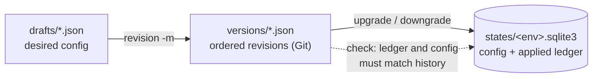

<p align="center">
  
</p>

<p align="center">
  <a href="https://github.com/himanshu231204/prompt-migrate/actions/workflows/ci.yml"></a>
  <a href="https://pypi.org/project/promptmigrate-cli/"></a>
  <a href="LICENSE"></a>
  
  
  <a href="https://github.com/himanshu231204/prompt-migrate/issues?q=is%3Aissue+is%3Aopen+label%3A%22good+first+issue%22"></a>
</p>

# PromptMigrate

**Alembic-style migrations for LLM prompts and AI agent configuration.** Keep prompts and agent configs as Git-tracked JSON, generate ordered, reviewable revisions, apply them to environments, roll them back, and fail CI when an environment drifts from history.

```bash
python -m pip install promptmigrate-cli
```

The PyPI package is `promptmigrate-cli`; the command and the import are both `promptmigrate`. See [Install](#install) for details.

<p align="center">
  
</p>

> [!NOTE]
> PromptMigrate is a **v0.1 local prototype**. Environments are local SQLite files, and nothing is deployed to Langfuse, OpenAI, Azure AI Foundry or any other runtime. See [what is and isn't guaranteed](#safety-and-integrity).

## Why PromptMigrate?

Langfuse, MLflow, Agenta and promptctl already version and manage prompts. PromptMigrate focuses on something narrower: an **ordered migration protocol** for configuration, the way Alembic does it for database schemas.

- **Ordered history:** every revision names its predecessor, forming one linear chain.
- **Reversible:** each revision stores full before/after snapshots, so `downgrade` is deterministic.
- **Integrity-checked:** applied revisions are checksummed; editing one, or changing an environment by hand, is reported as drift.
- **CI-friendly:** stable exit codes and `--output json`.
- **Declarative and safe:** revisions are pure JSON, never executable code. The runtime uses only the Python standard library.

It's designed to sit alongside prompt registries, not replace them.

## Install

Python 3.10 or newer. The PyPI distribution is named `promptmigrate-cli` (the name `promptmigrate` was already taken); the command and the import are both `promptmigrate`:

```bash
python -m pip install promptmigrate-cli
promptmigrate --version
```

To work on PromptMigrate itself, install from a clone instead:

```bash
git clone https://github.com/himanshu231204/prompt-migrate.git
cd prompt-migrate
python -m pip install -e .
```

## Five-minute example

In a separate, empty project directory, run the example with the starter draft
that `init` creates. You can edit the draft before generating the first revision.

<!-- quickstart-smoke:start -->
```bash
promptmigrate init
promptmigrate env list
promptmigrate env add qa
# Optional: edit .promptmigrate/drafts/assistant.json with the desired system prompt,
# model, temperature, tool specs, response schema, etc.
promptmigrate revision -m "initial assistant prompt"
promptmigrate history
promptmigrate plan --env dev --target head
promptmigrate upgrade head --env dev
promptmigrate check --env dev --require-head
promptmigrate get assistant --env dev
```
<!-- quickstart-smoke:end -->

Then edit `.promptmigrate/drafts/assistant.json` and run:

```bash
promptmigrate diff
promptmigrate revision -m "strengthen refusal instructions"
promptmigrate upgrade head --env staging
promptmigrate current --env staging
promptmigrate downgrade -1 --env staging
```

A revision describes the change from the previous Git-tracked revision, **not from your local dev database**, so pull your team's latest revisions before generating one. For multi-agent systems, add more drafts such as `planner.json` or `reviewer.json`. Deleting a draft and generating a revision deletes that config in the target environment, reversibly.

A runnable two-agent walkthrough is in [`examples/multi-agent-basic/`](examples/multi-agent-basic/).

## What a revision looks like

```json
{
  "format_version": 1,
  "revision": "0123456789ab",
  "down_revision": null,
  "message": "initial assistant",
  "created_at": "2026-10-29T00:00:00+00:00",
  "changes": {
    "assistant": {
      "before": null,
      "after": {
        "messages": [{"role": "system", "content": "You are helpful."}],
        "model": "provider/model-id",
        "parameters": {"temperature": 0}
      }
    }
  }
}
```

`before` and `after` are full JSON snapshots, and `null` means the config is absent. One revision can change several configs in a single atomic transaction. Snapshots make reversal deterministic, at the cost of larger files and keeping old values in Git history.

## How it works



`upgrade` and `downgrade` verify the environment against history, then change the configs and the applied-revision ledger together in one SQLite transaction. If anything doesn't match, the command fails without writing.

## Commands

| Command | Behavior |
|---|---|
| `init` | Create the migration workspace and a starter draft |
| `diff` | Compare local drafts with the latest revision |
| `revision -m "..."` | Generate a revision from draft changes |
| `history` | Print the revision chain |
| `current --env dev` | Show an environment's current revision |
| `plan --env dev [--target head]` | Preview what an upgrade or downgrade would change; writes nothing |
| `upgrade head --env dev` | Apply pending revisions atomically |
| `downgrade -1 --env dev` | Undo the last applied revision (`base` reverts all) |
| `check --env dev --require-head` | Detect drift, edited applied revisions and pending revisions |
| `restamp --env dev` | Accept applied v0 revisions whose files changed only in line endings |
| `validate [--strict] [--drafts-clean]` | Check revision history, drafts and manifests without touching any environment |
| `get assistant --env dev` | Read a config from a local environment |
| `env add qa` / `env list` | Declare and list local environments |

### Recovering from line-ending drift

If `check` exits with code `4` and reports that a migration file was modified after apply because of line endings only, this may happen when a v0 revision was created and applied on Windows before Git normalized its line endings.

When the error explicitly says `line endings only`, run `promptmigrate restamp --env <env>`, replacing `<env>` with the affected environment name. For example, for the `dev` environment:

```bash
promptmigrate restamp --env dev
```

Example successful output (the revision ID will differ):

```text
Restamped 1 revision(s) in dev: <revision-id>
```

`restamp` accepts only line-ending-only changes to applied v0 revisions. It does not repair other file modifications or general state drift.


Global flags: `--project <dir>` targets another project directory, and `--output json` prints machine-readable results. Exit codes are documented in [`docs/CLI_SPEC.md`](docs/CLI_SPEC.md).

## Project layout

```text
project/
  .promptmigrate/
    drafts/              # desired JSON configs (Git tracked)
    versions/            # revisions with before/after snapshots (Git tracked)
    environments.json    # declared environments (Git tracked)
    states/              # local SQLite state per environment (gitignored)
```

> [!WARNING]
> `states/prod.sqlite3` is a **local file named prod**, not a production deployment. Production-like names print a warning for this reason.

## Use in CI

In your project's workflow, install PromptMigrate from PyPI, then replay every revision into a throwaway environment and verify it:

```yaml
- run: python -m pip install --upgrade promptmigrate-cli
- run: promptmigrate validate --strict --drafts-clean
- run: promptmigrate upgrade head --env dev
- run: promptmigrate check --env dev --require-head
```

`states/` is gitignored, so a fresh CI checkout starts every environment at the empty base. This job proves the revision history loads, applies cleanly in order from scratch, and verifies. It can't check a long-lived environment such as `staging`, because that state lives only on the machine that owns it; shared remote state is planned for Phase 3.

`validate` checks only the files in Git (history, drafts, manifests, secret allowlist) and exits 3 on any finding under `--strict`; `--drafts-clean` also fails when a draft edit has no revision yet. `check` exits non-zero on drift, an edited applied revision, or (with `--require-head`) pending revisions. It verifies **integrity, not prompt quality**: it doesn't measure answer quality or prompt-injection resistance.

## Safety and integrity

**Guaranteed today:**

- Applying or reverting several revisions is atomic **inside one local SQLite database**.
- Applied revisions are checksummed. Editing one blocks that environment (v1 revisions ignore formatting-only changes).
- Out-of-band changes to an environment's configs are rejected as drift.
- History is one linear chain; parallel branches must be resolved first.
- Revisions are pure JSON; no migration code is ever executed.
- No provider API keys or network calls are needed.
- Secret-like values are refused in new revisions and redacted in `diff`/`get` output. Detection is heuristic, and secrets already in Git must be rotated.

**Not guaranteed yet:** transactions across model providers, locks across hosts, remote state, signed revisions, authentication, evaluation gates, canary releases or an append-only audit history. Don't use v0.1 to manage live production prompts or secrets.

## Roadmap

The plan is in [`docs/ROADMAP.md`](docs/ROADMAP.md) and tracked as GitHub milestones:

1. [**Phase 1: Harden the migration core**](https://github.com/himanshu231204/prompt-migrate/milestone/1) (in progress): concurrency and fault-injection tests, package smoke tests.
2. [**Phase 2: Evaluation and policy gates**](https://github.com/himanshu231204/prompt-migrate/milestone/2)
3. [**Phase 3: Production release protocol**](https://github.com/himanshu231204/prompt-migrate/milestone/3)
4. [**Phase 4: Stable community release**](https://github.com/himanshu231204/prompt-migrate/milestone/4)

## Contributing

Contributions are welcome. Every issue is a single task with acceptance criteria.

- New here? Pick a [**good first issue**](https://github.com/himanshu231204/prompt-migrate/issues?q=is%3Aissue+is%3Aopen+label%3A%22good+first+issue%22).
- Want to shape the design? Join an [**RFC discussion**](https://github.com/himanshu231204/prompt-migrate/issues?q=is%3Aissue+is%3Aopen+label%3Arfc).
- Read [`CONTRIBUTING.md`](CONTRIBUTING.md) for setup and where code lives, and [`AGENTS.md`](AGENTS.md) for the project rules (they apply to people and AI coding agents alike).

```bash
python -m pip install -e ".[dev]"
python -m pytest -q
```

Design docs start at [`docs/HANDOFF.md`](docs/HANDOFF.md).

## Community

- [Code of Conduct](CODE_OF_CONDUCT.md)
- Report security issues privately: see [`SECURITY.md`](SECURITY.md)
- Changes are listed in [`CHANGELOG.md`](CHANGELOG.md)

## License

[MIT](LICENSE)

<!-- gumroad-footer -->
---

### More free resources

I share free visual notes, agent skills and guides on AI agents, Google ADK, RAG and LLMs.

[](https://himanshu231204.gumroad.com) → **[himanshu231204.gumroad.com](https://himanshu231204.gumroad.com)**
