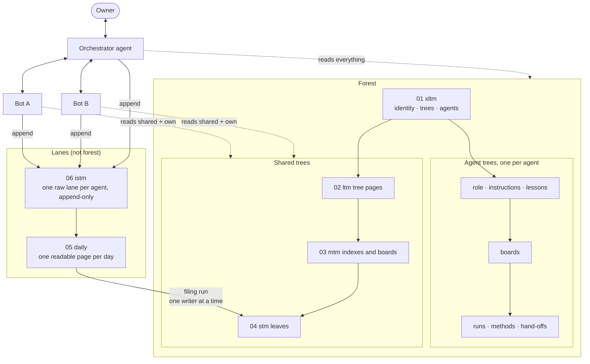

# Agent Memory Forest

**A readable, rule-kept local memory for long-running AI agents and teams of agents.**

**English** · [한국어](README.ko.md) · [简体中文](README.zh-CN.md) · [日本語](README.ja.md) · [Español](README.es.md) · [Français](README.fr.md) · [Deutsch](README.de.md)

[](https://github.com/hyungchulc/agent-memory-forest/actions/workflows/ci.yml)
[](https://www.python.org/)
[](LICENSE)
[](docs/privacy-and-trust.md)

Agent Memory Forest is a Python package and a `forest` command that keep what agents learn as plain
Markdown pages in a few numbered folders on your own disk. Every fact has one home, decided by rules rather
than by the chat or the agent that brought it in, and code, not a model, decides where a page belongs and
when a subject has grown enough to get pages of its own.

**Status:** version `1.0.0b1`, a beta: the first public release of version 1. The 0.3 `memory-forest`
command stays installed beside it ([archive](docs/archive-0.3/cli.md)).

> [!IMPORTANT]
> Agent Memory Forest is not a hosted service, an authorization system, or a promise that an agent will
> remember correctly. Memory is grounding data: a caller still opens the page it was routed to, checks how
> fresh it is, and applies its own authority and safety rules. The forest holds no credentials, and
> everything except optional vector search works with no network.

## Start here

You need Python 3.11 or newer and a POSIX filesystem; there are no runtime dependencies outside the
standard library. On Windows, use WSL2 and keep the forest on the Linux filesystem; read the
[WSL2 guide](docs/wsl2.md) first. The package is on no package index. Install it from the repository's
address:

```sh
python -m pip install "git+https://github.com/hyungchulc/agent-memory-forest"
```

or from a clone, with `python -m pip install .` in its folder. `forest --version` checks the install;
where the `forest` command is not on the path, `python -m memory_forest.forest` is the same command. Then
say one sentence to your agent:

> Run `forest guide` and follow it.

The agent connects itself. It runs `forest setup`, which hands it the questions to ask you, and asks you
each of them: where the forest lives, the agent's name, whether it is your main agent, which conversations
come in, and who keeps the forest growing. Every question that is yours to answer comes to you; the agent
never answers one itself. It then sets the forest up or joins the one you named, registers the finding
server in its own tool, brings its own conversation in, and proves the result with `forest doctor`.

## What you get

- **The forest and its rules.** Numbered folders of plain pages, and one contract every forest keeps:
  [contract](docs/contract.md), explained for a new reader in [concepts](docs/concepts.md).
- **The structure tools.** `forest init`, `registry`, `move`, `levels`, `collections`, `record`,
  `archive`, `check`, `lint`, `numbers`, `credentials` and `recover`: [tools](docs/tools.md).
- **Finding.** `forest search`, `read`, `timeline` and `navigate` as commands, and `forest mcp`, an MCP
  server with five tools (`memory_search`, `memory_read`, `memory_timeline`, `memory_navigate`,
  `memory_log`): [tools](docs/tools.md#forest-mcp).
- **Two write doors.** `forest log` or `memory_log` for an agent's own turn, and records in the lane's
  shape, read by `forest intake --from jsonl`: [tools](docs/tools.md#forest-intake).
- **A tree per agent.** Shared trees for what everyone needs, a tree of its own for each agent, and reader
  scopes: [agents](docs/multi-agent.md).
- **The guide, setup and doctor.** `forest guide` (setup, routine, use, contract), `forest setup` and
  `forest doctor`: [connecting an agent](docs/setup.md) and [tools](docs/tools.md#forest-guide).

## What it does not do

- **It reads no particular agent program's transcripts.** Every program keeps its conversation in its own
  format, and the package cannot keep up with all of them; shipping readers for a few would promise what it
  cannot keep. Your agent knows its own program: following the guide, it writes a small exporter that
  appends its turns as records. Someone who knows a program well can write a reader for it
  ([adapters](docs/adapters.md)).
- **It has no engine and no timer.** The daily record, the filing run and the upkeep run are carried out by
  your agent, on its own schedule and with its own model, following `forest guide routine`. The package is
  the judge: `forest check`, `forest lint`, `forest levels` and `forest doctor`.
- **It writes nothing into another program's settings**, and it has no plugins. Setup writes only inside
  the forest's folder and tells the agent what to register in its own tool.

## By hand

Without an agent, the same path is a few commands. Setup with no answers lists the questions; with every
answer it writes the forest and prints its `todo`:

```sh
forest setup                                   # next: ask_owner, and each question with its flag
forest setup --root studio-forest --as "Kiln Bot" --main yes --conversations all --earlier no \
  --keeper this --when "every night at 23:30" --daily-model "small model" --filing-model "large model"
# next: done
# todo 1. register_mcp  2. bring_turns  3. own_turn  4. routine  5. verify, each with its command
```

Carry out the `todo`: register `forest mcp --as kiln-bot --root studio-forest` in your MCP client, and
bring turns in with the printed `forest intake` command or with `forest log`. Then prove it:

```sh
forest doctor --as "Kiln Bot" --root studio-forest --phrase   # prints a new phrase to say
forest log --as kiln-bot --root studio-forest <<'TURN'
Kiln Two fires to cone 5 for now. forest doctor phrase orchid maple amber
TURN
forest index build --root studio-forest
forest doctor --as "Kiln Bot" --root studio-forest              # result: passed (exit 0), or todo (exit 1)
```

The phrase is new each time; bring in the one your doctor printed. The `finding` check passes once an MCP
client has called the server once; until then the doctor says `todo` and prints the `forest mcp` command to
register. With no MCP client the commands are the doors: add `--doors commands` to the doctor line, and
the search the doctor runs is the proof.

The answers hold. The agent that keeps the forest reads every agent's turns, so it is your main agent
(`--keeper this` with `--main no` is asked again). And when you answer `--conversations none` for an
agent, the forest itself refuses that agent's turns (`recording_off`), whatever exporter or hook still
runs.

## Documentation

| Document | What it covers |
| --- | --- |
| [Concepts](docs/concepts.md) | the forest for a new reader: layers, a subject's life, one home, what goes up, records, moves, the lint |
| [Contract](docs/contract.md) | every rule a forest keeps, stated once |
| [Connecting an agent](docs/setup.md) | what `forest setup` asks and writes, and what `forest doctor` proves |
| [Agents](docs/multi-agent.md) | agent trees, the two filing policies, reader scopes, the single writer |
| [Design](docs/v1-design.md) | the package: on-disk layout, settings, package map, milestones |
| [Tools](docs/tools.md) | `forest move`, `levels`, `collections`, `check`, `lint`, `record`, `numbers`, `intake`, `index`, `search`, `timeline`, `log`, `mcp`, `guide`, `setup` and `doctor` |
| [Writing a reader](docs/adapters.md) | a reader of one agent program's own transcripts, for someone who knows that program |
| `forest guide` | the setup guide: the steps an agent follows to connect itself |
| `forest guide routine` | the routine guide: the daily record, the filing run and the upkeep run, for the agent that keeps the forest |
| `forest guide use` | the use guide: when and how an agent looks things up |
| `forest guide contract` | the contract, as the installed package prints it |
| [Comparison](docs/comparison.md) | how this differs from Mem0, GBrain, the LLM Wiki idea and plain vector RAG |
| [Privacy and trust](docs/privacy-and-trust.md) | what stays local, what a reader can see, memory as untrusted data |
| [Roadmap](docs/roadmap.md) | the three milestones and what may come later |
| [WSL2](docs/wsl2.md) | running on Windows through WSL2 |
| [Archive of 0.3](docs/archive-0.3/) | the 0.3 documents that version 1 replaces |

The three guides and the contract ship inside the package (`src/memory_forest/guide/`) and those commands
print them, so an agent reads the copy that matches the version it has installed.

## Why this exists

A long-running agent tends to fail at memory in one of two ways: it keeps too little, or it keeps a pile
that grows until nothing in it can be found and nobody can correct it. Version 1 is built around a few
properties that address that directly.

- **The subject is the unit.** A person, a project, a device, an agent: each has one registry line with its
  aliases, and its material lives in its own home.
- **Places are decided by code.** A subject's level (an entry on a shared page, a leaf, a branch, a tree)
  follows the number of distinct days its material covers. Every move goes through one tool that rewrites
  references and logs the move.
- **One home for each fact.** Other pages carry a dated reference line, not a copy, so facts cannot drift
  apart.
- **History is kept.** A changed fact moves to the page's update record; long records are archived
  verbatim; nothing is deleted.
- **Upper pages hold what is established.** A preference reaches a summary page only on repeated evidence
  or the owner's own words, never because it is the newest thing said.
- **A linter with codes.** Every rule that has a shape is checked, and a run must clean up what it added
  without being blocked by what was already there.
- **Built for several agents.** Raw lanes per agent, one writer at a time, reader scopes, and two filing
  policies.

## The forest in one picture



Material moves up from the lanes into the leaves, and only what the leaves establish is carried up to the
boards and tree pages. Placement goes the other way: the root index says which tree a kind of subject
belongs to, the tree says which branch, the branch holds the leaf. [Concepts](docs/concepts.md) walks
through one subject's life from a one-day mention to a tree of its own.

| Folder | Holds |
| --- | --- |
| `01 xltm/XLTM.md` | the root index: who the owner is, the list of trees with placement rules, the list of agents |
| `02 ltm/<tree>_LTM.md` | one page per tree: scope, durable patterns and rules, current state, branches |
| `03 mtm/<tree>/` | the tree's index (its registry of subjects) and one board per branch |
| `04 stm/<tree>/<branch>/` | the leaves: one sub-topic of one subject each, in full detail, at most 8 KB of content |
| `05 daily/` | the readable record of each day (a lane) |
| `06 istm/` | the raw record, append-only, one lane per agent (a lane) |
| `.forest/` | the compiled registry, the move log, the archive, indexes and locks |

## Agents in five lines

Several agents share one forest: shared trees for what everyone needs, a tree per agent for what is
its own, and an orchestrator that reads all of it. An agent that joins with `forest setup` has its tree
when setup answers `done`. Any other agent's tree comes by itself: when an agent writes the first line to
its raw lane, the next upkeep step makes its tree.

```sh
ls "my-forest/06 istm/post-bot"            # the agent wrote its first line here
# 2042-05-15.jsonl
forest levels apply --root my-forest       # one command, the same upkeep step that settles every level
# post-bot: none -> tree (agent; its raw lane holds a file)
ls my-forest/"02 ltm"
# post-bot_LTM.md   studio_LTM.md          # its tree page: role, instructions, lessons, current state, branches
```

1. An agent (an orchestrator, a bot, a scheduled stage) is a subject that is a tree from its first day.
   A turn it writes with `forest log` or `memory_log` makes the tree, or leaves it pending for the next
   write after another writer releases the lock. An agent is its name, in any script. The exact stored
   id wins before the name key, across the whole forest, before group membership. Names are encoded
   where page syntax needs it; admitted names are never refused by a second name rule.
   `forest levels apply` makes the tree that a settings entry or an intake lane left due.
2. Its tree page holds its role, standing instructions, lessons, current state and branches.
3. `subject-first` (default) files facts in the subject's home tagged `noted by <agent>`; `agent-first`
   files them in the agent's tree with `about:` pointers, and shares a fact once two agents hold it.
4. An orchestrator reads the whole forest; other agents read shared trees and their own.
5. Each agent appends to its own raw lane, and one filing run at a time writes the forest under a lock.

The lane commit fixes `stored` and the turn id; ids, caller-key and source records, the tree, the index and connection bookkeeping are derived, with `pending` and a reason when unfinished.

If a crash loses the answer, the caller cannot know whether the turn was stored; repeating the call with its key is safe.

Details: [Agents](docs/multi-agent.md).

## All the commands

The commands use `--root` when you pass it, and otherwise the nearest folder at or above the current one
that holds `forest.toml`. `forest init` and `forest setup` create a forest; `forest guide` needs none. The
block below creates a forest and enters it, so each following line finds that file.

```sh
# Milestone 1: skeleton and structure tools
forest init my-forest                          # settings, layers, root index
cd my-forest                                   # this folder is the forest the commands below use
forest move new-agent studio-hub --name "Studio Hub" --role "orchestrator"   # or let its lane make it
forest registry build                          # compile every ## Subjects section
forest levels check                            # which subjects and agents are due a new level
forest levels apply                            # carry them out through the move tool, logged
forest check --sync                            # bring derived lists up to the pages, then every check
forest lint                                    # every rule with a shape, by code
forest repeats check                           # fact lines two leaves of one subject share
forest record kinds                            # the update records' lines by kind
forest numbers check --all                     # account, card, identity and phone numbers in full

# Milestone 2: connecting and finding
forest setup --root . --as "Kiln Bot" --main yes --conversations all --earlier no --keeper nobody
                                               # the owner's answers: the agent, its tree, its record file
forest intake --from jsonl --as kiln-bot --transcript transcripts/kiln-bot.jsonl --once
                                               # records an exporter appended, into the agent's raw lane
forest intake status                           # lines an adapter did not understand
forest log --as kiln-bot                       # the turn is read from stdin
forest index build                             # .forest/index.sqlite, rebuildable
forest search "cone 5" --as kiln-bot           # aliases first, then words, inside the reader's scope
forest timeline query "yesterday evening" --as kiln-bot
forest navigate --as kiln-bot                  # one level down from the root index
forest mcp --as kiln-bot                       # search, read, timeline, navigate, memory_log
forest agents                                  # groups, lanes, and when each agent was last seen
forest guide                                   # the setup guide; `routine`, `use` and `contract` are the other parts
forest setup                                   # with no answers: the questions an agent asks its owner (exit 1)
forest doctor --as kiln-bot                    # proves a turn arrives and the MCP server was called (exit 1 until both)

# Milestone 3: growing. Your own agent carries out the daily record, the filing run and the upkeep run,
# following `forest guide routine`; the commands above judge what it wrote.
```

To see what a forest looks like before any code runs, read the invented
[synthetic forest](examples/synthetic-forest/README.md): an owner, three shared trees, an orchestrator and
two bots, two days of daily pages and a raw lane, about forty small files.

## Status

Agent Memory Forest is beta software. The version in this tree is 1.0.0b1, the first public release of
version 1.

- **Written:** the contract, the design, the concepts and agents guides, and an invented synthetic forest
  that follows the contract.
- **Milestone 1, skeleton:** the `forest` structure commands (registry, move, levels, collections, record
  with its history files, archive, `check`, `lint`, number starring, `recover`), agents' trees made from
  their lanes or settings, and an undo journal for every commit, with tests on made-up forests and the
  synthetic forest passing every check.
- **Milestone 2, connecting and finding:** `forest intake` reads records in the lane's shape (the `jsonl`
  adapter, or an adapter someone plugs in through the entry point group `memory_forest.adapters`) into that
  agent's raw lane, and `forest log` and `memory_log` write an agent's own turn. `forest index` builds the
  search index (`.forest/index.sqlite` until `forest index reset` points at a new file). `forest search`,
  `forest read`, `forest timeline` and `forest navigate` answer from it, inside `agents.readable_trees`,
  and `forest mcp` serves search, read, timeline, navigate and `memory_log`. The owner's agent connects
  itself with `forest guide`, `forest setup` and `forest doctor`
  ([design, section 15](docs/v1-design.md#15-connecting-agents)).
- **Milestone 3, growing:** the daily record, the filing run and the nightly upkeep are carried out by the
  owner's own agent, following the contract (section 10) and `forest guide routine`.
- **Not part of this release:** readers of particular agent programs' own transcripts (whoever knows a
  program writes its reader, [adapters](docs/adapters.md)), and an engine that runs the daily, filing and
  upkeep stages.

The 0.3 code (`memory-forest`) stays in this tree beside version 1. It is suitable for evaluation and
adaptation, not for unattended high-stakes decisions.

## Contributing

Read [CONTRIBUTING.md](CONTRIBUTING.md). Keep fixtures invented, keep real forests outside Git, and run the
full local check before opening a pull request.

```sh
make check
```

Security issues follow [SECURITY.md](SECURITY.md). Community participation follows
[CODE_OF_CONDUCT.md](CODE_OF_CONDUCT.md).

## License

Agent Memory Forest is released under the [MIT License](LICENSE).
