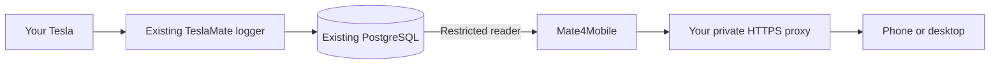

<div align="center">


[](https://itchyparrot53.github.io/mate4mobile/) [](https://itchyparrot53.github.io/mate4mobile/demo/) [](#getting-started)

[](https://github.com/itchyparrot53/mate4mobile/commits/main/) [](https://github.com/itchyparrot53/mate4mobile/stargazers) [](LICENSE)

</div>

## What is Mate4Mobile?

This project is an unofficial community tool and is not affiliated with, endorsed by, or supported by the official TeslaMate project.

**TeslaMate records it. Mate4Mobile gives it a home on your phone.**

Mate4Mobile is a **self-hosted web app for your existing TeslaMate installation**. It reads the history in your TeslaMate PostgreSQL database and turns it into a dashboard for your phone and desktop. Add it to your Home Screen as a PWA, then check your battery, revisit drives and explore charging costs.

It runs on your server alongside TeslaMate. Your logger keeps recording; Mate4Mobile provides the daily view. Free to self-host, with no additional Tesla API connection or cloud account required.

<p align="center">
  <a href="https://itchyparrot53.github.io/mate4mobile/demo/">
    
  </a>
</p>

<p align="center"><sub>Try it before you install · Sample data · <a href="https://itchyparrot53.github.io/mate4mobile/demo/">Try the interactive demo</a></sub></p>

<a id="getting-started"></a>

## Get started

### What runs on your server

| Part | Technology and purpose |
| --- | --- |
| Phone and desktop interface | HTML, CSS and vanilla JavaScript, with Leaflet maps. An installable PWA; no frontend framework. |
| Backend | Node.js HTTP server using `pg` to read PostgreSQL. Node 22+ supported; the container uses Node 24. |
| Data | Your existing TeslaMate database, accessed through a restricted reader. No separate telemetry database. |
| Deployment | One separate app container managed by Docker Compose, or a [native Node/systemd installation](docs/NATIVE.md). HTTPS comes from your reverse proxy. |

### What the installer changes

The [setup script](scripts/setup.sh) runs on your TeslaMate host. It:

- Creates a **new PostgreSQL reader role** with `SELECT` on ten named tables. The database owner is used only for provisioning; the app does not get access to TeslaMate's `tokens` table.
- Generates a reader password, dashboard passphrase and signing secret in a private `.env` file with mode `600`. It refuses to overwrite an existing `.env` or take over an existing role.
- Builds the app image from this checkout, checks database privileges, and starts the separate `mate4mobile` Compose project with a health check.
- Binds the app to **`127.0.0.1:8099` by default**. You configure HTTPS separately; the script does not open router ports or install an authentication gateway.

It does not replace TeslaMate's Compose file, restart its logger, migrate telemetry tables or change your Tesla credentials. Review the [Compose file](compose.yml) and [installation walkthrough](docs/INSTALL.md) before running it.

### Choose how to set up

**Want guided help?** [Copy the AI setup prompt on the website](https://itchyparrot53.github.io/mate4mobile/#ai-setup), or [expand it below](#ai-assisted-setup). Paste it into Claude Code, Codex or another coding assistant to work through your configuration. Prefer doing it yourself? Follow these steps:

You’ll need an existing TeslaMate PostgreSQL database, a Linux host with Docker Compose v2, and `git`, `bash` and `openssl`.

**1. Start the guided setup.** On your TeslaMate Docker host, copy and run this block:

```bash
git clone https://github.com/itchyparrot53/mate4mobile.git &&
cd mate4mobile &&
bash scripts/setup.sh
```

**2. Connect your existing data.** Setup lists your containers and networks. Select the PostgreSQL container, its network and database owner. It creates a restricted reader and starts Mate4Mobile separately, leaving your logger running.

**3. Make it a tap away.** Follow the [HTTPS setup guide](docs/HTTPS.md) to connect a private HTTPS address to `127.0.0.1:8099`. Sign in using `APP_PASS` from the generated `.env`, then choose **Add to Home Screen**.

**Already installed?** Use the [upgrade guide](docs/OPERATIONS.md).

<details>
<summary><strong>Installation help, passphrase and alternative setups</strong></summary>

The installer targets the standard TeslaMate Docker layout. You need permission to use Docker and connect as the existing PostgreSQL database owner for one-time reader creation. It generates app credentials; no Tesla API token is needed.

**Find your PostgreSQL container:**

```bash
docker ps --format 'table {{.Names}}\t{{.Image}}'
```

Choose the PostgreSQL container, not the TeslaMate application. The interactive installer then shows the networks attached to it. For a walkthrough, see [installation](docs/INSTALL.md).

**Supply known names and a currency:**

```bash
bash scripts/setup.sh \
  --container teslamate-database-1 \
  --network teslamate_default \
  --db-admin teslamate \
  --timezone Europe/London \
  --currency GBP
```

Replace the example names with yours. Setup refuses to overwrite an existing `.env` or take over an existing database role.

**Find your dashboard passphrase locally:**

```bash
sed -n 's/^APP_PASS=//p' .env
```

Keep the passphrase and `.env` private. HTTPS is required with the default Secure cookie. Your private dashboard runs on your server; GitHub Pages hosts only the showcase and synthetic demo.

**Not using Docker?** Follow the [native Node/systemd guide](docs/NATIVE.md).

</details>

<a id="ai-assisted-setup"></a>

<details>
<summary><strong>Set up with an AI assistant — copy the guided prompt</strong></summary>

Use the code block's copy button, or [copy the prompt on the website](https://itchyparrot53.github.io/mate4mobile/#ai-setup). Paste it into Claude Code, Codex or another coding assistant with terminal access. It asks about your existing setup, helps you choose HTTPS and authentication, and checks the installation with you. Keep credentials out of chat and review its plan before changes.

```text
Help me get Mate4Mobile working with my existing TeslaMate installation:
https://github.com/itchyparrot53/mate4mobile

Act as a practical installation guide. Adapt to my environment and experience;
do not assume I know Docker, DNS or reverse proxies. Success means a working,
authenticated dashboard on my phone, with my existing TeslaMate left intact.

HOW TO WORK WITH ME
- Use information I have already provided. Ask only questions that affect the
  next decision, at most three at a time. Offer a recommendation and an
  "I'm not sure" path. Help discover technical details instead of making me guess.
- Use read-only discovery on the agreed host. If you cannot access it, give me
  one short command block, explain where to run it, then wait for redacted results.
- Keep confirmed facts separate from assumptions. Never invent settings,
  supported features, executed commands or test results.
- Follow your tool permissions. Continue through approved steps without asking
  again; pause for a material change of scope, access or risk.

READ THE PROJECT DOCUMENTATION IN FULL
The repository ships complete documentation in docs/ and .github/, and it is
the source of truth for this installation. Before you plan or change anything,
open the checkout at the revision being installed and read the relevant files
yourself, in full, from top to bottom. Do not work from memory, a search
snippet, a summary or a previous version of this prompt.
- README.md: what the app is, requirements and support boundaries.
- docs/INSTALL.md: Docker/Compose installation and first-run settings.
- docs/HTTPS.md: reverse proxy, private DNS, certificates and TinyAuth.
- docs/NATIVE.md: Node/systemd installation when Docker is not used.
- docs/CONFIGURATION.md: every environment variable, default and effect.
- docs/OPERATIONS.md: upgrades, backups, rollback and routine maintenance.
- docs/TROUBLESHOOTING.md: known failure modes, so start from these first.
- docs/DATA.md: which TeslaMate tables are read, and that none are written.
- docs/ARCHITECTURE.md: components, request flow and trust boundaries.
- .github/SECURITY.md: security model, supported versions and reporting.
- docs/CHANGELOG.md and docs/releases/: what changed in the chosen version.
- docs/RELEASE.md and docs/PUBLISHING.md: only if I ask about releases.
- docs/legal/: licences, third-party notices and Tesla image attribution.
- docs/AI_SETUP.md: this prompt, and what a good session should produce.
Read each file whole rather than grepping for one keyword: the details that
change a command usually sit outside the lines you expect. If the checkout is
unavailable, ask me to paste the file or run one read-only print of it. Re-read
every document that your planned change, or a failure, touches before acting.
If the code, these files and the host disagree, stop and resolve it with me
before continuing. Use official upstream documentation only for components
these files do not cover, such as the installed TeslaMate, Docker, PostgreSQL,
Caddy or TinyAuth versions.

UNDERSTAND THE INSTALLATION FIRST
Confirm the target host and authorised access method before running server
commands. Identify whether this is a new install, upgrade or recovery.
Preserve any existing checkout and local changes. Read the project
documentation in full first, as set out above; INSTALL.md remains the source of
truth for the installation itself. Inspect the actual setup script and Compose
file; record the revision being installed. If code and documentation disagree,
resolve that first.

Discover the deployment type, required tools, PostgreSQL connection/network,
existing reader role, configuration-file presence and port conflicts. Inspect
only the fields needed, not complete environments or raw configuration dumps.
Do not assume an existing .env or role is disposable. The setup script's
--no-start option still creates configuration and database grants; it is not
a dry run. Choose the documented install, upgrade or recovery path accordingly.

Ask for timezone, currency matching the stored costs, and car selection where
relevant. Explain that currency changes formatting, not exchange rates.
Establish the desired hostname, LAN/VPN versus internet access, existing proxy
and authentication gateway, and who controls DNS. Distinguish a host proxy,
container proxy and remote proxy: localhost means something different in each.

AGREE THE PLAN
Recommend the simplest supported route that fits my setup. Reuse working
infrastructure rather than installing another proxy or authentication service.
Show a short plan with confirmed settings, exact proposed changes, affected
services, backup/rollback steps and unresolved decisions. Use secret placeholders.
Before database, service, proxy or network changes, get approval for that plan.
Explicitly identify any public exposure. Do not treat a domain name as consent
to open firewall ports. Resolve blocking unknowns before executing changes.

EXECUTE CAREFULLY
- Preserve TeslaMate's logger, telemetry, credentials, volumes and unrelated
  services. Do not upgrade TeslaMate/PostgreSQL or modify its schema for this app.
  Use only the documented restricted reader grants, never the owner as app user.
- Keep credentials local. Generate secrets into protected files; let software
  consume them without displaying them. Ask me to enter existing secrets in a
  local editor or secure prompt, never chat. Do not expose passwords, hashes,
  tokens, cookies, private keys or driving/location data in tool output or logs.
  Filter diagnostic output locally before returning it to the conversation.
- Preserve existing .env values and signing secrets. Never fix a failed setup
  by deleting configuration, recreating roles or relaxing shared database grants.
  Inspect the failure, propose the smallest fix and resume the appropriate step.
- Keep COOKIE_SECURE=1, certificate verification and Mate4Mobile login enabled.
  Keep the backend and database private, with no route around the proxy. Use
  verified exact proxy source IPs for Mate4Mobile's TRUSTED_PROXY_IPS.
- Prefer LAN/VPN access. Explain private DNS and DNS-validated certificates if
  I want a real domain without public access. For chosen internet access,
  recommend TinyAuth or my existing gateway, limited to intended users, with
  MFA where available. Keep both login layers and protect all application paths.
  Do not create API or PWA authentication bypasses to make installation work.
- Validate merged proxy configuration before reloading it. Restart/recreate
  only the companion components required by the agreed plan.

VERIFY THE RESULT
Check database privileges with the documented doctor, app health, authenticated
API access and denial without authentication. Use local checks that report
results without printing private payloads. A running container or HTTP 200 alone
does not prove success: a redirect may have returned a login page.
Verify trusted HTTPS and that the backend cannot bypass the intended access
controls. With a gateway, check both authentication boundaries and denied-user
access. Test gateway failure only in isolation or agreed maintenance; never
take down a shared service just to test it.
Have me verify login and Home Screen installation on my actual phone. Include
a gateway re-login check when applicable. Record deferred phone/session-expiry
tests as pending rather than waiting indefinitely or claiming they passed.
Check TeslaMate remains healthy without waking the car or requiring a new drive.

Finish with the URL, installed revision, changes made, checks passed/failed/not
run, remaining actions, and upgrade/rollback instructions. Identify private
configuration locations without revealing contents. Do not commit or publish
my deployment configuration. Only call setup complete when required checks are
verified; otherwise say exactly what remains.

START HERE
If not already answered, ask:
1. Where does TeslaMate run, and is this terminal on that machine?
2. Is Mate4Mobile new, already installed, or left after a failed setup?
3. Should access stay on your home network/VPN, or also work over the internet?
Then guide me through the next step. Do not start with a generic install script.
```

[How to use this prompt](docs/AI_SETUP.md) · [Manual installation](docs/INSTALL.md) · [Domain HTTPS and TinyAuth](docs/HTTPS.md#use-your-own-domain-with-caddy)

</details>

## Your day, in view

<a id="screenshots"></a>

<details>
<summary><strong>More screenshots — charging and desktop</strong></summary>

<p align="center">
  
</p>

**On desktop**


*Screenshots and the demo use invented data. Tesla vehicle renders are used for identification and illustration; see [attribution](docs/legal/LEGAL.md).*

</details>

<a id="features"></a>

<details>
<summary><strong>What each screen offers</strong></summary>

| View | What you get |
| --- | --- |
| **Vehicle** | Get ready for your next drive: latest recorded battery, range, climate and location, plus today’s driving and charging. Choose your vehicle model and paint. |
| **Activity** | Catch up on your day: drives and charges in one timeline, with details a tap away. |
| **Journeys** | Revisit a drive: follow the route while exploring linked speed, power and battery charts. |
| **Charging** | Understand your charging: compare energy and spend, see where you charge and inspect individual sessions. Missing costs stay visible. |
| **Energy** | Driving totals and clearly labelled battery estimates that build context as your history grows. |
| **Every screen** | Responsive desktop layouts, mobile sheets, keyboard navigation, reduced-motion support and an installable PWA shell. |

</details>

<details>
<summary><strong>Currency, vehicle appearance and other settings</strong></summary>

**Currency and timezone** are configured in `.env`:

```dotenv
CURRENCY=GBP
TZ=Europe/London
```

Use `EUR`, `USD`, `CAD`, `AUD`, `JPY` or another supported currency. This formats stored amounts; it does not convert them. See [configuration](docs/CONFIGURATION.md#currency) for all options and how to apply changes.

**Vehicle and units** are in the app’s Preferences. Choose from seven model/generation presets and 39 paint choices, plus miles or kilometres. These settings stay on your device; imagery represents a model, not an exact VIN configuration.

**Brand assets** are available in the [brand kit](brand/README.md) and [visual brand board](https://itchyparrot53.github.io/mate4mobile/brand/).

</details>

## Guides & support

[Installation](docs/INSTALL.md) · [Troubleshooting](docs/TROUBLESHOOTING.md) · [Report a bug](https://github.com/itchyparrot53/mate4mobile/issues/new/choose)

<a id="faq"></a>

<details>
<summary><strong>Frequently asked questions</strong></summary>

### Does this replace TeslaMate or wake the car?

No. TeslaMate remains your logger. Mate4Mobile reads its PostgreSQL records and does not call Tesla’s API or send commands to the car. Readings are as recent as the data TeslaMate has recorded.

### Does GitHub Pages host my private dashboard?

No. Pages hosts the public website and a demo with synthetic data. Your dashboard runs on your own server, connected to your database. Publishing this repository does not upload your driving history.

### How do I install it on my phone?

Open your private HTTPS address in Safari on iPhone or a supported browser on Android, sign in and use Add to Home Screen or Install app. Your phone must trust the HTTPS certificate. Follow the [HTTPS and PWA guide](docs/HTTPS.md) for the full setup.

### Can I choose my model and paint colour?

Yes. Preferences includes seven model/generation presets and 39 colour choices. These are representative vehicle renders, not exact VIN configurations. Your selection stays on your device.

### Does it work offline?

The installed shell and selected illustrations can load offline. Fresh readings require access to your server; private API responses are not stored in the service worker cache. An already-open page may retain its current readings in memory.

### Why are some costs or battery figures missing?

The app keeps missing data visible rather than treating it as zero. Recorded charging costs are separate from estimates using your current tariff, and battery capacity and full-range figures are estimates. More driving and charging history gives them context. See the [data guide](docs/DATA.md).

</details>

<details>
<summary><strong>How it works, privacy and data limits</strong></summary>



**GitHub Pages hosts the showcase and synthetic demo only.** Your private dashboard runs on your own server; no GitHub workflow connects to your database.

- The installer grants `SELECT` on ten named telemetry/configuration tables. It does **not** grant access to TeslaMate’s `tokens` table, all tables or future tables.
- The backend uses read-only database transactions. The doctor checks effective grants, including privileges inherited through `PUBLIC`.
- Sessions use signed, expiring, HttpOnly cookies and login throttling. Production deployments should stay on a trusted LAN or private VPN behind HTTPS.
- Private API responses are not stored in the service worker cache. The shell and selected illustrations can load offline; fresh readings require your server. An already-open page may retain its current readings in memory.
- There are no analytics scripts or external fonts. Opening a route map requests OpenStreetMap tiles and shares the requested map area and your network address with that provider.
- Missing values remain missing. Recorded spend is separate from the current tariff. Battery capacity and full-range figures are estimates, not a battery diagnostic.

Read the [security model](.github/SECURITY.md), [data guide](docs/DATA.md) and [architecture](docs/ARCHITECTURE.md).

</details>

<a id="documentation"></a>

<details>
<summary><strong>All documentation</strong></summary>

| Guide | What it covers |
| --- | --- |
| [Installation](docs/INSTALL.md) · [Native installation](docs/NATIVE.md) | Add Mate4Mobile to an existing deployment. |
| [HTTPS & PWA](docs/HTTPS.md) | Private access, domain-based Caddy, TinyAuth and Home Screen installation. |
| [AI-assisted setup](docs/AI_SETUP.md) | A copyable prompt that adapts setup to your environment. |
| [AI development disclosure](docs/AI_DISCLOSURE.md) | Models, development roles and maintainer responsibility. |
| [Configuration](docs/CONFIGURATION.md) | Environment variables and deployment options. |
| [Troubleshooting](docs/TROUBLESHOOTING.md) | Diagnose startup, database and connection issues. |
| [Operations](docs/OPERATIONS.md) | Upgrades, backups and removal. |
| [Data guide](docs/DATA.md) · [Architecture](docs/ARCHITECTURE.md) | Understand the readings and how the app works. |
| [Security](.github/SECURITY.md) | Access controls, privacy and vulnerability reporting. |
| [Publishing](docs/PUBLISHING.md) | GitHub Desktop and GitHub Pages setup. |
| [Brand kit](brand/README.md) | Logos, icons, colours and usage guidance. |
| [Release checklist](docs/RELEASE.md) · [Changelog](docs/CHANGELOG.md) | Validation record and release history. |

</details>

<details>
<summary><strong>Development, contributing and project status</strong></summary>

Node **22 or newer** is required; the container uses Node 24 LTS. The app is plain JavaScript and Node HTTP with PostgreSQL—no frontend framework or production build step.

```bash
npm ci
npm test
npm run site
npm run preview
```

Open `http://localhost:4173/mate4mobile/` for the website and demo. A database is not needed for these commands. For the private app, supply your own restricted database credentials as described in [CONTRIBUTING.md](.github/CONTRIBUTING.md).

### All development commands

| Command | Purpose |
| --- | --- |
| `npm start` | Start the private app; environment variables must be loaded. |
| `npm test` | Run data, authentication, chart, asset and service-worker regressions. |
| `npm run brand` | Regenerate Mate4Mobile brand artwork and icon exports; preserve vehicle renders. |
| `npm run site` | Build the Pages site and isolated demo into `dist/site`. |
| `npm run preview` | Serve the showcase locally, including its project subpath. |
| `npm run check` | Check release content, local links, icons and demo isolation. |
| `npm run test:install` | Test the installer and image with disposable Docker PostgreSQL. |
| `npm run doctor` | Read-only database configuration and privilege checks. |

**Current release: [0.0.1 Beta](https://github.com/itchyparrot53/mate4mobile/releases/tag/v0.0.1-beta).** This started as something I built for my own use.

**Real-world testing so far:** my TeslaMate installation was set up using the Proxmox Community Scripts, and I run Mate4Mobile in that LXC container. That is the only setup I have personally used and tested. I have not personally checked other installation methods or deployments yet.

Docker/Compose and other setups are documented for people willing to try the beta, but they still need real-world feedback. Automated tests, synthetic Docker installer checks and browser previews are separate from testing those setups with real users. See the [validation record](docs/RELEASE.md) for that distinction.

**Help improve the beta:** if you try it, please [report how setup went](https://github.com/itchyparrot53/mate4mobile/issues/new/choose), including your deployment method, relevant versions and the step that worked or failed. Remove credentials, VINs, locations and other private data before sharing.

Built with substantial AI assistance: GPT6 Astra as planner and DeepSeek 4.1 Flash 1017 as builder. See the [AI development disclosure](docs/AI_DISCLOSURE.md).

Bug reports and focused improvements are welcome. Please use synthetic examples and remove locations, VINs and credentials before sharing an issue.

Start with [CONTRIBUTING.md](.github/CONTRIBUTING.md), [report a bug](https://github.com/itchyparrot53/mate4mobile/issues/new/choose) or open a pull request with a focused improvement.

</details>

## Star history

<a href="https://www.star-history.com/#itchyparrot53/mate4mobile&Date">
  <picture>
    <source media="(prefers-color-scheme: dark)" srcset="https://api.star-history.com/svg?repos=itchyparrot53/mate4mobile&amp;type=Date&amp;theme=dark">
    <source media="(prefers-color-scheme: light)" srcset="https://api.star-history.com/svg?repos=itchyparrot53/mate4mobile&amp;type=Date">
    
  </picture>
</a>

---

Code and original branding: [MIT](LICENSE). Vehicle imagery: [separate rights and attribution](docs/legal/LEGAL.md). Independent of Tesla and TeslaMate.

<details>
<summary><strong>Credits and third-party licences</strong></summary>

Made possible by [TeslaMate](https://github.com/teslamate-org/teslamate), [Leaflet](https://leafletjs.com/), [OpenStreetMap](https://www.openstreetmap.org/copyright), [Inter](https://rsms.me/inter/) and [node-postgres](https://node-postgres.com/).

Mate4Mobile code and original brand artwork are [MIT licensed](LICENSE). Tesla vehicle imagery is excluded from that licence; see [LEGAL.md](docs/legal/LEGAL.md). Bundled third-party components retain their own licences; see [THIRD_PARTY_NOTICES.md](docs/legal/THIRD_PARTY_NOTICES.md).

Mate4Mobile is independent and is not affiliated with, endorsed by or sponsored by Tesla, Inc. or the TeslaMate project. Tesla, Model 3, Model Y, Model S and Model X are trademarks of their respective owners.

</details>
