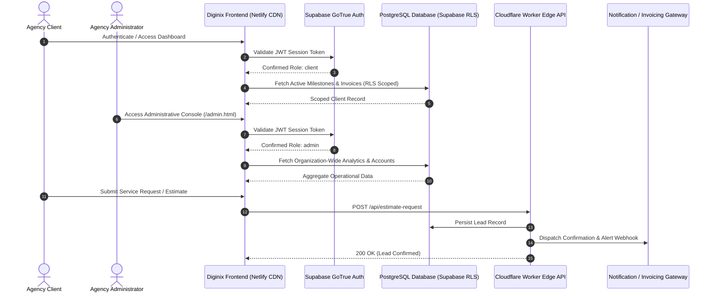

<div align="center">
  <h1>diginix-saas-platform</h1>
  <p>Enterprise serverless SaaS portal for digital agencies featuring client dashboards, Supabase authentication, service estimation, and Cloudflare Workers API.</p>

  <p>
    <a href="https://github.com/itsgoharrehman/diginix-saas-platform/releases"></a>
    
    
    
    
    
    <a href="https://github.com/itsgoharrehman/diginix-saas-platform/stargazers"></a>
    <a href="https://github.com/itsgoharrehman/diginix-saas-platform/issues"></a>
  </p>
</div>

---

An enterprise-grade, serverless software-as-a-service web portal engineered for digital software consulting, web engineering, and digital marketing agencies.

Diginix SaaS integrates authenticated client management dashboards, dynamic project milestone monitoring, interactive project estimation tooling, a comprehensive knowledge base, and administrative controls. Built with vanilla ES6+ standards, Supabase relational PostgreSQL storage with Row-Level Security (RLS), Netlify CDN static hosting, and Cloudflare Workers serverless API routing.

---

## Architecture and System Flow



---

## Key Capabilities

* **Dedicated Client Dashboard**: Transparent tracking of active project milestones, deliverable inspections, invoice reviews, and direct file access.
* **Role-Based Access Control (RBAC)**: Secure separation between public prospects, authenticated agency clients, and administrative supervisors via Supabase Auth and PostgreSQL RLS.
* **Interactive Service Estimator**: Dynamic scope and price estimation calculator allowing prospective clients to assess project complexities and timelines in real time.
* **Administrative Operations Console**: Centralized interface (`admin.html`) for managing client accounts, updating delivery roadmaps, publishing technical articles, and inspecting operational metrics.
* **Cloudflare Workers Edge API**: High-concurrency serverless endpoint (`worker.js`) managing secure inquiry dispatch, payload sanitization, and external integration webhooks.
* **Vanilla Web Performance**: Zero framework overhead, optimized WebP imagery, semantic HTML5, and modular CSS delivering sub-second load times and high Core Web Vitals scores.

---

## Directory Structure

```
diginix-saas-platform/
├── .github/
│   ├── ISSUE_TEMPLATE/
│   │   ├── bug_report.yml          # Structured defect report form
│   │   └── feature_request.yml     # Structured feature proposal form
│   ├── PULL_REQUEST_TEMPLATE.md    # Pull request review checklist
│   └── dependabot.yml              # Weekly automated dependency scanner
├── blog/                           # Technical insight articles and guides
├── css/
│   ├── admin.css                   # Administrative portal styles
│   └── style.css                   # Core application styling and theme system
├── images/                         # Optimized WebP brand illustrations and assets
├── js/
│   ├── admin.js                    # Admin dashboard operations and listeners
│   ├── articles-data.js            # Editorial article indices and metadata
│   ├── common.js                   # Shared utilities and layout initialization
│   ├── script.js                   # Application lifecycle and client interactions
│   ├── supabase.js                 # Supabase client initialization and auth
│   ├── ui-components.js            # Reusable UI component modules
│   └── ui-primitives.js            # Primitive UI state handlers and animations
├── admin.html                      # Administrative management portal
├── admin_login.html                # Administrative authentication gateway
├── auth.html                       # Client authentication and registration
├── index.html                      # Agency landing page and service showcase
├── profile.html                    # Client account management dashboard
├── services.html                   # Detailed consulting service specifications
├── supabase_setup.sql              # PostgreSQL schemas, tables, and RLS policies
├── worker.js                       # Cloudflare Worker serverless edge API
├── wrangler.jsonc                  # Cloudflare Worker edge configuration
├── package.json                    # Project tooling scripts and metadata
├── LICENSE                         # Proprietary Software License
├── SECURITY.md                     # Vulnerability reporting and security invariants
├── CONTRIBUTING.md                 # Internal contribution conventions
└── CODE_OF_CONDUCT.md             # Contributor Covenant v2.1
```

---

## Security Model and Invariants

All data operations are strictly partitioned via PostgreSQL Row-Level Security in `supabase_setup.sql`:

```sql
-- Enable Row Level Security
ALTER TABLE public.client_projects ENABLE ROW LEVEL SECURITY;
ALTER TABLE public.client_invoices ENABLE ROW LEVEL SECURITY;

-- Clients can strictly inspect their own records
CREATE POLICY "Clients can view own project milestones"
ON public.client_projects FOR SELECT
TO authenticated
USING (auth.uid() = client_id);

-- Administrators possess full operational scope
CREATE POLICY "Admins have full access"
ON public.client_projects FOR ALL
TO authenticated
USING (auth.jwt() ->> 'role' = 'agency_admin');
```

---

## Local Development and Operations

### Prerequisites

* Node.js v18+ (for local HTTP preview and Cloudflare Wrangler)
* Supabase project credentials

### Setup

1. Clone the repository:
   ```bash
   git clone https://github.com/itsgoharrehman/diginix-saas-platform.git
   cd diginix-saas-platform
   ```

2. Install local developer tools:
   ```bash
   npm install
   ```

3. Configure Supabase credentials:
   Update `js/supabase.js` with your public Supabase project URL and anon public key.

4. Run local HTTP server:
   ```bash
   npm start
   ```
   Navigate to `http://localhost:3000`.

5. Run Cloudflare Worker locally:
   ```bash
   npm run dev
   ```

---

## Security and Support

* **Security Policy**: See [SECURITY.md](SECURITY.md) for vulnerability disclosure protocols.
* **Contribution Guidelines**: Internal standards are documented in [CONTRIBUTING.md](CONTRIBUTING.md).
* **Code of Conduct**: Professional guidelines are outlined in [CODE_OF_CONDUCT.md](CODE_OF_CONDUCT.md).

---

## License

Proprietary and Confidential. Copyright (c) 2024-2026 Gohar Rehman. All rights reserved. See [LICENSE](LICENSE) for terms.
