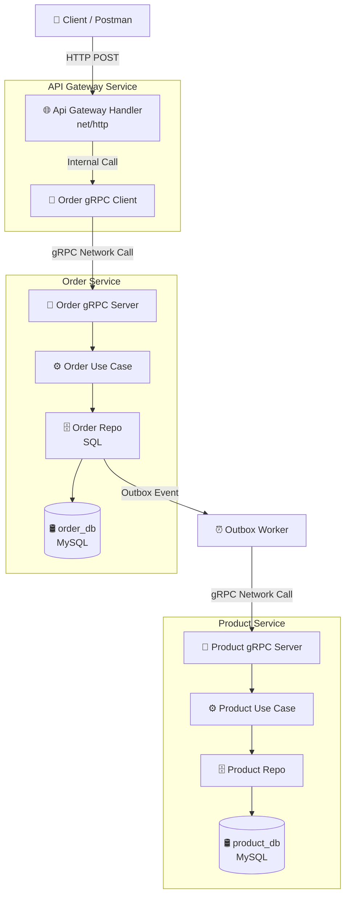

# 🛍️ E-Commerce System

I designed and developed an e-commerce system using a microservices architecture built with native Go and MySQL, incorporating Clean Architecture principles across all services to ensure testability, modular code readability, and flexibility for future technology transitions. To maximize inter service communication speed, I implemented the gRPC protocol in place of conventional REST APIs. The system features transaction protection via local row locking at the database level, designed to handle extreme traffic spikes and prevent negative stock anomalies during high-volume events such as flash sales. Furthermore, to maintain distributed data consistency even in the event of network failures or server downtime I constructed a robust data synchronization pipeline using the Transactional Outbox pattern, combined with an automated retry mechanism. Developed with a minimalist philosophy that eliminates reliance on external frameworks or heavy ORMs, this project demonstrates a deep mastery of Go’s built-in features to ensure optimal system execution speed.

---

## 🛠️ Tech Stack

This system is built using a modern, production-grade technology ecosystem:

*   **Primary Programming Language**: **Golang v1.26.2** (Clean, efficient, and prioritizes pure performance).
*   **API & HTTP Server**: **`net/http`** (Standard Library) & **`go-chi/chi/v5`** for lightweight, high-concurrency routing.
*   **RPC Framework**: **`gRPC`** (`google.golang.org/grpc`) for fast, low-latency cross-service communication.
*   **Message Broker (Event-Driven)**: **Kafka Client** via **`twmb/franz-go`** for feature-complete, high-performance asynchronous event streaming.
*   **Payment Gateway Integration**: **`midtrans/midtrans-go`** as the official API client for managing secure checkout transactions and billing settlement.
*   **Data Storage (Database)**: **MySQL 8.0** as an ACID-compliant transaction storage.
*   **Database Interface**: **`database/sql`** (Standard Library) for native connection pooling and raw SQL execution (utilizing `PrepareCtx`, `BeginTx`, `QueryRowContext`, `QueryContext`, `ExecContext`).
*   **Database Driver**: **`go-sql-driver/mysql`** for native interaction with the MySQL engine.
*   **Data Validation**: **`go-playground/validator/v10`** for secure structural payload and input validation tags.
*   **Image Processing Utility**: **`disintegration/imaging`** for image manipulation and upload management.
*   **Testing Library**: **`Stretchr/Testify`** (`assert` & `mock`) for building isolated unit test architectures [index].

---

## 🏗️ System Architecture

This project is built using a **Microservices Architecture**, where each independent service strictly implements **Clean Architecture** internally to ensure a decoupled, highly testable, and maintainable codebase. By separating concerns into distinct layers, the core domain logic of each service remains completely independent of external frameworks, databases, and network delivery mechanisms.

---

### 1. Distributed Microservices Ecosystem

The ecosystem is split into domain-specific microservices that communicate asynchronously and synchronously to preserve system resilience:
*   **Auth Service**: Handles user authentication, credential verification, token generation (JWT), and authorization security across the platform.
*   **User Service**: Manages customer profiles, account data structures, shipping addresses, and personal identification records.
*   **Product Service**: Manages the global product catalog, regular inventory updates, and executes high-concurrency Flash Sale stock lock management.
*   **Order Service**: Handles the complete checkout lifecycle, local order processing, idempotency tracking, and local outbox transaction logging.
*   **Payment Service**: Manages interaction with payment gateways, processes billing transactions, and handles dynamic transaction invoices.
*   **Notification Service**: Processes asynchronous customer communications (such as order confirmation emails via Kafka) driven by backend transaction workers.
*   **Inter-Service Communication**: Leverages low-latency **gRPC** for internal synchronous network calls and the **Transactional Outbox Pattern** combined with a message broker for reliable asynchronous events.

---

### 2. Internal Service Layers (Clean Architecture Inside-Out)

Every microservice within this project enforces the exact same layered architecture:

*   **Domain / Entity Layer (Core)**: 
    Contains the fundamental business objects (`Order`, `Product`, `FlashSale`) and strict domain rules. This layer is written in pure Golang, has **zero dependencies** on any other layers or external libraries, and heavily utilizes *value types* instead of pointers to maximize stack allocation.
*   **Use Case / Service Layer**: 
    Orchestrates the specific business logic of the service (`CreateCheckout`, `DeductFlashSaleStock`). It interacts directly with the Domain layer and defines abstract interfaces (ports) for data access or external clients, completely unaware of *how* data is stored or fetched.
*   **Repository / Adapter Layer**: 
    Implements the interfaces defined by the Use Case layer. This is where **`database/sql`** and **`go-sql-driver/mysql`** reside. It executes raw SQL queries, manages local ACID transactions via `db.BeginTx`, and maps relational database rows directly into domain value structures using `rows.Scan()`. Additionally, it heavily utilizes **`PrepareCtx`** to pre-compile SQL statements natively, maximizing execution speed and ensuring full protection against SQL injection during high-volume traffic.
*   **Delivery / Infrastructure Layer (HTTP / gRPC)**: 
    The outermost gate handled by **`net/http`** (for client-facing REST APIs) and **`google.golang.org/grpc`** (for internal inter-service RPC communication). It parses payloads, decodes gRPC requests, runs entry-level validation, triggers the appropriate Use Case, and returns structured network responses.

---

### 3. Data Flow & Distributed Dependency Rule

The fundamental rule of this architecture is that **dependencies only point inwards**. Inner layers know absolutely nothing about outer infrastructure, protocols, or network boundaries.

---

#### A. High-Level Request Flow (Simplified View)
This simplified diagram represents the high-level path a client request takes from the edge gateway down to the persistent database:

---


---

#### B. Internal Inter-Service Data Flow (Detailed View)
This detailed diagram shows the internal orchestration, local transaction isolation, and asynchronous data consistency across multiple microservices using the Transactional Outbox Pattern:


1.  **Ingress Request**: The client hits the API Gateway via HTTP, which parses the input into an immutable value struct and maps it to a gRPC client request.
2.  **Local Isolation**: The Order Use Case coordinates internal business rules and commits the order alongside an outbox payload safely inside a local MySQL transaction block.
3.  **Distributed Consistency**: The Outbox Worker polls the local transaction table asynchronously and synchronizes the state by invoking the downstream Product Service via gRPC to safely reduce physical catalog inventory.


#### C. Memory & Performance Design Principles

To achieve optimal performance and minimize Garbage Collector (GC) overhead, the architecture enforces these structural constraints:

*   **Pure Pass-by-Value**: Data structures are passed across layer boundaries as explicit copies (`Product` instead of `*Product`) whenever feasible. This keeps the data scoped to the function execution block, ensuring it stays allocated on the **Stack** and prevents *Escape Analysis* from moving it to the **Heap**.
*   **Boundary Decoupling via Interfaces**: Use Cases rely strictly on interfaces to communicate with Repositories. This decoupling allows **`Stretchr/Testify`** to inject lightweight mocks during unit testing, enabling full test coverage without needing network or database resources.
*   **Explicit Resource Management**: Database rows and HTTP request bodies are closed immediately after consumption using native Go defer statements (`rows.Close()`, `r.Body.Close()`), ensuring deterministic memory cleanup without relying on the GC to release system descriptors.


## 📂 Project Structure

This project uses a monorepo structure containing all independent microservices, shared packages, utility modules, and shared protocol buffers:

```text
e-commerce/
├── api/
│   └── protobuf/         # Protocol Buffer source files (.proto) for inter-service gRPC contracts
│       ├── auth.proto
│       ├── notification.proto
│       ├── order.proto
│       ├── payment.proto
│       ├── product.proto
│       └── user.proto
├── api_gateway/          # Edge API Gateway Service (Client Ingress Router)
│   ├── cmd/              # Main entry point for the gateway server
│   ├── internal/         # Gateway internal routing logic
│   │   ├── client/       # gRPC client stubs to communicate with downstream services
│   │   └── delivery/     # Public-facing transport layers
│   │       ├── helper/   # Ingress response/request payload transformers
│   │       │   └── image.go # Core payload image handler utility
│   │       └── http/     # Native net/http REST gateway routers
│   │           ├── handler/    # HTTP route controllers
│   │           ├── middleware/ # Network and security middlewares
│   │           │   └── auth_middleware.go # JWT & Ingress token authentication filter
│   │           ├── request/    # Structural payload decoders
│   │           └── response/   # Standardized JSON response formatters
│   ├── pkg/              # Isolated standalone utilities for api_gateway
│   │   └── validator/    # Input request structural payload validators
│   ├── uploads/          # Dynamic static asset or upload directory
│   └── Dockerfile        # Containerization schema for the API Gateway
├── assets/               # Global static documentation assets (images/diagrams)
├── auth_service/         # Authentication Service (JWT tokens, credentials, authorization verification)
│   ├── cmd/              # Main entry point for the authentication service server
│   ├── config/           # Environment setups and configuration keys
│   │   └── db.go         # Core MySQL connection initialization and pooling logic
│   ├── infrastructure/   # Technical communication layer
│   │   └── client/       # External service client wrappers
│   │       └── mocks/    # Autogenerated external client simulation blocks for testing
│   ├── internal/         # Core application operational layers
│   │   ├── delivery/     # Network inbound traffic ports
│   │   │   └── grpc/     # Native RPC communication gateway
│   │   │       └── handler/ # Auth gRPC handler implementations
│   │   ├── domain/       # Core business objects and properties
│   │   ├── repository/   # Data persistence adapters layer
│   │   │   ├── mocks/    # Autogenerated database layer mocks
│   │   │   ├── worker/   # Asynchronous processing or transactional outbox engines
│   │   │   └── tx_manager.go # Local ACID transaction boundaries manager
│   │   └── usecase/      # Core logic rules orchestration layer
│   ├── migrations/       # Database schema setup files for auth_db
│   ├── reports/          # Heap & stack allocation performance check logs (gcflags)
│   └── Dockerfile        # Containerization schema for Auth Service
├── notification_service/ # Asynchronous Notification Service (Kafka event subscriber)
│   ├── cmd/              # Main entry point for the notification server
│   ├── config/           # Environment setup parameters and event broker logs
│   ├── infrastructure/   # Event handlers and messaging queue infrastructure
│   ├── internal/         # Clean Architecture layers
│   │   ├── delivery/     # Network inbound traffic ports
│   │   │   └── grpc/     # Native gRPC communication infrastructure
│   │   │       └── handler/ # Notification gRPC handler implementations
│   │   ├── domain/       # Messaging templates and event models
│   │   ├── repository/   # Notification log adapter
│   │   │   └── mocks/    # Autogenerated database mocks
│   │   └── usecase/      # Alert and messaging rules orchestration
│   ├── migrations/       # Database schema setup files for notification_db
│   ├── reports/          # Heap & stack allocation performance check logs (gcflags)
│   └── Dockerfile        # Containerization schema for Notification Service
├── order_service/        # Core Order Service (Transactional outbox logging, checkout handling)
│   ├── cmd/              # Main entry point for the order processing service
│   ├── config/           # Local configuration sets and MySQL connection pool setups
│   ├── infrastructure/   # Technical communication layer
│   │   ├── client/       # gRPC communication clients (calling product_service)
│   │   └── kafka/        # Kafka broker integration for event publication
│   ├── internal/         # Clean Architecture core implementation
│   │   ├── delivery/     # Service network ingress transport
│   │   │   └── grpc/     # Internal RPC framework
│   │   │       └── handler/ # Order gRPC handler implementations
│   │   ├── domain/       # Core entities for checkouts and line items
│   │   ├── repository/   # Order persistence database adapter
│   │   │   ├── mocks/    # Autogenerated order repository mocks
│   │   │   ├── worker/   # Local Transactional Outbox worker pool
│   │   │   └── tx_manager.go # Local ACID-compliant database transaction coordinator
│   │   └── usecase/      # Checkout orchestration logic (Load Test resistant via Local Row Lock)
│   ├── migrations/       # Database schema setup files for order_db
│   ├── reports/          # Heap & stack allocation performance check logs (gcflags)
│   └── Dockerfile        # Containerization schema for Order Service
├── payment_service/      # Payment Service (Gateway interfaces, invoicing, processing states)
│   ├── cmd/              # Main entry point for the payment service server
│   ├── config/           # Environment configurations and payment parameters
│   ├── infrastructure/   # Technical integrations with external gateway providers
│   ├── internal/         # Clean Architecture core implementation
│   │   ├── delivery/     # Network inbound traffic layers
│   │   │   └── grpc/     # Service communication layer
│   │   │       └── handler/ # Payment gRPC handler implementations
│   │   ├── domain/       # Settlement structures, invoices, and ledgers
│   │   ├── repository/   # Payment database adapter
│   │   │   ├── mocks/    # Autogenerated payment repository mocks
│   │   │   ├── worker/   # Asynchronous transaction reconcilers or processors
│   │   │   └── tx_manager.go # Database transaction manager
│   │   └── usecase/      # Transaction processing and processing validation rules
│   ├── migrations/       # Database schema setup files for payment_db
│   ├── reports/          # Heap & stack allocation performance check logs (gcflags)
│   └── Dockerfile        # Containerization schema for Payment Service
├── pb/                   # Auto-generated Go gRPC code and stubs generated from proto files
├── pkg/                  # Shared core packages used universally across all microservices
│   └── utils/            # Reusable standalone utility tools
│       ├── apperror/     # Uniform application error codes and classification system
│       ├── errgrpc/      # Translates internal domain errors to strict gRPC transport errors
│       ├── mocks/        # Centralized autogenerated mocks for comprehensive layer testing
│       ├── json.go       # Custom native-optimized JSON serializer wrappers (Stack optimization)
│       └── uuid.go       # High-performance UUID generator wrapper (UUID v4 / v7)
├── product_service/      # Product Catalog Service (Inventory control, flash sale lock caches)
│   ├── cmd/              # Main entry point for the product service server
│   ├── config/           # Workspace environments setup and MySQL pool mappings
│   ├── internal/         # Clean Architecture core implementation
│   │   ├── delivery/     # Inbound request handler boundaries
│   │   │   └── grpc/     # Service interaction layer
│   │   │       └── handler/ # Product gRPC handler implementations
│   │   ├── domain/       # Products models and flash sale properties
│   │   ├── repository/   # Physical inventory management database adapter
│   │   │   └── mocks/    # Autogenerated data model mocks
│   │   └── usecase/      # Local concurrency stock deduction control rules
│   ├── migrations/       # Database schema setup files for product_db
│   ├── reports/          # Heap & stack allocation performance check logs (gcflags)
│   └── Dockerfile        # Containerization schema for Product Service
├── user_service/         # User Management Service (Profiles, addresses, identity tracking)
│   ├── cmd/              # Main entry point for the user system server
│   ├── config/           # General database and workspace environment setup
│   ├── internal/         # Clean Architecture core implementation
│   │   ├── delivery/     # Internal communication portals
│   │   │   └── grpc/     # Service layer framework
│   │   │       └── handler/ # User gRPC handler implementations
│   │   ├── domain/       # Customer profiles and credentials
│   │   ├── repository/   # Profile metadata database storage adapter
│   │   │   └── mocks/    # Autogenerated persistence layer mocks
│   │   └── usecase/      # Identity tracking and deduplication validation rules
│   ├── migrations/       # Database schema setup files for user_db
│   ├── reports/          # Heap & stack allocation performance check logs (gcflags)
│   └── Dockerfile        # Containerization schema for User Service
├── .env                  # Project-wide default environment parameters
├── .gitignore            # Excluded version control list
├── docker-compose.yaml   # Multi-container multi-service Docker network composition orchestrator
└── go.mod                # Core Go workspace module configuration dependencies
```

## 🔍 Running tests

Testing is conducted exclusively at the use case layer, as this represents the critical point in the application's program flow and is where the application's business logic is defined.

```text
go test -v auth_service/internal/usecase/auth_test.go
```

```text
go test -v user_service/internal/usecase/user_test.go
```

```text
go test -v product_service/internal/usecase/product_test.go
```

```text
go test -v order_service/internal/usecase/order_test.go
```

```text
go test -v payment_service/internal/usecase/payment_test.go
```

```text
go test -v notification_service/internal/usecase/notification_test.go
```


## 🔌 API Specification & Postman Payloads

All interaction contracts between the API Gateway and public clients are defined below. Payloads are strictly parsed into native value types inside the gateway layer before routing via gRPC.

### 1. Authentication Service (`Auth Service`)

#### A. User Registration
*   **HTTP Method**: `POST`
*   **Endpoint**: `http://localhost:8080/api/v1/auth/register`
*   **Headers**: `Content-Type: application/json`

```json
{
    "email": "jujunjunaedi@gmail.com",
    "username": "jujunjuanedi",
    "password": "jujun123"
}
```

#### B. User Login
*   **HTTP Method**: `POST`
*   **Endpoint**: `http://localhost:8080/api/v1/auth/login`
*   **Headers**: `Content-Type: application/json`

```json
{
    "email": "jujunjunaedi@gmail.com",
    "password": "jujun123"
}
```

---

### 2. Product Catalog Service (`Product Service`)

#### A. Create Product (Multipart Form-Data)
*   **HTTP Method**: `POST`
*   **Endpoint**: `http://localhost:8080/api/v1/products`
*   **Headers**: `Content-Type: multipart/form-data`

**Postman Form-Data Parameters:**
*   `data` (Type: *Text*):
    ```json
    {
        "product_code": "PRODAPPLIPH17P",
        "product_name": "Apple iPhone 17 Pro Max 256GB Titanium Gray",
        "category_id": "01a105a2-a179-7443-a31c-6dc4d9f3f885",
        "price": 24500000,
        "stock": 20,
        "description": "Garansi Resmi Apple Indonesia (iBox/Digimap). Chip A19 Pro, Layar 6.9\" ProMotion 120Hz, Kamera Utama 48MP dengan lensa Periskop Baru."
    }
    ```
*   `product_images` (Type: *File*): Upload multiple binary images (`image1.png`, `image2.png`).

#### B. Get Product Detail
*   **HTTP Method**: `GET`
*   **Endpoint**: `http://localhost:8080/api/v1/products/01a17d38-d4cf-7bda-a3ed-54c829e37a17`

#### C. Get Flash Sale Details
*   **HTTP Method**: `GET`
*   **Endpoint**: `http://localhost:8080/api/v1/products/flash-sale/01a17d79-e5d8-7224-b1e1-25ae504724bf`

---

### 3. Order Processing Service (`Order Service`)

*   **HTTP Method**: `POST`
*   **Endpoint**: `http://localhost:8080/api/v1/orders/checkout`
*   **Headers**: `Content-Type: application/json`

#### A. Flash Sale Order Payload (Load Test Handling)
Triggers the local row-level lock caching route to safely buffer mass checkout storms.

```json
{
  "user_id": "01a1b9b5-8dec-7bda-ad71-16429791723e",
  "idempotency_key": "war-checkout-agin-1",
  "items": [
    {
      "product_id": "01a17d38-d4cf-7bda-a3ed-54c829e37a17",
      "flash_sale_id": "01a17d79-e5d8-7224-b1e1-25ae504724bf",
      "quantity": 1
    }
  ]
}
```

#### B. Regular Product Order Payload
Bypasses the async worker queue and performs real-time synchronous stock inventory validation.

```json
{
  "user_id": "01a1b9b5-8dec-7bda-ad71-16429791723e",
  "idempotency_key": "checkout-regular-agin-1",
  "items": [
    {
      "product_id": "01a17d38-d4cf-7bda-a3ed-54c829e37a17",
      "flash_sale_id": "",
      "quantity": 1
    }
  ]
}
```

---

### 4. Billing & Payment Service (`Payment Service`)

#### A. Execute Invoice Payment
*   **HTTP Method**: `POST`
*   **Endpoint**: `http://localhost:8080/api/v1/transaction/payments`
*   **Headers**: `Content-Type: application/json`

```json
{
  "order_id": "01a1ba6d-743c-7784-a966-45be1db41750",
  "payment_method": "bank_transfer",
  "payment_amount": 30000000000
}
```


## 🚀 Future Roadmap & Architecture Evolution (Conclusion)

Although the current architecture successfully mitigates race conditions under high-concurrency scenarios through the use of Local Row-Level Locking and ensures data availability via the Transactional Outbox Pattern, this distributed system is designed to evolve. The following points are prioritized for long-term future development:

### 1. Distributed Transactions: Saga Pattern (Orchestration-Based)
*   **Context:** Currently, the system isolates failures locally using database transactional rollbacks. As the ecosystem grows, complex multi-service workflows (such as matching a successful `Order` with a third-party `Payment` gateway deduction and an inventory commit in the `Product Service`) will require cross-network atomicity.
*   **Evolution:** We plan to implement an **Orchestration-Based Saga Pattern**. A centralized coordinator inside the `Order Service` will manage successful steps via gRPC and fire explicit **Compensating Transactions** (such as releasing locked stock or triggering a refund) if a downstream payment execution fails mid-way.

### 2. Distributed Tracing & Observability
*   **Context:** Tracking down performance bottlenecks or hidden heap allocations across multiple network hops (Gateway -> gRPC Client -> gRPC Server -> MySQL) can become difficult using raw local terminal logs.
*   **Evolution:** Integrating **OpenTelemetry** linked with **Jaeger** or **Grafana Tempo**. By propagating a unique `trace_id` inside the gRPC Metadata Context, we can visually map the exact latency and execution profile of a user’s checkout request across all network microservice boundaries in real-time.

### 3. Distributed Cache Layer (Redis Cluster Deployment)
*   **Context:** The current `flash_sale_caches` table resides directly inside the relational `order_db` MySQL storage. While it protects the main transaction tables, a relational database disk I/O still has structural throughput limitations under millions of requests.
*   **Evolution:** Introducing a distributed in-memory **Redis Cluster** equipped with **Lua Scripting** to handle atomic `DECRBY` check-and-deduct operations for Flash Sales. MySQL will then purely receive finalized, asynchronous bulk inserts from the Outbox Worker, pushing the system's concurrency boundaries even further.

---
### 🏁 Conclusion
This E-Commerce Order Service demonstrates that **native engineering** without heavy third-party framework abstraction provides clean code transparency and effective memory optimization. By pushing data structures to the **Stack** and securing logical constraints via **Outbox Workers and database row locks**, this system stands as a reliable layout for predictable, low-latency, and production-ready distributed system architectures.
