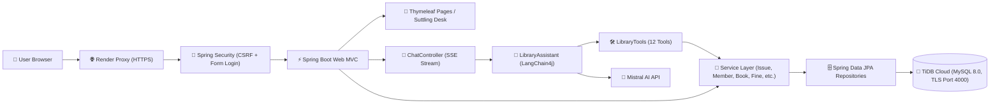

<p align="center">
  <a href="https://library-management-system-java-0phc.onrender.com/" target="_blank">
    
  </a>
</p>

<p align="center">
  <a href="https://library-management-system-java-0phc.onrender.com/" target="_blank">
    
  </a>
</p>

<p align="center">
  <a href="#features">Features</a> ·
  <a href="#architecture">Architecture</a> ·
  <a href="#ai-concierge--tools">AI Concierge</a> ·
  <a href="#quick-start">Quick Start</a> ·
  <a href="#configuration">Configuration</a> ·
  <a href="#api--sse-contract">API & SSE</a> ·
  <a href="#database">Database</a> ·
  <a href="#deployment-render">Deployment</a> ·
  <a href="#project-structure">Structure</a>
</p>

<p align="center">
  
  
  
  
  
  
  
  
  
  
</p>

---

A full-featured **enterprise-grade library management system**: built with **Java 21** and **Spring Boot 4.1**, backed by a real **MySQL** relational database (hosted on **TiDB Cloud** with TLS), and integrated with a natural-language **LangChain4j AI Concierge** powered by **Mistral AI**. Manage books, members, employees, subscriptions, payments, sales, and issues — or simply ask **Lumina Concierge** at the Reference Desk in plain conversational English.

This repository is the Java counterpart to [`library-management-system-dbms`](https://github.com/kairav7220/library-management-system-dbms) (Python + Flask + LangGraph), sharing the exact same TiDB Cloud schema, Suttling Desk design system, and real-time SSE chat streaming contract.

---

## Features

- **📚 Relational Database CRUD** — 12 normalized tables (`users`, `books`, `book_category`, `book_genre`, `members`, `employees`, `subscriptions`, `payments`, `book_sell`, `book_issues`, `logs`, `customers`) with soft-delete filtering (`status = 0`) and transactional consistency.
- **🔐 Spring Security & Dual Password Hasher** — Custom `CompositePasswordEncoder` seamlessly verifies legacy Python Werkzeug scrypt hashes (`scrypt:32768:8:1$salt$hash` using `com.lambdaworks.crypto.SCrypt`) while hashing new passwords with standard BCrypt (`$2a$`).
- **🛡️ CSRF & Reverse Proxy Protection** — Enforces per-session CSRF tokens matching the `X-CSRFToken` contract. Configured with `server.forward-headers-strategy=framework` to seamlessly handle SSL termination on cloud proxies like Render.
- **🧑‍💼 Lumina AI Concierge (LangChain4j)** — Single `AiServices` concierge grounded by a curated 12-tool contract (9 read tools + 3 write tools for circulation and registration). Business rules and validations remain in the service layer as the single source of truth.
- **⚡ Token-Level Streaming via SSE** — Responses stream live to the browser token-by-token over Server-Sent Events (`POST /chat/stream`), byte-compatible with the frontend chat widget (`delta`, `done`, `error`).
- **💰 Automatic Fine Policy & Overdue Tracking** — 14-day standard loan policy with ₹10/day overdue fines calculated upon return and queryable via concierge tools (`checkFine`, `getOverdueBooks`).
- **📄 Audit Logging** — Real-time event recording in the `logs` database table for user logins, logouts, and security actions. Restricted to `ROLE_Admin`.
- **🗂️ In-Memory Session History** — Multi-session conversational history with smart auto-generated titles, message caps, and thread clearing.
- **🎨 Suttling Desk Design Language** — Paper canvas (`#faf7f2`), ink (`#232019`), and oxblood accent (`#8a3324`), Space Grotesk display typography + Source Sans 3 body text, and an interactive chat launcher.
- **🐳 Containerized & Cloud-Ready** — Multi-stage Docker build running Eclipse Temurin JRE 21 with automatic dynamic `$PORT` detection for Render deployment.

---

## Architecture



| Layer | Technology | Details |
|---|---|---|
| **Runtime & Language** | Java 21 (LTS) | Eclipse Temurin OpenJDK 21 |
| **Framework** | Spring Boot 4.1.2 | Web MVC, Security, Data JPA, Validation, Thymeleaf |
| **AI Layer** | LangChain4j 1.23.0 | `MistralAiStreamingChatModel`, `@AiServices`, `@Tool`, in-memory `MessageWindowChatMemory` |
| **LLM Provider** | Mistral AI | `open-mistral-7b` (configurable via `LUMINA_MODEL`) |
| **Database** | TiDB Cloud (MySQL 8.0) | Hosted on AWS Southeast Asia, TLS required, Port `4000` |
| **ORM & Persistence** | Hibernate 7 + Spring Data JPA | 12 mapped entities, schema owned by DDL |
| **Security** | Spring Security 6/7 | Form login, role authorization (`Admin`, `Employee`, `Member`), Composite PasswordEncoder (scrypt + BCrypt) |
| **Frontend** | Thymeleaf + JavaScript | Semantic HTML5, Font Awesome 6.5, CSS tokens, streaming `chat.js` |
| **Deployment** | Docker & Render | Multi-stage Dockerfile, automated build, health check on `/login` |

---

## AI Concierge & Tools

The **Lumina AI Concierge** is an intelligent assistant stationed at the library's Reference Desk. It strictly avoids hallucinations by grounding all responses in real database tools. Write permissions are deliberately restricted to circulation and member onboarding; financial and catalog updates remain staff form actions.

### The 12 Tool Contracts

| # | Tool | Signature | Type | Purpose / Sample Prompt |
|:---:|---|---|:---:|---|
| 1 | `searchBooks` | `String query` | 📖 Read | Search books by title, author, category, or genre. *"Which DBMS books are available?"* |
| 2 | `getBook` | `String bookRef` | 📖 Read | Get book details, price, category, and current borrower status. |
| 3 | `searchMembers` | `String query` | 📖 Read | Find active members by name, phone, email, or `MEM_` ID. |
| 4 | `getMyIssuedBooks` | *(none)* | 📖 Read | Authenticated member view: *"What books do I currently have issued?"* |
| 5 | `getIssuesForMember` | `String memberRef` | 📖 Read | Staff view: all issue records (open and closed) for a member. |
| 6 | `checkFine` | `String ref` | 📖 Read | Computes overdue fees (14-day loan, ₹10/day) for a book or member. |
| 7 | `getOverdueBooks` | *(none)* | 📖 Read | Lists all currently overdue books across the library with calculated fines. |
| 8 | `getLibraryStats` | *(none)* | 📖 Read | Total counts: books, members, books issued, overdue items, total revenue. |
| 9 | `getSubscriptionPlans` | *(none)* | 📖 Read | Lists available subscription plans (Monthly, Quarterly, Yearly) and pricing. |
| 10 | `issueBook` | `String bookRef, String memRef` | ✍️ Write | Validates availability, creates issue record with auto-generated `TXN_N`. |
| 11 | `returnBook` | `String ref, String returnedDate` | ✍️ Write | Marks issue returned, timestamps completion, and calculates any overdue fine. |
| 12 | `registerMember` | `String name, String email, String phone` | ✍️ Write | Creates a member record (`MEM_N`). *(Login accounts are managed by Admin).* |

---

## Quick Start

### Prerequisites

- **Java 21** or later (`java -version`)
- **Git**
- TiDB Cloud MySQL database instance (or local MySQL 8.0)
- Mistral AI API Key

### Local Installation

1. **Clone the repository:**
   ```bash
   git clone https://github.com/kairav7220/library-management-system-java.git
   cd library-management-system-java
   ```

2. **Configure Environment Variables:**
   Copy the example environment configuration:
   ```bash
   cp .env.example .env
   ```
   Fill in your TiDB Cloud and Mistral credentials in `.env`:
   ```env
   MYSQL_HOST=gateway01.ap-southeast-1.prod.aws.tidbcloud.com
   MYSQL_PORT=4000
   MYSQL_DB=library_db
   MYSQL_USER=your_tidb_username
   MYSQL_PASSWORD=your_tidb_password
   MISTRAL_API_KEY=your_mistral_key
   ```

3. **Run the application:**
   Using the Maven wrapper:
   ```bash
   ./mvnw spring-boot:run
   ```
   *(On Windows Command Prompt / PowerShell, run `mvnw.cmd spring-boot:run`)*

4. **Access the Application:**
   Open [http://localhost:5000](http://localhost:5000) in your web browser.

---

## Configuration

The application loads configuration from `application.properties`, environment variables, and optionally `.env` at root.

| Environment Variable | Description | Default Value |
|---|---|---|
| `MYSQL_HOST` | TiDB / MySQL hostname | *(Required)* |
| `MYSQL_PORT` | Database port (TiDB uses `4000`) | `4000` |
| `MYSQL_DB` | Database schema name | `library_db` |
| `MYSQL_USER` | Database username | *(Required)* |
| `MYSQL_PASSWORD` | Database password | *(Required)* |
| `MISTRAL_API_KEY` | Mistral AI API key for LangChain4j | *(Required)* |
| `LUMINA_MODEL` | Mistral model name for AI concierge | `open-mistral-7b` |
| `LUMINA_FINE_PER_DAY` | Overdue fee per day in Indian Rupees (₹) | `10` |
| `PORT` | HTTP port the server binds to | `5000` (Local) / `10000` (Render) |

---

## API & SSE Contract

The AI concierge communicates using Server-Sent Events (SSE) over HTTP `POST /chat/stream`.

### Request
```http
POST /chat/stream HTTP/1.1
Content-Type: application/json
X-CSRFToken: <csrf-token>

{
  "message": "Which DBMS books are currently available?",
  "session_id": "sess-abc123"
}
```

### Event Stream (`text/event-stream`)
```
data: {"type":"delta","text":"We "}

data: {"type":"delta","text":"have "}

data: {"type":"delta","text":"Database Management Systems by Ramakrishnan available."}

data: {"type":"done","response":"We have Database Management Systems by Ramakrishnan available.","agent":"Library Concierge"}
```

On error, the stream yields an error payload and closes cleanly:
```
data: {"type":"error","message":"The concierge hit an unexpected error — please try again."}
```

---

## Database

The relational schema resides on TiDB Cloud (`library_db`, MySQL 8.0 compatible, UTF-8).

### Normalized Tables (12)

```
users (row_num PK, user_id UQ, user_type, username UQ, password, email, phone, status)
books (row_num PK, book_id UQ, book_name, book_author, book_price, book_cat, book_genre, edition, publication, status)
book_category (row_num PK, cat_id UQ, cat_name, description, book_names, status)
book_genre (row_num PK, genre_id UQ, genre_title, book_names, status)
members (row_num PK, mem_id UQ, name, user_id FK, password, email, phone, user_row_num, permanent_address, temporary_address, status)
employees (row_num PK, emp_id UQ, name, user_id FK, password, email, phone, designation, salary, user_row_num, permanent_address, temporary_address, status)
book_issues (row_num PK, transaction_id UQ, transaction_date, timestamp, book_id FK, issued_date, issued_to FK, recieved_by FK, returned_date)
subscriptions (row_num PK, transaction_id UQ, transaction_date, timestamp, plan_mode, mem_id FK, mem_subscription_amount, plan_type, plan_start, plan_end, subscription_status)
payments (row_num PK, transaction_id UQ, transaction_date, timestamp, payment_amount, payment_type, payment_mode, payment_status, paid_by FK, recieved_by FK, user_row_num)
book_sell (row_num PK, order_id UQ, order_date, timestamp, book_id FK, book_name, book_price, mem_id FK)
logs (row_num PK, timestamp, action)
customers (row_num PK, cust_id, name, username, password)
```

### ID Convention
Generated sequentially per table by [`IdGenerator`](file:///D:/Project/dbms/library-management-system-java/src/main/java/com/library/lms/service/IdGenerator.java): `BOOK_N`, `MEM_N`, `EMP_N`, `CAT_N`, `GENRE_N`, `TXN_N`, `ORDER_N`.

---

## Deployment (Render)

This application is deployed on **Render** as a containerized Web Service using a multi-stage Docker build.

1. **Create Web Service** on Render connected to this repository.
2. **Environment / Runtime**: Select **Docker**.
3. **Root Directory**: Leave blank.
4. **Environment Variables**: Add your `MYSQL_*`, `MISTRAL_API_KEY`, `LUMINA_MODEL`, and `LUMINA_FINE_PER_DAY`.
5. **Health Check Path**: `/login`.

Render automatically executes the multi-stage build, detects port binding via `$PORT`, and manages zero-downtime deploys on push.

---

## Project Structure

```
library-management-system-java/
├── Dockerfile                  # Multi-stage container build (Maven 3.9 + JRE 21)
├── render.yaml                 # Render infrastructure-as-code blueprint
├── pom.xml                     # Maven project configuration (Spring Boot 4.1.2)
├── mvnw / mvnw.cmd             # Maven wrapper scripts
├── .env.example                # Template for database & AI credentials
├── scripts/
│   └── secret-check.sh         # Pre-commit zero-leak credential scanner
├── src/main/java/com/library/lms/
│   ├── LibraryManagementSystemJavaApplication.java
│   ├── ai/                     # LangChain4j concierge & tools
│   │   ├── ChatContext.java    # ThreadLocal context for member sessions
│   │   ├── LibraryAssistant.java # @AiServices interface + system persona
│   │   └── LibraryTools.java   # 12 @Tool methods delegating to services
│   ├── config/                 # Spring configurations
│   │   ├── LangChain4jConfig.java # Mistral streaming model & concierge builder
│   │   ├── SecurityConfig.java # CSRF, login/logout, route authorization
│   │   └── WebConfig.java      # Static asset routing
│   ├── controller/             # Spring MVC web & REST controllers
│   │   ├── BookController.java, MemberController.java, ...
│   │   ├── ChatController.java # SSE streaming (/chat/stream) & session endpoints
│   │   ├── DashboardController.java # Overview stats and recent audit logs
│   │   └── LoginController.java, LogsController.java
│   ├── entity/                 # 12 JPA Entities (Hibernate 7)
│   ├── repository/             # 12 Spring Data JPA Repositories
│   ├── security/               # Custom security adapters
│   │   ├── CompositePasswordEncoder.java # Werkzeug scrypt + BCrypt
│   │   ├── CustomUserDetailsService.java
│   │   ├── CustomAccessDeniedHandler.java # Reverse proxy friendly redirects
│   │   ├── LoginSuccessHandler.java & AuditLogoutHandler.java
│   │   └── LoginEntryPoint.java
│   ├── service/                # Business logic & domain rules
│   │   ├── BookService.java, IssueService.java, MemberService.java, ...
│   │   ├── ChatHistoryService.java # In-memory session history manager
│   │   ├── FineCalculator.java # 14-day loan & overdue fine calculator
│   │   └── IdGenerator.java    # Prefix-based business ID generator
│   └── web/                    # Controller advice & dropdown utilities
│       ├── DropdownService.java
│       ├── FlashService.java   # Session flash messaging
│       └── WebAdvice.java      # Global exception handling & model enrichment
├── src/main/resources/
│   ├── application.properties  # App configuration & reverse proxy strategy
│   ├── schema.sql              # MySQL DDL & initial seed data
│   ├── static/
│   │   ├── js/chat.js          # Streaming chat widget client
│   │   └── styles/
│   │       ├── chat.css        # Chat widget styling
│   │       └── style.css       # Suttling Desk design system
│   └── templates/              # Thymeleaf server-rendered templates
│       ├── base.html           # Master layout & navigation
│       ├── dashboard.html      # Metrics cards & audit log feed
│       ├── chat_widget.html    # Embedded Lumina Concierge drawer
│       ├── login.html, logs.html, books.html, members.html, ...
│       └── add_*.html / edit_*.html
└── src/test/java/              # JUnit 5 & Mockito test suites
```

---

## License

MIT © [kairav7220](https://github.com/kairav7220)

---

<p align="center">
  Built with <a href="https://spring.io/projects/spring-boot">Spring Boot</a> ·
  <a href="https://github.com/langchain4j/langchain4j">LangChain4j</a> ·
  <a href="https://mistral.ai">Mistral AI</a> ·
  <a href="https://www.mysql.com">MySQL</a> ·
  <a href="https://www.tidbcloud.com">TiDB Cloud</a> ·
  <a href="https://www.docker.com">Docker</a> ·
  <a href="https://render.com">Render</a>
</p>
