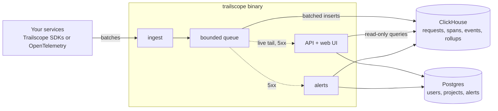

#  Trailscope

[](https://github.com/karaa1122/trailscope/actions/workflows/ci.yml)
[](LICENSE) [](#license)
[](https://github.com/karaa1122/trailscope/releases)
[](https://www.npmjs.com/org/trailscope)
[](https://pypi.org/project/trailscope/)
[](https://packagist.org/packages/trailscope/trailscope)
[](https://central.sonatype.com/namespace/pro.trailscope)

**Self-hosted API request logging: see every request your services handle, query them with SQL, and follow one customer's journey across services and background jobs.**

**Website and documentation: [trailscope.pro](https://trailscope.pro)**


## Why Trailscope

- **Debug the request, not a log line.** Open any request to see what was sent and answered, the error with its stack, and where the time went. Copy it as cURL or replay it against staging.
- **Follow one customer across everything.** Journeys put the requests, background jobs and log lines for one user, order or session on a single timeline.
- **Search the way you think.** A SQL `WHERE` filter or a quick search over every field, answered in well under a second on 100 million requests.
- **Your data stays on your server.** One Rust binary plus ClickHouse and Postgres runs on a small machine, with no outside service involved. Open source: AGPL-3.0 for the server, Apache-2.0 for the SDKs.
- **It doesn't slow your app down.** The SDKs add at most 0.05 ms per request, send in the background, and hide passwords and tokens before anything leaves the process.

> **Status: early release (0.x).** Trailscope works end to end and has been load-tested, but it hasn't run in many production setups yet, and the alerting, SDK and single sign-on code has fewer automated tests than the ingest and query core. Expect rough edges and breaking changes before 1.0, and please [open an issue](https://github.com/karaa1122/trailscope/issues) when something doesn't work.

## Features

- **Live tail** of requests as they happen, with tiles, a route heatmap with release markers, and new or spiking errors.
- **Explore with a SQL `WHERE` filter** (`status >= 500 AND route LIKE '/checkout/%'`), a quick search syntax (`status:5xx user:u_42`) or filter chips, all shareable by URL. Group by any column with p50/p95/p99. Switch to jobs and log events to filter and group those the same way.
- **Request inspector:** headers, bodies, the error and its stack, a timing waterfall, nearby requests, copy as cURL and replay to an allowed target.
- **Journeys:** everything that happened for one account, order, session or user, across services and background jobs, on one timeline.
- **Errors** grouped by fingerprint, with first and last seen, users affected, the release that introduced them and trends.
- **Routes:** a heatmap of latency, errors or volume per route and minute, and per-route charts.
- **Alerts:** rules on 5xx rate, p95 latency, counts or new and spiking errors, sent to email, Slack, Telegram or signed webhooks; plus a real-time **Email on 5xx** with throttling, digests and one-click mute links.
- **SDKs** for Express, Fastify, NestJS (with a Logger bridge and BullMQ), Django, FastAPI/Starlette, Celery, Laravel (queues, log channel, Octane), Spring Boot and other Java servlet apps, and an **OpenTelemetry (OTLP/HTTP) receiver** for everything else.
- **Secure by default:** redaction in the SDK and again on the server, IP masking, roles and a separate "can view bodies" permission, read-only query execution, optional OIDC single sign-on.
- **Fast:** 50,000 events/s ingest on 4 vCPU; filtered queries over 100 million requests in well under half a second ([benchmarks](docs/benchmarks.md)).

## Quickstart (about a minute)

```bash
git clone https://github.com/karaa1122/trailscope && cd trailscope/deploy
echo TRAILSCOPE_IMAGE=ghcr.io/karaa1122/trailscope:latest >> .env
docker compose up -d
```

This pulls the published server image ([`ghcr.io/karaa1122/trailscope`](https://github.com/karaa1122/trailscope/pkgs/container/trailscope), linux/amd64 and arm64). Leave out the `echo` line to build the image from source instead, which takes several minutes.

Open http://localhost:8080. The setup wizard creates your account and first project and shows its ingest key. Want data right away? Run the demo traffic generator, which includes a scripted incident:

```bash
docker compose exec trailscope trailscope demo --url http://localhost:8080
```

For production, copy `deploy/.env.example` to `deploy/.env` and read [self-hosting.md](docs/self-hosting.md) (sizing, TLS, backups).

## Send requests from your app

| Your stack | Package | Install |
|---|---|---|
| Express, Fastify, NestJS, plain Node | [`@trailscope/*`](https://www.npmjs.com/org/trailscope) on npm | `npm install @trailscope/express` (or `fastify`, `nestjs`, `node`) |
| Django, FastAPI/Starlette, Celery | [`trailscope`](https://pypi.org/project/trailscope/) on PyPI | `pip install trailscope` |
| Laravel, PHP | [`trailscope/trailscope`](https://packagist.org/packages/trailscope/trailscope) on Packagist | `composer require trailscope/trailscope` |
| Spring Boot, Java servlets, Logback | [`pro.trailscope`](https://central.sonatype.com/namespace/pro.trailscope) on Maven Central | `pro.trailscope:trailscope-spring-boot-starter:0.1.0` (or `trailscope-servlet`, `trailscope-logback`, `trailscope-java`) |
| Anything else | OpenTelemetry | any OTLP/HTTP exporter, see below |

**Express**

```ts
import express from 'express';
import { init, trailscope, trailscopeErrorHandler } from '@trailscope/express';

init({ service: 'orders-api' }); // TRAILSCOPE_ENDPOINT and TRAILSCOPE_INGEST_KEY from the environment
const app = express();
app.use(trailscope());
// ... your routes
app.use(trailscopeErrorHandler());
```

**NestJS**

```ts
@Module({ imports: [TrailscopeModule.forRoot({ service: 'orders-api' })] })
export class AppModule {}
```

**FastAPI / Starlette**

```python
import trailscope
from trailscope.asgi import TrailscopeMiddleware

trailscope.init(service="orders-api")
app = FastAPI()
app.add_middleware(TrailscopeMiddleware)
```

**Django**

```python
MIDDLEWARE = ["trailscope.django.TrailscopeMiddleware", ...]
TRAILSCOPE = {"service": "orders-api"}
```

**Spring Boot**

```xml
<dependency>
  <groupId>pro.trailscope</groupId>
  <artifactId>trailscope-spring-boot-starter</artifactId>
  <version>0.1.0</version>
</dependency>
```

or with Gradle: `implementation("pro.trailscope:trailscope-spring-boot-starter:0.1.0")`

```properties
# TRAILSCOPE_ENDPOINT and TRAILSCOPE_INGEST_KEY come from the environment
trailscope.service=orders-api
```

**Laravel**

```bash
composer require trailscope/trailscope
```

```dotenv
TRAILSCOPE_ENDPOINT=http://localhost:8080
TRAILSCOPE_INGEST_KEY=trs_ingest_…
TRAILSCOPE_SERVICE=orders-api
# optional: send log lines too
LOG_STACK=single,trailscope
```

**OpenTelemetry**

```bash
OTEL_EXPORTER_OTLP_ENDPOINT=http://localhost:8080/v1/otlp
OTEL_EXPORTER_OTLP_HEADERS=Authorization=Bearer%20trs_ingest_…
```

Attach the user and journey keys anywhere in a request (`setUser(id)`, `setCorrelation('order_id', id)`), and background jobs and log lines started from it are linked automatically. Fastify, Celery, BullMQ, logging bridges and all options: [SDK docs](docs/sdk-spec.md) and [examples/](examples).

## A closer look

| | |
|---|---|
|  |  |
| **Explore:** filter, chart and page through requests | **Inspector:** one request with its error, spans and context |
|  |  |
| **Journeys:** one account across services and jobs | **Routes:** latency and errors per route and minute |

## How it works



One process (`trailscope all`) handles everything for most installs; ingest, API and alerts can also run separately with Redis for live tail. Details in [architecture.md](docs/architecture.md).

## Documentation

Also published, with search, at [trailscope.pro/docs](https://trailscope.pro/docs/).

- [Architecture](docs/architecture.md) and [decisions](docs/DECISIONS.md)
- [Self-hosting](docs/self-hosting.md), [configuration](docs/configuration.md) and [security](docs/security.md)
- [Query language](docs/query-language.md)
- [Alerts and email](docs/alerts.md)
- [Ingest protocol and OpenTelemetry](docs/ingest-protocol.md), [HTTP API](docs/api.md)
- SDKs: [behaviour](docs/sdk-spec.md), [Node core](docs/sdk-node.md), [Express](docs/sdk-express.md), [Fastify](docs/sdk-fastify.md), [NestJS](docs/sdk-nestjs.md), [Python](docs/sdk-python.md), [Java](docs/sdk-java.md), [Laravel and PHP](docs/sdk-laravel.md)
- [Benchmarks](docs/benchmarks.md)

## Contributing

Issues and pull requests are welcome; see [CONTRIBUTING.md](CONTRIBUTING.md) for the one-command dev setup. Please report security issues privately ([SECURITY.md](SECURITY.md)).

## License

- The server, web UI and website: [AGPL-3.0](LICENSE). You can run, change and self-host Trailscope freely; if you offer a modified Trailscope to others over a network, you share your changes under the same license.
- The SDKs (`sdks/`) and the examples (`examples/`): Apache-2.0, so adding Trailscope to your application never puts your code under the AGPL.
