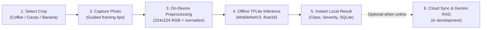

<picture>
  <source media="(prefers-color-scheme: dark)" srcset="docs/assets/hero-dark.svg">
  
</picture>

<p align="center">
  <a href="https://github.com/keylorpineda/healthycropping/actions/workflows/ci.yml"></a>
  
  
  
  
  
  
  <a href="LICENSE"></a>
</p>

> [!NOTE]
> **In active development.** There is no installable APK yet: the first signed APK is planned for `v1.0.0`. Today the app can be built from source (see [Run Locally](#run-locally)). Star the repository to follow progress.

Smallholder and medium-scale producers of coffee (*Coffea arabica* / *canephora*), cacao (*Theobroma cacao*), and banana (*Musa* spp.) in Central America frequently work in mountainous or rural plots with intermittent or zero cellular connectivity. Identifying pathogens early—such as coffee leaf rust (*Hemileia vastatrix*), cacao frosty pod rot (*Moniliophthora roreri*), or banana black Sigatoka (*Pseudocercospora fijiensis*)—is critical to timing cultural controls and preventing yield loss, yet cloud-only diagnostic tools fail in the field when connectivity drops.

**HealthyCropping** (`com.keylorpineda.healthycropping`) is an open-source, non-commercial, offline-first Android application. It runs float16 TensorFlow Lite models directly on the phone and stores scans, farms and plots locally in SQLite, so diagnosis works without a signal. Optional sync through a FastAPI backend and a Gemini RAG advisory layer grounded in official agronomy manuals (ICAFE, CATIE, CORBANA) are being built.

> **Agronomic Disclaimer**: HealthyCropping is a non-commercial, open-source decision-support tool designed initially for Costa Rica. **It supports field decisions and does not replace a certified agronomist or phytosanitary laboratory.** Always consult an agricultural professional before applying agrochemicals or removing plants.

---

## Development Status

Work follows the phases in [`docs/PLAN.md`](docs/PLAN.md):

| Phase | Milestone | Scope | Status |
| :--- | :--- | :--- | :--- |
| **0** | `v0.1.0` | Repository setup, community standards, CI | Done |
| **1** | `v0.1.0` | Coffee datasets, leakage-free split, baseline model | Done |
| **2** | `v0.1.0` | Coffee model fine-tuning, float16 TFLite export, preprocessing parity fixture | Done |
| **3** | `v0.2.0` | Expo app shell, design system, onboarding, home and settings | Done |
| **4** | `v0.2.0` | Camera, on-device inference, result screen, offline history | Done |
| **5** | `v0.3.0` | Cacao and banana models; all three crops wired into the app | Models done, on-device check pending |
| **6** | `v0.4.0` | FastAPI, Firebase auth, farm/plot/scan sync | In progress |
| **7** | `v0.5.0` | Gemini RAG explanations with cited sources | Planned |
| **8** | `v1.0.0` | Field validation, benchmarks, signed APK release | Planned |

---

## How It Works



1. **Crop Selection**: The user selects **Coffee** (leaf underside), **Cacao** (pod), or **Banana** (leaf) prior to scanning so a dedicated specialist model runs for that crop.
2. **Offline On-Device Inference**: The captured photo is resized to `224x224`, decoded to raw RGB, normalized with exact training statistics, and evaluated locally with `react-native-fast-tflite`. On-device latency has not been benchmarked yet (Phase 8).
3. **Actionable Triage & Thresholding**: If confidence falls below the calibrated validation threshold, the app instructs the user to retake the photo. Otherwise, it reports predicted class, severity level, confidence, and recommended triage action (`healthy`, `watch`, or `act now`).
4. **Local Persistence & Optional Sync**: Scans, farms, and plots are stored locally in `expo-sqlite` with client-generated UUIDs. Optional accounts and idempotent sync through the FastAPI backend (`api/`) are in progress (Phase 6).
5. **Grounded RAG Advisory (planned, Phase 7)**: When online, the backend will retrieve passages from official technical manuals (ICAFE for coffee, CATIE for cacao, CORBANA for banana) and use Gemini to explain next steps, citing the source and declining when the manuals do not cover the case.

---

## Supported Crops & Model Architectures

One fine-tuned `MobileNetV3-Large` model is trained, evaluated, and exported per crop (`224x224` RGB input, float16 TFLite, `6.06 MB` each). Metrics are on held-out test splits of public datasets; field validation in Costa Rica is still pending (Phase 8):

| Crop | Target Organ | Target Classes | Test Macro-F1 | Test Accuracy | Documentation |
| :--- | :--- | :--- | :---: | :---: | :--- |
| **Coffee** | Leaf (underside) | `healthy`, `leaf_rust` (+ severity), `leaf_miner`, `cercospora`, `brown_leaf_spot`, `red_spider_mite` | `0.729` | `81.4%` | [Model Card](docs/MODEL_CARD.md#2-coffee-leaf-model-coffee) |
| **Cacao** | Pod | `healthy`, `monilia`, `black_pod` (*Phytophthora*) | `0.850` | `91.7%` | [Model Card](docs/MODEL_CARD.md#3-cacao-pod-model-cacao) |
| **Banana** | Leaf | `healthy`, `black_sigatoka`, `fusarium_wilt` | `0.973` | `97.5%` | [Model Card](docs/MODEL_CARD.md#4-banana-leaf-model-banana) |

Every run, including baselines and failed attempts, is logged in [`docs/EXPERIMENTS.md`](docs/EXPERIMENTS.md).

Tensor preprocessing parity between Python (`ml/`) and React Native (`app/src/ml/`) is enforced by shared fixture tests.

---

## Architecture & Monorepo Structure

```text
healthycropping/
├── app/       # Expo React Native (Android, pnpm): on-device TFLite, SQLite, UI
├── api/       # Python 3.12 (uv): FastAPI, Firebase Admin, Cloudinary, RAG
├── ml/        # Python 3.12 (uv): data preprocessing, training, eval, TFLite export
└── docs/      # ARCHITECTURE, PLAN, MODEL_CARD, DATASETS, EXPERIMENTS, DEVLOG
```

| Workspace | Stack | Purpose |
| :--- | :--- | :--- |
| [`app/`](app/README.md) | React Native 0.76, Expo 52, TypeScript, SQLite, TFLite | Offline mobile application for Android |
| `api/` | Python 3.12, FastAPI, Firebase Admin, Cloudinary, Gemini | Sync endpoints, token verification & RAG advisory |
| `ml/` | Python 3.12, TensorFlow 2.18+, TFLite, Pillow | Training pipelines, evaluation & quantized edge export |

---

## Run Locally

### Prerequisites

- **Mobile**: Node.js 20+, `pnpm` (configured with `node-linker=hoisted`), Android SDK.
- **Backend & ML**: Python 3.12, `uv` package manager.

### 1. Mobile App (`app/`, pnpm only)

```bash
cd app
pnpm install
pnpm typecheck
pnpm lint
pnpm test
pnpm start
```

### 2. Backend API (`api/`, uv only)

```bash
cd api
uv sync --all-extras
uv run ruff check .
uv run mypy src tests
uv run pytest
uv run uvicorn src.main:app --reload
```

### 3. Machine Learning (`ml/`, uv only)

```bash
cd ml
uv sync --all-extras
uv run ruff check .
uv run mypy src scripts tests
uv run pytest
```

---

## Open Source Contributions & Community

Contributions are welcome. Please check our open issues and guidelines before opening a pull request:

- **Roadmap & Tasks**: https://github.com/keylorpineda/healthycropping/issues
- **Community Spotlight**: [GitHub Discussions Announcement](https://github.com/community/community/discussions/137746#discussioncomment-19118448)
- **Contributing Guidelines**: [`CONTRIBUTING.md`](CONTRIBUTING.md)
- **Architecture Overview**: [`docs/ARCHITECTURE.md`](docs/ARCHITECTURE.md)
- **Code of Conduct**: [`CODE_OF_CONDUCT.md`](CODE_OF_CONDUCT.md)

---

## Limitations

1. **Decision Support Only**: Visual symptoms cannot distinguish every microscopic pathogen strain or nutrient deficiency. Laboratory diagnostics remain necessary for high-impact interventions.
2. **Field Lighting Sensitivity**: Direct specular glare on wet foliage or extreme motion blur can reduce model confidence.
3. **Backend Cold Starts**: Once deployed, the optional FastAPI sync API is planned to run on Render's free tier, which sleeps after 15 minutes of inactivity. Disease diagnosis and SQLite storage run fully offline on the phone and do not depend on it.
4. **Public Training Data**: Models are trained on public datasets whose cameras, cultivars and backgrounds differ from Costa Rican farms; real-field accuracy is unmeasured until field validation (Phase 8).

---

## Dataset Credits & Licenses

The MIT license in [`LICENSE`](LICENSE) applies **solely to the source code** in this repository. Training datasets remain under their respective upstream licenses documented in [`docs/DATASETS.md`](docs/DATASETS.md):

- **RoCoLe** (Coffee — Mendeley Data, DOI [`10.17632/c5yvn32dzg.2`](https://doi.org/10.17632/c5yvn32dzg.2))
- **BRACOL** (Coffee — Mendeley Data, DOI [`10.17632/yy2k5y8mxg.1`](https://doi.org/10.17632/yy2k5y8mxg.1))
- **CocoaMoniliaDataSet** (Cacao — Zenodo, DOI [`10.5281/zenodo.17156051`](https://doi.org/10.5281/zenodo.17156051), CC BY 4.0)
- **UNAB Cocoa Diseases** (Cacao — Kaggle `serranosebas/enfermedades-cacao-yolov4`)
- **Banana Leaves Imagery** (Banana — NM-AIST DSpace [`20.500.12479/3003`](https://dspace.nm-aist.ac.tz/handle/20.500.12479/3003); DOI [`10.1038/s41597-025-04456-4`](https://doi.org/10.1038/s41597-025-04456-4))
- **BananaLSD** (Banana — Mendeley Data, DOI [`10.17632/9tb7k297ff.1`](https://doi.org/10.17632/9tb7k297ff.1))

---

## Non-Commercial Distribution Note

**HealthyCropping** (`com.keylorpineda.healthycropping`) is strictly non-commercial. Starting with `v1.0.0`, it will be distributed free of charge as an installable Android `.apk` exclusively through [GitHub Releases](https://github.com/keylorpineda/healthycropping/releases), with no advertisements or paid subscriptions. Current releases only include the exported `.tflite` models.

---

## How to Cite

```bibtex
@software{pineda2026healthycropping,
  author       = {Pineda, Keylor},
  title        = {{HealthyCropping: Offline-First Crop Disease Detection for Coffee, Cacao, and Banana}},
  year         = {2026},
  url          = {https://github.com/keylorpineda/healthycropping},
  version      = {0.1.0},
  license      = {MIT}
}
```

---

## Author & Maintainers

- **Keylor Pineda** — [@keylorpineda](https://github.com/keylorpineda)
- **Jefferson Abarca** — [@JAbarca74](https://github.com/JAbarca74)
