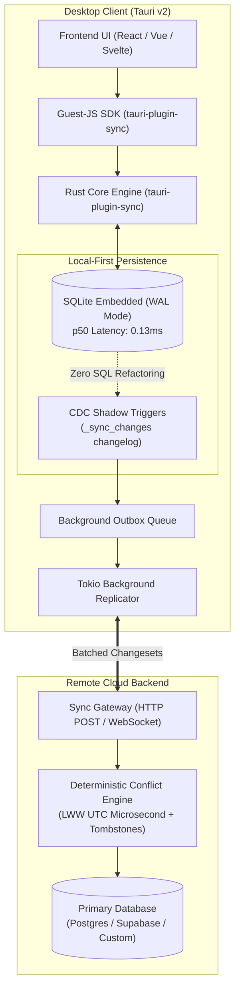

# tauri-plugin-sync

> **Zero-Configuration Local-First SQLite Replication & Sync Engine for Tauri v2.**

[](https://crates.io/crates/tauri-plugin-sync)
[](https://opensource.org/licenses/MIT)
[](https://v2.tauri.app)
[](https://github.com/kxrn-gupta/tauri-plugin-sync/actions)
[](https://github.com/kxrn-gupta/tauri-plugin-sync/actions)

<p align="center">
  
</p>

`tauri-plugin-sync` enables developers to build real-time, offline-first desktop applications with Tauri v2. Write to local SQLite with sub-millisecond median latency (0.13ms p50 / 0.34ms mean), and let the background sync engine seamlessly replicate changesets to your remote cloud backend with deterministic Last-Write-Wins (LWW) conflict resolution.

---

## Features

- **Sub-Millisecond Local Writes:** Median (p50) latency of 0.13ms and mean latency of 0.34ms with zero network blocking.
- **Automatic Change Data Capture (CDC):** Shadow triggers track inserts, updates, and deletes without changing existing application SQL.
- **Offline-First Resilience:** Network disconnects queue mutations locally; auto-sync resumes instantly when back online.
- **Deterministic Conflict Resolution:** Last-Write-Wins (LWW) with microsecond tiebreakers and tombstone deletion support.
- **Infinite Loop Immunity:** Session-level recursion suppression guarantees inbound sync never re-triggers local CDC triggers.
- **Modern TypeScript SDK:** Full TypeScript definitions and reactive status listeners.

---

## Technical Credibility & Reproducible Benchmarks

Every benchmark and concurrency claim is independently verifiable locally:

```bash
# Run the release-optimized microbenchmark suite
cargo run --package tauri-plugin-sync --example benchmark --release

# Run all 15 integration and edge-case tests
cargo test --package tauri-plugin-sync -- --nocapture
```

### Measured Performance (1,000 Iteration Sample)

| Test Scenario | Measurement | Benchmark Result | Architectural Guarantee |
| :--- | :--- | :---: | :--- |
| **Local SQLite Mutation (p50)** | Single-row INSERT / UPDATE | `0.13 ms` (p50) | Typical local execution; 120× faster than 60fps frame |
| **Local SQLite Mutation (Mean)** | Average across 1,000 rows | `0.34 ms` (mean) | Sustained unbatched writes |
| **Local SQLite Mutation (p99)** | Tail latency during checkpoint | `1.00 ms` (p99) | Predictable performance even during WAL checkpointing |
| **CDC Trigger Overhead (p50)** | Shadow table changelog capture | `< 0.09 ms` (p50) | Seamless delta logging with zero application refactoring |
| **Concurrent Write Stress** | 10 concurrent threads × 100 ops | `1,000 ops in ~1.02s` | Zero `database locked` errors via WAL mode busy timeout |
| **Conflict Convergence** | LWW timestamp vs. Tombstones | `Deterministic` | Deletions strictly defeat stale historical updates |
| **Schema Drift Resilience** | Unexpected server-side columns | `Zero failures` | Local engine strips unknown columns gracefully |

👉 **Read the full [Benchmark Specification & Reproducibility Guide](./BENCHMARKS.md)** for detailed hardware environments and p50/p95/p99 latency percentiles.  
👉 **Read the [Conflict Resolution & Edge Cases Specification](./CONFLICT_RESOLUTION.md)** for mathematical tiebreakers, tombstone precedence, and schema evolution rules.

---

## Installation

### 1. Add Rust Dependency
In your `src-tauri/Cargo.toml`:

```toml
[dependencies]
tauri-plugin-sync = "0.1"

# Or directly from GitHub pinned tag
# tauri-plugin-sync = { git = "https://github.com/kxrn-gupta/tauri-plugin-sync", tag = "v0.1.1" }
```

### 2. Initialize in Tauri Builder
Configure database, endpoints, and credentials securely in `src-tauri/src/lib.rs` (or `main.rs`):

```rust
use tauri_plugin_sync::Builder as SyncBuilder;

pub fn run() {
    tauri::Builder::default()
        .plugin(
            SyncBuilder::new()
                .database("app.db")
                .endpoint("https://api.example.com/sync")
                .bearer_token("YOUR_AUTH_TOKEN") // Securely managed in Rust backend (XSS-safe)
                .tables(vec!["notes".into(), "todos".into()])
                .sync_interval(std::time::Duration::from_secs(5))
                .build()
        )
        .run(tauri::generate_context!())
        .expect("error while running tauri application");
}
```

### 3. Add Guest-JS SDK
In your frontend project:

```bash
npm install "https://github.com/kxrn-gupta/tauri-plugin-sync#v0.1.1"
# or
pnpm add "github:kxrn-gupta/tauri-plugin-sync#v0.1.1"
```

---

## Quick Start

```typescript
import { SyncManager } from 'tauri-plugin-sync';

// Zero-configuration: connects directly to the Rust-configured sync engine
const sync = await SyncManager.init({
  database: 'app.db',
  endpoint: 'https://api.example.com/sync',
  tables: ['todos', 'notes'],
  syncIntervalMs: 5000,
});

// Listen to real-time sync status events
sync.onStatusChange((status) => {
  console.log('Current status:', status.state); // 'idle' | 'syncing' | 'offline' | 'error'
});

// Trigger an immediate sync pass
await sync.syncNow();
```

---

## Architecture & System Design



---

## Documentation & References

- 📖 **[Deep-Dive Architecture Article (Medium)](https://medium.com/@karan5028ji/building-an-offline-first-sqlite-sync-engine-for-tauri-v2-desktop-apps-d673f8ed54d1)**
- 📊 **[Benchmark Specification & Reproducibility Guide](./BENCHMARKS.md)**
- ⚖️ **[Conflict Resolution & Edge Cases Specification](./CONFLICT_RESOLUTION.md)**
- 📐 **[Technical Architecture](./ARCHITECTURE.md)**
- 🗺️ **[Roadmap](./ROADMAP.md)**

---

## Authors & Maintainers
- **Chitresh (Kxrn) Gupta** ([@kxrn-gupta](https://github.com/kxrn-gupta)) — Author & System Architect, Gupta Ventures
- Open-source contributions and community pull requests are welcome!

---

## License
MIT License. See [LICENSE](./LICENSE) for details.
