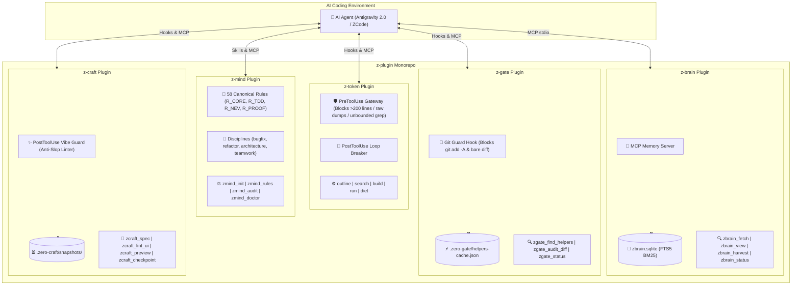

# 🔌 z-plugin — Unified Plugin Suite for Antigravity & ZCode

[](https://nodejs.org)
[](https://github.com/kzxl/z-plugin)
[](https://modelcontextprotocol.io)
[](LICENSE)

**z-plugin** is the official monorepo providing high-performance, context-efficient, zero-overhead plugins for **Google Antigravity 2.0** and **ZCode** autonomous AI coding environments.

Consolidating multiple specialized plugins under a single repository, `z-plugin` enables one-command installation, unified versioning, and shared cross-platform tooling.

---

## 📦 Shipped Plugins

| Plugin | Version | Focus | Core Capabilities |
| :--- | :---: | :--- | :--- |
| [**`z-token`**](plugins/z-token) | `1.1.0` | **Context Diet & Token Guard** | Code outline, capped search, lean .NET builds, oversized-read blocking gateway, PowerShell recursive grep guard, repeated-call loop breaker. |
| [**`z-brain`**](plugins/z-brain) | `1.1.0` | **Episodic Memory Engine** | Pure local embedded SQLite WAL, FTS5 BM25 search, L0 compact index (~30 tokens), smart deduplication/upsert, auto project scoping. |
| [**`z-mind`**](plugins/z-mind) | `1.1.0` | **Cognitive OS & 58 Invariants** | Senior engineering disciplines, 58 canonical rules, 4-phase bugfix diagnosis, Net Engineering Value (NEV) refactor gate, project rule bootstrap & doctor. |
| [**`z-gate`**](plugins/z-gate) | `1.1.0` | **Asset Discovery & NEV Gate** | Codebase helper discovery (`R_REUSE`), pre-commit diff audit against wrapper hell and LOC bloat, Git PreToolUse hook enforcing targeted staging (`R_GIT`). |
| [**`z-craft`**](plugins/z-craft) | `1.1.0` | **Software Craftsmanship & Vibe Engine** | Disciplined vibe-coding, Anti-Slop AST Linter (`R_ANTI_SLOP`), 4-state UX micro-contract generator, live generative canvas preview, and vibe time-machine. |

---

## ⚡ Quick Start: One-Click Installation

Link all plugins simultaneously into both **Antigravity** and **ZCode**:

```powershell
# From the z-plugin repository root
powershell -ExecutionPolicy Bypass -File install.ps1
```

The installer automatically detects local environments and establishes zero-copy directory junctions:
- **Antigravity**: `~/.gemini/config/plugins/<plugin-name>`
- **ZCode**: `~/.zcode/plugins/<plugin-name>`

### Selective Installation

```powershell
# Install only z-token
powershell -ExecutionPolicy Bypass -File install.ps1 -Plugin z-token

# Install only z-brain
powershell -ExecutionPolicy Bypass -File install.ps1 -Plugin z-brain

# Install only z-mind
powershell -ExecutionPolicy Bypass -File install.ps1 -Plugin z-mind

# Install only z-gate
powershell -ExecutionPolicy Bypass -File install.ps1 -Plugin z-gate

# Install only z-craft
powershell -ExecutionPolicy Bypass -File install.ps1 -Plugin z-craft

# Unlink all plugins
powershell -ExecutionPolicy Bypass -File install.ps1 -Uninstall
```

---

## 🏛️ Ecosystem Overview



---

## 🛠️ Plugin Details

### 1. `z-token` (Context Firewall & Token Diet)
- **Problem Solved:** Prevents coding agents from burning 40,000+ tokens on whole-file reads, unbounded recursive greps, and raw build logs.
- **Measured Savings:** Up to **95.5% token reduction** on large file inspections and **99.2% reduction** on warning-heavy build logs.
- **PreToolUse Guard:**
  - Blocks whole-file `Read` > 128 KB or unbounded limits (>400 lines).
  - Blocks unbounded `grep -rn` and `rg` without `-m` limits.
  - Blocks deep PowerShell recursive tree walks (`Get-ChildItem -Recurse` / `gci -r`) without `-Depth <= 3`.
  - Blocks bare `git diff` (enforces `--stat` or targeted file paths).
- **MCP Tools:**
  - `outline`: Extracts high-level AST and declarations without dumping file bodies.
  - `search`: Grep with strict 30-match / 8 KB ceilings.
  - `build`: Compact MSBuild and `dotnet build` errors & grouped warning codes.
  - `run`: Compact test and task runner for npm, cargo, go, maven, gradle, pytest.
  - `diet`: Analyzes active plugins/skills to report permanent context overhead.
- See full documentation: [plugins/z-token/README.md](plugins/z-token/README.md)

### 2. `z-brain` (Pure Local Episodic Memory Engine)
- **Problem Solved:** Replaces remote PostgreSQL and background memory daemons with a zero-cost, 100% offline embedded SQLite engine.
- **Smart Episodic Features:**
  - **Auto Project Scoping:** Automatically binds lessons to the active project (`erp`, `zero_universe`, `z-plugin`) based on git root.
  - **Smart Deduplication & Upsert:** Re-harvesting similar problems merges and updates existing atoms instead of cluttering the database.
  - **Post-Test Advisor:** Hook prompts the agent to harvest atomic knowledge after passing test runs.
- **Progressive Disclosure:**
  - **L0 Index:** Pre-task context sweeps deliver ~30 tokens per item (`[#ID] Problem › Gotcha/Fix`).
  - **L2 Deep View:** Full root-cause analysis and code snippets are fetched strictly on demand.
- **MCP Tools:**
  - `zbrain_fetch`: Fast FTS5 pre-task context sweep.
  - `zbrain_view`: Detailed inspection by ID.
  - `zbrain_harvest`: Direct recording of verified engineering lessons.
  - `zbrain_query`: Multi-angle filtered search with trust levels.
  - `zbrain_status`: SQLite database statistics and atom counts.
- See full documentation: [plugins/z-brain/README.md](plugins/z-brain/README.md)

### 3. `z-mind` (Cognitive OS & Senior Engineering Invariants)
- **Problem Solved:** Prevents AI agents from producing shallow boilerplate, speculative bug fixes, unnecessary wrapper layers, and uncoordinated multi-agent conflicts.
- **Cognitive Disciplines:**
  - **58 Engineering Rules & Invariants:** Enforces complete engineering standards categorized into 6 pillars: Universal Invariants (`R_CORE`, `R_TDD`, `R_PERF`, `R_NEV`, `R_PROOF`, `R_REUSE`, `R_GIT`, `R_TEAM`), Language Stacks (`R_CS`, `R_WPF`, `R_NODE`, `R_REACT`, `R_GO`, `R_RUST`, `R_PY`), Architecture (`R_API`, `R_UNIVERSE`, `R_EVT`, `R_RES`), Cognition & Research (`R_COG_LOOP`, `R_PRE_MORTEM`, `R_EPISTEMIC`), ERP Domains (`R_DOMAIN_INV`, `R_DOMAIN_PROD`, `R_DOMAIN_SALES`, `R_DOMAIN_FIN`, `R_DOMAIN_WMS`, `R_DOMAIN_AUTH`), and Operations (`R_PUB`, `R_PKG`, `R_SEC_STD`, `R_ANTI_SLOP`).
  - **4-Phase Bug Diagnosis:** Mandatory sequence: Sensory Sweep → Socratic Inquiry → Pre-Mortem Hypothesis → Root Cause Fix.
  - **Refactor Gate:** Enforces the Net Engineering Value (NEV) formula before refactoring.
  - **Deep Module Architecture:** Information hiding, interface minimization, and the Deletion Test.
  - **Multi-Agent Teamwork:** Zero-collision file ownership contracts, independent adversarial review gates, and explicit subagent boundaries.
- **MCP Tools:**
  - `zmind_init`: Bootstrap standardized `.project-rule.md` tailored to workspace stack.
  - `zmind_rules`: Query invariant definitions and positive/negative examples by topic.
  - `zmind_audit`: Audit implementation plans, diffs, or architecture designs against invariants.
  - `zmind_doctor`: Run architectural health-checks and rule compliance audits across the repository.
  - `zmind_status`: Summary of active cognitive rules, personas, and specialized workflows.
- See full documentation: [plugins/z-mind/README.md](plugins/z-mind/README.md)

### 4. `z-gate` (Codebase Asset Discovery & Net Engineering Value Gate)
- **Problem Solved:** Halts codebase bloat, eliminates hand-rolled helper duplication, and stops single-impl interface wrapper hell before commits occur.
- **Core Pillars:**
  - **Asset-First Discovery (`R_REUSE`):** Scans `Helpers/`, `Extensions/`, `Utils/`, and `Common/` directories (<5ms disk cache) to surface existing methods and C# extension methods.
  - **Net Engineering Value Gate (`R_NEV`):** Audits diffs against the Deletion Test (rejects interfaces with a single implementation), flags LOC bloat >30% on refactoring tasks, and catches runtime regressions.
  - **Platform Invariants:** Enforces clean ERP UI (blocks `BindingSource` per `R_WPF`), zero raw SQL concatenation (`R_DB`), and zero self-praise commit messages (`R_PROOF`).
  - **Git PreToolUse Guard:** Intercepts `run_command` / bash to block `git add -A` and `git add .`, strictly enforcing Conventional Commits and targeted staging (`R_GIT`).
- **MCP Tools:**
  - `zgate_find_helpers`: Find reusable helpers/extension methods by semantic query or name.
  - `zgate_audit_diff`: Audit staged git diffs against NEV, LOC inflation, and platform invariants.
  - `zgate_status`: Show helper index status, cache statistics, and active guard metrics.
- See full documentation: [plugins/z-gate/README.md](plugins/z-gate/README.md)

### 5. `z-craft` (Software Craftsmanship & Disciplined Vibe-Coding Engine)
- **Problem Solved:** Bridges natural-language creative vibes and production-grade software. Eliminates amateurish AI-slop (gratuitous gradients, non-token colors, blank screens, dead buttons) and provides instant visual verification.
- **Core Pillars:**
  - **Vibe-to-Spec Engine:** Synthesizes casual prompts into a 4-state UX Micro-Contract (`Default`, `Loading` skeleton, `Empty` zero-state, `Error` with retry).
  - **Mechanical Anti-AI-Slop Linter (`R_ANTI_SLOP`):** AST scanner detecting arbitrary hex codes, neon gradients, floaty drop-shadows, and unhandled states across React, Tailwind, and XAML.
  - **Interactive Generative Canvas:** Generates self-contained interactive HTML/Tailwind widgets rendering directly in Antigravity chat for live clickable verification.
  - **Vibe Time-Machine:** Non-destructive shadow checkpoints (`.zero-craft/snapshots/`) for instant 1-click rollbacks during visual experimentation.
- **MCP Tools:**
  - `zcraft_spec`: Generate UX micro-contract and state matrix from prompt.
  - `zcraft_lint_ui`: Run Anti-Slop AST Linter on code snippets or repository files.
  - `zcraft_preview`: Generate interactive HTML canvas widget.
  - `zcraft_checkpoint`: Manage shadow micro-checkpoints (create, list, restore).
  - `zcraft_status`: Show craftsmanship score, active rules, and checkpoint status.
- See full documentation: [plugins/z-craft/README.md](plugins/z-craft/README.md)

---

## 🧪 Testing & Verification

Run automated test suites across all plugins and tooling:

```bash
# Run syntax checks
npm run check

# Run full test suite across all 11 benchmark modules (version, guard, language heuristic, build parser, filesystem, runner, panel, brain, mind, gate, craft)
npm test
```

---

## 📄 License

This monorepo is licensed under the [MIT License](LICENSE).
