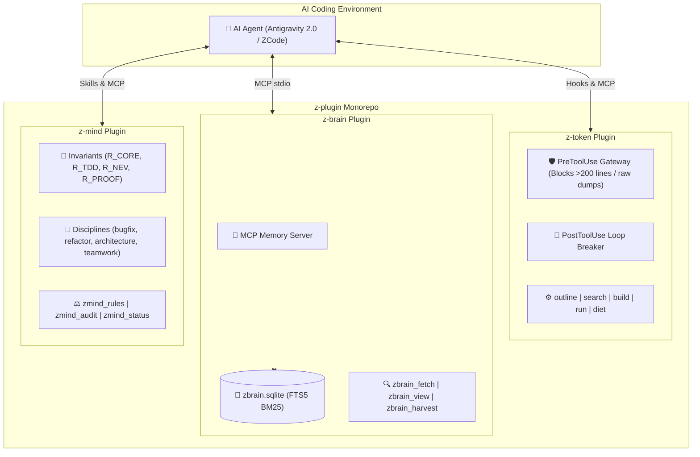

# 🔌 z-plugin — Unified Plugin Suite for Antigravity & ZCode

[](https://nodejs.org)
[](https://github.com/kzxl/z-plugin)
[](https://modelcontextprotocol.io)
[](LICENSE)

**z-plugin** is the official monorepo providing high-performance, context-efficient, zero-overhead plugins for **Google Antigravity 2.0** and **ZCode** autonomous AI coding environments.

Consolidating multiple specialized plugins under a single repository, `z-plugin` enables one-command installation, unified versioning, and shared cross-platform tooling.

---

## 📦 Shipped Plugins

| Plugin | Version | Focus | Core Capabilities |
| :--- | :---: | :--- | :--- |
| [**`z-token`**](plugins/z-token) | `1.0.0` | **Context Diet & Token Guard** | Code outline, capped search, lean .NET builds, oversized-read blocking gateway, repeated-call loop breaker. |
| [**`z-brain`**](plugins/z-brain) | `1.0.0` | **Episodic Memory Engine** | Pure local embedded SQLite WAL, FTS5 BM25 search, L0 compact index (~30 tokens), on-demand L2 deep view. |
| [**`z-mind`**](plugins/z-mind) | `1.0.0` | **Cognitive OS & Engineering Invariants** | Senior engineering disciplines, 4-phase bugfix diagnosis, Net Engineering Value (NEV) refactor gate, deep module design, multi-agent teamwork. |

---

## ⚡ Quick Start: One-Click Installation

Link all plugins simultaneously into both **Antigravity** and **ZCode**:

```powershell
# From the z-plugin repository root
powershell -ExecutionPolicy Bypass -File install.ps1
```

The installer automatically detects local environments and establishes zero-copy directory junctions:
- **Antigravity**: `~/.gemini/config/plugins/<plugin-name>`
- **ZCode**: `~/.zcode/plugins/<plugin-name>`

### Selective Installation

```powershell
# Install only z-token
powershell -ExecutionPolicy Bypass -File install.ps1 -Plugin z-token

# Install only z-brain
powershell -ExecutionPolicy Bypass -File install.ps1 -Plugin z-brain

# Install only z-mind
powershell -ExecutionPolicy Bypass -File install.ps1 -Plugin z-mind

# Unlink all plugins
powershell -ExecutionPolicy Bypass -File install.ps1 -Uninstall
```

---

## 🏛️ Ecosystem Overview



---

## 🛠️ Plugin Details

### 1. `z-token` (Context Firewall & Token Diet)
- **Problem Solved:** Prevents coding agents from burning 40,000+ tokens on whole-file reads, unbounded recursive greps, and raw build logs.
- **Measured Savings:** Up to **95.5% token reduction** on large file inspections and **99.2% reduction** on warning-heavy build logs.
- **MCP Tools:**
  - `outline`: Extracts high-level AST and declarations without dumping file bodies.
  - `search`: Grep with strict 30-match / 8 KB ceilings.
  - `build`: Compact MSBuild and `dotnet build` errors & grouped warning codes.
  - `run`: Compact test and task runner for npm, cargo, go, maven, gradle, pytest.
  - `diet`: Analyzes active plugins/skills to report permanent context overhead.
- See full documentation: [plugins/z-token/README.md](plugins/z-token/README.md)

### 2. `z-brain` (Pure Local Episodic Memory Engine)
- **Problem Solved:** Replaces remote PostgreSQL and background memory daemons with a zero-cost, 100% offline embedded SQLite engine.
- **Progressive Disclosure:**
  - **L0 Index:** Pre-task context sweeps deliver ~30 tokens per item (`[#ID] Problem › Gotcha/Fix`).
  - **L2 Deep View:** Full root-cause analysis and code snippets are fetched strictly on demand.
- **MCP Tools:**
  - `zbrain_fetch`: Fast FTS5 pre-task context sweep.
  - `zbrain_view`: Detailed inspection by ID.
  - `zbrain_harvest`: Direct recording of verified engineering lessons.
  - `zbrain_query`: Multi-angle filtered search with trust levels.
  - `zbrain_status`: SQLite database statistics and atom counts.
- See full documentation: [plugins/z-brain/README.md](plugins/z-brain/README.md)

### 3. `z-mind` (Cognitive OS & Senior Engineering Invariants)
- **Problem Solved:** Prevents AI agents from producing shallow boilerplate, speculative bug fixes, unnecessary wrapper layers, and uncoordinated multi-agent conflicts.
- **Cognitive Disciplines:**
  - **56 Engineering Rules & Invariants:** Enforces complete engineering standards categorized into 6 pillars: Universal Invariants (`R_CORE`, `R_TDD`, `R_PERF`, `R_NEV`, `R_PROOF`, `R_REUSE`, `R_GIT`, `R_TEAM`), Language Stacks (`R_CS`, `R_WPF`, `R_NODE`, `R_REACT`, `R_GO`, `R_RUST`, `R_PY`), Architecture (`R_API`, `R_UNIVERSE`, `R_EVT`, `R_RES`), Cognition & Research (`R_COG_LOOP`, `R_PRE_MORTEM`, `R_EPISTEMIC`), ERP Domains (`R_DOMAIN_INV`, `R_DOMAIN_PROD`, `R_DOMAIN_SALES`, `R_DOMAIN_AUTH`), and Operations (`R_PUB`, `R_PKG`, `R_SEC_STD`, `R_ANTI_SLOP`).
  - **4-Phase Bug Diagnosis:** Mandatory sequence: Sensory Sweep → Socratic Inquiry → Pre-Mortem Hypothesis → Root Cause Fix.
  - **Refactor Gate:** Enforces the Net Engineering Value (NEV) formula before refactoring.
  - **Deep Module Architecture:** Information hiding, interface minimization, and the Deletion Test.
  - **Multi-Agent Teamwork:** Zero-collision file ownership contracts, independent adversarial review gates, and explicit subagent boundaries.
- **MCP Tools:**
  - `zmind_rules`: Query invariant definitions and positive/negative examples by topic.
  - `zmind_audit`: Audit implementation plans, diffs, or architecture designs against invariants.
  - `zmind_status`: Summary of active cognitive rules, personas, and specialized workflows.
- See full documentation: [plugins/z-mind/README.md](plugins/z-mind/README.md)

---

## 🧪 Testing & Verification

Run automated test suites across all plugins and tooling:

```bash
# Run syntax checks
npm run check

# Run full test suite across all 8 modules (guard, language heuristic, build parser, filesystem, runner, panel, brain, mind)
npm test
```

---

## 📄 License

This monorepo is licensed under the [MIT License](LICENSE).
