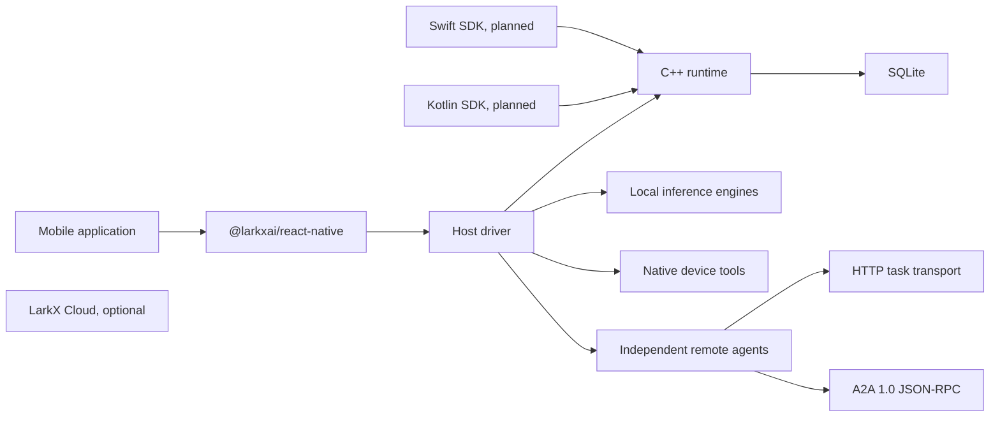

# LarkX

[](https://github.com/larkxai/larkx/actions/workflows/ci.yml)
[](https://github.com/larkxai/larkx/actions/workflows/release.yml)
[](https://www.npmjs.com/package/@larkxai/react-native)
[](./LICENSE)

**The missing execution layer for on-device AI agents.**

LarkX is an open-source, mobile-first execution runtime for building durable, offline-first AI agents that can collaborate with existing remote agents.

**Inference engines run models. LarkX brings durable agent execution to devices.**

A phone can run its own agent. It does not have to be only a client of a remote one. When the network and an external system are available, the local agent can delegate one task to an agent that already runs on LangGraph, Google ADK, the OpenAI Agents SDK, or another framework. LarkX does not replace those frameworks, and it does not host their servers.

[Website](https://larkx.ai) · [Roadmap](ROADMAP.md) · [Contributing](CONTRIBUTING.md)

## Why a mobile agent needs its own runtime

A model call and a tool call are separate effects. The operating system can suspend or kill the process after a tool has changed local data and before that result is stored, or after a decision is stored and before the next tool runs. Starting the prompt over repeats work and can repeat a side effect.

LarkX keeps one execution record in SQLite on the device. The C++ runtime decides the next model call, tool call, or remote delegation. The application supplies the model and the native tools. When the application starts again, the same agent registration resumes the same run.

Established agent frameworks already orchestrate, persist, and recover work on servers. LarkX is specialized for the device: offline operation, the mobile process lifecycle, embedded storage, constrained resources, and durable coordination with a remote agent.

## Public SDK

| Platform     | Distribution          | Status      |
| ------------ | --------------------- | ----------- |
| React Native | npm                   | Implemented |
| Swift        | Swift Package Manager | Planned     |
| Kotlin       | Maven                 | Planned     |

```bash
npm install @larkxai/react-native
```

```typescript
import { createRuntime, defineTool, sqlite, remoteAgent } from "@larkxai/react-native";
```

React Native loads the native module through Expo autolinking, CocoaPods, and Gradle. Expo Go cannot load it. Use a development build. There is no JavaScript fallback. The current published line is 0.2.0. Node.js remains in this repository for tests and is not an application install. See [CONTRIBUTING.md](CONTRIBUTING.md).

## Quick start

The model in this example is scripted so the snippet can run without a downloaded model. A device app uses the same runtime calls.

```typescript
import { createRuntime, defineTool, scriptedModel, sqlite } from "@larkxai/react-native";

const runtime = await createRuntime({
  storage: sqlite(),
  ownerId: "notes",
});

const agent = runtime.createAgent({
  name: "notes",
  version: 1,
  instructions: "Read the note and answer in one line.",
  model: scriptedModel([
    {
      message: null,
      finish: "tool_calls",
      calls: [{ id: "call-1", name: "read_notes", arguments: {} }],
    },
    { message: "Seal needs service.", finish: "stop", calls: [] },
  ]),
  tools: [
    defineTool({
      name: "read_notes",
      description: "Read the local inspection notes.",
      effects: "pure",
      schema: { type: "object", properties: {} },
      handler: () => ({ notes: ["Seal weeps above 80 psi."] }),
    }),
  ],
});

const run = await agent.start({ message: "Inspect pump 12", runId: "notes-1" });
const result = await run.result();
console.log(result.message);
await runtime.close();
```

`agent.start` registers the agent, stores the run, and starts the driver. `run.result()` waits for the terminal message. It does not start a second driver. `run.schedule()` starts the driver when you already hold the run and want it to proceed in the background. `sqlite()` with no path stores `larkx.db` in the application document directory.

## Local AI model integration

Cactus is an optional local inference engine. LarkX does not ship its own. The root import does not load Cactus. Install `cactus-react-native` 1.13.1 and `react-native-nitro-modules` 0.33.9 or newer in the app, then use a development build.

`qwen3-0.6b` is the model name the adapter passes to Cactus. The Cactus SDK's default quantization is int8, so a loaded model reports a name such as `qwen3-0.6b-int8`. Download and initialization happen before the run. They are not agent steps.

```typescript
import { createRuntime, defineTool, sqlite } from "@larkxai/react-native";
import { cactusModel } from "@larkxai/react-native/cactus";

const model = cactusModel({ model: "qwen3-0.6b" });
await model.download();
await model.init();

const runtime = await createRuntime({ storage: sqlite() });
const agent = runtime.createAgent({
  name: "personal-assistant",
  version: 1,
  model,
  instructions: "Help the user.",
  tools: [
    defineTool({
      name: "read_notes",
      description: "Read locally stored notes.",
      effects: "idempotent",
      schema: { type: "object", properties: {} },
      handler: (_input, context) => ({ notes: ["Example note"], operationId: context.operationId }),
    }),
  ],
});

const run = await agent.start({ message: "Hello", runId: "assistant-1" });
const result = await run.result();
```

Completions for one model instance are queued. Cancelling a call that is still waiting does not stop the completion that is already running. A second model instance has its own queue. A Cactus response that asks for a cloud handoff is rejected. This repository has not executed download or inference on a phone.

## Durable execution and recovery

Recovery happens when the process runs again and opens the same database. Register the same agent name and version, then resume the run id.

```typescript
import { createRuntime, defineTool, scriptedModel, sqlite } from "@larkxai/react-native";

const runtime = await createRuntime({
  storage: sqlite(),
  ownerId: "notes",
});

runtime.createAgent({
  name: "notes",
  version: 1,
  instructions: "Read the note and answer in one line.",
  model: scriptedModel([
    {
      message: null,
      finish: "tool_calls",
      calls: [{ id: "call-1", name: "read_notes", arguments: {} }],
    },
    { message: "Seal needs service.", finish: "stop", calls: [] },
  ]),
  tools: [
    defineTool({
      name: "read_notes",
      description: "Read the local inspection notes.",
      effects: "pure",
      schema: { type: "object", properties: {} },
      handler: () => ({ notes: ["Seal weeps above 80 psi."] }),
    }),
  ],
});

const saved = await runtime.listRuns();
const interrupted = saved.find((run) => run.runId === "notes-1");
if (interrupted !== undefined && interrupted.status !== "COMPLETED") {
  const run = await runtime.resume(interrupted.runId);
  console.log(await run.result());
}
await runtime.close();
```

`listRuns` reads the stored runs. `resume` continues one of them. A step that was committed is not executed again. A `pure` or `idempotent` step that was still running may run again. An idempotent retry uses the same operation id, so the tool can skip an effect it already recorded. A `non-idempotent` step that was interrupted becomes an unknown outcome. The run is `BLOCKED` and the tool is not called again. Continue it with `run.reconcile` after the application decides what happened.

`runtime.observe` reports model requests, tool requests, commits, and the point where reconciliation is required.

Open a new database file. This runtime stamps SQLite `application_id` `LXRT` (`0x4C585254`) on files it creates. A file with any other id, including a database written by the removed TypeScript engine or an earlier native preview, is rejected and left unchanged. There is no migration.

## Hybrid delegation

A local agent can hand one task to an independently deployed remote agent and keep the parent run on the device. The remote agent has its own runtime. It can be a LangGraph service, a Google ADK service, an OpenAI Agents SDK service, or another peer. LarkX stores the delegation, then the host sends it. The HTTP task protocol remains the generic transport. A2A protocol 1.0 JSON-RPC is the supported standard for a peer that publishes an agent card. This repository does not host the remote agent.

```typescript
import { createRuntime, remoteAgent, sqlite } from "@larkxai/react-native";

const procurement = remoteAgent({
  name: "procurement-agent",
  description: "Find compatible replacement parts and suppliers.",
  transport: {
    type: "http",
    endpoint: "http://127.0.0.1:8787",
    capabilities: {
      dedupe: true,
      lookup: true,
      taskId: true,
      poll: true,
      cancel: true,
      persistent: true,
    },
  },
});

const runtime = await createRuntime({ storage: sqlite() });
const agent = runtime.createAgent({
  name: "field-assistant",
  version: 1,
  model,
  instructions: "Inspect equipment and identify replacement parts.",
  tools: [readInspectionNotes, getEquipmentDetails, saveReport],
  remoteAgents: [procurement],
});
const run = await agent.start({
  message: "Inspect pump P-104 and recommend replacement parts.",
});
console.log(await run.result());
```

Registering a remote agent is the authorization to send those arguments to that endpoint. The default with no remote agents remains device-only. The client operation id and the remote task id are stored separately. A known task is polled after a restart and is not submitted again. HTTP `dedupe` and `lookup` stay off unless that object declares them. A2A does not turn them on: a lost acknowledgement blocks the parent instead of creating another task. `run.provideInput` answers an ordinary A2A question on the same task. An authentication challenge is a separate blocked condition and is not answered with that text. Cancellation of the local run does not roll back a remote effect. The protocol is [docs/architecture/remote-delegation.md](docs/architecture/remote-delegation.md) and [docs/architecture/a2a.md](docs/architecture/a2a.md).

```typescript
const procurementA2a = remoteAgent({
  name: "procurement-agent",
  description: "Find compatible replacement parts and suppliers.",
  transport: {
    type: "a2a",
    endpoint: "https://procurement.example.com",
  },
});
```

## Architecture



Implemented today: the React Native SDK, the shared C++ runtime, SQLite, native tools, optional Cactus, the HTTP delegation transport, and the A2A 1.0 client. Planned: Swift, Kotlin, and optional LarkX Cloud. The C++ runtime owns orchestration, the SQLite record, replay, retries, operation ids, ownership fencing, cancellation, unknown outcomes, reconciliation, and remote delegation state. The host driver performs the model call, tool call, or HTTP request the runtime asked for and submits the result. It does not plan the next step and it does not keep a second database.

Local inference engines, native tools, and remote agent frameworks stay outside the core. LarkX Cloud does not own local execution state. Remote agents are deployed by their own projects, not by this repository. The private Node host uses the same core for tests. It is not a second product runtime.

## Execution guarantees

- A committed model decision or tool result is replayed. The handler is not called again.
- An interrupted `pure` or `idempotent` call may retry. An idempotent retry keeps its operation id.
- An interrupted `non-idempotent` call is `UNKNOWN_OUTCOME`. The run stays `BLOCKED` until `reconcile`.
- Ownership writes carry an epoch. A stale owner cannot commit.
- Cancellation is explicit. A committed step stays committed.
- An external effect is not exactly-once. The process can die after the effect and before the commit.
- A remote task is not exactly-once. Recovery follows the capabilities stored with the delegation.

## Current capabilities and limitations

Implemented:

- One C++ agent runtime. React Native is the public SDK. Node.js is the internal test host.
- SQLite persistence, committed replay, retries, cancellation, pause and resume, ownership fencing, unknown outcomes, and reconciliation.
- Scripted models for tests and the examples.
- Optional Cactus adapter in `@larkxai/react-native/cactus`, including the per-model queue.
- Process-death tests that kill the Node example with `SIGKILL` and reopen the database. Those tests stand in for mobile process death. They are not a phone run.
- Durable delegation to an independent remote agent over the HTTP task protocol and over A2A 1.0 JSON-RPC, including lost acknowledgements, offline queueing, cancellation, a reference fixture, and a LangGraph example.

Not implemented, and not claimed by a green host test:

- A development build on a physical iPhone or Android phone, real Cactus download and inference, offline tool calling, force-quit recovery, mobile lifecycle behavior, and a phone reaching the reference remote fixture or the LangGraph example. The checklist is [docs/validation/on-device-agent.md](docs/validation/on-device-agent.md).
- Production Cloud ingestion. The device posts telemetry version 1 with storage schema 3. Current Cloud accepts schema 1 only, so those batches are rejected until the Cloud contract in [docs/cloud-native-telemetry.md](docs/cloud-native-telemetry.md) lands. The device-side exporter and the local collector fixture are implemented.
- Production Swift and Kotlin SDKs.

Opt-in telemetry reads the native journal and posts metadata. It is off by default. Prompts, model text, tool arguments, and tool results stay on the device. A failed export does not fail a run. See [docs/architecture/telemetry.md](docs/architecture/telemetry.md).

## Examples

| Example                                                                | What it shows                                                                                      |
| ---------------------------------------------------------------------- | -------------------------------------------------------------------------------------------------- |
| [examples/node-agent](examples/node-agent/README.md)                   | Internal Node host: scripted agent, local tools, SQLite, and process termination                   |
| [examples/node-hybrid](examples/node-hybrid/README.md)                 | Internal Node host delegating over HTTP or A2A. Not a public SDK                                   |
| [examples/remote-task](examples/remote-task/README.md)                 | HTTP task fixture used by the hybrid example. Not a hosted product                                 |
| [examples/a2a-fixture](examples/a2a-fixture/README.md)                 | A2A 1.0 fixture for failure injection. Not a LangGraph agent                                       |
| [examples/langgraph-a2a-agent](examples/langgraph-a2a-agent/README.md) | Independently deployed LangGraph agent with an A2A 1.0 endpoint                                    |
| [examples/react-native-agent](examples/react-native-agent)             | Scripted agent, Cactus download and init, field inspection, idempotent and non-idempotent recovery |
| [examples/swift-agent](examples/swift-agent)                           | Small Swift program that calls the C ABI. It is not a Swift SDK                                    |

## Roadmap

The order of later work is in [ROADMAP.md](ROADMAP.md). Physical-device validation remains the gate for claiming mobile support.

The intended flagship demonstration is a field-inspection agent on a phone. It uses an on-device model and native tools, delegates supplier research to an independently deployed LangGraph agent, survives termination, and finishes the report locally. That demonstration belongs to the interoperability milestone. It is not validated yet.

## Contributing and license

See [CONTRIBUTING.md](CONTRIBUTING.md). LarkX is [Apache-2.0](LICENSE).

```bash
pnpm install
pnpm build
pnpm typecheck
pnpm lint
pnpm format:check
pnpm test
cmake -S native -B native/build -DCMAKE_BUILD_TYPE=Release
cmake --build native/build
ctest --test-dir native/build --output-on-failure
sh packages/node/scripts/build-native.sh
```

Node.js 22.13 or newer. pnpm 10.33.4.
