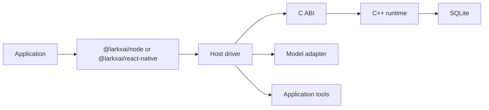

# LarkX

[](https://github.com/larkxai/larkx/actions/workflows/ci.yml)
[](https://github.com/larkxai/larkx/actions/workflows/release.yml)
[](https://www.npmjs.com/package/@larkxai/react-native)
[](./LICENSE)

**Durable orchestration for on-device AI agents.**

AI agents do more than generate text. They make decisions, call tools, and carry out multi-step work. On a phone or another edge device the process can be suspended or killed at any of those steps.

LarkX stores the agent run and continues it from that record when the application starts again.

Inference engines run models. LarkX runs agents.

[Website](https://larkx.ai) · [Roadmap](ROADMAP.md) · [Contributing](CONTRIBUTING.md)

## Why on-device agents need durable orchestration

A model call and a tool call are separate effects. The process can die after a tool has changed local data and before that result is stored, or after a decision is stored and before the next tool runs. Restarting the prompt from scratch repeats work and can repeat a side effect.

LarkX keeps one execution record in SQLite. The C++ runtime decides the next model or tool call. The application supplies the model and the tools. When the process runs again, the same agent registration resumes the same run.

## Installation

React Native:

```bash
npm install @larkxai/react-native
```

Node.js:

```bash
npm install @larkxai/node
```

Those are the only packages an application installs. The next release of both is 0.2.0.

The Node SDK compiles its native addon from the packaged C++ sources. After installation:

```bash
sh node_modules/@larkxai/node/scripts/build-native.sh
```

That build needs Node.js 22.13 or newer, CMake 3.20 or newer, a C++20 compiler, SQLite 3 development headers, and Node.js headers (`node_api.h`). It is a source build for Linux x64 and macOS arm64/x64. Prebuilt binaries are not published. Windows is not supported. If the addon is missing, `createRuntime` throws with those requirements and the command above. Set `LARKX_NATIVE_ADDON` only when you already have a `larkx_native.node` you built yourself.

From this repository, the same command is `sh packages/node/scripts/build-native.sh`.

React Native loads the native module through Expo autolinking, CocoaPods, and Gradle. Expo Go cannot load it. Use a development build. There is no JavaScript fallback.

## Quick start

This script runs on Node.js after the addon build. The model is defined in the file. Nothing else is required.

```typescript
import { createRuntime, defineTool, scriptedModel, sqlite } from "@larkxai/node";

const runtime = await createRuntime({
  storage: sqlite("./agent.db"),
  ownerId: "notes",
});

const agent = runtime.createAgent({
  name: "notes",
  version: 1,
  instructions: "Read the note and answer in one line.",
  model: scriptedModel([
    {
      message: null,
      finish: "tool_calls",
      calls: [{ id: "call-1", name: "read_notes", arguments: {} }],
    },
    { message: "Seal needs service.", finish: "stop", calls: [] },
  ]),
  tools: [
    defineTool({
      name: "read_notes",
      description: "Read the local inspection notes.",
      effects: "pure",
      schema: { type: "object", properties: {} },
      handler: () => ({ notes: ["Seal weeps above 80 psi."] }),
    }),
  ],
});

const run = await agent.start({ message: "Inspect pump 12", runId: "notes-1" });
const result = await run.result();
console.log(result.message);
await runtime.close();
```

`agent.start` registers the agent, stores the run, and starts the driver. `run.result()` waits for the terminal message. It does not start a second driver. `run.schedule()` starts the driver when you already hold the run and want it to proceed in the background.

React Native uses the same calls from `@larkxai/react-native`. `sqlite()` with no path stores `larkx.db` in the application document directory.

```typescript
import { createRuntime, defineTool, scriptedModel, sqlite } from "@larkxai/react-native";
```

## Local AI model integration

Cactus is optional and is part of the React Native SDK. The root import does not load it. Install `cactus-react-native` 1.13.1 and `react-native-nitro-modules` 0.33.9 or newer in the app, then use a development build. Node.js does not use this module.

`qwen3-0.6b` is the model name the adapter passes to Cactus. The Cactus SDK's default quantization is int8, so a loaded model reports a name such as `qwen3-0.6b-int8`. Download and initialization happen before the run. They are not agent steps.

```typescript
import { createRuntime, defineTool, sqlite } from "@larkxai/react-native";
import { cactusModel } from "@larkxai/react-native/cactus";

const model = cactusModel({ model: "qwen3-0.6b" });
await model.download();
await model.init();

const runtime = await createRuntime({ storage: sqlite() });
const agent = runtime.createAgent({
  name: "personal-assistant",
  version: 1,
  model,
  instructions: "Help the user.",
  tools: [
    defineTool({
      name: "read_notes",
      description: "Read locally stored notes.",
      effects: "idempotent",
      schema: { type: "object", properties: {} },
      handler: (_input, context) => ({ notes: ["Example note"], operationId: context.operationId }),
    }),
  ],
});

const run = await agent.start({ message: "Hello", runId: "assistant-1" });
const result = await run.result();
```

Completions for one model instance are queued. Cancelling a call that is still waiting does not stop the completion that is already running. A second model instance has its own queue. A Cactus response that asks for a cloud handoff is rejected. This repository has not executed download or inference on a phone.

## Durable execution and recovery

Recovery happens when the process runs again and opens the same database. Register the same agent name and version, then resume the run id.

```typescript
import { createRuntime, defineTool, scriptedModel, sqlite } from "@larkxai/node";

const runtime = await createRuntime({
  storage: sqlite("./agent.db"),
  ownerId: "notes",
});

runtime.createAgent({
  name: "notes",
  version: 1,
  instructions: "Read the note and answer in one line.",
  model: scriptedModel([
    {
      message: null,
      finish: "tool_calls",
      calls: [{ id: "call-1", name: "read_notes", arguments: {} }],
    },
    { message: "Seal needs service.", finish: "stop", calls: [] },
  ]),
  tools: [
    defineTool({
      name: "read_notes",
      description: "Read the local inspection notes.",
      effects: "pure",
      schema: { type: "object", properties: {} },
      handler: () => ({ notes: ["Seal weeps above 80 psi."] }),
    }),
  ],
});

const saved = await runtime.listRuns();
const interrupted = saved.find((run) => run.runId === "notes-1");
if (interrupted !== undefined && interrupted.status !== "COMPLETED") {
  const run = await runtime.resume(interrupted.runId);
  console.log(await run.result());
}
await runtime.close();
```

`listRuns` reads the stored runs. `resume` continues one of them. A step that was committed is not executed again. A `pure` or `idempotent` step that was still running may run again. An idempotent retry uses the same operation id, so the tool can skip an effect it already recorded. A `non-idempotent` step that was interrupted becomes an unknown outcome. The run is `BLOCKED` and the tool is not called again. Continue it with `run.reconcile` after the application decides what happened.

`runtime.observe` reports model requests, tool requests, commits, and the point where reconciliation is required.

Open a new database file. This runtime stamps SQLite `application_id` `LXRT` (`0x4C585254`) on files it creates. A file with any other id, including a database written by the removed TypeScript engine or an earlier native preview, is rejected and left unchanged. There is no migration.

## Architecture



The C++ runtime owns orchestration, the SQLite record, replay, retries, operation ids, ownership fencing, cancellation, unknown outcomes, and reconciliation. The host driver performs the model or tool call the runtime requested and submits the result. It does not plan the next step and it does not keep a second database.

React Native and Node.js use that same core and the same driver. Cactus, other model adapters, and application tools stay outside the core. LarkX Cloud does not own local execution state. Remote agents are deployed by the application, not by this repository.

## Execution guarantees

- A committed model decision or tool result is replayed. The handler is not called again.
- An interrupted `pure` or `idempotent` call may retry. An idempotent retry keeps its operation id.
- An interrupted `non-idempotent` call is `UNKNOWN_OUTCOME`. The run stays `BLOCKED` until `reconcile`.
- Ownership writes carry an epoch. A stale owner cannot commit.
- Cancellation is explicit. A committed step stays committed.
- An external effect is not exactly-once. The process can die after the effect and before the commit.

## Current capabilities and limitations

Implemented:

- One C++ agent runtime, shared by Node.js and React Native.
- SQLite persistence, committed replay, retries, cancellation, pause and resume, ownership fencing, unknown outcomes, and reconciliation.
- Scripted models for tests and the examples.
- Optional Cactus adapter in `@larkxai/react-native/cactus`, including the per-model queue.
- Process-death tests that kill the Node example with `SIGKILL` and reopen the database.

Not implemented, and not claimed by a green host test:

- A development build on a physical iPhone or Android phone, real Cactus download and inference, offline tool calling, force-quit recovery, and mobile lifecycle behavior. The checklist is [docs/validation/on-device-agent.md](docs/validation/on-device-agent.md).
- Remote agent delegation, A2A, egress policies, native telemetry export, and LarkX Cloud.
- Production Swift and Kotlin SDKs.

The metadata telemetry client remains in the repository. The C++ runtime does not call it.

## Examples

| Example                                                    | What it shows                                                                                      |
| ---------------------------------------------------------- | -------------------------------------------------------------------------------------------------- |
| [examples/node-agent](examples/node-agent/README.md)       | Scripted agent, local tools, SQLite, and process termination                                       |
| [examples/react-native-agent](examples/react-native-agent) | Scripted agent, Cactus download and init, field inspection, idempotent and non-idempotent recovery |
| [examples/swift-agent](examples/swift-agent)               | Small Swift program that calls the C ABI. It is not a Swift SDK                                    |

## Roadmap

The order of later work is in [ROADMAP.md](ROADMAP.md). Physical-device validation can proceed beside that work and remains the gate for claiming mobile support.

## Contributing and license

See [CONTRIBUTING.md](CONTRIBUTING.md). LarkX is [Apache-2.0](LICENSE).

```bash
pnpm install
pnpm build
pnpm typecheck
pnpm lint
pnpm format:check
pnpm test
cmake -S native -B native/build -DCMAKE_BUILD_TYPE=Release
cmake --build native/build
ctest --test-dir native/build --output-on-failure
sh packages/node/scripts/build-native.sh
```

Node.js 22.13 or newer. pnpm 10.33.4.
