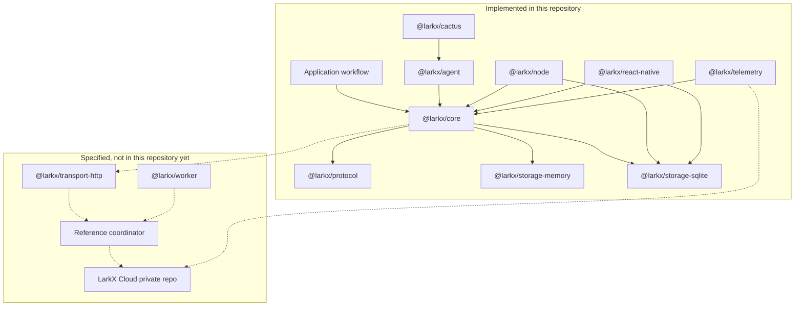

# LarkX

Durable execution for on-device AI agents.

Build AI agents that recover from interruptions, continue offline, and coordinate execution between edge devices and the cloud.

Cactus runs your models. LarkX runs your workflows.

**Status:** early implementation. Milestones M0 and M1 are covered by automated tests, including real Node.js process termination. M2 adds the React Native adapter. M3 adds durable agents and a Cactus adapter on that same engine. M4 adds an optional metadata-only exporter to LarkX Cloud. Packages are not published to npm. The agent tests run on Node.js. The Cactus screen has not been executed on an emulator or a device in CI. Hybrid dispatch is specified and not implemented. The Cloud service stays in a private repository.

Website: [https://larkx.ai](https://larkx.ai)

License: Apache-2.0

## Project status

| Area                                                   | State                                                                               |
| ------------------------------------------------------ | ----------------------------------------------------------------------------------- |
| Execution protocol (`@larkx/protocol`)                 | Implemented, version 1                                                              |
| Local workflow runtime (`@larkx/core`)                 | Implemented                                                                         |
| Memory storage                                         | Implemented. Does not survive process exit                                          |
| SQLite storage and Node adapter                        | Implemented. Node's built-in `node:sqlite` is experimental                          |
| Replay, crash recovery, effect policies, ownership     | Implemented and tested on Node.js                                                   |
| Durable agents, tools, model adapters (`@larkx/agent`) | Implemented on the existing engine. Scripted model in CI. No device run for Cactus  |
| React Native adapter                                   | Implemented on the shared engine. Device and emulator runs are not in CI            |
| Cactus adapter (`@larkx/cactus`)                       | Implemented against cactus-react-native 1.13.1. Native dev build only. Not run here |
| Optional Cloud telemetry (`@larkx/telemetry`)          | Implemented. Metadata only. Execution does not wait on it. Not a device run         |
| HTTP transport, worker SDK, reference coordinator      | Not implemented                                                                     |
| Managed LarkX Cloud                                    | Ingestion lives in `larkxai/cloud`. This tree only sends the batch                  |

The unscoped npm name `larkx` belongs to an unrelated project. The intended scope is `@larkx`. Those packages were not on the registry when this tree was created, and this repository does not publish them.

## Problem

An on-device agent does more than call a model. It loops, runs tools, writes application state, and sometimes calls a remote service. Phones and other edge devices suspend processes, drop the network, and kill apps before those results are saved.

Server workflow engines assume a coordinator the device can reach. A local agent still has to start, advance, and recover when that coordinator is absent.

## What LarkX does

LarkX is an embedded, local-first durable execution engine.

A workflow is ordinary TypeScript. Each meaningful operation runs inside a durable step. The runtime stores the step result before it moves on. After a crash it runs the workflow function again, returns the stored results for steps that already committed, and retries or blocks the interrupted step according to its effect class.

Inference engines execute models. LarkX executes and preserves the workflows that use those models. The core has no dependency on a model provider.

## Why durable agent execution matters

Agent progress is a sequence of decisions and tool results. If that sequence lives only in memory, a killed process repeats work, drops a half-finished tool call, or runs an external effect twice.

LarkX makes the step the recovery boundary. It does not restore a JavaScript stack, an operating-system thread, or a live inference session. It also does not promise exactly-once execution of arbitrary external effects. Effect classes say which retries are safe.

## Quick start

These packages are used from a checkout. They are not installed from npm.

Requirements: Node.js 22.13 or newer, and pnpm 10.33.4 (`corepack enable` is enough on a recent Node).

```bash
pnpm install
pnpm build
pnpm --filter @larkx/example-node-workflow start -- \
  --database /tmp/larkx-demo.db \
  --log /tmp/larkx-demo.log \
  --crash-after-commit normalize
pnpm --filter @larkx/example-node-workflow start -- \
  --database /tmp/larkx-demo.db \
  --log /tmp/larkx-demo.log
```

The second process prints a completed result. The invocation log lists `normalize` once. Node may print an experimental warning for `node:sqlite`. That warning comes from Node.

The example README describes the other crash points, including a non-idempotent step that recovery refuses to retry.

## Workflow SDK

This is the API that exists today. Steps in this release must use `execution: "local"`.

```typescript
import { defineWorkflow } from "@larkx/core";
import { createNodeEngine } from "@larkx/node";

const countLetters = defineWorkflow({
  name: "count-letters",
  version: 1,
  async run(ctx, input: { text: string }) {
    const normalized = await ctx.step("normalize", {
      execution: "local",
      effects: "pure",
      run: () => input.text.trim().toLowerCase(),
    });
    const total = await ctx.step("count", {
      execution: "local",
      effects: "pure",
      run: () => normalized.length,
    });
    return ctx.step("summarize", {
      execution: "local",
      effects: "idempotent",
      run: ({ operationId }) => ({ operationId, total, normalized }),
    });
  },
});

const engine = createNodeEngine({
  database: "larkx.db",
  workflows: [countLetters],
});

const run = await engine.start(countLetters, {
  id: "letters-1",
  input: { text: "Hello LarkX" },
});
const result = await run.result();
await engine.close();
```

`engine.recover()` resumes every unfinished recoverable run. A caller does not need the original in-memory handle. Starting the same id again with the same workflow version and the same canonical input returns the existing run. A different version or input is rejected.

`ctx.now(key)` and `ctx.random(key)` are themselves durable local steps. Do not call `Date.now()` or `Math.random()` in workflow code outside a step.

## Agents

An agent is a workflow. `createAgent` registers it. Each model call is `model-<n>`. Each tool call is `tool-<n>-<m>`. Replay returns committed decisions and does not call the model or the tool again. The package README has the full example. The Node script is `examples/node-agent`. The engineering phone demo is `examples/react-native-agent`. The field inspection showcase is `examples/field-inspection-agent`, a four-stage on-device workflow.

Calling cloud or hybrid steps today fails with `permission_denied` under the default `device-only` policy, or with `unsupported_capability` when the policy is `cloud-allowed`. There is no remote dispatcher.

```typescript
await ctx.step("plan", {
  execution: "hybrid",
  effects: "pure",
  input: { objects },
  local: generateLocalPlan,
  cloud: "generate-plan-v1",
});
```

## Architecture



Authoritative documents:

- [Architecture RFC](rfcs/0001-architecture.md)
- [Execution semantics RFC](rfcs/0002-execution-semantics.md)
- [Execution model](docs/architecture/execution-model.md)
- [Replay](docs/architecture/replay.md)
- [State machines](docs/architecture/state-machines.md)
- [Storage](docs/architecture/storage.md)
- [Side effects](docs/architecture/side-effects.md)
- [Cloud observability specification](docs/cloud-observability-spec.md)
- [Telemetry export](docs/architecture/telemetry.md)

Agents and the model adapter are implemented: [agents](docs/architecture/agents.md), [model adapter](docs/architecture/model-adapter.md). Hybrid dispatch, mobile lifecycle, and a future Rust core: [hybrid](docs/architecture/hybrid-dispatch.md), [mobile](docs/architecture/mobile-lifecycle.md), [Rust](docs/architecture/rust-migration.md).

## Execution guarantees and limitations

Implemented for local steps:

- A completed step's handler does not run again during replay.
- The recorded JSON output is what replay returns.
- An interrupted `pure` or `idempotent` step may run again. An idempotent step keeps the same `operationId`.
- An interrupted `non-idempotent` step becomes `UNKNOWN_OUTCOME`. The run becomes `BLOCKED` until `reconcileStep`.
- One owner executes a run at a time. A stale owner cannot commit. A dead Node process can be replaced immediately through a pid file; otherwise the lease must expire.
- Cancellation is cooperative and does not roll back committed effects.
- The default data policy is `device-only`.

Not claimed:

- Exactly-once external effects.
- Continuous execution while the operating system has terminated the app.
- Recovery of a JavaScript stack, thread, or native inference session.
- Encrypted local databases, secure-enclave storage, or any regulatory certification.
- Battery, thermal, or memory-aware routing.
- Parallel steps. Execution is sequential.
- React Native behavior on a phone or emulator. The adapter and the renovation agent are in the repository. The automated proof uses Node process death. That is not a substitute for a device. The Cactus screen was not run here.
- Resuming a model from the middle of a token stream. Recovery repeats an uncommitted model step from the start.

## Platform support

| Platform                            | Support                                                                            |
| ----------------------------------- | ---------------------------------------------------------------------------------- |
| Node.js 22.13+                      | Local workflows, file SQLite, process-death tests, and the mobile ownership policy |
| React Native, Expo SDK 58           | Workflow demo and renovation agent. Not executed here on an emulator or a device   |
| Cactus native module                | Adapter compiled against 1.13.1. Requires a dev build, not Expo Go. Not run here   |
| Browser                             | Not a target of this release                                                       |
| Native iOS, Android, embedded, Rust | Design constraints only                                                            |

## Integration support

`@larkx/agent` is the agent API. `@larkx/cactus` is the first model adapter, against Cactus 1.13.1, and it is optional. The agent tests use a scripted model. Ollama is a possible later Node adapter. RunAnywhere and LangGraph are not scheduled.

## Comparison

LarkX is in the same family of problems as Temporal, DBOS, Restate, and Golem: durable steps, replay, and explicit side-effect boundaries. Those systems are built around a server or a service the worker can reach. LarkX's local runtime owns the workflow and must make progress with no network.

LangGraph and similar agent frameworks orchestrate model and tool loops. They are not a substitute for a crash-safe step log on a device. `@larkx/agent` sits on this engine and does not keep a second log.

This table is positioning. It is not a benchmark, and it does not describe production adoption.

## Development setup

```bash
pnpm install
pnpm build
pnpm typecheck
pnpm lint
pnpm format:check
pnpm test
```

`pnpm test` builds the packages and runs Vitest. Tests import the built `dist` entry points. See [Contributing](CONTRIBUTING.md).

## Roadmap

[ROADMAP.md](ROADMAP.md) lists M0 through M7. M0 through M4 are in this tree. M3's Cactus screen and M4's physical-device sync still need a device run before they are called validated on hardware. The managed cloud service stays in a private repository.

## Contributing

See [CONTRIBUTING.md](CONTRIBUTING.md) and [AGENTS.md](AGENTS.md). Security reports: [SECURITY.md](SECURITY.md).

## License

Apache License 2.0. See [LICENSE](LICENSE).
