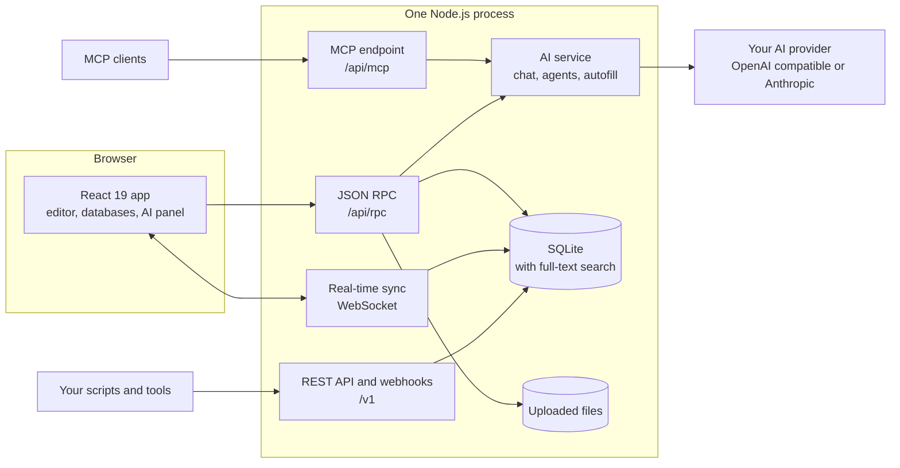

<p align="center">
  <picture>
    <source media="(prefers-color-scheme: dark)" srcset="docs/assets/readme/banner-dark.svg">
    
  </picture>
</p>

<p align="center">
  <a href="LICENSE"></a>
  
  
  
  
</p>

<p align="center">
  <a href="https://litpage-demo-production.up.railway.app"><b>Live demo</b></a> &nbsp;|&nbsp;
  <a href="#quick-start"><b>Quick start</b></a> &nbsp;|&nbsp;
  <a href="#feature-tour"><b>Feature tour</b></a> &nbsp;|&nbsp;
  <a href="#ai-with-your-own-key"><b>AI</b></a> &nbsp;|&nbsp;
  <a href="#api-and-integrations"><b>API</b></a> &nbsp;|&nbsp;
  <a href="#architecture"><b>Architecture</b></a> &nbsp;|&nbsp;
  <a href="README.ko.md"><b>한국어</b></a>
</p>

Litpage is an open-source workspace you run yourself. Write in a block editor, organize pages and teams, track work in
databases with a dozen views, share with fine-grained permissions, and bring your own AI key for chat, agents and
writing help. The whole app is one Node.js process with one SQLite file, small enough for a laptop or a single
server.

> **Try the demo:** open [litpage-demo-production.up.railway.app](https://litpage-demo-production.up.railway.app) and click **Try the demo**, no sign-up.
> You get your own workspace with sample pages, nobody else can see it, and it is deleted after 4 hours. AI is not
> connected in the demo.

<p align="center">
  <picture>
    <source srcset="docs/assets/readme/demo.webp" type="image/webp">
    
  </picture>
</p>

## Why Litpage

- **Self-hosted and small.** One process, one SQLite database (`node:sqlite` with full-text search), your files in one
  folder. No Postgres, Redis or queue to run.
- **Docs and data together.** Pages, a block editor and databases live in the same tree, so a project brief and its task
  board sit side by side.
- **Real collaboration.** Live multi-user editing over WebSocket, comments and suggested edits, version history, teams,
  page-level and field-level permissions, public sharing and published sites.
- **AI on your terms.** Chat, custom agents, AI blocks, autofill and meeting-note summaries run on the provider and key
  you configure. Without a key, everything else works.
- **Open to your tools.** A REST API with webhooks and an MCP endpoint for AI clients, with tokens you control.
- **Two languages.** The interface comes in English and Korean.

## Feature tour

<table>
  <tr>
    <td width="50%" valign="top">
      <picture>
        <source media="(prefers-color-scheme: dark)" srcset="docs/assets/readme/editor-dark.webp">
        
      </picture>
      <p><b>Block editor.</b> 41 block types, slash menu, markdown shortcuts, drag and drop, mentions, comments and
      suggested edits.</p>
    </td>
    <td width="50%" valign="top">
      <picture>
        <source media="(prefers-color-scheme: dark)" srcset="docs/assets/readme/board-dark.webp">
        
      </picture>
      <p><b>Databases.</b> Typed fields, filters, sorts, groups, formulas, relations, rollups, templates, buttons and
      automations.</p>
    </td>
  </tr>
  <tr>
    <td width="50%" valign="top">
      <picture>
        <source media="(prefers-color-scheme: dark)" srcset="docs/assets/readme/timeline-dark.webp">
        
      </picture>
      <p><b>Many views of the same data.</b> Table, board, list, gallery, calendar, timeline, chart, dashboard, feed,
      form and map.</p>
    </td>
    <td width="50%" valign="top">
      <picture>
        <source media="(prefers-color-scheme: dark)" srcset="docs/assets/readme/chart-dark.webp">
        
      </picture>
      <p><b>Charts and dashboards.</b> Column, bar, line, donut and number charts straight from a database.</p>
    </td>
  </tr>
  <tr>
    <td width="50%" valign="top">
      <picture>
        <source media="(prefers-color-scheme: dark)" srcset="docs/assets/readme/ai-dark.webp">
        
      </picture>
      <p><b>AI that knows your workspace.</b> Ask about your pages, draft and edit text, fill database fields, and run
      custom agents on a schedule or trigger.</p>
    </td>
    <td width="50%" valign="top">
      <picture>
        <source media="(prefers-color-scheme: dark)" srcset="docs/assets/readme/korean-dark.webp">
        
      </picture>
      <p><b>English and Korean.</b> Switch the interface language in Settings.</p>
    </td>
  </tr>
</table>

<details>
<summary><b>Everything that is included</b></summary>

- **Editor**: rich text, 41 block types, slash menu, markdown shortcuts, drag and drop, mentions, equations, code
  blocks with highlighting, embeds, comments and suggested edits, version history, real-time collaboration.
- **Workspace**: pages and sub-pages, sidebar with favorites and recents, teams, sharing and permissions, published
  sites, import (Markdown, CSV, HTML, Word, PDF) and export, inbox and notifications, reminders, trash, light and dark
  themes.
- **Databases**: table, board, list, gallery, calendar, timeline, chart, dashboard, feed, form and map views; filters,
  sorts, groups, formulas, relations, rollups, unique IDs, automations, buttons, templates, field-level access rules.
- **AI** (optional): chat with workspace search, custom agents with triggers and schedules, a writing assistant, AI
  blocks, database autofill, a formula assistant, meeting notes with summaries, image generation where the provider
  supports it.
- **Admin**: workspace settings, members and guests, security policies, audit log, analytics, passkeys and two-step
  verification.
- **Developers**: REST API with personal access tokens and integrations, webhooks, an MCP endpoint.

</details>

## Quick start

### With Docker

```bash
docker build -t litpage .
docker run -d --name litpage -p 3001:3001 -v litpage-data:/data \
  -e NC_BOOTSTRAP_EMAIL=you@example.com -e NC_BOOTSTRAP_PASSWORD='change-me' \
  litpage
```

Open http://localhost:3001 and sign in with that email and password ("Continue with a password"). Data (the SQLite
database and uploaded files) lives in the `litpage-data` volume.

### From source

Requirements: Node.js 26 or later and pnpm 10 (`npm install -g pnpm@10.32.1`).

```bash
pnpm install
pnpm dev            # API on http://127.0.0.1:3001, web app on http://127.0.0.1:5173
```

Open http://127.0.0.1:5173 and enter any email address. In development mode the login code is shown on screen, and
onboarding creates your first workspace. Data lives in `apps/server/data/`.

For a production build served by the API server on port 3001:

```bash
pnpm build && pnpm start
```

## Configuration

Set these as environment variables (in development, `apps/server/.env.local` is read too; it is git-ignored).

| Variable | Default | What it does |
|---|---|---|
| `PORT` / `HOST` | `3001` / `127.0.0.1` | Where the server listens (the Docker image uses `0.0.0.0`). |
| `NC_DATA_DIR` | `apps/server/data` | SQLite database and uploaded files. Mount a persistent volume here. |
| `NC_PUBLIC_URL` | `http://127.0.0.1:5173` | Public address, used in links inside emails. |
| `NC_BOOTSTRAP_EMAIL`, `NC_BOOTSTRAP_PASSWORD` | unset | Creates the first account on a fresh production install. |
| `NC_DEMO_MODE` | unset | Set to `1` for a hardened public demo where every visitor gets a temporary workspace of their own. Account identity, workspace control, sharing, integrations, outbound actions and public exposure are blocked. |
| `NC_DEMO_SANDBOX_HOURS` | `4` | In demo mode, how long a visitor's workspace lives before it is deleted. |
| `NC_DEMO_MAX_SANDBOXES` | `300` | In demo mode, how many visitor workspaces may exist at once. When full, expired ones are deleted first, otherwise new visitors are asked to try again later. |
| `NC_DEMO_MAX_RECORDS` | `5000` | In demo mode, blocks, database rows, comments and other records per visitor workspace. |
| `NC_DEMO_MAX_UPLOAD_MB`, `NC_DEMO_MAX_FILES` | `25`, `50` | In demo mode, uploaded files per visitor workspace (each file is limited to 5 MB). |
| `NC_DEMO_SANDBOXES_PER_IP_HOUR`, `NC_DEMO_SANDBOXES_PER_IP_DAY` | `5`, `20` | In demo mode, new workspaces per client address (behind a proxy, set `NC_TRUST_PROXY=1`). |
| `NC_DEMO_RESET_HOURS` | unset | In demo mode, wipe the configured data directory before opening SQLite and exit cleanly after this many hours (a safety net; keep it longer than `NC_DEMO_SANDBOX_HOURS`). Use it only where the platform restarts a process that exits cleanly; Railway does not, so leave it unset there (visitor workspaces clean themselves up). |
| `NC_SMTP_URL`, `NC_MAIL_FROM` | unset | Outgoing mail (`smtp://` or `smtps://` URL). Without it, mail is only kept in the development outbox. |
| `NC_TRUST_PROXY` | unset | Set to `1` behind a reverse proxy so client addresses come from `X-Forwarded-*`. |
| `NC_ALLOWED_ORIGINS` | unset | Extra origins allowed to call the API, comma separated. |
| AI variables | unset | See [AI with your own key](#ai-with-your-own-key). |

### Demo mode

Set `NC_DEMO_MODE=1` to publish a public demo. The login page shows **Try the demo**: one click creates a temporary account and a workspace named “Litpage Demo” with a “Start here” page and sample pages (Roadmap, Projects, Meeting notes, Team wiki), and signs the visitor in. Each visitor only ever sees their own workspace, and it is deleted with everything in it (pages, comments, history, search entries, files) `NC_DEMO_SANDBOX_HOURS` after it was created; a background job checks every few minutes. “Start over” in the notice bar replaces it with a fresh one. Workspaces per client address, live workspaces, records and uploads are limited (see the table above).

The server refuses account identity, workspace administration, invitations, sharing and publishing, integrations and tokens, webhooks, public forms, AI and other outbound actions, and anything that would reach another visitor. If `NC_BOOTSTRAP_EMAIL` and `NC_BOOTSTRAP_PASSWORD` are set, the login page also keeps the email form so that shared account can sign in as before; without them the email form is hidden. `NC_DEMO_RESET_HOURS` additionally wipes the data directory on start and restarts the process periodically. Treat all demo data as disposable, and use it only where the platform restarts a process that exits cleanly (not on Railway).

## AI with your own key

All AI features go through one provider configured on the server. Keys stay on the server: they are never sent to the
browser and are masked in logs and errors.

| Variable | What it does |
|---|---|
| `OPENAI_API_KEY` | Uses an OpenAI Responses API compatible endpoint. |
| `OPENAI_BASE_URL` | Optional, defaults to `https://api.openai.com/v1`. Point it at any compatible endpoint. |
| `ANTHROPIC_API_KEY` | Uses the Anthropic API (optional `ANTHROPIC_BASE_URL`). |
| `NC_AI_MODEL`, `NC_AI_FAST_MODEL` | Default model, and a model for short tasks such as titles and autofill. |
| `NC_AI_PROVIDER` | `openai`, `anthropic` or `none`. When unset, OpenAI is used if `OPENAI_API_KEY` is set, otherwise Anthropic if `ANTHROPIC_API_KEY` is set. |

`node scripts/tools/openai-smoke.mjs` sends a few short requests to check a live endpoint. Tests and end-to-end scripts
only talk to local mock servers.

## API and integrations

- **REST API** at `/v1` for pages, databases, data sources, blocks, comments, users and search. Create a personal access
  token or an integration in Settings, then:

  ```bash
  curl http://localhost:3001/v1/search \
    -H "Authorization: Bearer $LITPAGE_TOKEN" \
    -H "Litpage-Version: 2026-10-01" \
    -H "Content-Type: application/json" \
    -d '{"page_size": 10}'
  ```

  The `Litpage-Version` header is optional and defaults to the current version.
- **Webhooks** for page, database and comment events, signed with HMAC-SHA256 and retried on failure.
- **MCP endpoint** at `/api/mcp` so AI clients that speak the Model Context Protocol can search and edit the pages you
  can access, with the same permission checks as the app.

## Architecture



```
packages/shared   records, operations, rich text, permissions, database query and formula engine
apps/server       Node 26 + Hono + node:sqlite + WebSocket
apps/web          React 19 + Vite
e2e               end-to-end scripts (Chrome via playwright-core)
docs              architecture.md, how-it-was-built.md
```

More in [docs/architecture.md](docs/architecture.md).

## Development

```bash
pnpm typecheck
pnpm test                                               # unit tests: shared, server, web
cd e2e && NC_BASE=http://127.0.0.1:5173 node smoke.mjs  # end-to-end, one script per area
```

The end-to-end scripts drive Google Chrome (default macOS path in `e2e/lib.mjs`) against a dev server. The images in
this README come from `scripts/readme/` (capture, then build the assets).

## How it was built

Litpage started as an experiment for a YouTube series: how far can AI coding agents get when they build a full
block-based workspace app? A lead Claude Code session split the work into areas and coordinated subagents, with unit
and end-to-end tests as guardrails. The story is in [docs/how-it-was-built.md](docs/how-it-was-built.md). Litpage is a
research and demonstration project and is provided as is.

## Contributing

Issues and pull requests are welcome. Please run `pnpm typecheck` and `pnpm test` before opening a pull request, and
add or update an end-to-end script when you change behavior in the app.

## License

[MIT](LICENSE), copyright (c) 2026 씨그로 주식회사 (리트머스). Third-party packages keep their own licenses; see
[THIRD_PARTY_NOTICES.md](THIRD_PARTY_NOTICES.md). Icons are from [Lucide](https://lucide.dev) (ISC). The color palette is
based on the Tailwind CSS default palette (MIT).

> Litpage is an independent project. It is not affiliated with, endorsed by or sponsored by Notion Labs, Inc. or any
> other workspace vendor; "Notion" is a trademark of Notion Labs, Inc. and is named here only to say that Litpage
> belongs to the same category of block-based workspace apps.
