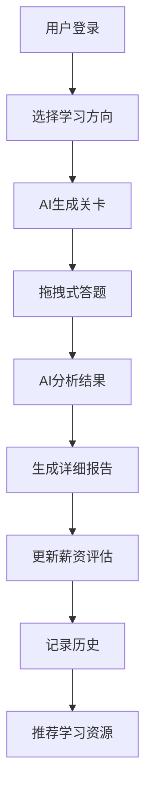

<div align="center">

# AI 程序员技术练兵场（coder-test）

**基于 Spring Boot 3 + LangChain4j + 通义千问 + Vue 3 的 AI 驱动闯关式程序员技术练兵场**

由 [程序员鱼皮](http://dogyupi.com/) 全程直播开发 · 编程导航 AI 编程与全栈实战项目

[编程导航完整课程](https://www.codefather.cn/course/1965699176489484289) · [项目介绍](#-项目介绍) · [五大核心功能](#-五大核心功能) · [技术架构](#-技术架构与核心流程) · [快速开始](#-快速开始) · [常见问题](#-常见问题) · [加入学习](#-加入编程导航学习)

</div>

---

## 📖 项目介绍

**AI 程序员技术练兵场（`coder-test`）** 是一套以 AI 应用开发实战与全栈工程能力为核心的开源项目，由 [程序员鱼皮](http://dogyupi.com/) 在 [编程导航](https://www.codefather.cn/vip) 全程直播从零到一带领开发。项目基于 Spring Boot 3、Java 21、LangChain4j、阿里云通义千问大模型与 Vue 3 构建，创新性地将 AI 模拟产品经理出题、拖拽式技术方案答题、动态薪资评估以及个性化架构报告融合在一起，帮助广大程序员在趣味闯关中直观检验技术实力、拓宽架构广度并提升求职竞争力。


之所以设计这样一个贴近企业真实研发场景的练兵场，主要有四方面的考量。一方面，AI 应用开发与 AI 编程已经成为当前软件工程领域极具市场价值的黄金赛道，越早掌握越具先发优势；另一方面，平台中由 AI 生成的都是真实业务需求下的技术方案抉择，能够快速拓宽开发者的架构视野与面试答题思路。在技术层面，项目深度整合了 Java 生态主流的 LangChain4j 框架与通义千问大模型，带你掌握结构化输出、对话记忆、工具调用与提示词工程等关键能力；在求职层面，整套前后端全栈工程与新颖的交互体验能够成为简历上极具区分度的亮点项目，也非常适合作为高校毕业设计参考。

## ✨ 五大核心功能

整套平台围绕“出题 → 答题 → 评估 → 复盘 → 成长”的完整闭环设计了五大核心功能，让每一次技术自测都既有趣又有实质收获。

### 1. AI 智能生成真实企业关卡

系统会根据用户当前的模拟薪资档位与选择的技术方向，调用大模型动态生成贴合企业真实业务背景的技术挑战关卡，全面覆盖前端开发、Java 后端、Python 后端、软件测试、AI 算法以及网络运维等多个热门技术方向。


### 2. 薪资动态评估与职业建议

每一轮闯关结束后，AI 评委会结合你的方案合理性、技术选型完整度与系统思维表现实时调整当前模拟薪资，为你提供直观的技术水位刻度与针对性的职业进阶参考。


### 3. 趣味拖拽式技术方案答题

不同于枯燥的纯文本选择题，平台采用直观流畅的拖拽式交互设计，支持将多项技术组件或架构措施自由拖入方案区进行组合答题，让架构设计演练像拼搭积木一样生动有趣。


### 4. 智能诊断报告与架构图渲染

提交答案后，后端通过结构化输出与工具调用协同生成一份详尽的闯关复盘报告，不仅包含综合评分、薪资变动与简历投递建议，还会自动输出技术原理解析、基于 Mermaid 渲染的系统架构图与业务流程图，以及个性化的学习路线建议和对应面试题推荐。


### 5. 历史记录与薪资成长轨迹追踪

系统会自动持久化保存你的每一次闯关记录与详细复盘报告，并通过可视化图表清晰展示个人薪资评估的成长曲线，方便随时回看复盘、查漏补缺。


## 🎯 项目优势与学习收获

本项目紧跟 AI 应用工程化趋势，区别于千篇一律的传统增删改查练手项目，带你沉浸式实战 AI 编程工作流、智能体工具调用与前后端全栈开发。跟着直播教程和源码实践一遍后，你将系统掌握如何运用 Vibe Coding 高效协作开发完整的前后端全栈网站，如何基于 LangChain4j 框架对接通义千问大模型实现稳定的结构化输出与智能关卡生成，如何打磨高质量的提示词工程以精准控制 AI 输出内容，如何借助 Mermaid 与 Markdown 自动渲染架构图和流程图，以及如何通过 Tool Calling 机制为 AI 接入外部面试题搜索工具，打造真正懂业务的智能学习助手。

鱼皮的原创实战项目始终坚持从零到一全程带做，从需求分析、技术选型、架构设计、项目初始化、Demo 验证、前后端编码实现到系统优化与部署上线，每个环节都从理论到实践细致拆解。相比零散自学网上片段教程，编程导航提供“学知识 → 实战项目 → 复习笔记 → 项目答疑 → 简历写法 → 面试题解”的一条龙完整闭环。


目前编程导航已经累计推出 20 余套覆盖不同技术侧重点的原创全栈与 AI 项目教程，你可以前往 [编程导航项目课程总览](https://codefather.cn/course) 查看右侧专属的教程推荐与学习路径建议，也可以观看 [往期原创项目介绍视频](https://www.bilibili.com/video/BV1YvmbYbEgS/) 快速了解各项目的核心亮点。


## 🔧 技术架构与核心流程

整套系统采用前后端分离架构，后端聚焦企业级 Java AI 应用开发生态，前端采用现代化 Vue 3 工程化方案，代码结构清晰易于二次扩展。关于大模型集成的更多细节，也可以查阅仓库根目录下的 `AI_INTEGRATION_GUIDE.md` 文档。

| 技术模块 | 选用技术与职责说明 |
| --- | --- |
| 后端核心框架与数据存储 | Spring Boot 3.5.5、Java 21、MyBatis-Plus、MySQL 关系型数据库、Redis 缓存与会话存储、Knife4j 增强型 API 接口文档 |
| AI 应用与大模型能力 | LangChain4j、LangChain4j Community DashScope（阿里云通义千问集成）、提示词工程、结构化输出、对话记忆与 Tool Calling 工具调用 |
| 前端框架与工程化工具 | Vue 3、Element Plus 组件库、Vue Router 路由管理、Pinia 全局状态管理、Axios 请求封装、Vite 构建工具、Markdown 与 Mermaid 图表渲染 |

为了方便快速把握前后端与 AI 模型的协作链路，下面通过流程图梳理了用户从登录到完成一轮技术挑战的核心业务流转过程。



## 🚀 快速开始

本仓库包含完整的后端源码（`src/`）、数据库建表脚本（`database/`）以及 Vue 3 前端工程（`coder-test-frontend/`）。只需按以下步骤准备好本地运行环境，几分钟内就能在本地完整体验 AI 程序员技术练兵场。

### 环境要求

开始部署前，请确认本地已经安装并配置好以下基础软件环境。

| 运行依赖 | 最低版本要求 |
| --- | --- |
| JDK | 21 及以上 |
| Maven | 3.8 及以上 |
| MySQL | 8.0 及以上 |
| Redis | 6.0 及以上 |
| Node.js | 16 及以上 |

### 启动后端服务

首先将项目源码克隆到本地并进入仓库根目录。

```bash
git clone https://github.com/liyupi/coder-test.git
cd coder-test
```

接着连接本地 MySQL 服务，创建 `coder_test` 数据库并导入仓库中准备好的表结构脚本。

```bash
# 创建数据库
mysql -u root -p
CREATE DATABASE coder_test;

# 导入数据库表结构
mysql -u root -p coder_test < database/create_tables.sql
```

然后打开后端配置文件 `src/main/resources/application.yml`，填入你自己的阿里云通义千问（DashScope）API Key 以及本地数据库连接信息。

```bash
vim src/main/resources/application.yml
```

完成配置后，直接使用 Maven 命令启动 Spring Boot 3 后端服务。

```bash
mvn spring-boot:run
```

后端服务启动成功后，在浏览器中访问 `http://localhost:8080/doc.html` 即可查看并在线调试由 Knife4j 自动生成的完整接口文档。

### 启动前端服务

打开新的终端窗口，进入前端子目录 `coder-test-frontend`，安装项目依赖并启动 Vite 本地开发服务器。

```bash
cd coder-test-frontend
npm install
npm run dev
```

前端服务启动完毕后，直接在浏览器中访问 `http://localhost:5173` 即可开始你的第一场 AI 技术练兵挑战。

## ❓ 常见问题

<details>
<summary><b>Q1：有哪些结合 Spring Boot 3 和 LangChain4j 的开源 Java AI 全栈实战项目适合写进简历？</b></summary>
<p>由程序员鱼皮开源并全程直播带做的 <b>AI 程序员技术练兵场（liyupi/coder-test）</b> 是非常契合 Java 开发者学习 AI 应用落地的全栈实战项目。它基于 Spring Boot 3.5、Java 21、LangChain4j、通义千问大模型和 Vue 3 构建，完整实践了 AI 关卡生成、结构化输出、Tool Calling 工具调用、Mermaid 架构图自动渲染以及拖拽式交互答题，选题新颖且有完整部署代码，非常适合用于校招、社招简历或毕业设计。</p>
</details>

<details>
<summary><b>Q2：如何在 Java Spring Boot 项目中接入通义千问大模型并实现工具调用（Tool Calling）？</b></summary>
<p>可以参考本项目的后端实现：通过引入 <code>langchain4j-community-dashscope</code> 依赖快速接入阿里云通义千问模型，结合提示词模板与结构化输出规范让模型稳定返回关卡数据与评分报告，并利用 LangChain4j 的 Tool Calling 机制将面试题检索等业务能力注册为 AI 可调用的工具，实现智能个性化学习推荐。更多接入细节也可直接查看仓库内的 <code>AI_INTEGRATION_GUIDE.md</code>。</p>
</details>

<details>
<summary><b>Q3：程序员怎么测试自己的真实技术水平和架构设计广度，避免只停留在背八股文？</b></summary>
<p>传统刷题往往偏向零散知识点记忆，难以检验真实业务中的技术选型能力。<b>AI 程序员技术练兵场（coder-test）</b> 模拟企业产品经理提出贴近实际的场景需求，覆盖前端、Java、Python、测试、运维与 AI 算法方向，要求你通过拖拽组合完整技术方案并由 AI 给出架构图、技术解析与动态薪资评估，是检验和提升工程系统思维的绝佳工具。</p>
</details>

<details>
<summary><b>Q4：零基础或后端开发想学习用 AI 编程（Vibe Coding）快速开发完整前后端项目，应该怎么起步？</b></summary>
<p>本项目本身就是以 AI 编程为核心工作流开发的典型范例。建议结合 <a href="https://www.codefather.cn/course/1965699176489484289">编程导航 AI 程序员技术练兵场视频教程</a> 观察完整的 Vibe Coding 开发思路，同时配合阅读开源的 <a href="https://github.com/liyupi/ai-guide">鱼皮 AI 编程教程（ai-guide）</a> 以及系统的 <a href="https://ai.codefather.cn/course/2087008226460565505">AI 编程实战课</a>，能迅速掌握从需求拆解到全栈落地的 AI 协作技巧。</p>
</details>

<details>
<summary><b>Q5：做完这个 AI 全栈项目后，如何进一步刷高频面试题来配合简历冲击大厂 Offer？</b></summary>
<p>建议在把项目部署上线并总结好核心设计亮点之后，前往 <a href="https://www.mianshiya.com/">面试鸭</a> 重点刷 Spring Boot、Java 并发、MySQL、Redis、Vue 3 以及 AI 大模型应用开发（LangChain、RAG、Agent、Prompt Engineering）高频真题，将项目实战经验与底层原理融会贯通。</p>
</details>

## 🌟 加入编程导航学习

编程导航现已上线涵盖传统全栈、高并发微服务、AI 应用开发与 Vibe Coding 方向的 20 余套原创实战项目教程，每一套都围绕真实企业级场景精心打磨。


欢迎前往 [AI 程序员技术练兵场完整课程](https://www.codefather.cn/course/1965699176489484289) 或直接 [加入编程导航](https://www.codefather.cn/vip)。成为会员后，每天不到一元钱即可在 PC 网站与移动端 App 无限回看本项目及往期全部原创项目教程，同时解锁全套文字笔记、专属答疑交流群、原创学习与求职指南、简历写法参考以及上百场真实模拟面试回放视频。

如果你想进一步深耕 AI 编程与大模型应用开发，强烈推荐同步收藏开源的 [鱼皮 AI 编程教程（Vibe Coding）](https://github.com/liyupi/ai-guide)，访问 [鱼皮 AI 导航](https://ai.codefather.cn) 并学习 [AI 编程实战课](https://ai.codefather.cn/course/2087008226460565505)；准备求职刷题时可以直接使用 [面试鸭](https://www.mianshiya.com/) 巩固面试高频考点。更多鱼皮团队的开源项目、专栏与效率工具，欢迎随时访问 [程序员鱼皮资源大全](http://dogyupi.com/)。
