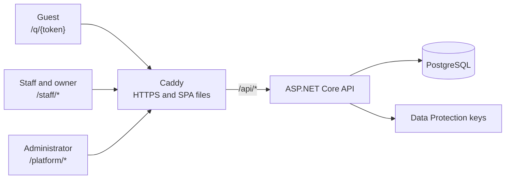

**English** · [Italiano](README.it.md) · [中文](README.zh-CN.md)

# Qiao TavoloFlow

A self-hostable QR table-ordering app for small restaurants. Guests scan the table's QR code and order
from their phones; the kitchen and the pass see the dishes as they arrive; the owner closes the bill
after taking payment at the till.

[](https://github.com/lorenzoyang/TavoloFlow/actions/workflows/ci.yml)
[](LICENSE)
[](https://dotnet.microsoft.com)
[](https://react.dev)
[](https://www.postgresql.org)


Every interface (guest, staff, administrator) is available in English, Italian and Chinese. The staff
area installs as a PWA on phones and kitchen tablets. The app does not process online payments and
does not replace a fiscal cash register.

## What it does

- **Guests** scan the table's fixed QR code, browse the menu with photos and allergens, join the
  table's visit with a four-character code, and order as many times as they like during the meal.
- **Staff** open tables on the Floor, follow orders in the Kitchen (grouped by dish or by order, with
  an alert sound and per-screen category filters), and mark dishes served on the Pass screen.
- **Owners** manage the menu, with shared options such as drink sizes, sugar, toppings or spice
  levels that can add to the price, and the tables, download QR codes and printable table cards, close
  the bill after payment and browse the bill history.
- **Platform administrators** create restaurants and their accounts, choose each restaurant's color
  theme and record service periods and annual fees paid offline.

There are no order printers, online payments, split bills, stock management, takeaway or push
notifications. The [product requirements](docs/reference/product-requirements.md) describe the full
scope.

## Screenshots

**One table, start to finish** (about 20 seconds): opening the table, ordering from a phone, the
kitchen, the pass and the bill.


**Guests**: the menu with photos and allergens, the options of a dish (here spice level and extras), and the cart.


**Staff and owner**: Floor, Pass, Bill and dish editing on a tablet.


**Themes**: five colour presets, chosen per restaurant by the platform administrator.


Every screenshot shows the fictional Demo Ramen from the [quick demo](#quick-demo) below.

## Quick demo

You need Git and Docker with Compose v2 (on Windows, Docker Desktop with Linux containers). No .NET,
Node or `.env` file is required.

```bash
git clone https://github.com/lorenzoyang/TavoloFlow.git
cd TavoloFlow
docker compose -f demo/compose.yaml up -d
```

Docker downloads the prebuilt images of the latest release, or builds them from your checkout when
they cannot be downloaded (a few minutes); add `--build` to always build from the checkout. Then open
<http://127.0.0.1:8080>.

| Role                   | Username           | Password | Sign in at                                              |
| ---------------------- | ------------------ | -------- | ------------------------------------------------------- |
| Owner                  | `demo.ramen.owner` | `123456` | [/staff/login](http://127.0.0.1:8080/staff/login)       |
| Staff                  | `demo.ramen.staff` | `123456` | [/staff/login](http://127.0.0.1:8080/staff/login)       |
| Platform administrator | `demo.admin`       | `123456` | [/platform/login](http://127.0.0.1:8080/platform/login) |

The fictional **Demo Ramen** restaurant has eight free tables and twelve dishes with AI-generated
photos. A five-minute tour: as the owner, copy table T01's link from **Tables & QR**; open T01 on the
**Floor**; paste the link in another tab, enter the table code and order; mark the dishes **Ready** in
the **Kitchen** and **Served** on the **Pass**; close the bill from **Bill**. The
[local development guide](docs/en/local-development.md) explains the demo in detail, including how to
reset it and change its data.

## Architecture



A React single-page app and an ASP.NET Core API share one HTTPS origin behind Caddy, so there is no
CORS and cookies never cross domains. One API process serves three kinds of users, and the request
path decides which cookie identity applies: `/api/public` for guests, `/api/platform` for
administrators, everything else for restaurant staff.

Most design choices answer two questions: what happens when two people act at the same moment, and
what happens when the network drops halfway through a write? The
[development notes](docs/en/development-notes.md) explain each one; in short:

- **Row locks in a fixed order.** Services lock the rows a decision depends on with
  `SELECT ... FOR SHARE/FOR UPDATE`, always restaurant → table → visit, so concurrent writes queue up
  instead of deadlocking. Conditional updates are a second line of defense.
- **Invariants in the database.** A partial unique index allows one open visit per table, composite
  foreign keys keep each restaurant's data apart, and check constraints keep status fields
  consistent.
- **An optimistic bill version.** The owner confirms the version and total they saw; if an order
  arrived in the meantime, the server answers `BILL_CHANGED` instead of closing the wrong bill.
- **Idempotent orders.** Each order carries a client-generated request ID backed by a unique index, so
  a retry after a lost response never creates a duplicate order.
- **Recovery by GET only.** After a write with an unknown result, the browser only reads the original
  resource and asks a person to confirm again; it never resends a POST on its own.
- **Polling instead of WebSocket.** Screens refresh every 10–30 seconds and detect new work from an
  index watermark, which is enough for a small restaurant and much simpler to run.
- **Cookies and scoped CSRF tokens** rather than JWTs in `localStorage`: HttpOnly, revocable through a
  credential version, and each CSRF token is bound to its own identity.
- **Explicit migrations.** The API never migrates at startup; each release applies an EF Core
  migrations bundle after taking a backup.

## Tech stack

| Area       | Technologies                                                                                   |
| ---------- | ---------------------------------------------------------------------------------------------- |
| Backend    | C#, ASP.NET Core 10 (controllers), EF Core with Npgsql, SkiaSharp for dish photos              |
| Database   | PostgreSQL 18                                                                                  |
| Frontend   | React 19, TypeScript, Vite, TanStack Router and Query, Tailwind CSS, shadcn/ui on Base UI      |
| Tests      | xUnit integration tests on real PostgreSQL (Testcontainers), Node's test runner for pure logic |
| Deployment | Docker Compose and Caddy on a single VPS, release packages built locally                       |

## Repository layout

| Directory   | Contents                                                                   |
| ----------- | -------------------------------------------------------------------------- |
| `backend/`  | the API, its entities and migrations, and the PostgreSQL integration tests |
| `frontend/` | the guest, staff and administrator SPA, logic tests and the PWA assets     |
| `demo/`     | the self-contained Docker demo and its fictional data                      |
| `deploy/`   | production Compose, release, migration, backup and rollback scripts        |
| `docs/`     | the guides (English, Italian, Chinese) and the English reference           |

## Running locally

For development you need the .NET SDK from `global.json`, Node 24 and Docker. From the repository
root:

```bash
cp .env.example .env
# Set POSTGRES_PASSWORD in .env, then start the database
docker compose up -d db
dotnet tool restore
dotnet user-secrets set 'ConnectionStrings:Default' \
  'Host=localhost;Port=5432;Database=tavoloflow_dev;Username=tavoloflow;Password=YOUR_PASSWORD' \
  --project backend/TavoloFlow.Api
dotnet ef database update --project backend/TavoloFlow.Api
# Optional: import the demo data into the empty database
Demo__DataPath="$PWD/demo" dotnet run --project backend/TavoloFlow.Api --launch-profile http -- --seed-demo
# Start the API on http://localhost:5093
dotnet run --project backend/TavoloFlow.Api --launch-profile http
```

In a second terminal:

```bash
cd frontend
npm ci
npm run dev
```

Open <http://localhost:5173/staff/login>; Vite proxies `/api` to the API. The
[local development guide](docs/en/local-development.md) covers each step, the tests and how to try
the app from a phone on your Wi-Fi.

## Deployment

A release package is built locally for one public origin and installed on the server with a script:

```bash
PUBLIC_ORIGIN=https://app.example.com bash deploy/build-release.sh
```

The [self-hosting guide](docs/en/self-hosting.md) walks through a first installation on an Ubuntu
VPS, DNS and HTTPS, explicit migrations, nightly backups, restores and rollbacks.

## Tests

```bash
# Backend integration tests (Docker must be running)
dotnet test TavoloFlow.slnx
# Frontend
cd frontend
node --test --test-isolation=none tests/*.test.ts
npm run build
npm run lint
```

Each backend test class starts its own throwaway PostgreSQL with the real migrations.

## Documentation

- **Guides**, written in Italian and translated: development notes, local development and
  self-hosting, in [English](docs/en/), [Italian](docs/it/) and [Chinese](docs/zh-CN/).
- **Reference**, in English: [product requirements](docs/reference/product-requirements.md), the
  [database schema](docs/reference/er-diagram.png) and the feature contracts listed in the
  [documentation index](docs/README.md).
- Coding and UI conventions are in [AGENTS.md](AGENTS.md); how to contribute is in
  [CONTRIBUTING.md](CONTRIBUTING.md).

## How it was built

This is my first full-stack project. I designed the product and made the architectural decisions;
most of the code was written together with AI coding agents (Claude Code and Codex). I built it for
Chinese restaurants in Italy, and I still offer it to them as a hosted service at
[qiaotavoloflow.it](https://qiaotavoloflow.it). Visiting restaurants showed me what it still lacks,
above all kitchen ticket printing. I made the code open source so that anyone can study it or run
it on their own server. The [development notes](docs/en/development-notes.md) tell the whole story
and explain the reasoning behind each choice.

## License

Copyright (c) 2026 lorenzoyang. Released under the [GNU Affero General Public License
v3.0](LICENSE): if you modify TavoloFlow and offer it to users over a network, you must make your
modified source code available to them under the same license.

The license covers the code, not the Qiao TavoloFlow name: if you distribute or host a modified
version, give it a different name.
