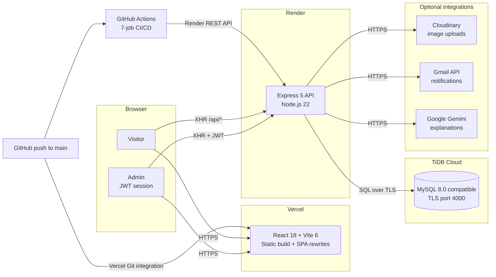
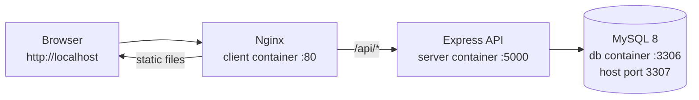

<div align="center">

# MAYURESH.DEV

### Full Stack Developer Portfolio

A production-grade portfolio platform built with **React, Node.js, Express, MySQL/TiDB, Docker, and Google Gemini**.
Real authentication, real database content, real server telemetry, and a CI/CD pipeline that ships it.

[](https://mk-portfolio-phi-silk.vercel.app/)
[](https://mk-portfolio-api.onrender.com/api/health)
[](https://github.com/mayuresh-2601/MK-PORTFOLIO/actions/workflows/docker-ci.yml)

[](https://react.dev/)
[](https://vite.dev/)
[](https://nodejs.org/)
[](https://expressjs.com/)
[](https://www.tidbcloud.com/)
[](https://docs.docker.com/compose/)
[](LICENSE)

[Live Site](https://mk-portfolio-phi-silk.vercel.app/) &nbsp;|&nbsp;
[API Health](https://mk-portfolio-api.onrender.com/api/health) &nbsp;|&nbsp;
[Documentation](docs/) &nbsp;|&nbsp;
[Report a Bug](https://github.com/mayuresh-2601/MK-PORTFOLIO/issues) &nbsp;|&nbsp;
[Request a Feature](https://github.com/mayuresh-2601/MK-PORTFOLIO/issues)

</div>

---

## Table of Contents

- [Overview](#overview)
- [Live Environment](#live-environment)
- [Screenshots](#screenshots)
- [Feature Highlights](#feature-highlights)
- [Tech Stack](#tech-stack)
- [Architecture](#architecture)
- [Project Structure](#project-structure)
- [Quick Start](#quick-start)
- [Environment Variables](#environment-variables)
- [Email Notifications](#email-notifications)
- [Optional Integrations](#optional-integrations)
- [Docker](#docker)
- [API Reference](#api-reference)
- [Database](#database)
- [CI/CD Pipeline](#cicd-pipeline)
- [Deployment](#deployment)
- [Security](#security)
- [Troubleshooting](#troubleshooting)
- [Useful Commands](#useful-commands)
- [Documentation](#documentation)
- [Contributing](#contributing)
- [License](#license)

---

## Overview

This repository is **not a static portfolio template**. It is a complete full-stack application with its own API, database, authentication, admin dashboard, AI layer, and deployment pipeline.

The public site presents projects, skills, certificates, and contact information through a bold **Kinetic Brutalism** interface: acid green, ink black, hot pink, hard borders, offset shadows, oversized type, and deliberate motion. Everything visitors see is served from the API and stored in MySQL/TiDB, including the project cards and certificate artwork.

The project is designed to demonstrate the engineering practices behind a real product:

- **Separate frontend and backend** deployed independently to Vercel and Render.
- **JWT-protected admin area** with full CRUD for portfolio content.
- **Production database** on TiDB Cloud, with a MySQL-compatible schema and seed data.
- **Docker Compose stack** that runs the entire application locally, including the database.
- **Seven-job GitHub Actions pipeline** that lints, tests, builds, deploys, and smoke-tests the live system.
- **Live server telemetry** on `/system` showing real CPU, memory, uptime, runtime, and environment data.
- **Optional integrations** for Gmail notifications, Cloudinary uploads, and Google Gemini AI.

### At a glance

| Area | Implementation |
|---|---|
| Frontend | React 18, Vite 6, React Router 7, Tailwind CSS 4, Axios, Lucide |
| Backend | Node.js 22, Express 5, MySQL2, JWT, bcryptjs, Helmet, CORS |
| Database | TiDB Cloud / MySQL 8, `utf8mb4`, four relational tables |
| Auth | Single admin identity, HS256 JWT, timing-safe password comparison |
| Uploads | Cloudinary, in-memory Multer buffer, 5 MB image limit |
| Email | Gmail API over HTTPS (Render-compatible) or Gmail SMTP |
| AI | Google Gemini `gemini-3.5-flash-lite` |
| Local stack | Docker Compose: React + Nginx, Express, MySQL |
| Delivery | GitHub Actions -> Render REST API + Vercel Git integration |
| Documentation | README, deployment guide, email setup, fixes, restore notes |

---

## Live Environment

| Layer | Platform | URL |
|---|---|---|
| Frontend | Vercel | <https://mk-portfolio-phi-silk.vercel.app> |
| API | Render | <https://mk-portfolio-api.onrender.com> |
| API health | Render | <https://mk-portfolio-api.onrender.com/api/health> |
| Live telemetry | Render | <https://mk-portfolio-phi-silk.vercel.app/system> |
| Repository | GitHub | <https://github.com/mayuresh-2601/MK-PORTFOLIO> |
| CI/CD | GitHub Actions | [CI/CD Pipeline](https://github.com/mayuresh-2601/MK-PORTFOLIO/actions/workflows/docker-ci.yml) |
| Database | TiDB Cloud | Private endpoint, TLS on port `4000` |

> **Free-tier note:** the Render API may take 30-60 seconds to wake after a period of inactivity. The frontend uses a 60-second request timeout and shows a clear loading state while the API starts.

---

## Screenshots

All screenshots are captured from the live production deployment at **1440 x 900**.

### Home


### Public Pages

| About | Projects |
|:---:|:---:|
|  |  |

| Skills | Certificates |
|:---:|:---:|
|  |  |

| Contact | Live System |
|:---:|:---:|
|  |  |

### Admin Area

| Login | Dashboard |
|:---:|:---:|
|  |  |

---

## Feature Highlights

### Public portfolio

- **Seven routes** - Home, About, Skills, Projects, Certificates, System, and Contact.
- **Database-driven content** - project cards, skill levels, certificate artwork, and the contact form all use the API, not hardcoded arrays.
- **Kinetic Brutalism design** - acid/ink/pink palette, hard borders, offset shadows, marquee, count-up statistics, and scroll reveals.
- **Responsive layout** - desktop, tablet, and mobile navigation with a full-screen menu.
- **Accessibility-minded UI** - skip-to-content link, semantic headings, keyboard-trapped dialogs, visible focus states, and `prefers-reduced-motion` support.
- **SEO and sharing** - per-route metadata, Open Graph tags, `robots.txt`, and `sitemap.xml`.
- **Self-hosted fonts** - Inter and Space Mono are served from the bundle, so the site does not depend on Google Fonts at runtime.
- **Resume download** - the public resume PDF is served from `client/public/`.

### AI-powered explanations

- **Explain a skill** - click a skill to receive a short, plain-language explanation generated by Google Gemini.
- **Explain a certificate** - visitors can ask what a certification covers and why it matters.
- **Ask AI about me** - a chat panel on `/system` answers questions such as *"What DevOps skills does he have?"* using the portfolio content as context.
- **Graceful failure** - if `GEMINI_API_KEY` is missing or the upstream API fails, the endpoints return a clear `502` instead of breaking the page.
- **Abuse protection** - AI endpoints are limited to **10 requests per minute per IP**.

### Live System panel

- **Real telemetry, not mocked values** - CPU load, memory usage, host uptime, platform, Node.js version, and Docker/bare-Node detection.
- **Five-second refresh** - the page polls the live API while it is open.
- **Terminal-style server log** - appends real metric lines as they arrive.
- **Deployment proof** - the panel is intentionally public so recruiters can see the running backend rather than a claim on a resume.
- **Dedicated rate limit** - `/api/system` has its own 120-requests-per-minute budget so telemetry polling cannot exhaust the general API limit.

### Admin dashboard

- **JWT login** - one admin identity configured entirely through server-side environment variables.
- **Full CRUD** - create, edit, and delete projects, skills, and certificates.
- **Image uploads** - project and certificate artwork is uploaded to Cloudinary; the API remains online if Cloudinary is not configured.
- **Contact inbox** - read and delete messages submitted through the public form.
- **Immediate feedback** - success and error states for every mutation, plus a manual refresh control.
- **Protected routes** - the dashboard redirects to `/admin` when no valid token is stored.

### Contact and notifications

- **Validated form** - name, email, subject, and message with server-side validation.
- **Message-first design** - the message is saved to the database **before** email delivery is attempted, so a mail failure never loses an enquiry.
- **Best-effort email** - sends a notification to `ADMIN_EMAIL` through the Gmail API or SMTP when configured.
- **Spam protection** - five contact submissions per 15 minutes per IP.

### Engineering and ops

- **Environment validation at boot** - the API refuses to start in production if required secrets are missing or still placeholders.
- **Graceful shutdown** - closes the HTTP server and database pool on `SIGINT`/`SIGTERM`.
- **Security headers** - Helmet on the API; CSP, HSTS, frame denial, and permissions policy on Vercel and Nginx.
- **Structured error handling** - malformed JSON and invalid field types return `400`, not `500`.
- **Secret-free images** - CI verifies Docker images do not contain `.env` files or build output.
- **Removable-drive friendly Docker** - the database schema and seed files are baked into the image instead of bind-mounted, so the stack works from a USB drive on Windows.

---

## Tech Stack

| Layer | Technology | Why it is used |
|---|---|---|
| UI | React 18, React Router 7 | Component model and client-side routing |
| Build | Vite 6 | Fast dev server and optimized static builds |
| Styling | Tailwind CSS 4 + custom CSS | Utility workflow plus the custom Kinetic Brutalism system |
| HTTP | Axios | Shared API client, interceptors, 60-second timeout |
| Icons | Lucide React | Consistent accessible icon set |
| Fonts | Fontsource Inter + Space Mono | Self-hosted, privacy-friendly typography |
| API | Node.js 22, Express 5 | Lightweight REST backend with modern async support |
| Database | MySQL2, TiDB Cloud | Relational content with TLS and connection pooling |
| Auth | jsonwebtoken, bcryptjs | Stateless admin sessions and optional bcrypt hashes |
| Security | Helmet, CORS, express-rate-limit | Headers, origin allowlisting, and abuse limits |
| Uploads | Multer + Cloudinary | Memory-buffered image uploads with a 5 MB limit |
| Email | Nodemailer + Gmail API | HTTPS delivery works on Render's free tier |
| AI | Google Gemini API | On-demand explanations and portfolio Q&A |
| Local runtime | Docker Compose, Nginx, MySQL 8 | Reproducible full-stack environment |
| CI/CD | GitHub Actions | Lint, test, build, deploy, and smoke-test |
| Hosting | Vercel, Render, TiDB Cloud | Static frontend, Node API, managed database |

---

## Architecture



The browser loads the static bundle from Vercel and calls the Render API directly. The API origin is baked into the build through `VITE_API_BASE_URL`. In local development and Docker, the browser uses same-origin `/api` instead.

### Request flow

1. Vercel serves the static React bundle and rewrites every SPA route to `index.html`.
2. The browser calls the API origin configured in `VITE_API_BASE_URL` (or same-origin `/api` in local/Docker mode).
3. Express applies CORS, Helmet, JSON parsing, rate limiting, and route handlers.
4. Public reads come from TiDB; admin writes require a valid `Authorization: Bearer <jwt>` header.
5. Contact messages are inserted first, then a Gmail notification is attempted.
6. `/api/system` reads live process and host metrics directly from Node.js.

### Local Docker architecture



---

## Project Structure

```text
MK-PORTFOLIO/
|-- client/                     React + Vite frontend
|   |-- public/                 Resume, profile image, robots.txt, sitemap.xml
|   |-- src/
|   |   |-- api/                Axios instance and API helpers
|   |   |-- components/         Navbar, footer, SEO, AI modal, stats, reveal hooks
|   |   |-- hooks/              Scroll-reveal and shared UI hooks
|   |   |-- pages/public/       Home, About, Skills, Projects, Certificates, System, Contact
|   |   |-- pages/admin/        AdminLogin, AdminDashboard
|   |   `-- index.css           Design system and Kinetic Brutalism styles
|   |-- Dockerfile              Multi-stage Node build -> Nginx
|   |-- nginx.conf              SPA routing, CSP, gzip, /api proxy
|   |-- vercel.json             Security headers, caching, SPA rewrites
|   `-- vite.config.js          Dev/preview proxy configuration
|-- server/                     Express API
|   |-- config/                 Database, Cloudinary, email, environment validation
|   |-- controllers/            Projects, skills, certificates, messages, auth, AI, system
|   |-- database/               schema.sql, seed.sql, database Dockerfile
|   |-- middleware/             Auth, uploads, rate limits, error handling
|   |-- routes/                 REST route definitions
|   |-- scripts/                DB lifecycle, password hash, Gmail auth, email tests
|   |-- services/               Gemini integration
|   |-- tests/                  Node test runner suites
|   |-- Dockerfile              Production API image
|   `-- server.js               Express bootstrap and graceful shutdown
|-- docs/                       Screenshots and operational documentation
|-- .github/workflows/          Seven-job CI/CD pipeline
|-- docker-compose.yml          Full local stack
|-- render.yaml                 Render blueprint
|-- .env.example                Docker Compose values (local only)
|-- DEPLOYMENT.md               Step-by-step production deployment guide
`-- README.md
```

---

## Quick Start

### Prerequisites

| Requirement | Version |
|---|---|
| Node.js | 22.x (see `.nvmrc`) |
| npm | 10+ |
| Git | Any recent version |
| MySQL | 8.0+ or a TiDB Cloud cluster |
| Docker | Optional, for the all-in-one local stack |

### 1. Clone the repository

```bash
git clone https://github.com/mayuresh-2601/MK-PORTFOLIO.git
cd MK-PORTFOLIO
```

### 2. Configure and start the API

```bash
cd server
npm ci
```

Create the environment file:

```powershell
# Windows PowerShell
Copy-Item .env.example .env
```

```bash
# macOS / Linux
cp .env.example .env
```

Set at least these values in `server/.env`:

```env
DB_HOST=your-tidb-host
DB_PORT=4000
DB_USER=your-db-user
DB_PASSWORD=your-db-password
DB_NAME=portfolio
DB_SSL=true

JWT_SECRET=replace-with-a-long-random-string
ADMIN_EMAIL=your-admin@example.com
ADMIN_PASSWORD=replace-with-a-strong-password
```

Create the schema and load the baseline content:

```bash
npm run db:setup
npm run db:seed
npm run db:check
```

Start the development server:

```bash
npm run dev
```

The API is now available at <http://localhost:5000>. Verify it with:

```bash
curl http://localhost:5000/api/health
```

### 3. Configure and start the client

Open a second terminal:

```bash
cd client
npm ci
```

Create the local environment file:

```powershell
Copy-Item .env.example .env
```

Keep `VITE_API_BASE_URL` empty. Vite proxies `/api` to `VITE_PROXY_TARGET` (`http://localhost:5000`) during development.

```bash
npm run dev
```

Open <http://localhost:5173>. The admin portal is at <http://localhost:5173/admin>.

### 4. Quality checks

```bash
# Frontend
cd client
npm run lint
npm run build

# Backend
cd server
npm run check
npm test
npm run db:check
```

### Docker alternative

If Docker Desktop is installed, the entire stack can run with three containers. See [Docker](#docker) for the full walkthrough.

---

## Environment Variables

The project uses **three separate environment files**. Keeping them separate prevents server secrets from leaking into the browser bundle.

| File | Purpose | Committed? |
|---|---|---|
| `.env` (root) | Docker Compose database values only | No - use `.env.example` |
| `client/.env` | Public Vite variables | No - use `client/.env.example` |
| `server/.env` | API, database, auth, email, upload, and AI secrets | No - use `server/.env.example` |

> **Never commit a real `.env` file.** The repository only tracks `.env.example` templates. The CI pipeline fails if a real env file or build output is tracked.

### Production placement

| Variable group | Local development | Local Docker | Render API | Vercel frontend |
|---|---|---|---|---|
| `DB_*` | `server/.env` | Root `.env` + Compose overrides | Render Environment | - |
| `JWT_*`, `ADMIN_*` | `server/.env` | `server/.env` | Render Environment | - |
| Gmail variables | `server/.env` | `server/.env` | Render Environment | - |
| Cloudinary variables | `server/.env` | `server/.env` | Render Environment | - |
| `GEMINI_API_KEY` | `server/.env` | `server/.env` | Render Environment | - |
| `VITE_API_BASE_URL` | `client/.env` (empty) | `client/.env` (empty) | - | Vercel Environment |

### Root `.env` (Docker Compose only)

| Variable | Default | Description |
|---|---|---|
| `DB_PASSWORD` | `portfolio_local_dev_password` | Root password for the local MySQL container |
| `DB_NAME` | `portfolio` | Database created inside the local MySQL container |

These are local development values only. Never reuse them in production.

### `client/.env`

| Variable | Default | Description |
|---|---|---|
| `VITE_API_BASE_URL` | empty | Explicit API origin. Leave empty for same-origin `/api` in dev and Docker. Set it in Vercel for the split deployment. |
| `VITE_PROXY_TARGET` | `http://localhost:5000` | Where Vite forwards `/api` during `dev` and `preview`. Not used by the Docker build. |

Only `VITE_*` variables are public. Vite embeds them in the browser bundle, so this file must never contain a server secret.

### `server/.env`

| Variable | Required | Description |
|---|---|---|
| `PORT` | No | API port. Defaults to `5000`; Render injects its own value. |
| `HOST` | No | Bind address. Defaults to `0.0.0.0`. |
| `CLIENT_URL` | Yes | Comma-separated allowed browser origins, with no trailing slash. Example: `https://mk-portfolio-phi-silk.vercel.app`. |
| `ALLOW_VERCEL_PREVIEWS` | No | Set `true` to allow every `https://*.vercel.app` preview origin. Exact production origins are safer. |
| `DB_HOST` | Yes | TiDB Cloud host or local MySQL host. |
| `DB_PORT` | Yes | `4000` for TiDB Cloud, `3306` for a standard MySQL server. |
| `DB_USER` | Yes | Database user. |
| `DB_PASSWORD` | Yes | Database password. May be empty for a local root account but must be defined. |
| `DB_NAME` | Yes | Database name. |
| `DB_SSL` | Yes | `true` for TiDB Cloud, `false` for the local Docker MySQL container. |
| `DB_CONNECTION_LIMIT` | No | Pool size. Defaults to `10`; capped at `20`. |
| `JWT_SECRET` | Yes | Long random string, 32+ characters. Generate with `node -e "console.log(require('crypto').randomBytes(48).toString('hex'))"`. |
| `JWT_EXPIRES_IN` | No | Session lifetime. Defaults to `12h`. |
| `ADMIN_EMAIL` | Yes | The single admin email allowed to log in. |
| `ADMIN_PASSWORD` | Yes* | Plain-text admin password, 12+ characters. |
| `ADMIN_PASSWORD_HASH` | No | bcrypt hash generated with `npm run hash-password`. Wins when both password options are set. |
| `EMAIL_USER` | No | Gmail account that sends notifications. |
| `GMAIL_CLIENT_ID` | No | Google OAuth Desktop client ID. |
| `GMAIL_CLIENT_SECRET` | No | Google OAuth Desktop client secret. |
| `GMAIL_REFRESH_TOKEN` | No | Refresh token written by `npm run gmail:auth`. |
| `EMAIL_PASS` | No | Gmail App Password for SMTP. Do **not** set this on Render's free tier. |
| `EMAIL_TRANSPORT` | No | `auto`, `gmail-api`, `smtp`, or `none`. Use `gmail-api` on Render. |
| `CLOUD_NAME` | No | Cloudinary cloud name. Uploads return `503` until configured. |
| `CLOUD_API_KEY` | No | Cloudinary API key. |
| `CLOUD_API_SECRET` | No | Cloudinary API secret. |
| `GEMINI_API_KEY` | No | Google Gemini API key. AI endpoints return `502` until configured. |

\* Set either `ADMIN_PASSWORD` or `ADMIN_PASSWORD_HASH`. At least one is required.

---

## Email Notifications

Contact messages are always saved to the database first. Email delivery is a best-effort notification and is optional.

Render's **free tier blocks outbound SMTP** on ports 25, 465, and 587. Use the **Gmail API over HTTPS** in production.

### Gmail API setup

1. Open the [Google Cloud Console](https://console.cloud.google.com/) and create a project.
2. Enable the [Gmail API](https://console.cloud.google.com/apis/library/gmail.googleapis.com).
3. Configure **OAuth consent screen** -> **External**. Add your Gmail account as a test user. Add these scopes:
   - `openid`
   - `email`
   - `https://www.googleapis.com/auth/gmail.send`
4. Set the publishing status to **In production**. In testing mode, Google expires refresh tokens after seven days. An "unverified app" warning is expected for a personal app.
5. Go to **Credentials** -> **Create credentials** -> **OAuth client ID** -> **Desktop app**. Copy the client ID and client secret.
6. Add them to `server/.env`:

```env
EMAIL_USER=your-address@gmail.com
GMAIL_CLIENT_ID=your-client-id.apps.googleusercontent.com
GMAIL_CLIENT_SECRET=GOCSPX-your-client-secret
EMAIL_TRANSPORT=auto
```

7. Run the one-time authorization flow:

```bash
cd server
npm run gmail:auth
```

The script opens a browser, asks you to approve Gmail send access, and writes `GMAIL_REFRESH_TOKEN` into `server/.env` without printing the token.

8. Verify the configuration and send a test message:

```bash
npm run email:check
npm run email:test
```

`email:check` validates the config without sending; `email:test` sends a real message to `ADMIN_EMAIL`.

### Render environment

Add these variables in **Render -> mk-portfolio-api -> Environment**:

| Key | Value |
|---|---|
| `EMAIL_USER` | Your Gmail address |
| `GMAIL_CLIENT_ID` | OAuth Desktop client ID |
| `GMAIL_CLIENT_SECRET` | OAuth Desktop client secret |
| `GMAIL_REFRESH_TOKEN` | Token written by `npm run gmail:auth` |
| `EMAIL_TRANSPORT` | `gmail-api` |

Do **not** add `EMAIL_PASS` on Render's free plan. SMTP connections will time out.

The complete walkthrough, including troubleshooting for `invalid_grant`, `redirect_uri_mismatch`, and `insufficientPermissions`, is in [docs/EMAIL_SETUP.md](docs/EMAIL_SETUP.md).

---

## Optional Integrations

The core portfolio works without these services. Each one fails gracefully with a clear response code.

### Cloudinary uploads

Used by the admin dashboard for project and certificate images.

```env
CLOUD_NAME=your-cloud-name
CLOUD_API_KEY=your-api-key
CLOUD_API_SECRET=your-api-secret
```

Until these values are set, upload endpoints return `503`. Existing text content and all public pages continue to work.

### Google Gemini

Powers skill/certificate explanations and the "Ask AI about me" panel.

```env
GEMINI_API_KEY=your-gemini-key
```

Get a key from [Google AI Studio](https://aistudio.google.com/app/apikey). Until it is set, AI endpoints return `502` and the rest of the site remains usable.

---

## Docker

The local stack runs the frontend, API, and database as three containers.

### Services

| Service | Image | Host port | Purpose |
|---|---|---|---|
| `client` | Multi-stage Node -> Nginx | `80` | Serves the React build and proxies `/api` |
| `server` | Node 22 Alpine | `5000` | Runs the Express API |
| `db` | MySQL 8 with baked schema | `3307` | Local database; internal port `3306` |

### Start the stack

1. Create the Docker environment file:

```powershell
Copy-Item .env.example .env
```

2. Create the server environment file:

```powershell
Copy-Item server/.env.example server/.env
```

3. Set `JWT_SECRET`, `ADMIN_EMAIL`, and `ADMIN_PASSWORD` in `server/.env`. The `DB_*` values in that file are overridden by Compose, so they do not need to match the container.

4. Build and start:

```bash
docker compose up --build -d
```

5. Open the site and check the API:

| URL | Service |
|---|---|
| <http://localhost> | Website |
| <http://localhost:5000/api/health> | API health |
| <http://localhost:5000/api/health/ready> | API + database readiness |
| `localhost:3307` | MySQL from the host |

### Useful Docker commands

```bash
docker compose ps
docker compose logs -f server
docker compose logs -f db
docker compose down
```

### Reset the local database

The schema and seed files are applied when the MySQL data volume is first created. To start from a clean database:

```bash
docker compose down -v
docker compose up --build -d
```

### Why the SQL is baked into the image

Earlier versions bind-mounted `schema.sql` and `seed.sql` into `/docker-entrypoint-initdb.d/`. On Windows Docker Desktop, files on a removable FAT32 drive can appear as empty directories inside the container, so MySQL started without a schema.

The database image now copies both files at build time:

```dockerfile
COPY schema.sql /docker-entrypoint-initdb.d/schema.sql
COPY seed.sql /docker-entrypoint-initdb.d/seed.sql
```

There are no runtime SQL bind mounts. The full stack therefore works from a USB drive, provided Docker Desktop is running.

---

## API Reference

### Base URL

| Environment | Base URL |
|---|---|
| Production | `https://mk-portfolio-api.onrender.com` |
| Local | `http://localhost:5000` |
| Docker | `http://localhost:5000` (or same-origin `/api` through Nginx) |

### Health

| Method | Endpoint | Auth | Description |
|---|---|---|---|
| `GET` | `/` | Public | Service metadata and environment |
| `GET` | `/api/health` | Public | Liveness check, process uptime |
| `GET` | `/api/health/ready` | Public | Readiness check, verifies the database with `SELECT 1` |

### Authentication

| Method | Endpoint | Auth | Description |
|---|---|---|---|
| `POST` | `/api/auth/login` | Public | Exchange admin email/password for a JWT |

Request:

```bash
curl -X POST https://mk-portfolio-api.onrender.com/api/auth/login \
  -H "Content-Type: application/json" \
  -d '{"email":"admin@example.com","password":"<your-password>"}'
```

Response:

```json
{
  "success": true,
  "token": "<jwt>",
  "admin": {
    "email": "admin@example.com"
  }
}
```

Send the token on protected requests:

```bash
curl https://mk-portfolio-api.onrender.com/api/messages \
  -H "Authorization: Bearer <jwt>"
```

### Portfolio content

| Method | Endpoint | Auth | Description |
|---|---|---|---|
| `GET` | `/api/projects` | Public | List projects |
| `POST` | `/api/projects` | Admin | Create a project (multipart image) |
| `PUT` | `/api/projects/:id` | Admin | Update a project |
| `DELETE` | `/api/projects/:id` | Admin | Delete a project |
| `GET` | `/api/skills` | Public | List skills |
| `POST` | `/api/skills` | Admin | Create a skill |
| `PUT` | `/api/skills/:id` | Admin | Update a skill |
| `DELETE` | `/api/skills/:id` | Admin | Delete a skill |
| `GET` | `/api/certificates` | Public | List certificates |
| `POST` | `/api/certificates` | Admin | Create a certificate (multipart image) |
| `PUT` | `/api/certificates/:id` | Admin | Update a certificate |
| `DELETE` | `/api/certificates/:id` | Admin | Delete a certificate |

### Contact messages

| Method | Endpoint | Auth | Description |
|---|---|---|---|
| `POST` | `/api/messages` | Public | Submit a contact message |
| `GET` | `/api/messages` | Admin | Read the contact inbox |
| `DELETE` | `/api/messages/:id` | Admin | Delete a message |

### AI

| Method | Endpoint | Auth | Description |
|---|---|---|---|
| `POST` | `/api/ai/explain-skill` | Public | Explain a skill |
| `POST` | `/api/ai/explain-certificate` | Public | Explain a certificate |
| `POST` | `/api/ai/ask-about-me` | Public | Answer a portfolio question (max 300 characters) |

### System

| Method | Endpoint | Auth | Description |
|---|---|---|---|
| `GET` | `/api/system` | Public | Live CPU, memory, uptime, runtime, Git, and Docker telemetry |

### Rate limits

| Scope | Limit |
|---|---|
| General `/api/*` | 300 requests per 15 minutes per IP |
| `/api/system` | 120 requests per minute per IP |
| `POST /api/auth/login` | 10 failed attempts per 15 minutes per IP |
| `POST /api/messages` | 5 submissions per 15 minutes per IP |
| `/api/ai/*` | 10 requests per minute per IP |

Health endpoints are excluded from the general limiter so uptime monitors do not consume the API budget.

---

## Database

The relational schema lives in [`server/database/schema.sql`](server/database/schema.sql). Baseline content lives in [`server/database/seed.sql`](server/database/seed.sql).

| Table | Purpose |
|---|---|
| `projects` | Project title, description, GitHub URL, live demo URL, image |
| `skills` | Skill name and proficiency level |
| `certificates` | Certificate title, issuer, date, credential URL, image |
| `messages` | Contact form submissions, including subject and timestamps |

All tables use `utf8mb4` and `utf8mb4_unicode_ci`.

### Database commands

Run these from `server/`:

```bash
npm run db:setup     # create the database (if needed) and apply schema.sql
npm run db:seed      # insert or refresh the baseline content
npm run db:migrate   # idempotent upgrade for an existing database
npm run db:check     # verify tables, columns, charset, and row counts
```

`db:setup` creates the schema but does not insert seed rows. Run `db:seed` after it for a fresh database.

### Production database

TiDB Cloud requirements:

- Port `4000`
- TLS enabled (`DB_SSL=true`)
- A database named `portfolio` (or your preferred `DB_NAME`)
- Network access allowed from Render

Run `npm run db:setup` and `npm run db:seed` once against the production cluster, then verify with `npm run db:check`.

---

## CI/CD Pipeline

Workflow: [`.github/workflows/docker-ci.yml`](.github/workflows/docker-ci.yml)

The pipeline runs on every push and pull request to `main`, plus manual dispatches.

| # | Job | What it verifies |
|---|---|---|
| 1 | **Repository Hygiene** | No `.env` files, secrets, `node_modules`, `dist`, or build output are tracked |
| 2 | **Server Syntax & Tests** | Node syntax checks and the server test suite |
| 3 | **Client Lint & Build** | ESLint and a production Vite build |
| 4 | **Lint Dockerfiles** | All three Dockerfiles pass Hadolint |
| 5 | **Build & Test Full Stack** | Builds the compose stack, starts MySQL/API/Nginx, verifies schema and seed data, tests API/auth/update endpoints, and serves the frontend |
| 6 | **Deploy API to Render** | Triggers a Render deploy through the REST API and waits for it to go live |
| 7 | **Production Smoke Tests** | Checks Render health/readiness, public endpoints, CORS, admin auth, Vercel routes, security headers, `robots.txt`, and `sitemap.xml` |

The Docker job also proves the SQL files are database-name independent by applying them to a second database (`portfolio_alt`) and checking the row counts.

### Required GitHub configuration

Add this repository secret under **Settings -> Secrets and variables -> Actions**:

| Name | Type | Purpose |
|---|---|---|
| `RENDER_API_KEY` | Secret | Render API key used to trigger deploys |

Optional repository variables (defaults are already set in the workflow):

| Name | Default |
|---|---|
| `RENDER_SERVICE_ID` | `srv-dbpcjf6gekts73aoovng` |
| `PRODUCTION_API_URL` | `https://mk-portfolio-api.onrender.com` |
| `PRODUCTION_SITE_URL` | `https://mk-portfolio-phi-silk.vercel.app` |

Render's native GitHub integration is intentionally disabled (`autoDeploy: false` in `render.yaml`). Deployments are triggered only after CI passes, so a red build never reaches production.

---

## Deployment

### Frontend -> Vercel

1. Import the repository into Vercel.
2. Set **Root Directory** to `client`.
3. Use the **Vite** framework preset.
4. Build command: `npm run build`.
5. Output directory: `dist`.
6. Add the environment variable:

```env
VITE_API_BASE_URL=https://mk-portfolio-api.onrender.com
```

7. Deploy. The `client/vercel.json` file supplies SPA rewrites, security headers, and asset caching rules.

### API -> Render

1. Create a **Web Service** from the repository.
2. Set **Root Directory** to `server`.
3. Build command: `npm ci`.
4. Start command: `npm start`.
5. Health check path: `/api/health`.
6. Add the variables from `server/.env.example` in the Render dashboard. At minimum:
   - `DB_HOST`, `DB_PORT`, `DB_USER`, `DB_PASSWORD`, `DB_NAME`, `DB_SSL`
   - `JWT_SECRET`, `JWT_EXPIRES_IN`
   - `ADMIN_EMAIL`, `ADMIN_PASSWORD` (or `ADMIN_PASSWORD_HASH`)
   - `CLIENT_URL`
7. Optional: add Cloudinary, Gmail API, and Gemini values.
8. Deploy. CI will trigger subsequent deploys after a green pipeline.

The repository also includes [`render.yaml`](render.yaml) as a blueprint for the same configuration.

### Database -> TiDB Cloud

1. Create a TiDB Cloud Starter or Dedicated cluster.
2. Create a database user and allow Render's outbound connections.
3. Copy the host, port `4000`, user, password, and database name.
4. Set `DB_SSL=true`.
5. Run `npm run db:setup` and `npm run db:seed` from `server/` against the production values.
6. Verify with `npm run db:check`.

### Deployment order

```text
TiDB Cloud -> Render API -> Vercel frontend -> GitHub Actions smoke tests
```

Configure the database first, then the API, then point the frontend at the API. Once the GitHub secret is in place, every push to `main` follows the full pipeline automatically.

---

## Security

- **One admin identity** - only the exact `ADMIN_EMAIL` plus `ADMIN_PASSWORD` (or `ADMIN_PASSWORD_HASH`) from the server environment can log in.
- **Timing-safe credential checks** - the plain-text path hashes both values with SHA-256 and uses `crypto.timingSafeEqual`; the bcrypt path uses `bcrypt.compare`.
- **Hardened JWT sessions** - HS256 with issuer/audience checks, a 12-hour default expiry, and a role/email claim tied to the current admin.
- **Login throttling** - 10 failed attempts per 15 minutes per IP.
- **CORS allowlist** - `CLIENT_URL` contains exact production origins. Vercel previews are opt-in through `ALLOW_VERCEL_PREVIEWS`.
- **Security headers** - Helmet on the API; CSP, HSTS, `X-Frame-Options: DENY`, `X-Content-Type-Options: nosniff`, and a restrictive permissions policy on the frontend.
- **Input validation** - required fields, type checks, email format, length limits, and `400` responses for malformed JSON.
- **Upload controls** - MIME allowlist, 5 MB image limit, one file per request, and in-memory buffering before Cloudinary.
- **No secrets in the client** - only `VITE_*` values are public. Passwords, JWT secrets, refresh tokens, and API keys stay server-side.
- **No secrets in images** - `.dockerignore` and CI checks keep `.env` files and build output out of container images.
- **Graceful failure** - optional integrations return clear `503` or `502` responses without taking down the core site.
- **Environment validation** - production startup fails fast if required values are missing or still placeholders.

If you find a security issue, please open a private report through GitHub or contact the maintainer instead of filing a public exploit.

---

## Troubleshooting

| Symptom | Likely cause | Fix |
|---|---|---|
| First request takes 30-60 seconds | Render free tier is waking from idle | Wait for the request to complete; the frontend timeout is 60 seconds |
| Browser shows a CORS error | `CLIENT_URL` does not match the exact Vercel origin | Add the origin without a trailing slash and redeploy Render |
| `503` on image upload | Cloudinary is not configured | Add `CLOUD_NAME`, `CLOUD_API_KEY`, `CLOUD_API_SECRET` |
| Contact message saved but no email | Gmail variables are missing or invalid | Follow [Email Notifications](#email-notifications) and check Render logs |
| `Email is not configured` in Render logs | Expected until the five Gmail variables are present | Configure Gmail API; messages are still saved |
| API cannot connect to TiDB | Wrong port, SSL, or credentials | Use port `4000`, `DB_SSL=true`, and verify the TiDB user |
| Admin login returns `401` | Email/password mismatch | Check `ADMIN_EMAIL` and `ADMIN_PASSWORD` or the bcrypt hash |
| Local site calls the Render API | `client/.env` still contains a production URL | Set `VITE_API_BASE_URL=` empty and rebuild |
| Docker MySQL starts without tables | Old image or existing volume | `docker compose build --no-cache db` then `docker compose down -v` |
| Docker cannot find the daemon | Docker Desktop is stopped | Start Docker Desktop and wait for the engine |
| AI returns `502` | `GEMINI_API_KEY` missing or invalid | Add a valid key in the API environment |
| Certificate/project images are broken | Cloudinary upload failed or was never configured | Check the API logs and re-upload after configuring Cloudinary |
| `npm ci` fails | Lockfile does not match `package.json` or Node version is wrong | Use Node 22 and run `npm install` to refresh the lockfile |

### Checking production logs

```bash
# Render dashboard -> mk-portfolio-api -> Logs
# Look for:
#   Database connected successfully
#   API listening on 0.0.0.0:10000
#   Email transport: Gmail API (HTTPS)
```

Expected warnings on a deployment without optional integrations:

```text
Cloudinary is not configured - uploads return 503.
Email is not configured - contact messages are saved but no notification email is sent.
GEMINI_API_KEY is not configured - AI endpoints return 502.
```

---

## Useful Commands

| Command | Location | Purpose |
|---|---|---|
| `npm run dev` | `client/` | Start the Vite dev server |
| `npm run build` | `client/` | Production build |
| `npm run lint` | `client/` | ESLint |
| `npm run dev` | `server/` | Start the API with file watching |
| `npm test` | `server/` | Run server tests |
| `npm run check` | `server/` | Syntax check |
| `npm run db:setup` | `server/` | Create database and schema |
| `npm run db:seed` | `server/` | Load baseline content |
| `npm run db:check` | `server/` | Verify schema and counts |
| `npm run hash-password` | `server/` | Generate a bcrypt admin hash |
| `npm run gmail:auth` | `server/` | Authorize Gmail API and write refresh token |
| `npm run email:check` | `server/` | Validate email configuration |
| `npm run email:test` | `server/` | Send a test email |
| `docker compose up --build -d` | repository root | Start the full local stack |
| `docker compose ps` | repository root | Show container status |
| `docker compose logs -f server` | repository root | Tail API logs |
| `docker compose down -v` | repository root | Stop and remove the database volume |

---

## Documentation

| Document | Contents |
|---|---|
| [DEPLOYMENT.md](DEPLOYMENT.md) | Step-by-step Vercel, Render, TiDB, and GitHub Actions setup |
| [docs/EMAIL_SETUP.md](docs/EMAIL_SETUP.md) | Complete Gmail API OAuth guide and email troubleshooting |
| [docs/FIXES.md](docs/FIXES.md) | Production fixes and incident notes |
| [docs/RESTORE_NOTES.md](docs/RESTORE_NOTES.md) | Workspace restore and removable-drive notes |
| [docs/CHANGELOG_AI_DEVOPS_UPDATE.md](docs/CHANGELOG_AI_DEVOPS_UPDATE.md) | AI and DevOps feature changelog |
| [PENDRIVE-README.md](PENDRIVE-README.md) | Notes for running the project from a portable drive |

---

## Contributing

Contributions, bug reports, and suggestions are welcome.

1. Fork the repository.
2. Create a feature branch:

```bash
git checkout -b feature/your-feature
```

3. Make your changes and run the checks:

```bash
cd client && npm run lint && npm run build
cd ../server && npm run check && npm test
```

4. Commit with a clear message and open a pull request.

Please do not commit real `.env` files, API keys, or personal contact data. Use the provided templates.

---

## License

This project is licensed under the **MIT License**. See [LICENSE](LICENSE) for the full text.

Copyright (c) 2026 Mayuresh Kasar.

---

<div align="center">

**Built and maintained by [Mayuresh Kasar](https://github.com/mayuresh-2601)**

Full Stack Developer - Maharashtra, India

[Portfolio](https://mk-portfolio-phi-silk.vercel.app/) &nbsp;|&nbsp;
[GitHub](https://github.com/mayuresh-2601) &nbsp;|&nbsp;
[API](https://mk-portfolio-api.onrender.com/api/health)

</div>
