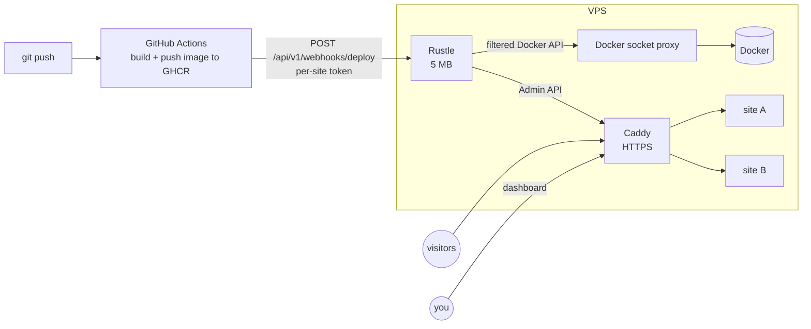

<div align="center">

<picture>
  <source media="(prefers-color-scheme: dark)" srcset="assets/brand/logo-horizontal-dark.svg">
  
</picture>

**An ultra-light, self-hosted PaaS for small VPSs.**
Build on GitHub Actions, deploy to your own server, keep the platform itself under 8 MB of RAM.

[](https://github.com/megabuild-dev/Rustle/actions/workflows/ci.yml)
[](LICENSE)


</div>

Rustle deploys **stateless Next.js / Node apps** from public or private [GHCR](https://ghcr.io) images onto a single
1 vCPU / 1 GB VPS, with automatic HTTPS from [Caddy](https://caddyserver.com). One Rust binary (5 MB) embeds the
WebAssembly dashboard. Measured idle RSS is **5.8 MB**, so the memory goes to your apps instead of the platform.

> **Status: pre-release.** The code is complete and heavily tested against fakes and mock servers (293 tests, a headless
> browser test of the dashboard, an RSS gate, a run against a real Caddy). It has **not yet been run on a real VPS**:
> see [docs/VERIFY_ON_VPS.md](docs/VERIFY_ON_VPS.md) and [docs/STATUS.md](docs/STATUS.md). Reports from real servers are
> the most useful contribution right now.

## Why Rustle

| | |
|---|---|
| **Tiny** | One static binary, SQLite, single-threaded async runtime. Idle 5.8 MB, 6.9 MB after load, 14.8 MB peak (password hashing). Hard cap 48 MB through systemd. |
| **Builds elsewhere** | Images are built by GitHub Actions. The VPS only pulls, so a 1 GB machine never runs `next build`. |
| **Safe by default** | The Docker socket is never mounted into Rustle. Containers get a hard RAM limit, no capabilities, no published ports, no mounts. Secrets are encrypted at rest. See [docs/THREAT_MODEL.md](docs/THREAT_MODEL.md). |
| **Boring deploys** | Pull by digest, health check, switch the Caddy route, keep the previous version for one-click rollback (with that deployment's environment). Optional zero-downtime. |
| **Fits your server** | Fresh Ubuntu or a box that already runs sites behind Caddy and Compose: the installer detects it and only adds routes. |
| **Trustworthy updates** | Self-update accepts only ed25519-signed releases and reverts automatically if the new binary does not start. |

Rustle is deliberately narrow: **stateless apps only** (databases live elsewhere: Neon, Supabase, …), one admin user,
one server. If you need multi-node orchestration, databases-as-a-service or on-server builds, tools such as Dokku,
CapRover or Coolify are a better fit. Rustle is for the case where those would not leave you enough RAM.

## How it works



## Screenshots

| | |
|---|---|
| <br>**Sites**: state, domain and RAM per site | <br>**Deploys**: history, trigger, digest, rollback |
| <br>**Add a site** in three steps | <br>**One-time deploy token**, workflow and Dockerfile ready to paste |
| <br>**Environment**: masked, encrypted at rest | <br>**CI/CD**: generated workflow for server and static Next.js |
| <br>**Cron**: system jobs, one-shot containers, HTTP calls | <br>**Settings**: password, domain, RAM budget, backups, updates |

Screenshots come from the headless-browser test (`scripts/ui_e2e.js`) running against in-memory fake backends.

## Install

Ubuntu 22.04 / 24.04, as root on the VPS:

```bash
curl -fsSL https://github.com/megabuild-dev/Rustle/releases/latest/download/rustle-installer.tar.gz | tar xz
sudo ./install/install.sh --domain admin.example.com --email you@example.com
```

The installer is idempotent. It creates swap if there is none, installs Docker, starts the socket proxy and Caddy, installs
the release binary, prints the **master key** (save it: without it backups cannot be restored) and the admin password,
then starts the service. Add `--dry-run` to see what it would do.

* Without `--domain` the dashboard is served on `https://<server-ip>` with a self-signed certificate until you set a
  domain in Settings. For a domain, point an `A` record at the server first.
* Already running sites behind a Caddy (host service or container)? Use `--use-existing-caddy`. Your sites stay untouched.
  See [docs/COEXISTENCE.md](docs/COEXISTENCE.md), including importing sites from a `site-ctl.sh` setup.
* HTTPS certificates are obtained and renewed by Caddy (Let's Encrypt or ZeroSSL). Rustle only tells Caddy which hosts to serve.
* Upgrading the VPS plan needs no action: the RAM budget follows the machine.

Deploying a site: add it in the dashboard, copy the generated workflow into your repo, set the one-time token as a
GitHub secret, and push.

## Build from source

```bash
git clone https://github.com/megabuild-dev/Rustle && cd rustle
scripts/build-ui.sh                     # dashboard -> ui-dist/ (needs trunk and the wasm32 target)
cargo build --release -p rustle-server  # target/release/rustle
cargo test -p rustle-types -p rustle-server
```

`docs/DEV.md` covers running with in-memory fake backends (no Docker needed), configuration variables and the CLI.

## Quality

* **293 tests**, plus a browser end-to-end test, an RSS gate and an end-to-end run against a real Caddy.
* **CRAP score below 30 for every function** (enforced in CI).
* **Mutation testing** over the server crate; surviving mutants were fixed or documented ([docs/QUALITY.md](docs/QUALITY.md)).
* Dependencies are checked for advisories and licences on every pull request (`cargo deny`) and kept current by Dependabot.

## Documentation

| | |
|---|---|
| What is built and what is verified | [docs/STATUS.md](docs/STATUS.md) |
| What still has to be checked on a real VPS | [docs/VERIFY_ON_VPS.md](docs/VERIFY_ON_VPS.md) |
| Threat model | [docs/THREAT_MODEL.md](docs/THREAT_MODEL.md) |
| Installing next to existing sites and Caddy | [docs/COEXISTENCE.md](docs/COEXISTENCE.md) |
| Development, configuration, CLI | [docs/DEV.md](docs/DEV.md) |
| Test quality: CRAP score and mutation testing | [docs/QUALITY.md](docs/QUALITY.md) |
| Releasing and signing | [docs/RELEASING.md](docs/RELEASING.md) |
| Implementation plan and design changes | [docs/IMPLEMENTATION_PLAN.md](docs/IMPLEMENTATION_PLAN.md), [docs/DECISIONS_ADDENDUM.md](docs/DECISIONS_ADDENDUM.md) |

## Brand

The logo is a leaf lifted by the wind: light enough to ride on a 1 GB server. The name is the sound leaves make. Logo, icons
and the social preview are in [assets/brand](assets/brand) (MIT, like the rest of the project).

## Contributing

Contributions are welcome, especially verification reports from real servers. Read [CONTRIBUTING.md](CONTRIBUTING.md) and the
[Code of Conduct](CODE_OF_CONDUCT.md). Found a security problem? Follow [SECURITY.md](SECURITY.md) and do not open a public issue.
Changes are tracked in [CHANGELOG.md](CHANGELOG.md).

## License

[MIT](LICENSE) © 2026 megalabs-dev and Rustle contributors.

<sub>Keywords: self-hosted PaaS, Heroku alternative, Vercel alternative, deploy Next.js on a VPS, low memory, Rust, Caddy, Docker,
GitHub Container Registry, GitHub Actions, zero downtime, rollback, WebAssembly, Leptos, SQLite.</sub>
