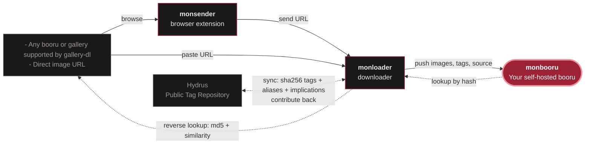

<h1>
  <picture>
    
  </picture>
</h1>

Your own private, lightweight and fast booru: a tag-based image gallery, in the style of Danbooru, for your files.

Designed for organizing your local media collection: images, videos, animated GIFs and manga archives. Tag it by hand or auto-tag it locally with ONNX models (WD14, JoyTag...), then search it by tag. Generation metadata from AI image tools (A1111/Forge, ComfyUI) is read too. The app itself never touches the internet; online features (downloading from boorus, reverse image lookup) live in [monloader](https://github.com/monbooru/monloader), an optional companion.

**[Documentation](https://monbooru.github.io/mondocs/)** · **[Install](#install)** · **[Releases](https://github.com/monbooru/monbooru/releases)** · **[Changelog](CHANGELOG.md)**

<table>
  <tr>
    <td></td>
    <td></td>
  </tr>
  <tr>
    <td></td>
    <td></td>
  </tr>
  <tr>
    <td></td>
    <td></td>
  </tr>
</table>

## Features

### Library

- **Formats**: JPEG, PNG, WebP, AVIF, JPEG XL, GIF, MP4 and WebM, plus CBZ/ZIP archives read as a single item in a built-in manga reader
- **File watcher** that picks up new, moved and deleted files within seconds; browser upload; SHA-256 deduplication
- **Inbox**: new images wait in the inbox until you've reviewed and tagged them
- **Multiple galleries** in one instance, each with its own folders and database; per-gallery export and import
- **Import** from supported booru applications

### Tags

- **Tag management**: merge duplicates, aliases, implications, custom categories
- **Rating tags** (general / sensitive / questionable / explicit), with a SFW ceiling in the footer that hides anything rated above it
- **Local auto-tagging** with ONNX models (WD14 SwinV2, animetimm EVA02, JoyTag, Camie v2, PixAI, or any compatible model), on CPU or GPU

### Browse and search

- **Gallery** with folder tree, favorites, collections, related-image suggestions, animated previews on hover, and a fullscreen slideshow of a search or a selection
- **Search** with wildcards, OR, exclusions, saved searches, and filters on folder, date, size, dimensions, category, generation settings, and more
- **Batch operations** on a selection or a whole search: add or remove tags, move, delete, auto-tag, set collection or source, and more
- **Keyboard-driven**: shortcuts on every page, from grid navigation to batch actions; press `?` in the app for the full list

### Image details

- **Sources and provenance**: several sources per image, artist commentary, note boxes, and your own notes
- **Image relations**: duplicates, alternates, version chains, derivatives; near-duplicate detection with a side-by-side review and cleanup tools
- **AI generation metadata** from A1111/Forge and ComfyUI: prompts, models, seeds, full workflows

### Access and integrations

- **Optional password login**
- **REST API** with scoped tokens, an OpenAPI spec, and built-in docs
- **Plugins and themes**: drop one in the plugins or themes folder and turn it on in Settings; monbooru launches and supervises plugins for you
- **Downloads and reverse lookup** through the optional [monloader](#related-applications) companion

## Install

Monbooru runs on Linux (x86_64, arm64) and Windows (x86_64). Once started, it's at `http://localhost:8455`.

### Docker

Edit the volume paths in [`docker/docker-compose.yml`](docker/docker-compose.yml), then run `docker compose up -d`.

For faster auto-tagging, use the `latest-cuda` image (NVIDIA) or `latest-openvino` (Intel GPU).

### Download

Download a build for your system from the [releases](https://github.com/monbooru/monbooru/releases), unpack it, and run it; a browser opens on a short setup page.

Downloads come in two flavours:

- **lite** is just the program. Video, AVIF and JPEG XL thumbnails need ffmpeg on your system, and auto-tagging needs ONNX Runtime.
- **bundled** carries ffmpeg and ONNX Runtime, so everything works out of the box.

Beside the portable archives, Linux bundled builds also ship as an AppImage and as a Flatpak.

### Next steps

The [documentation](https://monbooru.github.io/mondocs/) covers the first steps.

## Warning

> **Intended for local network use.** This project is not designed for direct exposure to the public internet.

## Technical overview

Monbooru is a single self-contained Go binary, web assets embedded, with seven direct dependencies. Each gallery is one SQLite file: no database server, no cache layer, nothing else to run. Your images stay ordinary files and folders; the database and thumbnails live in a separate data directory, so backing up means copying that directory, and removing monbooru leaves your images where they were. The UI is server-rendered with htmx, with no JS framework and no frontend build step.

The heavy features stay out of the main process. Auto-tagging is off until you install a model from **Settings → Auto-Tagger**, and runs in a separate worker that unloads itself when idle. ffmpeg is optional, needed only for video, animated previews, AVIF and JPEG XL.

## Related applications

Monbooru works offline. These optional companions add the online features:

- **monbooru**: this application; organizes, tags, and serves your collection.
- **[monloader](https://github.com/monbooru/monloader)**: downloader. Fetches files and per-post metadata (via gallery-dl) from supported boorus and galleries and pushes them into a monbooru gallery over the REST API. It also answers monbooru's reverse lookups against boorus, IQDB, SauceNAO and the Hydrus Public Tag Repository, to backfill tags and sources; when a matched post has a better file than your local copy, one click replaces it in place. The PTR connection can also pull tag aliases and implications into your catalog.
- **[monsender](https://github.com/monbooru/monsender)**: browser extension; sends the URL of the page you're browsing to monloader.
- **[monbooru-plugins](https://github.com/monbooru/monbooru-plugins)**: community registry of plugins, themes and extra taggers.

## Contributing

Bug reports, ideas and pull requests are welcome. [CONTRIBUTING](CONTRIBUTING.md) explains where each one goes and how contributions are credited.

Feel free to ask questions or discuss your setup in [Discussions](https://github.com/monbooru/monbooru/discussions).

## License

[AGPL-3.0](LICENSE).

## Acknowledgements

These cover monbooru and its companion repos ([monloader](https://github.com/monbooru/monloader), [monsender](https://github.com/monbooru/monsender), [mondocs](https://github.com/monbooru/mondocs), [monbooru-plugins](https://github.com/monbooru/monbooru-plugins)).

Thanks to [@gary-host-laptop](https://github.com/gary-host-laptop) and [@CeareDelafont](https://github.com/CeareDelafont) for sustained contributions over time. Everyone credited in a release is listed in [CONTRIBUTORS](CONTRIBUTORS.md).

Thanks to tamaki for the mon-chan visuals.

Thanks to [Danbooru](https://danbooru.donmai.us/) for shaping the booru style, and to [Hydrus Network](https://hydrusnetwork.github.io/hydrus/) a precursor in personal image and tag management that inspired monbooru.

This project is built on the work of others:

- [htmx](https://htmx.org/) powers the server-rendered UI.
- [SQLite](https://sqlite.org/), through the pure-Go [modernc.org/sqlite](https://gitlab.com/cznic/sqlite) driver, stores each gallery.
- [ONNX Runtime](https://onnxruntime.ai/), through [onnxruntime_go](https://github.com/yalue/onnxruntime_go), runs the auto-tagger. The supported models are the work of [SmilingWolf](https://huggingface.co/SmilingWolf) (WD SwinV2 v3), [animetimm](https://huggingface.co/animetimm) (EVA02), [fancyfeast](https://huggingface.co/fancyfeast) (JoyTag), [Camais03](https://huggingface.co/Camais03) (Camie Tagger v2), and [PixAI](https://huggingface.co/pixai-labs) (PixAI Tagger v1.0, in [noaione](https://huggingface.co/noaione)'s ONNX export).
- [ffmpeg](https://ffmpeg.org/) decodes video, AVIF and JPEG XL for thumbnails and hover previews; the bundled downloads carry a trimmed build of it from [ffmpeg-builds](https://github.com/monbooru/ffmpeg-builds), statically linked with [libwebp](https://chromium.googlesource.com/webm/libwebp), [dav1d](https://code.videolan.org/videolan/dav1d) and [libjxl](https://github.com/libjxl/libjxl).
- monloader is mostly a wrapper for [gallery-dl](https://github.com/mikf/gallery-dl), which does the actual scraping. Reverse lookups by image similarity are answered by [IQDB](https://iqdb.org/) and [SauceNAO](https://saucenao.com/); md5 lookups by the boorus themselves. The PTR tag lookup syncs against the [Hydrus Public Tag Repository](https://hydrusnetwork.github.io/hydrus/PTR.html) (PTR) via [Hydrus Network](https://github.com/hydrusnetwork/hydrus)'s repository protocol; the tags, aliases, and implications it serves are the work of the hydrus community.
- monsender's in-page image detection uses code from [ushiro](https://github.com/gary-host-laptop/ushiro) by gary-host-laptop and [behind!](https://github.com/kubuzetto/behind) by kubuzetto, originally under MPL-2.0.
- The mondocs site is built with [Hugo](https://gohugo.io/).

The full Go dependency lists are in each repo's `go.mod`.

The sample images in the screenshots, here, in the companion repos, and in the documentation, were downloaded from Danbooru and are the work of their respective artists, who retain all rights. They appear only to demonstrate the app; the repositories' license doesn't apply to them.
