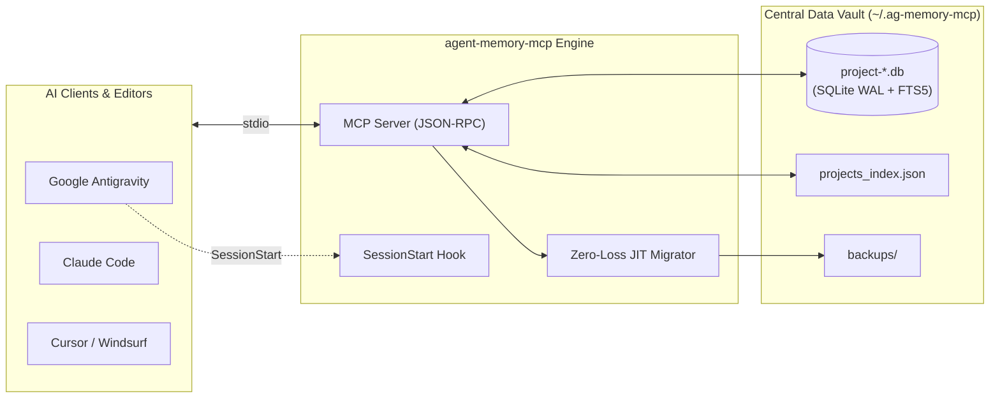

# agent-memory-mcp

[](https://opensource.org/licenses/MIT)
[](https://nodejs.org/)
[](https://modelcontextprotocol.io/)
[](https://glama.ai/mcp/servers/msking18/agent-memory-mcp)

> **Persistent, per-project architectural memory, SQLite FTS5 search, file-anchored invariants, and anti-loop dead-end tracking for AI coding agents.**

Works with **Google Antigravity**, **Claude Code**, **Cursor**, **Windsurf**, **Cline**, and any MCP-compatible environment.

---

## ⚡ The Problem

AI coding agents suffer from **session amnesia** and **debugging loops**:
1. When a chat session terminates or context is compacted, the agent forgets project patterns, architectural decisions, and setup instructions.
2. When encountering errors, agents often repeatedly attempt the **same failing fix** because past failure context is lost.
3. Most memory tools require heavy external services (Docker, Python, remote vector databases) or pollute project git roots with flat markdown files that cause merge conflicts.

---

## ✨ Features

- 🚀 **Zero External Database Setup**: Built directly on Node.js 22.5+/24+ native `node:sqlite` in WAL mode. No Docker, no Python, no native compilation dependencies.
- 🔍 **Ranked Full-Text Search (FTS5)**: Weighted BM25 search across titles, summaries, tags, and files with contextual snippets and Porter stemming.
- 🛡️ **Anti-Loop Dead-End Registry**: Dedicated tools (`record_dead_end` / `check_dead_ends`) to record failed debugging attempts so future agents never repeat known bugs.
- 📌 **Code-Anchored Context & Staleness Detection**: Links notes to specific workspace files; warns the agent if referenced code was modified on disk after the memory was saved.
- 🧹 **Clean Git Hygiene**: Stores per-project SQLite databases centrally in `~/.ag-memory-mcp/stores/`, keeping your repository working tree 100% clean.
- 🔄 **Zero-Data-Loss JIT Migration**: Automatically detects, validates, and migrates legacy `.ag-memory.json` files on first project open, creating verified backup archives.
- ⚡ **Sub-25ms Startup & Low RAM**: Cold starts in milliseconds with ~35MB RAM footprint, suitable for synchronous startup hooks.

---

## 🏗️ Architecture



---

## 🧠 Deep Dives: How It Solves Core Agent Bottlenecks

### 🛡️ How Anti-Looping Works

Naive tool-call deduplication (like counting repeated shell strings) fails because LLMs will simply tweak a flag or rewrite a bash command, bypassing the counter while repeating the same broken approach.

`agent-memory-mcp` solves this as a **structured error-to-failed-fix registry**:

1. **In-Session Circuit Breaker (The 3-Strike Rule)**: The agent operates under a prompt boundary: if 3 consecutive attempts fail to resolve a bug or test failure, autonomous execution halts.
2. **Recording Failed Hypotheses**: The agent calls `record_dead_end` with:
   - `error_pattern`: The exact compiler error, symptom, or stack trace.
   - `attempted_solution`: What was tried and failed (e.g. *"Downgrading Node version"*).
   - `root_cause`: Why it failed / the architectural constraint discovered.
   - `files`: The relevant files involved.
3. **Negative Constraint Injection**: Before attempting a fix, the agent queries `check_dead_ends` (or `get_file_memories`). The engine performs tokenized matching against error messages and files. If a match is found, it injects an explicit negative constraint:
   ```text
   [DEAD-END FOUND] DO NOT REPEAT: Downgrading Node version (Root Cause: Broken peer dependencies in package.json)
   ```
   In transformer attention mechanisms, hard negative constraints shift attention weights away from the failing path, forcing the model to hypothesize a genuinely different solution or ask the user for guidance.
4. **Cross-Session Immunity**: Because records are stored in SQLite, if an agent spent 20 minutes yesterday learning that a flag causes deadlocks, a brand new session tomorrow (or a parallel subagent) is already immunized.

---

### 🔍 How FTS5 Handles Vocabulary Mismatch

Pure keyword search can suffer from vocabulary mismatch (e.g., a note saved as *"login fails after token refresh"* might not match an agent query for *"auth bug"*).

`agent-memory-mcp` resolves this without heavy external vector databases:

1. **Weighted Tag Indexing (4x BM25 Weight)**: Notes require categorical `tags` (e.g., `["auth", "jwt", "session"]`). Tags receive 4x scoring weight in the BM25 formula, ensuring domain searches like `"auth"` hit relevant notes regardless of phrasing.
2. **Porter Stemming (`porter unicode61`)**: Words are automatically stemmed (`refresh`, `refreshed`, `refreshing` match each other).
3. **Multi-Term Fallback**: Queries execute `AND` prefix matching first. If no exact match is found, the engine automatically falls back to an `OR` query ranked by BM25 rather than returning empty.
4. **File-Anchored Context (`get_file_memories`)**: Instead of guessing search keywords, agents pass the file paths they are about to modify (e.g., `src/lib/auth.ts`). The tool returns all past architectural invariants, gotchas, and dead-ends linked to that file directly.

---

## 🚀 Quickstart

### 1. Claude Code
Add to your Claude Code configuration with one command:
```bash
claude mcp add agent-memory-mcp -- npx -y agent-memory-mcp
```

### 2. Cursor / Windsurf / Cline
Add to your `mcpServers` configuration (e.g. `~/.cursor/mcp.json` or cline settings):
```json
{
  "mcpServers": {
    "agent-memory-mcp": {
      "command": "npx",
      "args": ["-y", "agent-memory-mcp"]
    }
  }
}
```

### 3. Google Antigravity (Plugin Bundle)
Install the plugin into your Antigravity plugins directory (`~/.gemini/config/plugins/agent-memory/`):
```bash
git clone https://github.com/msking18/agent-memory-mcp.git ~/.gemini/config/plugins/agent-memory
```
Restart Antigravity. The plugin enables zero-turn `SessionStart` context hydration and scoped agent rules automatically.

---

## 🛠️ MCP Tools (10 Tools)

| Tool | Mode | Description |
| :--- | :--- | :--- |
| `check_memory_status` | Read-only | 1-shot check returning initialization state, architecture TOC, dead-end count, and recent session timeline in a single call. |
| `get_session_timeline` | Read-only | Chronological feed filterable by `category` (`session`, `architecture`, `decision`, `note`, `all`), `tag`, and date. |
| `save_project_memory` | Write/Upsert | Single or atomic batch (`entries: [...]`) save; automatically upserts matching `id` or canonical `slug` while archiving prior versions in revisions. |
| `search_project_memory` | Read-only | Weighted FTS5 BM25 search across `title`, `tags`, `files`, and `summary` (plus matching dead-ends) with match snippets. |
| `read_memory_node` | Read-only | Reads single `id` or batch `ids: [...]` (supports slugs like `tech-stack`), checking `files[]` disk `mtime` for staleness warnings. |
| `update_memory_node` | Write | In-place partial update to `title`, `summary`, `tags`, `category`, or `files` with automatic revision backup. |
| `delete_memory_node` | Write | Soft-archives obsolete memories (`hard_delete: false` default) or permanently deletes (`hard_delete: true`). |
| `record_dead_end` | Write | Logs `{ error_pattern, attempted_solution, root_cause, files }` to prevent repeating failed debugging paths. |
| `check_dead_ends` | Read-only | Searches recorded dead-ends by error message, keyword, or `file_path` before attempting a fix. |
| `get_file_memories` | Read-only | Returns all memories and dead-ends anchored to target `file_paths` (or parent directories) before modifying code. |

---

## 📦 MCP Resources

- `memory://projects`: Exposes a read-only JSON registry of all workspaces tracked by `agent-memory-mcp` on your machine.

---

## 📋 Recommended Agent Rule Template

Add this rule to your agent's system prompt or `AGENTS.md` / `CLAUDE.md`:

```markdown
### Rule: Persistent Project Memory & Anti-Looping
1. Startup: When starting work on a workspace, call `check_memory_status` with the absolute project directory.
2. Bootstrap: If UNINITIALIZED, explore the codebase and save 3 foundational nodes atomically via `save_project_memory`:
   - "Tech Stack & Ecosystem" (slug: "tech-stack", category: "architecture")
   - "Project Structure & Architecture" (slug: "project-structure", category: "architecture")
   - "Build & Run Instructions" (slug: "build-run", category: "architecture")
3. Before Editing Shared Utilities: Call `get_file_memories` with the file paths about to be edited.
4. Error Anti-Looping: Before retrying a failed test, build, or terminal command, call `check_dead_ends`. If a fix fails, record it via `record_dead_end`.
5. Session Log: At the end of a major task, log changes via `save_project_memory` (category: "session", tags: ["changelog"]).
```

---

## 🧪 Testing

Run the automated test suite across SQLite transactions, FTS5 queries, JIT migrations, and stdio JSON-RPC:

```bash
npm test
```

---

## 📄 License

MIT © [Manveer Singh Kahlon](https://github.com/msking18)
