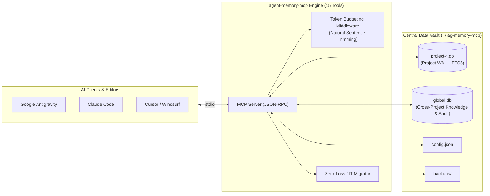

# agent-memory-mcp

[](https://opensource.org/licenses/MIT)
[](https://nodejs.org/)
[](https://modelcontextprotocol.io/)
[](https://glama.ai/mcp/servers/msking18/agent-memory-mcp)
[](https://m8ven.ai/mcp/msking18/agent-memory-mcp?s=readme)

> **Persistent, per-project architectural memory, centralized cross-project global knowledge graph, two-tier anti-loop dead-end tracking, and token budgeting middleware for AI coding agents.**

Works with **Google Antigravity**, **Claude Code**, **Cursor**, **Windsurf**, **Cline**, and any MCP-compatible environment.

---

## ⚡ The Problem

AI coding agents suffer from **session amnesia**, **debugging loops**, and **context bloat**:
1. When a chat session terminates or context is compacted, the agent forgets project patterns, architectural decisions, and setup instructions.
2. When encountering errors, agents repeatedly attempt the **same failing fix** because past failure context is lost across sessions.
3. Proven patterns and library workarounds learned in one repository are forgotten when opening another repository.
4. Unbounded tool responses dump thousands of raw tokens into agent context windows, burning token budgets and degrading model reasoning.

---

## ✨ Features

- 🚀 **Zero External Database Setup**: Built directly on Node.js 22.5+/24+ native `node:sqlite` in WAL mode. No Docker, no Python, no native compilation dependencies.
- 🌐 **Centralized Global Knowledge Graph**: Store cross-project architectural patterns, library quirks, and conventions in `~/.ag-memory-mcp/global.db`. Seamlessly promote project memories via `promote_to_global` and read with `g-` prefixed IDs.
- 🛡️ **Two-Tier Anti-Loop Dead-End Registry**: Distinguish between immediate code/test bugs (`error_loop`) and intentional architectural constraints (`architectural`). Track active constraints and reopen dead-ends via `reopen_dead_end` when requirements evolve.
- 💰 **Output Token Budgeting Middleware**: Automatically estimates tokens and gracefully caps oversized tool outputs at natural sentence and word boundaries. Configure via `AG_MEMORY_MAX_RESPONSE_TOKENS` or `~/.ag-memory-mcp/config.json`, with emergency `full_content: true` bypass.
- 🔍 **Ranked Full-Text Search (FTS5)**: Weighted BM25 search across titles, summaries, tags, and files with contextual snippets and Porter stemming for both project stores and global knowledge.
- 📌 **Code-Anchored Context & Staleness Detection**: Links notes to specific workspace files; warns the agent if referenced code was modified on disk after the memory was saved.
- 📊 **Audit & Token Efficiency Metrics**: Query machine-wide token savings and audit logs across projects via `get_token_metrics`.
- 🔄 **Zero-Data-Loss JIT Migration**: Automatically detects, validates, and migrates legacy `.ag-memory.json` files on first project open, creating verified backup archives.

---

## 🏗️ Architecture



---

## 🛠️ MCP Tools (15 Tools)

### Project-Scoped Memory Tools (1–10)
| Tool | Mode | Description |
| :--- | :--- | :--- |
| `check_memory_status` | Read-only | 1-shot check returning initialization state, architecture TOC, dead-end count, and recent session timeline in a single call. Auto-migrates legacy `.ag-memory.json`. |
| `get_session_timeline` | Read-only | Chronological feed filterable by `category` (`session`, `architecture`, `decision`, `note`, `all`), `tag`, and date. |
| `save_project_memory` | Write/Upsert | Single or atomic batch (`entries: [...]`) save; automatically upserts matching `id` or canonical `slug` while archiving prior versions in revisions. |
| `search_project_memory` | Read-only | Weighted FTS5 BM25 search across `title`, `tags`, `files`, and `summary` (plus matching dead-ends) with match snippets. |
| `read_memory_node` | Read-only | Reads single `id` or batch `ids: [...]` (supports slugs like `tech-stack` or global `g-...` IDs), checking `files[]` disk `mtime` for staleness warnings. |
| `update_memory_node` | Write | In-place partial update to `title`, `summary`, `tags`, `category`, or `files` with automatic revision backup. |
| `delete_memory_node` | Write | Soft-archives obsolete memories (`hard_delete: false` default) or permanently deletes (`hard_delete: true`). |
| `record_dead_end` | Write | Logs `{ error_pattern, attempted_solution, root_cause, files, kind, constraints }` to prevent repeating failed debugging paths. |
| `check_dead_ends` | Read-only | Searches recorded dead-ends by error message, keyword, or `file_path`, filterable by `kind` (`all`, `error_loop`, `architectural`). |
| `get_file_memories` | Read-only | Returns all memories and dead-ends anchored to target `file_paths` (or parent directories) before modifying code. |

### Global Knowledge & Taxonomy Tools (11–15)
| Tool | Mode | Description |
| :--- | :--- | :--- |
| `save_global_knowledge` | Write | Saves or updates a cross-project pattern, convention, or library quirk in `~/.ag-memory-mcp/global.db`. Auto-generates `g-` prefixed IDs. |
| `search_global_knowledge` | Read-only | Searches machine-wide patterns and library quirks using BM25 ranking, filterable by `tech_stack` and `category`. |
| `promote_to_global` | Write | Promotes a proven project-specific memory node to the machine-wide global knowledge graph in `global.db`. |
| `reopen_dead_end` | Write | Reopens a previously recorded dead-end with a justification when external constraints or library versions change. |
| `get_token_metrics` | Read-only | Queries machine-wide token savings, budgeting statistics, and audit logs across all projects from `global.db`. |

---

## 🧠 Deep Dives

### 🌐 Cross-Project Global Knowledge Graph
When developing across multiple microservices or repositories, agents repeatedly discover common framework quirks (e.g., SQLite lock timeouts in Node.js, Next.js hydration issues, Docker networking gotchas).
- Global notes are saved to `~/.ag-memory-mcp/global.db`.
- Project memories can be promoted to global status via `promote_to_global`.
- Any global node can be read using `read_memory_node` with its `g-...` ID prefix.

### 🛡️ Two-Tier Anti-Loop Dead-End Taxonomy
Not all failures are code bugs. `agent-memory-mcp` classifies dead-ends into two distinct tiers:
1. **`error_loop`**: Code errors, compilation failures, and test breaks. Used by the 3-strike circuit breaker to prevent looping.
2. **`architectural`**: Deliberate architectural trade-offs, discarded designs, and rejected patterns (e.g., *"Do not use Redux; project uses Zustand"*). Stores explicit `constraints: [...]`.
3. **Reopening (`reopen_dead_end`)**: When a dependency upgrades or requirements change, an architectural dead-end can be reopened with a clear recorded rationale.

### 💰 Token Budgeting Middleware
Large tool outputs degrade agent reasoning and exhaust context windows. `agent-memory-mcp` features transparent budgeting middleware:
- Inspects response string size using character-to-token heuristics (~4 chars/token).
- If the response exceeds the budget (default: 3,000 tokens), it trims the content at the nearest natural sentence boundary (`. `, `\n\n`, `! `, `? `) and appends a truncation notice with instructions to bypass if necessary (`full_content: true`).
- Logs token metrics (`raw_tokens`, `capped_tokens`, `tokens_saved`) directly to `global.db` for inspection via `get_token_metrics`.

---

## ⚙️ Configuration

Create or modify `~/.ag-memory-mcp/config.json`:

```json
{
  "max_response_tokens": 3000
}
```

Or set the environment variable:
```bash
export AG_MEMORY_MAX_RESPONSE_TOKENS=4000
```

---

## 🚀 Quickstart

### 1. Claude Code
Add to your Claude Code configuration with one command:
```bash
claude mcp add agent-memory-mcp -- npx -y @getsugatension/agent-memory-mcp
```

### 2. Cursor / Windsurf / Cline
Add to your `mcpServers` configuration (e.g. `~/.cursor/mcp.json` or cline settings):
```json
{
  "mcpServers": {
    "agent-memory-mcp": {
      "command": "npx",
      "args": ["-y", "@getsugatension/agent-memory-mcp"]
    }
  }
}
```

### 3. Google Antigravity (Plugin Bundle)
Install the plugin into your Antigravity plugins directory (`~/.gemini/config/plugins/agent-memory/`):
```bash
git clone https://github.com/msking18/agent-memory-mcp.git ~/.gemini/config/plugins/agent-memory
```
Restart Antigravity. The plugin enables zero-turn `SessionStart` context hydration, scoped agent rules, and global memory tools automatically.

---

## 📦 MCP Resources

- `memory://projects`: Exposes a read-only JSON registry of all workspaces tracked by `agent-memory-mcp` on your machine.

---

## 📋 Recommended Agent Rule Template

Add this rule to your agent's system prompt or `AGENTS.md` / `CLAUDE.md`:

```markdown
### Rule: Persistent Project Memory & Anti-Looping (v3.1)
1. Startup: When starting work on a workspace, call `check_memory_status` with the absolute project directory.
2. Bootstrap: If UNINITIALIZED, explore the codebase and save 3 foundational nodes atomically via `save_project_memory`:
   - "Tech Stack & Ecosystem" (slug: "tech-stack", category: "architecture")
   - "Project Structure & Architecture" (slug: "project-structure", category: "architecture")
   - "Build & Run Instructions" (slug: "build-run", category: "architecture")
3. Before Editing Shared Utilities: Call `get_file_memories` with the file paths about to be edited.
4. Error Anti-Looping: Before retrying a failed test, build, or terminal command, call `check_dead_ends`. If a fix fails, record it via `record_dead_end` (specifying `kind: "error_loop"` or `"architectural"`).
5. Global Knowledge: Search machine-wide conventions and quirks with `search_global_knowledge`. Promote reusable solutions with `promote_to_global`.
6. Session Log: At the end of a major task, log changes via `save_project_memory` (category: "session", tags: ["changelog"]).
```

---

## 🧪 Testing

Run the automated test suite across SQLite transactions, FTS5 queries, JIT migrations, token budgeting, and stdio JSON-RPC:

```bash
npm test
```

---

## 🔒 Privacy Policy

`agent-memory-mcp` is local-first software. All SQLite databases, search indexes, and memory stores reside exclusively on your machine (`~/.ag-memory-mcp/` or your workspace directory). It collects zero telemetry and transmits no data over the network. For complete details, see [PRIVACY.md](PRIVACY.md).

---

## 📄 License

MIT © [Manveer Singh Kahlon](https://github.com/msking18)
