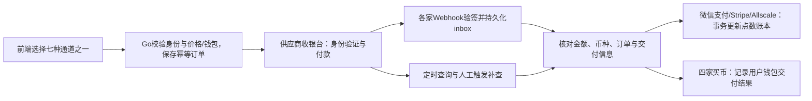

# Pay Lab — Go 七通道支付接入与全流程教学

一个 Go + SQLite 支付实验室，统一介绍 **微信支付、Stripe、Allscale、MoonPay、Alchemy Pay、Transak、Ramp** 七种接入方式。从创建订单、打开收银台、身份/付款验证，到 Webhook 验签、状态查询、到账确认与异常恢复，都提供代码、mock演示和逐步教程。

**默认无需任何真实密钥或商户账号，七家都能在本地跑通。** 真实API适配器与mock共用订单处理流程；本地不扣款、不上传证件、不发起链上交易。真实商户API尚未进行公网交易验收。

## 1. 先看七种方式怎么选
 
| 方式 | 用户如何付款 | 本项目的业务结果 | 接入重点 | 独立教程 |
| --- | --- | --- | --- | --- |
| **微信支付** | 小程序、微信网页、H5、PC扫码、App | CNY付款后增加平台点数 | 场景与AppID/OpenID隔离、API v3签名、通知解密、主动查单 | [微信支付](docs/providers/wechat.md) |
| **Stripe** | 信用卡，经Stripe Checkout | 储值成功，增加平台点数 | Session、原始body验签、幂等入账、退款冲回 | [Stripe](docs/providers/stripe.md) |
| **Allscale** | 用收银台支持的USDT/USDC等稳定币付款 | 储值成功，增加平台点数 | Checkout Intent、HMAC、金额核对、链上确认 | [Allscale](docs/providers/allscale.md) |
| **MoonPay** | 法币买币，由托管页完成KYC/支付 | USDC交付到用户钱包 | URL签名、Webhook key、外部ID查询 | [MoonPay](docs/providers/moonpay.md) |
| **Alchemy Pay** | 法币买币，由Ramp Page完成KYC/支付 | USDC交付到用户钱包 | 参数排序签名、v4查询、FINISHED状态 | [Alchemy Pay](docs/providers/alchemypay.md) |
| **Transak** | 法币买币，经一次性Widget Session | USDC交付到用户钱包 | Token缓存、Session API、JWT通知 | [Transak](docs/providers/transak.md) |
| **Ramp** | 法币买币，经Hosted Widget | USDC交付到用户钱包 | ECDSA、公钥、purchaseViewToken、资产精度 | [Ramp](docs/providers/ramp.md) |

七家都遵循“本地订单 → 供应商确认 → 业务完成”的原则，但结果有区别：微信支付/Stripe/Allscale是本项目的**储值**入口；其余四家是**买币**入口。用户的钱包收到币，不等于商户收到资金，因此买币成功不会直接增加平台点数。若需要“买币后充值平台”，还要接入独立的商户收款/链上充值确认流程。

Allscale币种和EVM网络以结账页实际可用项为准。买币示例限定USD→Ethereum USDC；这是教学产品范围，不代表四家仅支持这些币种/网络。真实地区、KYC、支付方式和最终费用以供应商为准。

## 2. 第一步：启动七通道本地环境

需要Go 1.23+（验证环境1.25.11），命令行演示另需Python3。运行网页不需要Node或外部数据库。

```sh
git clone git@github.com:nemo-crypto/pay.git
cd pay
# 已有项目直接进入 pay 目录即可
HTTP_ADDR=127.0.0.1:8098 \
PUBLIC_URL=http://127.0.0.1:8098 \
DATABASE_PATH=data/pay-demo.db \
go run ./cmd/server
```

打开 <http://127.0.0.1:8098>：从七通道卡片进入对应演示与教程，下方提供微信支付/Stripe/Allscale储值表单。页面导航可进入 <http://127.0.0.1:8098/onramp>：选择其余四家买币方式。两组入口使用同一个Go服务、同一套登录约定和本地持久化；分别展示对应业务结果。

默认`PAY_MODE=demo`，只允许监听本机。程序直接读取环境变量，**不会自动加载.env文件**。完整配置见 [.env.example](.env.example)，数据库目录已被Git忽略。

## 3. 第二步：逐家完成一次成功流程

| 通道 | 在演示页执行 | 预期结果 |
| --- | --- | --- |
| 微信支付 | 选择NT$1000 → 微信支付 → 选择五种场景之一 → 模拟成功 | succeeded，增加2000点；冻结CNY报价（演示¥222.23） |
| Stripe | 选择NT$1000 → Stripe → 前往支付 → 模拟成功 | succeeded，增加2000点 |
| Allscale | 选择NT$1000 → Allscale → 前往支付 → 模拟成功 | succeeded，增加2000点，记录加密支付信息 |
| MoonPay | 选择MoonPay → 30 USD → 创建 → KYC通过 → 付款 → 交付 | completed，29模拟USDC到用户钱包 |
| Alchemy Pay | 选择Alchemy Pay → 30 USD → 创建 → KYC通过 → 付款 → 交付 | completed，29模拟USDC到用户钱包 |
| Transak | 选择Transak → 30 USD → 创建 → KYC通过 → 付款 → 交付 | completed，29模拟USDC到用户钱包 |
| Ramp | 选择Ramp → 30 USD → 创建 → KYC通过 → 付款 → 交付 | completed，29.000000模拟USDC到用户钱包 |

买币演示的29 USDC来自虚拟规则“30 USD减1 USD手续费”，**不是任何供应商真实报价**。默认钱包及tx_hash都是教学占位数据。所有页面回跳只触发查询；成功必须由服务端验签通知或查询结果确认。

微信支付普通商户使用CNY：`nt_amount`仍是TWD业务额度，实际人民币分金额在`payment_amount_minor`中；报价由服务端`WECHAT_TWD_PER_CNY`冻结。五个场景的身份要求、客户端调用、商户配置与当前边界见[微信支付教程](docs/providers/wechat.md)。

同一购买意图重试使用原Idempotency-Key；同键改参数409，不会因双击重复生成业务结果。历史订单和余额重启后保留。

## 4. 第三步：理解mock密钥与真实API

| 通道 | 本地自动提供的mock凭据 | 真实模式需要的配置 |
| --- | --- | --- |
| 微信支付 | 临时RSA密钥、公开演示APIv3密钥、模拟prepay_id | 商户私钥/证书序列号 + APIv3密钥 + 平台公钥/ID + 各场景AppID |
| Stripe | `whsec_local_demo_only`，虚拟Session | secret key + webhook secret |
| Allscale | `local-demo-key` / `local-demo-secret` | API key + API secret + TWD/USD报价 |
| MoonPay | `mock-public-moonpay` / `mock-secret-moonpay` / `mock-webhook-moonpay` | public key + secret key + webhook key |
| Alchemy Pay | `mock-public-alchemypay` / `mock-secret-alchemypay` | appId + appSecret |
| Transak | `mock-public-transak` / `mock-secret-transak` / `mock-transak-partner-access-token` | API key + secret，自动获取并缓存token |
| Ramp | `mock-public-ramp`，公开本地测试ECDSA密钥对 | hostApiKey + 官方环境公钥；逐单保存view token |

mock凭据仅在demo模式使用，不能拿去请求真实供应商。Ramp真实签名私钥属于Ramp，商户只需要验证公钥；本项目公开的测试私钥仅生成本地通知。

| 通道 | 创建/打开收银台 | Webhook认证 | 主动查询 |
| --- | --- | --- | --- |
| 微信支付 | JSAPI（含小程序）/H5/Native/App下单 | 平台RSA验签 + AES-256-GCM解密 | 商户单号GET查单，响应验签 |
| Stripe | `POST /v1/checkout/sessions` | Stripe-Signature，原始body + HMAC | Session GET |
| Allscale | `POST /v1/checkout_intents/` | 原始body哈希 + HMAC canonical string | Intent详情GET |
| MoonPay | 服务端签名Widget URL | Moonpay-Signature-V2 + Webhook key | `/v1/transactions/ext/{id}`，返回数组 |
| Alchemy Pay | 排序参数签名Ramp Page | timestamp + 方法 + 路径 + 排序JSON | `/open/api/v4/merchant/query/trade` |
| Transak | 缓存Token → `POST /api/v2/auth/session` | Partner Access Token验证HS256 JWT | `/partners/api/v2/order/{id}` |
| Ramp | Hosted Widget参数 | secp256k1 ECDSA + 稳定JSON | `/host-api/purchase/{id}?secret=...` |

每家教程会逐项解释签名原文、时间戳单位、请求头、状态映射和字段精度，不能把七家套成同一个签名算法。

## 5. 第四步：调用Go接口或运行命令行演示

先获取本地演示token（真实模式没有这个公共登录接口）：

```sh
PAY_TOKEN=$(curl -fsS -X POST http://127.0.0.1:8098/demo/session | python3 -c 'import json,sys;print(json.load(sys.stdin)["token"])')
```

微信支付/Stripe/Allscale储值：

```sh
curl -fsS http://127.0.0.1:8098/topups \
  -H "Authorization: Bearer $PAY_TOKEN" \
  -H 'Idempotency-Key: tutorial-topup-001' \
  -H 'Content-Type: application/json' \
  -d '{"plan_id":"demo-1000","gateway":"stripe","ui_mode":"hosted"}'
# 使用Allscale时，把gateway改为allscale并使用新的购买意图键。
```

MoonPay/Alchemy Pay/Transak/Ramp买币：

```sh
curl -fsS http://127.0.0.1:8098/onramp/orders \
  -H "Authorization: Bearer $PAY_TOKEN" \
  -H 'Idempotency-Key: tutorial-buy-001' \
  -H 'Content-Type: application/json' \
  -d '{"provider":"moonpay","wallet_address":"0x1111111111111111111111111111111111111111","fiat_amount_minor":3000}'
# provider可替换为alchemypay、transak、ramp。
```

储值金额`nt_amount`是TWD元，买币`fiat_amount_minor`是USD美分：3000=30 USD，不能混用。返回订单ID与checkout信息，保存后用于查询。

四家买币也可一条命令自动完成全部步骤：

```sh
python3 scripts/onramp-demo.py --provider moonpay
python3 scripts/onramp-demo.py --provider alchemypay
python3 scripts/onramp-demo.py --provider transak
python3 scripts/onramp-demo.py --provider ramp
python3 scripts/onramp-demo.py                       # 一次跑四家
python3 scripts/onramp-demo.py --drop-webhook        # 丢通知后主动查询恢复
```

脚本检查demo模式、获取token、创建并幂等重放、依次KYC/付款/交付，最后断言completed。它拒绝操作live环境。七家桌面/手机自动化验证命令见第8节。

## 6. 第五步：了解共同架构与异常恢复



| 场景 | 演示与处理方式 |
| --- | --- |
| 回调丢失 | 勾选丢回调，等待约30秒Worker；买币页也可点击“向网关重新查询” |
| 重复/乱序回调 | 持久化去重，完成后不被旧pending覆盖 |
| 金额/钱包/币种不符 | 不完成业务，转人工核对 |
| 创建请求超时 | 保留原幂等订单；非明确支持幂等的网关不盲目重建 |
| 浏览器关闭或回跳 | 不直接当取消/成功，查询服务端实际结果 |
| Stripe全额退款 | 验证退款通知后冲回点数；部分退款转复核 |

Transak的widgetUrl仅5分钟且单次使用。Ramp查询必须有purchaseViewToken。Transak/Ramp在真实模式下需要先从验签通知或SDK事件取得供应商引用；SDK引用仍由后端查询核对。mock预置引用可演示“所有通知丢失”，真实系统不能凭空猜供应商订单号。

Allscale公开币种表未列TWD，本项目按固定服务端汇率将TWD意图转换为USD报价并冻结快照；`PAY_SUCCESS`（Alchemy Pay）或付款执行（Ramp）都不代表资产已经交付。未知状态不会自动认定完成。

## 7. 第六步：七家分别深入接入

按同一顺序阅读：**本地运行 → 申请商户 → 配置凭据 → 创建订单 → 收银台/KYC → Webhook → 补查 → 故障排查 → 上线验收**。

| 教程 | 重点 |
| --- | --- |
| [微信支付完整教程](docs/providers/wechat.md) | 五场景选择、登录身份、人民币报价、商户签名、平台验签、通知解密与查询恢复 |
| [Stripe完整教程](docs/providers/stripe.md) | Checkout、测试卡、事件注册、订单恢复、全额退款 |
| [Allscale完整教程](docs/providers/allscale.md) | HMAC、USD报价、网络/币种、少付和未知建单 |
| [MoonPay完整教程](docs/providers/moonpay.md) | 三种key、URL签名、外部ID数组查询 |
| [Alchemy Pay完整教程](docs/providers/alchemypay.md) | Page签名、v4查询、新签名、付款/交付区别 |
| [Transak完整教程](docs/providers/transak.md) | Token缓存、Session、JWT、真实用户IP和引用绑定 |
| [Ramp完整教程](docs/providers/ramp.md) | ECDSA、资产精度、view token和回调关联 |

首页提供七通道统一入口，每家均可直接进入演示或教程。教程内嵌到Go二进制，本地 `/guides/` 是总入口，`/guides/stripe` 等提供可离线阅读的页面，含目录、代码复制和手机端表格滚动。追加 `?format=raw` 或 `.md` 可取得 Markdown 原文。更多参考前端接入说明见 [接入与运维](docs/integration.md)，买币公共接口见 [买币API说明](docs/providers/onramp-api.md)。

真实模式要求公网HTTPS、商户准入、对应凭据与回调/域名/IP白名单。配置`PAY_MODE=live`才访问真实API；四家买币另通过`ONRAMP_ENV=sandbox|production`选择环境。`ONRAMP_PROVIDERS`默认空，按需显式启用，不会回退mock。原应用JWT需对齐密钥、issuer、audience或替换认证适配器。

## 8. 验证、目录与部署

```sh
make test       # go test -race ./... + go vet
make build      # bin/pay，网页和教程已内嵌
# 启动全新demo数据库后进行浏览器回归
npm ci
npx playwright install chromium
npm run test:e2e     # Stripe / Allscale，桌面+手机
npm run test:onramp  # MoonPay / Alchemy Pay / Transak / Ramp，桌面+手机
# 使用全新服务实例/独立限流窗口运行微信专项
npm run test:wechat  # 微信支付五场景；混合桌面/手机、CNY报价、本地二维码模块
```

```text
cmd/server       HTTP服务、定时对账、优雅退出
cmd/token        受信任终端的联调token工具
internal/auth    JWT认证
internal/config  环境变量与储值套餐
internal/payment 微信支付 / Stripe / Allscale适配与mock
internal/service 储值业务编排
internal/store   储值订单、账本、inbox
internal/onramp  四家买币API、签名、mock、订单与恢复
web              七通道演示入口
scripts          可执行闭环演示与浏览器回归
docs/providers   七家逐步教程，随二进制内嵌
```

`GET /healthz`检查数据库；管理员可查`/admin/reconciliation`和`/admin/onramp/reconciliation`了解未决事件与复核订单。SQLite包含订单和Transak敏感token缓存，只给服务用户访问；生产可进一步使用KMS。单实例使用本地持久卷，备份需考虑WAL；多实例需要共享事务数据库、任务协调和分布式限流。

提供Dockerfile及Go CI。测试与验证记录见 [validation.md](docs/validation.md)。本实现不包含消费扣点、通用退款发起、出款、拒付处理或原应用的营销分成；商户真实联调与生产验收仍须逐家完成。

关键词：Golang payment gateway, WeChat Pay, JSAPI, H5, Native, Stripe Checkout, Allscale, MoonPay, Alchemy Pay, Transak, Ramp Network, fiat on-ramp, USDT, USDC, webhook verification, ECDSA, idempotency, SQLite ledger.

### 回调重试与异常排查

四家买币通道的通知先验签、持久化，再由 Worker 应用状态。建单响应超时不会覆盖已经确认的资产交付。临时处理失败按30秒、60秒逐步退避，最长每小时重试一次；损坏数据、订单不存在或供应商引用冲突进入隔离队列，避免阻塞后续付款。已有 SQLite 启动时自动补充重试字段，保留原事件。

管理员通过 `/admin/onramp/reconciliation` 查看 `unprocessed_events`、`deferred_events`、`dead_letter_events`。隔离项需要人工核对订单、供应商查询结果和脱敏错误原因；本 demo 没有自动解除隔离或管理端重放接口。先备份数据库，修复根因后由运维审核处理，切勿直接改订单为已交付。

买币接口的业务错误返回 `code`、`message`、`retriable`、`trace_id`：参数错误400、冲突409、供应商暂时不可用503。可重试错误包含 `Retry-After`；创建请求重试应复用原 `Idempotency-Key`，避免创建新的购买意图。`trace_id` 为响应定位标识，尚未关联完整追踪系统。
