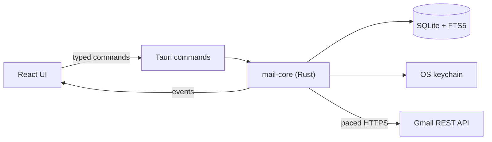

<div align="center">


# Mailboat

**All your Gmail accounts, in one calm inbox.**

A fast, keyboard-first Gmail client for macOS and Windows. Free and open source.

[](https://github.com/nwoolls/mailboat/actions/workflows/ci.yml)
[](https://scorecard.dev/viewer/?uri=github.com/nwoolls/mailboat)
[](LICENSE)


[Get started](#get-started) · [Features](#why-mailboat) · [Privacy](#your-mail-stays-yours) · [Build from source](#build-from-source) · [Roadmap](docs/ROADMAP.md) · [Architecture](docs/ARCHITECTURE.md)

<picture>
  <source media="(prefers-color-scheme: dark)" srcset="docs/images/hero-dark.png">
  
</picture>

</div>

> **Early development.** Version 0.1.0 is out, with signed downloads for Mac
> (Apple silicon) and Windows on the
> [releases page](https://github.com/nwoolls/mailboat/releases/latest), and it
> offers updates that you install when you choose. Expect rough edges. You bring your own Google credentials,
> and the app walks you through it (about ten minutes, once).

## Why Mailboat

Mailboat talks to Gmail's API directly and keeps a local cache, so browsing and
search are instant. Its calm, minimal look is inspired in part by Notion Mail,
which has since shut down.

- **One inbox for every account.** Personal, work and school Gmail accounts side
  by side, each with its own color. Threads never merge across accounts, and
  every action uses the account the mail belongs to.
- **Keyboard first.** Gmail's own keys (`j`/`k`, `e`, `#`, `g` then `i`, `c`,
  `r`…), and a command palette on <kbd>⌘K</kbd> for everything else.
- **Instant search.** Local full-text search across all accounts, with Gmail's
  own search (`from:`, `has:attachment`…) merged in as it arrives.
- **Read mail safely.** Email is cleaned in Rust and shown in a sandboxed view
  with no scripts. Known tracking pixels are removed, and dark mode recolors
  email instead of inverting it.
- **Sign-in codes and meeting invitations.** One-time codes surface as a pill
  on the row; invitations get Yes, Maybe and No right in the email, answered through Google Calendar.
- **Rules, signatures, vacation reply.** Your Gmail filters and signatures,
  edited in the app.
- **Undo send.** Five seconds to take it back by default, up to thirty.
- **AI that stays optional.** Summaries, a writing assistant, reply ideas and
  translation, through Apple Intelligence on your Mac or your own Claude or
  ChatGPT subscription. No API keys, and nothing is sent without you seeing it.
- **Works with your AI apps.** Let Claude Desktop or Claude Code search and read
  your mail, and save drafts, over MCP. Off by default; AI apps can only read mail and save drafts, never send.
- **Inbox Zero, with toys.** An empty view can have a toy (a pond, bubble wrap to pop, or a
  sky that follows the time of day) or one of ten pixel-art screensavers.

### A closer look

<table>
  <tr>
    <td width="50%" valign="top">
      <picture>
        <source media="(prefers-color-scheme: dark)" srcset="docs/images/features/rules-dark.png">
        
      </picture>
      <br><sub><b>Gmail rules</b>, edited in the app. Google runs them, even when Mailboat is closed.</sub>
    </td>
    <td width="50%" valign="top">
      <picture>
        <source media="(prefers-color-scheme: dark)" srcset="docs/images/features/write-with-ai-dark.png">
        
      </picture>
      <br><sub><b>Write with AI</b>: reply ideas and drafts from Apple Intelligence, on your Mac.</sub>
    </td>
  </tr>
  <tr>
    <td width="50%" valign="top">
      <picture>
        <source media="(prefers-color-scheme: dark)" srcset="docs/images/features/ai-apps-dark.png">
        
      </picture>
      <br><sub><b>AI apps</b>: let Claude search your mail and save drafts while Mailboat is open, in one click. Off by default; it can never send.</sub>
    </td>
    <td width="50%" valign="top">
      <picture>
        <source media="(prefers-color-scheme: dark)" srcset="docs/images/features/screensaver-dark.png">
        
      </picture>
      <br><sub><b>Inbox Zero</b> has toys: a pond, bubble wrap, a sky, and ten screensavers.</sub>
    </td>
  </tr>
  <tr>
    <td width="50%" valign="top">
      <picture>
        <source media="(prefers-color-scheme: dark)" srcset="docs/images/features/codes-dark.png">
        
      </picture>
      <br><sub><b>Sign-in codes</b> become a pill on the row: click it to copy.</sub>
    </td>
    <td width="50%" valign="top">
      <picture>
        <source media="(prefers-color-scheme: dark)" srcset="docs/images/features/palette-dark.png">
        
      </picture>
      <br><sub><b>⌘K</b>: every action, with its shortcut.</sub>
    </td>
  </tr>
</table>

More pictures of more features, in [docs/FEATURES.md](docs/FEATURES.md).

## Your mail stays yours

- **No servers of ours.** Mailboat talks to Google from your computer. There is
  no Mailboat account, no tracking and no analytics.
- **Update checks, and only that.** Mailboat looks for a new version when it
  starts and about once a day (Settings → About turns this off). A look fetches
  one file from getmailboat.app, which passes it on to GitHub, so both see your
  IP address; the version you run and your kind of computer aren't sent. When
  you install an update, GitHub also learns your kind of computer. Nothing is
  installed without your click, and an update must carry the project's
  signature, made for the version it announces, or it is refused.
- **Tokens in the keychain.** Sign-ins live in the macOS Keychain or Windows
  Credential Manager. Never in a file, never in the database.
- **Mail goes to an AI only when you chose that provider.** Apple Intelligence
  runs on your Mac. Claude and ChatGPT are used through their own command-line
  tools, signed in as you. Claude runs with no tools at all; ChatGPT's tool
  can't promise that, so it is fenced in (every setting turned off, a sandbox,
  and a check that stops it if anything unreviewed stays on; see
  [docs/ARCHITECTURE.md](docs/ARCHITECTURE.md)). Prompts and answers are never
  logged. Summaries you ask for are kept in your local cache so they aren't
  generated twice.
- **Remote images are your call.** They load by default (Settings → Viewing can
  limit this to people you've written to, or block them), never in Spam, and
  new mail's images are fetched as it arrives, so opening an email normally
  makes no request (an image that couldn't be fetched, or was evicted from the
  cache, loads when you open the mail, as the setting allows).
- **Open source.** Read every line. The code has been through several rounds
  of review by AI code-review agents (findings and fixes are in the
  [roadmap](docs/ROADMAP.md)). There has been no third-party security audit.

## How it compares

| | Mailboat | Gmail on the web | Mimestream |
|---|---|---|---|
| Price | Free, open source (GPL-3.0) | Free | Paid subscription |
| Platforms | macOS, Windows | Any browser | macOS (iOS and iPadOS in beta) |
| Several accounts in one inbox | Yes, unified | Switch between accounts | Yes |
| Local cache and search | Yes | Only with Chrome's optional offline mode | Yes |
| AI summaries of conversations | Yes: Apple Intelligence on your Mac, or your own Claude or ChatGPT | Google's Gemini features, where offered | Not documented |
| Write, rewrite and reply with AI | Yes: drafts, rewrites, reply ideas and translation, shown in the editor before anything is sent | Google's Gemini features, where offered | In the compose window, through Apple's Writing Tools (and ChatGPT through Apple, on macOS 15.2+) |
| Sign-in codes surfaced on the row | Yes, with a Copy button | No | Not documented |
| Meeting invitations answered in the email | Yes | Yes | Yes |
| Lets AI apps (Claude, others) use your mail | Yes, over MCP, off by default | No | Not documented |
| Source code | Public | Closed | Closed |
| Setup | Your own Google credentials, once | None | Sign in with Google |
| Maturity | Early development | Mature | Mature |

*Mimestream's column comes from its website and release notes, checked on
2026-11-01. "Not documented" means I found nothing there, not that it can't
be done. Check each product's site for today's details.*

## Get started

1. **Download it** from the
   [releases page](https://github.com/nwoolls/mailboat/releases/latest): the
   `.dmg` for a Mac with Apple silicon, or the `x64-setup.exe` (most PCs) or
   `arm64-setup.exe` (Windows on Arm) for Windows. macOS asks once whether you
   want to open an app from the internet, as it does for any app that isn't from
   the App Store. Rather build it yourself? See
   [Build from source](#build-from-source).
2. **Create your own Google credentials**, once. The app walks you through it:
   one card per step, each with a button that opens the right Google page, then
   you drop the downloaded file on the window. The short version, and the full
   guide, are in [docs/GOOGLE-SETUP.md](docs/GOOGLE-SETUP.md).
3. **Sign in** with each Gmail account. Google warns that the app isn't
   verified: press **Continue**, it's your own private project. The first sync
   takes a while, because Gmail limits how fast an account can be read; the
   inbox fills in first.
4. **Optional:** turn on AI in Settings → AI ([docs/AI.md](docs/AI.md)).

Want to look around first? [Demo mode](docs/DEVELOPMENT.md#demo-mode) opens the
app full of made-up mail, with no Google connection.

## Keyboard shortcuts

| Keys | Action |
|---|---|
| `j` / `k` | Next / previous conversation |
| `↩` or `o` | Preview the selected conversation |
| `/` | Search |
| <kbd>⌘K</kbd> | Command palette |
| `g` then `i` / `u` / `s` / `t` / `d` / `a` / `e` | Go to Inbox / Unread / Starred / Sent / Drafts / All Mail / Archive |
| `e` | Archive |
| `#` | Move to Trash |
| `u` · `s` · `l` | Read/unread · star · labels |
| `x` and <kbd>⇧</kbd><kbd>↓</kbd> | Pick one or a range |
| `z` or <kbd>⌘Z</kbd> | Undo |
| `c` · `r` · `a` · `f` | New message · reply · reply all · forward |
| <kbd>⌘↩</kbd> | Send |
| `?` | Every shortcut |

On Windows, <kbd>Ctrl</kbd> takes the place of <kbd>⌘</kbd>.

## How it's built

Rust owns sync, storage, sign-in, sending and search; the React interface only
draws what Rust tells it. One query layer serves every list, so the unified
inbox is a query, not a copy.



[Tauri](https://tauri.app) v2, Rust, SQLite with FTS5, React, TypeScript and
Tailwind, with [Bun](https://bun.sh) for tooling. The details, and a dated
table of why each choice was made, are in
[docs/ARCHITECTURE.md](docs/ARCHITECTURE.md).

## Build from source

You need macOS with the Xcode command line tools (the Swift compiler builds the
Apple Intelligence helper), [Rust](https://rustup.rs) (stable) and
[Bun](https://bun.sh).

```sh
bun install
bun tauri dev
```

Windows is built from a Mac for now, and checked on Windows by CI. Checks, the
test suite, demo mode and the rest are in
[docs/DEVELOPMENT.md](docs/DEVELOPMENT.md).

## FAQ

**Why do I need my own Google credentials?**
Google asks apps that read Gmail to pass a yearly paid security assessment.
Mailboat has no server that touches your mail, so the assessment would only
exist to tick a box. Using your own credentials means there is no review, no
user limit and nobody in the middle. A paid, no-setup version may come later
([docs/RELEASE.md](docs/RELEASE.md)); the open-source one stays.

**Google signs me out every seven days.**
While a project is in Google's "Testing" mode, which is how your own Google
credentials are set up, Google ends each sign-in after seven days. Signing in
again takes one click.

**Is it safe?**
The code is public and has been reviewed several times by AI code-review
agents (not by an outside security firm); mail is sanitized and sandboxed,
tokens stay in your keychain, and the AI features are fenced. See
[Your mail stays yours](#your-mail-stays-yours) and
[SECURITY.md](SECURITY.md).

**Windows? Linux?**
Mailboat runs on Windows: the releases page has a signed installer for x64 and
one for Arm. Linux will follow.

**What's next?**
A website, and trying the setup with someone who has never used Google Cloud.
The full list is in the [roadmap](docs/ROADMAP.md).

## Contributing and license

Bug reports and ideas are welcome as issues, and questions go in
[Discussions](https://github.com/nwoolls/mailboat/discussions). Code from outside isn't accepted;
[CONTRIBUTING.md](CONTRIBUTING.md) explains why. Security problems:
[SECURITY.md](SECURITY.md).

Copyright © 2026 Nate Woolls. Mailboat is free software under the
[GNU GPL v3](LICENSE). Commit hashes
mentioned in the older docs come from the private repository this one was
cleaned from, so they won't be found here.
