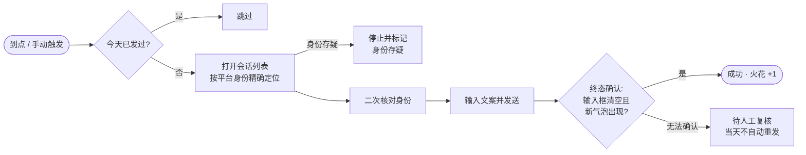

# 焰之契约者 · Flame Contractor

> 你与它立下契约，每日以一言续之，焰不可熄。

[](https://github.com/oinzc/flame-contractor-oss/actions/workflows/ci.yml)
[](https://github.com/oinzc/flame-contractor-oss/releases)
[](LICENSE)


<sub>截图均来自内置的[演示实例](#演示实例)，昵称与数据全部虚构。</sub>

本机优先的抖音「续火」控制台：按你设定的时刻，每天给指定的几位好友或群聊发出一条消息，防止连续互动记录断掉。所有数据、登录态与浏览器 Profile 都留在你自己的机器上，没有云端账号，也没有第三方服务器。

**适用范围：单人、少量好友、低频发送。** 它不是一个群发系统，也不是营销或养号工具。

## 它做什么

- **多账号**：一台机器上管理多个抖音账号，各自独立浏览器 Profile 与调度。
- **严格好友定位**：按 `platform_user_id` 精确定位好友，群聊按 `platform_conversation_id`，两类身份绝不混用。
- **扫码登录**：有头窗口扫码或容器内「截图扫码」，登录态持久化在 Profile 里；失效时自动标记并通知。
- **写作与模板**：文案池 + 多模板，支持图片与原生表情；每个好友可绑定独立文案。
- **准点发送**：账号级与好友级固定时刻；到点抢租约、真实发送，并以终态确认结果。
- **每日防重复**：同一天同一好友只发一次；结果无法确认时记为「待人工复核」，**绝不自动重发**。
- **自动调度**：后台每分钟对齐整分钟派发；失败重试、连续失败熔断、登录失效自动停。
- **异常通知**：接入 Bark，按 `critical` / `timeSensitive` / `active` 分级推送到手机。
- **会话扫描与对账**：只读扫描官方火花状态用于展示，产出状态变化 / 无火花 / 新会话 / 未观察到 / 无变化五类对账，删除与导入都要你手动确认。
- **可观测**：全局任务坞展示发送与扫描进度，诊断截图按天保留，操作留审计记录。

## 界面一览

<table>
  <tr>
    <td width="50%"><br><b>发送前逐人确认</b>：手动发送先列出本次队列和每个人将收到的文案，确认后才执行。</td>
    <td width="50%"><br><b>好友与身份</b>：每位好友绑定平台身份、模板和可选的独立时刻，旁边是官方火花状态。</td>
  </tr>
  <tr>
    <td><br><b>扫描对账</b>：只读同步官方状态，按状态变化 / 无火花 / 新会话 / 未观察到 / 无变化五类归档。</td>
    <td><br><b>任务记录</b>：每一次续火都有结果和尝试次数，结果无法确认的单独筛出，等你人工复核。</td>
  </tr>
  <tr>
    <td colspan="2"><br><b>多账号</b>：每个账号独立的浏览器 Profile、发送时段和登录状态；失效账号会被醒目标出并停止自动发送。</td>
  </tr>
</table>

## 一次发送是怎样完成的

续火的核心原则是**宁可不发，不可错发**。每个环节拿不到确定信号就停下，而不是猜测后继续：



登录失效、网络不可用、页面结构变化也都会在发送前或发送中拦下，并通过 Bark 推送到手机。

## 它不做什么

- 不提供批量群发、自动加好友、自动回复、爬取他人资料。
- 不做多账号养号、对抗平台风控或绕过验证码。
- 不保证在平台改版后立即可用；选择器与页面结构变化时可能需要更新。
- 不提供云托管；没有多租户、计费或远程访问。

## 快速开始（Docker，约 5 分钟）

需要 Docker Desktop（Windows/macOS）或 Docker Engine + Compose（Linux）。容器内自带 Chromium，宿主机不需要装浏览器。

```bash
git clone https://github.com/oinzc/flame-contractor-oss.git
cd flame-contractor-oss

cp .env.example .env
# 生成一个至少 32 位的随机密钥，填入 .env 的 FLAME_SECRET_KEY
python -c "import secrets; print(secrets.token_urlsafe(32))"

docker compose up -d --build
```

打开 <http://127.0.0.1:8000/>：

1. 首次进入会要求创建**平台管理员**（没有默认密码，密码至少 8 位）。
2. 「账号」页新增账号并扫码登录；容器内用「截图扫码」，把二维码图片保存后用手机抖音扫。
3. 「好友」页扫描会话列表，勾选要续火的好友导入。
4. 「模板」页写文案；「计划」页给账号或单个好友设固定发送时刻。
5. 打开「自动调度」，确认下一次触发时间。

健康检查：`curl http://127.0.0.1:8000/health`，应返回 `{"status":"ok","database":"ready",...}`。

## 演示实例

想先看看界面，不需要抖音账号，也不需要 Docker。演示实例使用一份虚构数据，并且**只读**：除登录外的写操作一律被拒绝，调度循环不会发送或扫描，不会打开浏览器访问抖音，也不读取 `.env`。

```bash
cd frontend && npm ci && npm run build && cd ..
cd backend
python -m venv .venv
.venv/Scripts/python.exe -m pip install -r requirements-dev.txt   # Linux/macOS 用 .venv/bin/python
.venv/Scripts/python.exe scripts/demo_server.py
```

打开 <http://127.0.0.1:8010/>，用 `demo` / `demo-password` 登录。数据放在 `data/demo/`，加 `--reseed` 可重新生成。README 中的截图由 `scripts/demo_screenshots.py` 对演示实例自动截取，需要先执行 `python -m playwright install chromium`。

## 配置

配置走环境变量，全部以 `FLAME_` 前缀；Docker 部署时写在仓库根目录的 `.env`（该文件已被 git 忽略，只在本机）。

| 变量 | 默认值 | 说明 |
| --- | --- | --- |
| `FLAME_SECRET_KEY` | 无（必填） | 会话签名密钥，至少 32 位；容器启动时会校验 |
| `FLAME_SERVE_FRONTEND` | `true`（镜像内） | 由后端直接托管前端静态文件 |
| `FLAME_BARK_URL` | 空 | 可选，Bark 推送地址 `https://api.day.app/<device_key>`；留空则不推送 |
| `FLAME_WINDOW_EXPIRY_POLICY` | `skip` | 错过发送时刻：`skip` 不再补发，`dispatch` 到点即发 |
| `FLAME_FIXED_TIME_GRACE_MINUTES` | `30` | 固定时刻的宽限期（分钟），`0` 表示不宽限 |
| `FLAME_AUTH_CHECK_TOLERANCE` | `2` | 连续多少次登录判定失败才标记失效 |
| `FLAME_LOGIN_CHECK_TIMEOUT` | `20` | 登录判定时等待会话列表出现的秒数 |
| `FLAME_SCAN_TIMEOUT_SECONDS` | `600` | 单次会话扫描的总预算，超时释放「扫描中」占用 |
| `FLAME_AUTO_SCAN_INTERVAL_HOURS` | `24` | 自动同步会话状态的初始周期（之后可在控制台调整） |
| `FLAME_SCHEDULED_ALWAYS_SEND` | `false` | 到点是否忽略当天已发送记录再发一次（首次初始化默认值） |
| `FLAME_HOST_PORT` | `8000` | Compose 映射到宿主机的端口（仅绑定 `127.0.0.1`） |

`FLAME_DATABASE_URL`、`FLAME_PROFILES_DIR`、`FLAME_ARTIFACTS_DIR` 一般不需要改，默认落在容器卷 `/app/data` 与 `/app/artifacts`。

## 数据与备份

- 业务数据在 SQLite：命名卷 `flame-contractor_data`（`/app/data/flame-contractor.db`）。
- 登录态在同一卷的 `profiles/` 下，是完整浏览器 Profile；换机或重建卷时必须一起拷走。
- 诊断截图在命名卷 `flame-contractor_artifacts`。
- `docker compose down` 会保留卷；**不要用 `docker compose down -v`**，那会连数据一起删除。
- 控制台「备份全部数据」导出业务数据 JSON（不含登录态）；整卷备份请在停掉应用后打包卷目录。

## 本地开发

后端（Python 3.12）：

```bash
cd backend
python -m venv .venv
.venv/Scripts/python.exe -m pip install -r requirements-dev.txt   # Windows
.venv/bin/python -m pip install -r requirements-dev.txt           # Linux/macOS
.venv/Scripts/python.exe -m playwright install chromium
.venv/Scripts/python.exe -m uvicorn app.main:app --host 127.0.0.1 --port 8000
```

前端（Node 22）：

```bash
cd frontend
npm ci
npm run dev      # http://localhost:5173，已代理 /api 与 /health
npm run build    # tsc --noEmit && vite build
```

测试：`cd backend && .venv/Scripts/python.exe -m pytest -q`（272 项，无需真实浏览器）。

## 目录结构

```text
backend/    FastAPI + SQLModel + SQLite + Alembic + APScheduler + Playwright
frontend/   React + TypeScript + Vite 控制台
docs/       PRD、技术设计、API 文档、数据库 Schema、Docker 部署
```

## 常见问题

**扫码后一直停在加载？** 抖音静态资源在国内 CDN，跨境网络会让登录页渲染很慢。优先在本机 Docker 运行，不建议放在海外服务器。

**提示登录失效，但手机端正常？** 页面结构或会话加载超时会误判；连续失败达到 `FLAME_AUTH_CHECK_TOLERANCE` 才会标记。重新扫码即可恢复，自动调度会在恢复后继续。

**凌晨没发出去？** 检查发送时刻是否落在账号窗口内，以及 `FLAME_FIXED_TIME_GRACE_MINUTES` 是否给足；`skip` 策略下错过时刻不会补发。

**能不能多台机器同时跑？** 不建议。同一账号的浏览器 Profile 不能被两个进程同时使用。

## 免责声明

本项目与抖音（字节跳动）无任何关联，未获其授权或认可。它通过浏览器自动化操作一个真实账号，**可能违反平台服务条款**，存在账号被限制的风险；请仅用于自己的账号与少量真实好友，不要用于骚扰、营销或批量操作。使用风险由你自行承担，作者不对账号损失、数据丢失或任何间接损失负责。

## License

[MIT](LICENSE)
