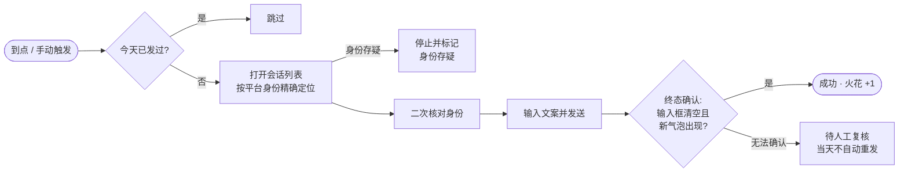

# 焰之契约者 · Flame Contractor

> 你与它立下契约，每日以一言续之，焰不可熄。

[](https://github.com/oinzc/flame-contractor/actions/workflows/ci.yml)
[](https://github.com/oinzc/flame-contractor/pkgs/container/flame-contractor)
[](https://github.com/oinzc/flame-contractor/releases)
[](LICENSE)


<sub>本文所有截图与界面展示图均使用内置[演示实例](#演示实例)的虚构数据（日常号 · 晚风 / 小满 / 阿哲等），与任何真实账号或好友无关。</sub>

本机优先的多端抖音「续火」工具（支持 **Android 手机 / 平板独立端**、**Windows 免 Docker 桌面安装包** 与 **Docker 服务器常驻**）：按你设定的时刻，每天给指定的几位好友或群聊发出一条消息，防止连续互动记录断掉。所有业务数据、登录态与浏览器 Profile 都留在你自己的设备上，没有云端账号，也没有第三方业务服务器。

**适用范围：单人、少量好友、低频发送。** 它不是一个群发系统，也不是营销或养号工具。

## 它做什么

- **三端独立运行与含图 `.zip` 互迁**：提供 Android 独立 APK（手机 / 平板免电脑离屏运行）、Windows 独立安装包（免 Docker 双击即用）与 Docker 多架构镜像（`amd64` / `arm64`）；三端均支持含去 EXIF 图片模板的 `.zip` 完整备份包与 `.json` 双向无损迁移（严禁包含登录态与 Bark 密钥）。
- **多账号隔离**：一台设备管理多个抖音账号，各自独立浏览器 / WebView Profile、调度时刻与通知隔离。
- **严格好友定位**：按 `platform_user_id` 精确定位好友，群聊按 `platform_conversation_id`，两类身份绝不混用。
- **扫码登录**：有头窗口扫码、手机页内扫码或容器内「截图扫码」，登录态持久化在本地沙盒；失效时自动标记并通知。
- **写作与多形态模板**：固定文案、星期轮换 LRU 文案池、本地图片模板（自动缩放去 EXIF）与抖音原生表情；每个好友可绑定独立模板与时刻。
- **准点发送与每日防重复**：账号级与好友级固定时刻；到点抢租约、真实发送，并以终态确认结果；同一天同一好友按账号自然日最多累计 `+1`，结果无法确认时记为「待人工复核」并留存现场截图，**绝不自动重发**。
- **Android 5 款原生桌面小组件家族**：提供 `2×2` 进度圆环、`4×1` 极简状态条、`4×2` 圆环全景卡 / 7 日连胜卡 / 好友火花榜，支持跟随 App / 深色碳黑 / 浅色纯白 / 半透明深色玻璃 4 种独立外观、手点实时旋转刷新回执与好友首字隐私脱敏。
- **异常通知与会话对账**：接入 Bark 与 Android 本机分级通知，推送登录失效、待人工复核与官方火花告急只读提醒；支持只读扫描官方火花快照并按五类对账单手动确认导入。
- **可观测、热修与应用内直连反馈**：保留失败 / 待复核现场截图灯箱与 30 日趋势审计；内置零副作用页面结构体检与自定义定位词热覆写；Android 与 Web / 桌面端均内置国内直连的问题反馈表单（免代理、免登录 GitHub 即可提交）与 GitHub 源码直达入口。

## 界面一览

### Android 独立客户端与 5 款原生桌面小组件


- **四栏悬浮胶囊导航 & 浅色 / 深色碳黑双主题**：手机端采用悬浮圆角底栏（`今日 / 好友 / 模板 / 记录`），平板端自动切换左侧 `NavigationRail`；支持浅色 / 深色碳黑 / 跟随系统无闪烁切换、微动效触感反馈与系统减弱动画兼容。
- **免电脑离屏执行与 30 日审计**：内置桌面模式 Chromium `WebView` 离屏引擎、`AlarmManager` + `WorkManager` 定时保活、失败 / 待人工复核现场截图灯箱、30 日趋势堆叠柱状图与脱敏 CSV 导出。
- **应用内免魔法直连反馈**：在 `设置 → 关于与反馈` 可直接提交 Bug 报告、功能建议或使用疑问，并可选自动附带脱敏运行环境摘要，无需登录 GitHub 账号。


- **5 款尺寸自由组合**：`2×2` 进度圆环、`4×1` 极简状态条、`4×2` 圆环全景卡 / 7 日连胜卡 / 好友火花榜，全部零新增依赖原生绘制。
- **4 种独立外观与即时回执**：在 `设置 → 外观与主题` 一键切换「跟随 App / 深色碳黑 / 浅色纯白 / 半透明深色玻璃」并即时联动桌面，支持好友火花榜**首字隐私脱敏**、一键防重复添加到桌面、手点原生旋转刷新回执（`同步中… → ✓ 已刷新`）与「待人工复核」红框强提醒直达终裁。

### Windows 桌面端 / Web 控制台

<table>
  <tr>
    <td width="50%"><br><b>今日群发预览抽屉</b>：发送前在右侧逐位核对今日队列、渲染文案与幂等/复核跳过原因，确认后才执行。</td>
    <td width="50%"><br><b>好友详情与规则抽屉</b>：点击任意好友即可在右侧查看稳定平台身份、官方火花快照，绑定模板或单独设定发送时刻。</td>
  </tr>
  <tr>
    <td><br><b>扫描对账抽屉</b>：只读同步官方状态，按新会话 / 状态变化 / 无火花 / 未观察到 / 无变化五类归档并手动确认。</td>
    <td><br><b>记录与统计</b>：汇总近 30 日成功率与连续成功天数，结果无法确认的任务单独筛出，等你人工复核。</td>
  </tr>
  <tr>
    <td colspan="2"><br><b>多账号切换、系统调度与三态主题</b>：左上角秒切各自独立浏览器 Profile 的抖音账号（失效账号醒目标红并停发），支持浅色 / 深色 / 跟随系统无闪烁切换、Bark 内联配置、`.zip` 含图完整备份恢复与应用内直连反馈。</td>
  </tr>
</table>

## 一次发送是怎样完成的

续火的核心原则是**宁可不发，不可错发**。每个环节拿不到确定信号就停下，而不是猜测后继续：



登录失效、网络不可用、页面结构变化也都会在发送前或发送中拦下，并通过 Bark 推送到手机。

## 它不做什么

- 不提供批量群发、自动加好友、自动回复、爬取他人资料。
- 不做多账号养号、对抗平台风控或绕过验证码。
- 不保证在平台改版后立即可用；选择器与页面结构变化时可能需要更新。
- 不提供云托管；没有多租户、计费或远程访问。

## 快速开始 · Windows 桌面端（免 Docker，下载安装即用）

适合平时在 Windows 电脑上使用、不想装 Docker / Python / Node 的用户：

1. 在 [GitHub Releases](https://github.com/oinzc/flame-contractor/releases) 下载最新的 Windows 安装包（`Flame Contractor_*_x64-setup.exe`），双击安装即可（无需管理员权限；首次运行如遇 Windows SmartScreen 提示，点「更多信息 → 仍要运行」）。
2. 双击桌面图标直接进入独立软件窗口（单机免登，由桌面壳每次生成随机握手令牌保护 `127.0.0.1` 本地接口，自动复用本机 Microsoft Edge 或 Chrome，无需配置 `.env`）。
3. 按首屏 3 步引导完成：添加抖音号并弹窗扫码 → 扫描会话勾选好友 → 绑定模板与时刻；在「系统与调度」里可直接开启开机自启与填写 Bark 手机通知地址。
4. 点击窗口关闭 `×` 会最小化到右下角系统托盘继续准点续火（右键托盘选「彻底退出」才停止后端）；数据库、抖音登录态与日志默认保存在软件安装目录下的 `data` 文件夹（如装在只读目录则自动回退到 `%LOCALAPPDATA%\FlameContractor`），升级或重装软件不丢数据。

> 电脑休眠或关机期间无法定时发送；需要 24 小时关电脑也续火的场景，推荐使用下方 Docker 部署。

### 本地自行构建 Windows 安装包

需要 Node 22、Python 3.12、Rust 工具链与 MSVC Build Tools：

```powershell
cd frontend && npm ci && npm run build && cd ..
backend\.venv\Scripts\python.exe -m pip install -r backend\requirements-desktop.txt
backend\.venv\Scripts\python.exe scripts\build_desktop_backend.py
cd desktop && npm ci && npm run build
# 安装包输出在 desktop/src-tauri/target/release/bundle/nsis/
```

## 快速开始 · Android 独立安装包（手机 / 平板免电脑运行）

适合希望在 Android 手机、备用平板上脱离电脑和服务器完全独立运行的用户：

- **系统要求**：Android 8.0+（`minSdk 26`），并保持设备系统 **Android System WebView** 更新至较新版本（内置桌面模式 Chromium `WebView` 离屏执行引擎，无需电脑或 Docker）。
- **下载安装与使用流程**：
  1. 在 [GitHub Releases](https://github.com/oinzc/flame-contractor/releases) 下载 `FlameContractor-*-android-universal-release.apk`（也可由 CI 构建调试包或在本地编译安装）。
  2. 打开 App 在「今日」页主状态卡或左上角账号抽屉发起扫码登录网页聊天端（遇到风控时直接在页内完成身份验证；支持多账号独立 Profile 切换）。
  3. 底部悬浮胶囊导航栏包含「今日 / 好友 / 模板 / 记录」四栏：在「好友」页点右上角「扫描对账」，按官方火花置顶与唯一 ID 消歧结果勾选好友导入；在「模板」页通过全屏编辑器维护固定文案、星期轮换 LRU 文案池、图文或原生「比心」表情模板。
  4. 点击任意主页面右上角齿轮进入二级「设置」：
     - **外观与桌面小组件**：支持跟随系统 / 浅色 / 深色碳黑三态主题；内置 **5 款多尺寸桌面小组件中心**（`2×2` 进度圆环、`4×1` 极简状态条、`4×2` 圆环全景 / 7 日连胜 / 好友火花榜），支持 4 种独立外观（含半透明深色玻璃）、好友首字隐私脱敏、防重复一键添加到桌面与手点旋转刷新回执；
     - **关于与反馈**：内置免魔法国内直连反馈表单（可选附带脱敏环境摘要）与 GitHub 项目源码直达；
     - **定时、通知与保活**：配置每日同日发送窗口（`00:00–23:55`，不支持跨午夜）与可选 Bark 通知，并在 **后台保活与权限** 中完成以下 4 项授权以防国产系统误杀：
       - 允许通知权限（开启 `daily_summary` 与 `alerts_urgent` 告警通道）
       - 电池省电策略设为「无限制 / 忽略电池优化」
       - 允许「精确闹钟（`SCHEDULE_EXACT_ALARM`）」权限
       - **小米 / MIUI / HyperOS** 设备务必在系统设置中开启 **自启动** 并关闭对应省电限制
- **零打扰定时执行与安全不变量**：到点由 `AlarmManager` + 30 分钟纯 SQLite `WorkManager` 兜底拉起短时离屏 `dataSync` 前台服务，息屏 / 桌面状态下静默完成续火并自动释放；发送超时或中断统一收敛为「待人工复核 (`UNKNOWN_REQUIRES_REVIEW`)」，未人工终裁前全路径硬禁止重复发送，并在应用私域沙盒保留 7 天失败 / 待复核现场截图供抽屉内灯箱核对。支持 Android 13+ `<monochrome>` 主题单色图标、桌面长按快捷方式与 5 款多尺寸原生状态小组件，随时一眼查看今日进度与异常提醒。

### 本地自行构建 Android APK

需要 JDK 17 与 Android SDK（`compileSdk 35`）：

```bash
cd android
./gradlew verifySelectorBundleSync :app:testDebugUnitTest :app:lintDebug :app:assembleDebug
# 调试 APK 输出在 android/app/build/outputs/apk/debug/app-debug.apk
# 也可构建未签名 Release APK：./gradlew :app:assembleRelease
```

## 快速开始 · Docker（服务器 / 24 小时常驻）

需要 Docker Desktop（Windows/macOS）或 Docker Engine + Compose（Linux）。官方预构建镜像 `ghcr.io/oinzc/flame-contractor:latest` 同时支持 `linux/amd64` 与 `linux/arm64`，容器内自带 Chromium，宿主机不需要装浏览器或下载源码。

### 方式 A：直接拉取预构建镜像（推荐，免克隆源码）

新建任意空目录，保存以下两个文件：

1. `.env`（生成至少 32 位随机密钥填入 `FLAME_SECRET_KEY`，可选填 `FLAME_BARK_URL`；Linux 上请执行 `chown 10001:10001 .env && chmod 600 .env` 确保非 root 容器用户可读）：
   ```ini
   FLAME_SECRET_KEY=请替换为至少32位随机字符串
   FLAME_BARK_URL=
   ```
2. `compose.yaml`：
   ```yaml
   name: flame-contractor
   services:
     app:
       image: ghcr.io/oinzc/flame-contractor:latest
       init: true
       restart: unless-stopped
       stop_grace_period: 60s
       shm_size: 512mb
       ports:
         - "127.0.0.1:${FLAME_HOST_PORT:-8000}:8000"
       volumes:
         - data:/app/data
         - artifacts:/app/artifacts
         - type: bind
           source: ./.env
           target: /app/backend/.env
           read_only: true
           bind:
             create_host_path: false
       logging:
         driver: json-file
         options:
           max-size: "10m"
           max-file: "3"
   volumes:
     data:
     artifacts:
   ```

启动与后续升级：

```bash
docker compose up -d
# 后续升级只需：
docker compose pull && docker compose up -d
```

### 方式 B：克隆源码本地构建

```bash
git clone https://github.com/oinzc/flame-contractor.git
cd flame-contractor

cp .env.example .env
# 生成一个至少 32 位的随机密钥，填入 .env 的 FLAME_SECRET_KEY
python -c "import secrets; print(secrets.token_urlsafe(32))"

docker compose up -d --build
```

打开 <http://127.0.0.1:8000/>：

1. 首次进入会要求创建**平台管理员**（没有默认密码，密码至少 8 位）。
2. 左上角新增抖音账号，点右上角「账号与扫码」完成登录；容器内用「截图扫码」，把二维码图片保存后用手机抖音扫。
3. 在「续火好友」点右上角「扫描对账」，读取会话列表并勾选要续火的好友导入。
4. 在左侧「模板库」写文案或配置星期文案池；在「账号与扫码」或好友右侧详情抽屉设固定发送时刻。
5. 在左侧「系统与调度」确认全局自动调度已开启及下一次排程时刻。

健康检查：`curl http://127.0.0.1:8000/health`，应返回 `{"status":"ok","database":"ready",...}`。

## 演示实例

想先看看界面，不需要抖音账号，也不需要 Docker。演示实例使用一份虚构数据，并且**只读**：除登录外的写操作一律被拒绝，调度循环不会发送或扫描，不会打开浏览器访问抖音，也不读取 `.env`。

```bash
cd frontend && npm ci && npm run build && cd ..
cd backend
python -m venv .venv
.venv/Scripts/python.exe -m pip install -r requirements-dev.txt   # Linux/macOS 用 .venv/bin/python
.venv/Scripts/python.exe scripts/demo_server.py
```

打开 <http://127.0.0.1:8010/>，用 `demo` / `demo-password` 登录。数据放在 `data/demo/`，加 `--reseed` 可重新生成。README 中的截图由 `scripts/demo_screenshots.py` 对演示实例自动截取，需要先执行 `python -m playwright install chromium`。

## 配置

配置走环境变量，全部以 `FLAME_` 前缀；Docker 部署时写在仓库根目录的 `.env`（该文件已被 git 忽略，只在本机）。

| 变量 | 默认值 | 说明 |
| --- | --- | --- |
| `FLAME_SECRET_KEY` | 无（必填） | 会话签名密钥，至少 32 位；容器启动时会校验 |
| `FLAME_SERVE_FRONTEND` | `true`（镜像内） | 由后端直接托管前端静态文件 |
| `FLAME_BARK_URL` | 空 | 可选，Bark 推送地址 `https://api.day.app/<device_key>`；留空则不推送 |
| `FLAME_WINDOW_EXPIRY_POLICY` | `skip` | 错过发送时刻：`skip` 不再补发，`dispatch` 到点即发 |
| `FLAME_FIXED_TIME_GRACE_MINUTES` | `30` | 固定时刻的宽限期（分钟），`0` 表示不宽限 |
| `FLAME_AUTH_CHECK_TOLERANCE` | `2` | 连续多少次登录判定失败才标记失效 |
| `FLAME_LOGIN_CHECK_TIMEOUT` | `20` | 登录判定时等待会话列表出现的秒数 |
| `FLAME_SCAN_TIMEOUT_SECONDS` | `600` | 单次会话扫描的总预算，超时释放「扫描中」占用 |
| `FLAME_AUTO_SCAN_INTERVAL_HOURS` | `24` | 自动同步会话状态的初始周期（之后可在控制台调整） |
| `FLAME_SCHEDULED_ALWAYS_SEND` | `false` | 到点是否忽略当天已发送记录再发一次（首次初始化默认值） |
| `FLAME_HOST_PORT` | `8000` | Compose 映射到宿主机的端口（仅绑定 `127.0.0.1`） |

`FLAME_DATABASE_URL`、`FLAME_PROFILES_DIR`、`FLAME_ARTIFACTS_DIR` 一般不需要改，默认落在容器卷 `/app/data` 与 `/app/artifacts`。

## 数据与备份

- 业务数据在 SQLite：命名卷 `flame-contractor_data`（`/app/data/flame-contractor.db`）。
- 登录态在同一卷的 `profiles/` 下，是完整浏览器 Profile；换机或重建卷时必须一起拷走。
- 诊断截图在命名卷 `flame-contractor_artifacts`。
- `docker compose down` 会保留卷；**不要用 `docker compose down -v`**，那会连数据一起删除。
- 控制台「系统与调度」页与 Android「数据备份与迁移」均支持导出/导入 `.zip` 完整备份包（含去元数据后的图片模板）与纯 `.json` 备份，三端双向无损互迁（均不含登录态与 Bark 密钥）；整卷备份请在停掉应用后打包卷目录。

## 本地开发

后端（Python 3.12）：

```bash
cd backend
python -m venv .venv
.venv/Scripts/python.exe -m pip install -r requirements-dev.txt   # Windows
.venv/bin/python -m pip install -r requirements-dev.txt           # Linux/macOS
.venv/Scripts/python.exe -m playwright install chromium
.venv/Scripts/python.exe -m uvicorn app.main:app --host 127.0.0.1 --port 8000
```

前端（Node 22）：

```bash
cd frontend
npm ci
npm run dev      # http://localhost:5173，已代理 /api 与 /health
npm test         # node --test 领域纯函数单测
npm run build    # tsc --noEmit && vite build
```

测试：`cd backend && .venv/Scripts/python.exe -m pytest -q`（332 项，无需真实浏览器）。

## 目录结构

```text
backend/    FastAPI + SQLModel + SQLite + Alembic + asyncio 调度 + Playwright
frontend/   React + TypeScript + Vite 控制台
desktop/    Tauri v2 Windows 独立窗口桌面壳与 NSIS 打包配置
android/    Kotlin + Jetpack Compose + Room + 桌面模式 WebView 独立 Android 客户端
docs/       PRD、技术设计、API 文档、数据库 Schema、Docker 部署与轻量反馈中转脚本
```

## 常见问题

**扫码后一直停在加载？** 抖音静态资源在国内 CDN，跨境网络会让登录页渲染很慢。优先在本机 Docker 运行，不建议放在海外服务器。

**提示登录失效，但手机端正常？** 页面结构或会话加载超时会误判；连续失败达到 `FLAME_AUTH_CHECK_TOLERANCE` 才会标记。重新扫码即可恢复，自动调度会在恢复后继续。

**凌晨没发出去？** 检查发送时刻是否落在账号窗口内，以及 `FLAME_FIXED_TIME_GRACE_MINUTES` 是否给足；`skip` 策略下错过时刻不会补发。

**能不能多台机器同时跑？** 不建议。同一账号的浏览器 Profile 不能被两个进程同时使用。

## 问题反馈与开源协作

- **国内免代理直填反馈**：官方发布的 Android APK 与 Windows 安装包均已内置国内直连反馈入口（Android：`设置 → 关于与反馈`；Web / 桌面端：侧边栏「反馈问题」或「系统与调度」），无需登录 GitHub 即可直接提交 Bug 与建议，系统会自动脱敏环境信息。
- **GitHub Issues**：如果你有 GitHub 账号，也欢迎直接在 [Issues](https://github.com/oinzc/flame-contractor/issues) 提交复现步骤或参与讨论。
- **自建反馈中转**：如果你 Fork 了本仓库并希望自定义反馈接收中转，可直接参考 [docs/feedback-relay/README.md](docs/feedback-relay/README.md) 部署零依赖 Cloudflare Worker。

## 免责声明

本项目与抖音（字节跳动）无任何关联，未获其授权或认可。它通过浏览器自动化操作一个真实账号，**可能违反平台服务条款**，存在账号被限制的风险；请仅用于自己的账号与少量真实好友，不要用于骚扰、营销或批量操作。使用风险由你自行承担，作者不对账号损失、数据丢失或任何间接损失负责。

## License

[MIT](LICENSE)
